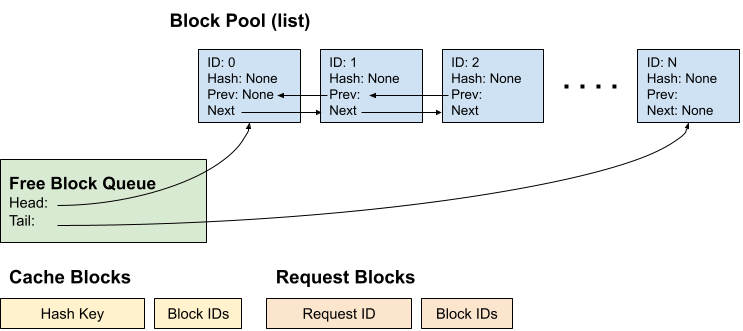
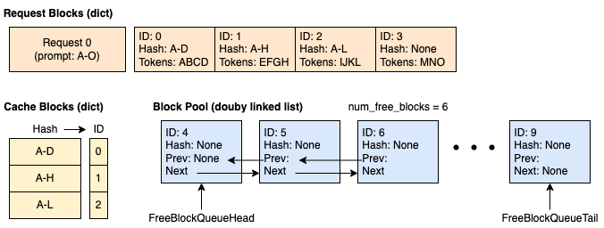
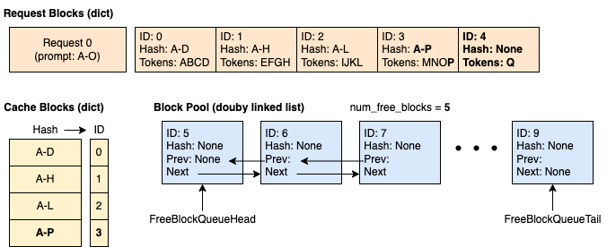
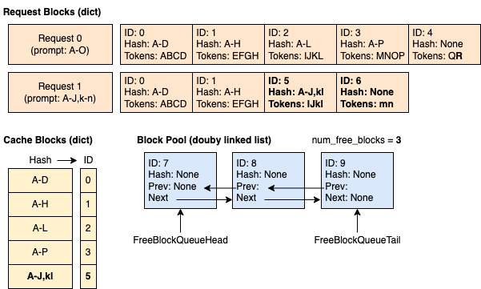
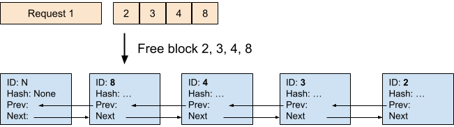

# vLLM V1 KV Cache管理架构总览

## 1. 为什么需要 KV Cache

### 1.1 背景

当前主流大语言模型都是**自回归**（autoregressive）生成：模型由 N 层 Transformer block 堆叠而成，每层包含 **attention** 与 **FFN** 两个子层；生成过程逐 token 进行，每个新 token 都以它之前的全部 token 为上下文。

两个子层对历史信息的依赖不同：

- **attention 层**：新 token 的 Query 必须与**之前所有 token** 的 Key/Value 做注意力计算，历史信息在这里被消费。
- **FFN 层**：只对当前 token 自己的隐藏向量做逐位置变换，不依赖任何历史 token，既不产生也不需要缓存。

因此"缓存什么"的答案只可能落在 attention 层：它每步都要用到的历史 K/V，正是被重复计算的部分。

### 1.2 KV Cache 优势

推理过程中，如果什么都不保存，生成第 k 个 token 时，attention 层必须把前 k−1 个 token 的 K/V 重新算一遍。而这些 K/V 只由各自的输入与固定权重决定，算过一次就不会改变，重算纯属重复劳动。

```
每生成一个 token，前面所有 token 在 attention 层计算的 K/V 都要重新计算一遍
（prompt="你是谁"，逐 token 输出"我是小明"；† 表示本步重算）

 prefill → 生成"我"：  [K/V 你] [K/V 是] [K/V 谁]
 生成"是"：            [K/V 你]† [K/V 是]† [K/V 谁]† [K/V 我]
 生成"小"：            [K/V 你]† [K/V 是]† [K/V 谁]† [K/V 我]† [K/V 是]
 生成"明"：            [K/V 你]† [K/V 是]† [K/V 谁]† [K/V 我]† [K/V 是]† [K/V 小]

 prompt"你是谁"的 K/V 被重算 3 次，每步都从零算起；每步计算量 O(n)，n 步合计 O(n²)

 注意：图中只画了一层 attention；模型有 N 层，每层都维护自己的 K/V，重复计算量还要再乘以 N。
```

如果把 attention 层算好的历史 K/V 保存在显存中，每步只计算新 token 的 K/V 并追加进缓存，历史部分直接读取，这样历史 K/V 的重复计算就被消除了：每步只需算新增 token，计算量从 O(n²) 降到 O(n)。注意 attention 本身仍要读取全部历史，其计算量依旧随序列长度增长，省下的是重复投影和历史注意力计算。

```
                     ▲ logits → 采样 → 第 k+1 个 token
                     │
┌────────────────────┴───────────────────┐
│ 第 N 层      attention → FFN           │
└────────────────────▲───────────────────┘
                     │
                    ...
                     │
┌────────────────────┴───────────────────┐
│ 第 i 层（展开示意）                    │
│  ┌──────────────────────────────────┐  │
│  │ FFN                              │  │
│  │ （无需缓存）                     │  │
│  └──────────────────────────────────┘  │
│                    ▲                   │
│                    │                   │
│  ┌──────────────────────────────────┐  │     ┌─ KV Cache（HBM 显存） ────────────────┐
│  │ attention                        │  │  ══>│ 写入第 k 个 token 的 K/V              │
│  │ （Q_k 与 1…k 的 K/V 做注意力）    │  │  <══│ 读取已缓存的第 1…k−1 个 token 的 K/V  │
│  └──────────────────────────────────┘  │     └───────────────────────────────────────┘
└────────────────────▲───────────────────┘
                     │
                    ...
                     │
┌────────────────────┴───────────────────┐
│ 第 1 层      attention → FFN           │
└────────────────────▲───────────────────┘
                     │
            输入第 k 个 token
```

图中以第 k 步为例：token 自第 1 层逐层上行；每层 attention 先写入第 k 个 token 的 K/V，此时缓存中已有 1…k 个 token 的 K/V（1…k−1 为此前缓存，第 k 个刚写入），再读取它们做注意力，Q_k 随当前 token 现算。第 N 层输出的 logits 经采样得到第 k+1 个 token，作为下一步的输入。N 层各自维护一份 KV Cache，互不共享。

在 NPU 上，真正读写这对张量的是 CANN 算子：`reshape_and_cache`（写 K/V）、`npu_fused_infer_attention_score`（FIA，prefill 与混合读）、`_npu_paged_attention`（PA，decode 读）。

### 1.3 为什么只缓存 K/V，不缓存 Q

由注意力的计算结构决定：`attention(Q, K, V) = softmax(QKᵀ / √d) V`。公式里的 Q 来自当前 token，K、V 来自全部 token（历史与当前），两者在后续步骤中的复用次数完全不同。

- **K、V 会被反复引用**：每个 token 的 K、V 只由它自己的输入和固定权重决定，算出来就不会再变；之后每一步的新 Q 都要与全部历史 K 相乘、对全部历史 V 加权，所以它们必须留在显存中。
- **Q 只用一次**：Q 属于当前 token，只在这一步与 K/V 做一次运算，算完即弃；历史 token 的 Q 早已用过，之后再无引用，保存没有意义。

所以缓存对象是 K/V 这对张量，Q 始终随当前 token 现算。

### 1.4 代价与下一步

代价是空间换时间：单条请求的 KV Cache 占用正比于"层数 × 序列长度 × KV 头数 × head_dim"，再乘以并发请求数；序列变长、并发变多，HBM 很快被占满。

于是问题从"要不要缓存"变成"这些缓存怎么管理"，这正是下一章要回答的问题。

---

## 2. KV Cache 如何管理

vLLM 的答案建立在 **PagedAttention** 上——借用操作系统虚拟内存分页的思路，把 KV Cache 切成固定大小的 block。块同时是分配、共享与回收的最小单位，管理的三个问题都落到它上面：

- **怎么放**：请求长短不一、生命周期交错，按最大长度预留连续显存会留下大量碎片；
- **怎么共享**：不同请求的 prompt 常有相同前缀，这部分 K/V 完全一致，重复存储就是浪费；
- **怎么回收**：请求结束后块要尽快交还给后续请求，同时让"算过的前缀"尽量留下来复用。


### 2.1 怎么放
PagedAttention 把连续的 KV 序列切分成固定大小的 **block**（Ascend 注意力算子的核内分页为 128 token），以 block 为最小单位进行管理。

```
一条请求的 token 序列（逻辑上连续），block_table = [7, 2, 9] 记录每个逻辑块对应的物理行号：

  逻辑块 0          逻辑块 1          逻辑块 2
  [t0 … t127]       [t128 … t255]     [t256 … t383]
      │                 │                 │
      ▼                 ▼                 ▼
  物理第 7 行        物理第 2 行        物理第 9 行       ← block_id 即物理张量行号
```

序列在逻辑上仍然连续，物理上离散存放：显存不必为整条序列预留连续空间，碎片从"按序列对齐"降为"按块对齐"。更关键的是，`block_id` 直接就是物理张量的第 0 维下标——逻辑侧只传这个整数，物理侧拿它当行号读写，两侧不需要任何地址换算，全程零显存拷贝。

一个块除了 `block_id`，还有两个重要的属性：

- **`ref_cnt`（引用计数）**：当前有多少请求正在引用这块，决定它还能不能被回收；
- **`block_hash`（链式哈希）**：整块 128 个 token 算出的哈希，未写满时为 `None`，决定它能否被别的请求命中。

KV 缓存管理器初始化完成后，会包含以下组件：



共享看哈希，回收看计数——下面两小节就此展开。

### 2.2 怎么共享

块化让前缀共享有了落点：相同前缀的 block 通过链式哈希定位，多个请求直接引用同一块物理空间，不必各存一份。哈希是链式的，`H(bₙ) = fn(H(bₙ₋₁), tokens(bₙ))`——前缀相同则整条哈希链相同，任一 token 变化都会改变它之后所有块的哈希，这是能否命中的判断依据。块要进缓存须同时满足整块 `block_size`个 token 已写满。入库即把哈希写进块自身字段，并插入"哈希 → 块"映射表。

假设block_size为 4（每个块可缓存 4 个 token），一共拥有 10 个块。
时刻1，缓存为空，请求1到达。分配 4 个块，其中 3 个块已经写满并完成缓存，第 4 个块为部分填充，4 个 token 里只存入了 3 个。



时刻 2：请求1把块 3 写满，并申请新块以继续解码，缓存块 3，同时分配块 4。



时刻 3：请求2到达，其中前 10 个 token 和请求 0 完全一致。前 2 个块（合计 8 个 token）命中缓存；第 3 个块仅匹配了 4 个 token 中的 2 个不会命中。




请求2首步调 `get_computed_blocks()`，沿自己的哈希链从左到右逐块查表，遇 miss 即停；命中上界是 `num_tokens − 1`，因为最后一个 token 的 logits 必须现算。查表只读试探，不改 `ref_cnt`；真正占用发生在随后 `allocate_slots` 的 `touch` 里——`ref_cnt++`、移出空闲队列、块号写入新请求的 `block_table`，物理 K/V 零拷贝共享，只重算未命中的那段 prompt。

```
  请求 1（已算过）                        请求 2（新来，前缀相同）
   每步写 K/V，块写满即记哈希             首步 get_computed_blocks()
                    │                                  │
                    └─────────────┬────────────────────┘
                                  ▼
            ┌───────────────────────────────────────────┐
            │ 哈希 → 块 映射表（链式哈希）              │
            │ h1→块1     h2→块2     h3→块3              │
            └─────────────────────│─────────────────────┘
                                  ▼
              命中块 touch：ref_cnt++、移出空闲队列
                                  ▼
        请求2.block_table = [块1, 块2, 新块]
        命中块物理 K/V 零拷贝共享，只算未命中的部分
```

### 2.3 怎么回收

块能否回收只由 `ref_cnt` 决定：`free` 不是"把块还回去"，只是减一次计数；仍被别的请求共享就原地不动，归零才真正回到可分配状态。回队时按有无哈希分流：带哈希的块 append 到队尾，受 LRU 保护、尽量晚被驱逐；无哈希的（未写满的尾块）prepend 到队首，优先复用。

```
    free(块)：ref_cnt--
            │
            ▼
    ┌───────┬───────┐
    │ ref_cnt ?     │ ──▶ ref_cnt > 0：块原地不动（别的请求仍在共享）
    └───────│───────┘
            ▼ ref_cnt == 0
    ┌───────┬───────┐
    │ 有哈希 ?      │ ──▶ 有：append 队尾，受 LRU 保护，仍可被命中
    └───────│───────┘
            ▼ 无哈希
    prepend 队首：优先复用，旧数据等下一次写入覆盖
```
当一个请求结束时，如果没有其他请求正在使用它对应的块（ref_cnt为 0），就释放该请求的全部块。释放请求，以及和它关联的块 2、3、4、8。可以看到，被释放的块会逆序追加到空闲队列的队尾。



关键点在于：请求结束、`ref_cnt` 归零，块被释放——但释放不等于失效，哈希条目依然保留。因此某个请求结束并不会让它的缓存立刻作废：只要该块还没被重新分配使用，后续请求就仍能命中这段前缀。回收只动逻辑结构、不搬显存：把 `KVCacheBlock` 插回空闲链表，K/V 双池对应行上的旧数据原地留存，等下一次分配写入时才覆盖。正因如此，`cache_blocks` 不只在 prefill 阶段调用，decode 的每一步也会调——某块当步写满即入表，命中块经 `touch` 零拷贝复用，结束时只减一次 `ref_cnt`，归零后带着哈希回到空闲队尾。算过的前缀由此长期留存，缓存随服务时间不断积累。


---

## 3. vLLM V1 KV Cache 管理架构

五层自下而上编号：第 1 层（物理显存）在 worker 进程，第 2～5 层（逻辑结构）在引擎进程。

```
┌────────────────────────────────────────────────────────────────┐
│                        逻辑侧（引擎进程）                      │
├────────────────────────────────────────────────────────────────┤
│  Scheduler（调用者）                                           │
│  统一管理 num_blocks 个逻辑块 KVCacheBlock，block_id 取 0…n−1  │
├────────────────────────────────────────────────────────────────┤
│  第 5 层 · 逻辑管理器   KVCacheManager                         │
│    · 持有 1 个 KVCacheCoordinator                                │
├────────────────────────────────────────────────────────────────┤
│  第 4 层 · 协调器   KVCacheCoordinator                         │
│    · 持有 N 个 SingleTypeKVCacheManager（每组 1 个）           │
│    · 持有 1 个 BlockPool（所有组共享）                         │
├────────────────────────────────────────────────────────────────┤
│  第 3 层 · 单类型管理   SingleTypeKVCacheManager × N           │
├────────────────────────────────────────────────────────────────┤
│  第 2 层 · 逻辑块池   BlockPool（唯一）                        │
│    职责：分配 / 释放 / 前缀缓存 / LRU 驱逐                     │
│    ├─ FreeKVCacheBlockQueue（LRU 空闲队列）                    │
│    └─ BlockHashToBlockMap（链式哈希 → block 映射）             │
└────────────────────────────────────────────────────────────────┘
             ╎ 桥接（非持有）：逻辑侧在引擎进程，物理侧在 worker 进程
             ╎ 两侧约定 block_id == 物理张量行号，K 池、V 池各一套同序号行空间
             ▼
┌────────────────────────────────────────────────────────────────┐
│                      物理侧（worker 进程）                     │
├────────────────────────────────────────────────────────────────┤
│  第 1 层 · 物理显存   NPUModelRunner.kv_caches[layer]          │
│    = (k_cache, v_cache)，K、V 各一张                           │
│    torch [num_blocks, block_size(128), num_kv_heads, head_dim] │
└────────────────────────────────────────────────────────────────┘
```

以 Full Attention 为例，五层架构如下：

| 层（自上而下） | 实例名 | 职责 |
|---|---|---|
| 第 5 层 · 顶层门面 | `KVCacheManager`（返回 `KVCacheBlocks`） | Scheduler 的唯一入口，暴露 `get_computed_blocks` / `allocate_slots` / `free`，管理完整请求生命周期 |
| 第 4 层 · 协调器 | `UnitaryKVCacheCoordinator` | 全模型只有 1 个 Full Attention group，直接把分配/释放请求透传给第 3 层，不做多组对齐 |
| 第 3 层 · 单类型管理 | `FullAttentionManager` × 1（基类 `SingleTypeKVCacheManager`） | 前缀查找、block 分配/释放、block_table 维护 |
| 第 2 层 · 逻辑块池 | `BlockPool` × 1（内含 `FreeKVCacheBlockQueue` + `BlockHashToBlockMap`） | 逻辑块分配/释放、链式哈希命中、LRU 空闲队列与驱逐 |
| 第 1 层 · 物理显存 | `NPUModelRunner.kv_caches[layer]` → `(k_cache, v_cache)` | 每层 K/V 两次独立申请（开传输时 2MiB 对齐）、`view` 成后端 shape、`bind` 到 Attention；与逻辑层仅靠 `block_id == 张量行号` 桥接 |


## 4. 系统启动期：KV Cache 管理初始化

启动期KV Cache 管理初始化分为两部分：

1. **物理张量初始化**：引擎进程通过 `_initialize_kv_caches()` 完成，横跨引擎进程与 worker 进程，共 4 步——①② 通过 RPC 调用 worker 进程，获取 KV Cache 规格与可用显存信息；③ 在引擎进程完成 `KVCacheConfig` 推导；④ 通过 RPC 调用每个 worker 进程，完成物理张量落地。
2. **逻辑管理器初始化**：引擎进程随后在 `Scheduler` 中创建 `KVCacheManager`。

以 Full Attention 为例，初始化如下：
```
          引擎进程                                      worker 进程（进程数 == NPU卡数）
────────────────────────────────────────────────────────────────────────────────────────
① 算规格  get_kv_cache_specs()               ──RPC──▶  每层 attention 返回 1 个 FullAttentionSpec
   产物：每层 1 个 FullAttentionSpec

② 测预算  determine_available_memory()       ──RPC──▶  profile_run（dummy forward）
   产物：每卡 KV 可用显存字节数                         总显存 × 利用率 − 权重 − 激活
                                                        （NPU 此步无图内存项）

③ 做编排  get_kv_cache_configs()
   产物：KVCacheConfig(num_blocks, kv_cache_tensors, kv_cache_groups)
         · 同规格层合并为一个 KV cache group（纯 Full Attention 时全模型仅 1 组）
         · 每个 worker 计算本卡 num_blocks = available_memory // page_size_bytes
         · 多 worker 取 min num_blocks，所有 worker 共用同一套 block_id 编号 0…n−1
         · 同一 group 内各层共用同一 block_id；不同 group 各自从共享 BlockPool 分配，block_id 互不相同

④ 落张量  initialize_from_config()           ──RPC──▶  FullAttention：按字节申请 K、V 各 group size 张 int8 字节池
                                                        → view 成后端 shape (num_blocks, block_size, num_kv_heads, head_size)
                                                        → bind 到 runner_kv_caches 与 Attention.kv_cache （第 1 层 · 物理显存）
                                                        → 双张量登记给 KV 传输层
```

物理张量落地后，回到引擎进程创建 `KVCacheManager`：

```
⑤ 建逻辑管理器（引擎进程）
Scheduler（调用者）
└─ KVCacheManager（第 5 层 · 逻辑管理器）── 对 Scheduler 暴露统一 API
   └─ UnitaryKVCacheCoordinator（第 4 层 · 协调器）
      ├─ FullAttentionManager（第 3 层 · 单类型管理）
      └─ BlockPool（第 2 层 · 逻辑块池，唯一，所有第 3 层共享）
         ├─ FreeKVCacheBlockQueue（LRU 空闲队列）
         └─ BlockHashToBlockMap（链式哈希）
```

初始化完成后，第 2～5 层在引擎进程（只持有 block_id），第 1 层在 worker 进程（只持有张量），两侧没有对象引用：调度器不感知张量形状，张量也不感知调度，唯一耦合点是 `block_id == 物理张量第 0 维下标`（NPU 上 K 池、V 池各一套同序号行空间，`block_size = 128`）。

## 5. 系统运行期：一条请求的 KV Cache 生命周期

启动装配完成后，KV Cache 管理体系由"建"转"用"：请求一旦进入系统，便落入 `schedule → execute_model → sample_tokens` 的步进循环，直到生成结束，KV Cache 全程相伴。循环中两侧各司其职——**分配在逻辑侧**（Scheduler 为请求选定 block id），**读写在物理侧**（worker 收到 block table 后，对物理张量写入本步新 K/V、读取历史 K/V 各一次）。

先从整体看。一条请求从入队到结束，依次经过 **prefill** 与 **decode** 两个阶段，二者大体对应调度器维护的 WAITING 与 RUNNING 两个队列（chunked prefill 时，首个 chunk 调度成功即转入 RUNNING，剩余 prompt 在后续步续算）。下表以 Full Attention 模型为例，给出这条请求 KV Cache 管理的完整过程：

```
阶段      逻辑侧（引擎进程）                                         物理侧（worker 进程）
────────────────────────────────────────────────────────────────────────────────────
入队      WAITING；Request 初始化链式哈希                            —（尚未涉及任何块）
          （request.py:175-180）
首步      get_computed_blocks() 查前缀命中块                         _update_states：写入全量 block_ids
prefill   allocate_slots() 分够本段 prompt 的块                      _prepare_inputs：换算 prompt 的 slot
          下发 block_ids（全量）                                     reshape_and_cache：写入 prompt K/V
                                                                     FIA：读命中块页表，或无命中时直读本步 K/V
                                                                     → 采样出第 1 个 token
          分配成功即转 RUNNING（不等计算完成）
续步      allocate_slots()：0 块；跨块边界才 1 块                    _update_states：append_row(增量)
decode    下发 new_block_ids（增量）                                 _prepare_inputs：只换算本步 token
                                                                     reshape_and_cache：写入本步 K/V
                                                                     PA/FIA：按 block_table 读历史
                                                                     → 采样出下一个 token
 ⋮        重复续步，直到 EOS 或 max_model_len
结束      _free_request() → free()                                   —（此后不再读写）
          （scheduler.py:1888-1909；抢占回卷 :983-990）
```

上表按时间展开，可以看出 prefill 与 decode 在 KV Cache 管理上走的是**同一条流程**——每一步都由两侧配套完成：逻辑侧先"选块、下发"，物理侧再"建表、换算、写入、读取"。两个阶段的差别不在流程，而在参数，具体差异如下：

| 侧 | 维度 | prefill（首步 / 每个 chunk 的首步） | decode（续步） |
|---|---|---|---|
| 逻辑侧（引擎进程） | 前缀查询 | 调用 `get_computed_blocks()` | 不调用 |
| | 本步 token 数 | prompt 长度（chunked 时为该 chunk 长度） | 1（投机解码为 `K` 或 `1 + K`） |
| | 本步新块数 | 按 prompt 长度分，可能一次多个 | 通常 0，跨块边界时 1 |
| | 下发字段 | `block_ids`（全量） | `new_block_ids`（增量） |
| 物理侧（worker 进程） | 本步 token 数 | prompt 长度（chunked 时为该 chunk 长度） | 1（投机解码为 `K` 或 `1 + K`） |
| | 块表写入 | 首行全量写入（`add_request`） | 追加增量（`append_row`） |
| | `attn_state` | `PrefillNoCache` / `PrefillWithCache` | `DecodeOnly` / `SpecDecoding` |
| | 读路径算子 | FIA（无历史页表或读命中块） | PA（形状命中时）或 FIA |

既然两个阶段同构，**只要搞懂一次前向中 KV Cache 是如何被管理的，prefill 与 decode 也就一并明白了**。NPU上，一次前向的两侧分工全貌如下图：

```
━━━━━━━━━━━━━━━━━━━━ 引擎进程 · 逻辑侧 ━━━━━━━━━━━━━━━━━━━━
Scheduler                                    只认 block_id，全程零显存拷贝、不触张量
  ├─ 选块                                    返回 KVCacheBlocks；显存不足返回 None
  │    ├─ get_computed_blocks()  前缀缓存命中查询（仅新请求首步，上界 num_tokens−1）
  │    │                         沿哈希链逐块查、遇 miss 即 break；只读不写、不改 ref_cnt
  │    └─ allocate_slots()       为本步新 token 追加 block
  │                              四步：容量检查 → touch 命中块 → 弹新块 → 满块入哈希
  │                              显存不足：等待中请求本步跳过、RUNNING 中请求先被抢占
  └─ 下发 SchedulerOutput
       · 新请求：block_ids（全量 = 前缀命中 + 本步新增）
       · 老请求：new_block_ids（增量 = 仅本步新增）
       · num_scheduled_tokens
                    │  只传整数与标量，无对象引用
                    ▼
━━━━━━━━━━━━━━━━━━━━ worker 进程 · 物理侧 ━━━━━━━━━━━━━━━━━━━━
NPUModelRunner.execute_model                  前向（本函数内不采样）
  ├─ _update_states      block_ids 写进 block_table（老请求 append_row 增量 / 新请求首行全量）
  ├─ _prepare_inputs     block_table → slot_mapping / attn_metadata
  │                      先 commit_block_table 拷块表；slot = block_id×128 + 块内偏移
  │                      padding 位填 PAD_SLOT_ID；只覆盖本步新算 token，历史不重算
  ├─ _model_forward      逐层：算 Q/K/V → reshape_and_cache 按 slot 写入本步 K/V
  │                            → FIA/PA 按 block_table 读历史 K/V（含本步刚写入的行）
  └─ compute_logits      只对本步要采样的位置算 logits，供后续采样

两侧唯一耦合：block_id == 物理张量第 0 维行号（K/V 双池各一套同序号行空间）
  · block_id 是唯一编号   · block_table 一表两用（写换算 slot / 读当页表）
  · SchedulerOutput 是唯一载体，只携带整数与标量
```

整条流程可看作两侧接力：**逻辑侧先「选块、下发」，物理侧再「建表、换算、读写」**，中间仅靠 block_id 与标量参数衔接。

**逻辑侧（引擎进程 · Scheduler）** 全程只认 block_id，不触张量、零显存拷贝：

- `get_computed_blocks()`：仅新请求首步调用，沿哈希链逐块查前缀命中、遇 miss 即 break（上界为 `num_tokens − 1`），只读不写、不改 `ref_cnt`；
- `allocate_slots()`：为本步新 token 追加 block，依次做容量检查 → `touch` 命中块 → 弹新块 → 满块入哈希；显存不足时，等待中的请求本步跳过、RUNNING 中的请求先被抢占，最终返回 `KVCacheBlocks`（不足则返回 `None`）；
- 下发 `SchedulerOutput`：新请求带全量 `block_ids`（前缀命中 + 本步新增），老请求带增量 `new_block_ids`（仅本步新增），并附 `num_scheduled_tokens`——整包只有整数与标量，无任何对象引用。

**物理侧（worker 进程 · `NPUModelRunner.execute_model`）** 收到后按序完成四步：

- `_update_states`：把 block_ids 写进 `block_table`（新请求首行全量写入，老请求 `append_row` 追加增量）；
- `_prepare_inputs`：由 `block_table` 换算 `slot_mapping` / `attn_metadata`，即 `slot = block_id × 128 + 块内偏移`，padding 位填 `PAD_SLOT_ID`，且只覆盖本步新算的 token，历史不重算；
- `_model_forward`：逐层先算 Q/K/V，用 `reshape_and_cache` 按 slot 写入本步 K/V，再由 FIA/PA 按 `block_table` 读取历史 K/V（含本步刚写入的行）——写与读相邻但并非两个阶段：第 l 层写完即读，随后才进第 l+1 层；
- `compute_logits`：只对本步要采样的位置算 logits，供后续采样。

两侧唯一的耦合点是 `block_id == 物理张量第 0 维行号`（K/V 双池各一套同序号行空间）：block_id 是唯一编号，`block_table` 一表两用（写时换算 slot、读时当页表），而 `SchedulerOutput` 是唯一载体。

---

## 6. 扩展：其他注意力类型概览

本文讲解的 KV Cache 主要围绕 Full Attention 模型展开。vLLM V1 同样支持以下场景，它们都在上述五层骨架上做扩展——差异集中在 **KV Cache 存什么、留多久、怎么检索**三个维度，逐类对比如下：

| Attn 类型 | 代表模型 | 主要差异（相对 Full Attention 的 KV Cache 行为） |
|------|---------|---------|
| **Sliding Window Attention (SWA)** | Mistral-7B、Gemma-2 | 每个 token 只看最近 `sliding_window` 个 token，更早的 block 可被驱逐——缓存窗口随位置滚动前移、不随序列无限增长；前缀查找从右往左，只在窗口内匹配 |
| **Mamba** | Mamba、Jamba、Bamba | 不使用 K/V，每层只保留一个固定大小的 recurrent state（无序列长度维、不随 token 增长）；前缀缓存改为缓存块边界（位置 i × block_size）上的 state，命中后从该 state 续算，block 存的是 state |
| **混合模型 (Full + SWA/Mamba)** | Qwen3.5、Gemma-3 | 同一模型内含多个 KV group，各 group 缓存策略不同，命中需在协调器层做跨组交集；多 group 共享同一 BlockPool，故 page size 必须统一 |
| **MLA (Multi-head Latent Attention)** | DeepSeek-V2、DeepSeek-V3 | K/V 被低秩压缩成 latent 向量后再缓存，物理张量形状与标准 MHA 不同（nope/rope 拆成两张张量）；单 token 的缓存体积显著更小 |
| **稀疏注意力 (DSA/SFA/C8)** | DeepSeek-V3.2 | attention 前多一步 indexer 选块，除 KV Cache 外还需额外维护 indexer/scale 等辅助张量 |
| **Cross-Attention** | T5、Whisper | 额外一个 encoder KV group：由编码结果静态填充、只读不写，随请求生命周期常驻、不参与回收 |
| **投机解码 (EAGLE/MTP)** | EAGLE、Medusa、DeepSeek-MTP | draft 层引入额外 KV group；每步需对被拒绝的 draft token 做 last-block drop（回滚最新块），已写入的缓存可被撤销 |

