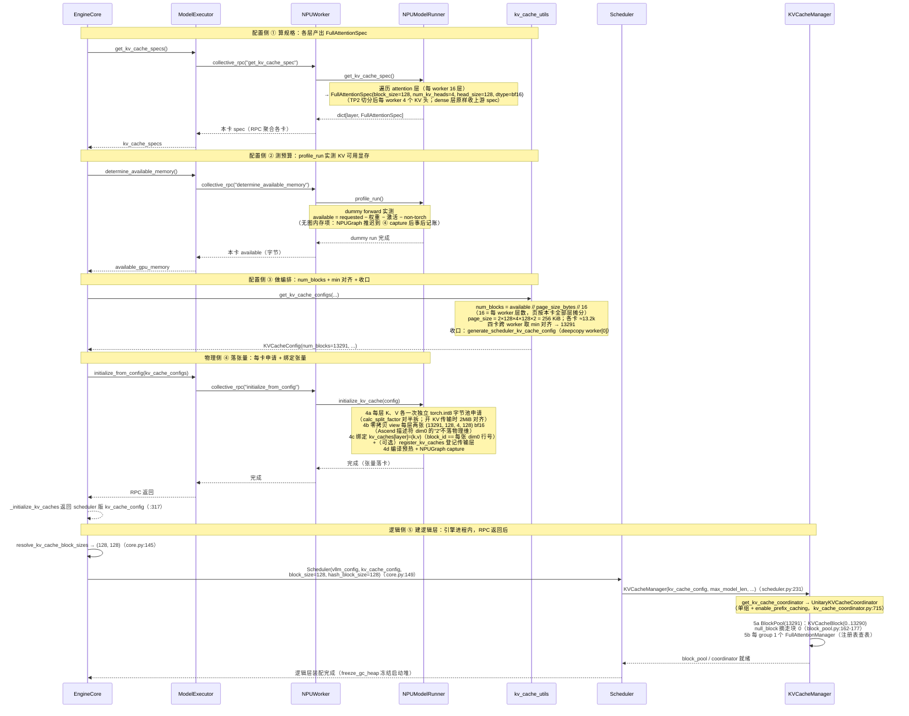

# vLLM V1 系统启动期初始化（NPU · vllm-ascend 视角）

文中统一示例环境：**切分策略 pp2tp2，4 张昇腾 NPU（Ascend）环境**——vllm-ascend 插件接入上游 vLLM；示例模型为 Meta-Llama-3-8B（纯 Full Attention）：

| Attention 类型 | Spec | 示例模型 | 模型链接 |
|----------------|------|----------|----------|
| Full Attention | `FullAttentionSpec` | Meta-Llama-3-8B | https://www.modelscope.cn/models/LLM-Research/Meta-Llama-3-8B |

**NPU 主线约定**：vllm-ascend 以平台插件身份接入——Worker/ModelRunner 换成 `NPUWorker`（vllm_ascend/worker/worker.py:89）/ `NPUModelRunner`（worker/model_runner_v1.py:268），逻辑侧与③编排原地复用上游。Ascend 注意力算子的核内块大小为 **128**，主线示例贯穿 `block_size=128`、bf16；本仓库 Llama-3-8B NPU 实验实测 KV 可用显存 ≈ 51.96 GiB，`num_blocks=13291`（详见 §1.2/§6）。

**章节顺序**：全文按「总览 → 三侧逐个详解 → 衔接 → 物理分布 → 速查」推进，各章如下：

| 章节 | 标题 | 内容主题 |
|------|------|----------|
| §1 | 启动期初始化总览 | 三侧五阶段 |
| §2 | 配置侧详解 | ① 算规格 → ② 测预算 → ③ 做编排 |
| §3 | 物理侧详解 | ④ 落张量 · K/V 双池 |
| §4 | 逻辑侧详解 | ⑤ 建逻辑层（平台无关） |
| §5 | 三侧衔接 | `block_id == K/V 池行号` |
| §6 | PP/TP 物理分布 | 切分策略下的张量布局 |
| §7 | 关键公式速查 | 容量/尺寸公式汇总 |
| §8 | 设计要点小结 | 设计取舍与结论 |

---

## 1. 系统启动期初始化总览（三侧视角）

系统启动期的 KV cache 初始化横跨**引擎进程**与 **worker 进程**，按运行位置与职责分为三侧：

- **配置侧**（引擎进程发起、NPU worker 实测响应）：依次 ① 算规格、② 测预算、③ 做编排，产出唯一的容量仲裁结果 `KVCacheConfig`（含 `num_blocks`、分组方案、张量尺寸）——这一侧**全程不申请任何 KV 显存**；
- **物理侧**（NPU worker 进程 · 每卡）：④ 落张量，按配置把每层 KV cache 物化为真正驻留在 NPU HBM 上的 **K、V 两张 `torch.Tensor`**（K/V 各一次 int8 字节池申请（开 KV 传输时每池 2MiB 对齐）→ 零拷贝 view 为后端逻辑 shape → 绑定到 attention 层 →（可选）双池登记给 KV 传输层），并触发编译预热（NPUGraph）；
- **逻辑侧**（引擎进程）：④ 的 RPC 全部返回后，⑤ 建逻辑层——`Scheduler → KVCacheManager → Coordinator → BlockPool + FullAttentionManager`，全部是纯元数据对象。

物理侧与逻辑侧之间没有任何对象引用：同一份 `KVCacheConfig`（收口时 deepcopy 出 scheduler 版，见 §2.3 收口）保证两侧 `num_blocks` 容量对齐，靠"`block_id` 即物理张量行号"的编号约定（NPU 上 K 池、V 池各有一套同序号行空间），逻辑链凭整数 `block_id` 直接索引物理行——这正是上层零拷贝调度的物理基座。

### 1.1 三侧五阶段管线

从 `EngineCore` 启动起步（`core.py:122` 建 ModelExecutor → `core.py:132` 调 `_initialize_kv_caches`），初始化沿**五阶段单向管线**推进：前三阶段属配置侧（产出 `KVCacheConfig`，尚未触及设备显存），第四阶段落物理，RPC 返回后第五阶段建逻辑：

```
           ┌──────────────────────────────────────────────────────┐
           │ 配置侧（引擎进程发起 · 全程不申请 KV 显存）           │
           │ ① 算规格 → 每层一个 FullAttentionSpec                │
           │ ② 测预算 → 每卡 KV 可用显存字节数                    │
           │ ③ 做编排 → KVCacheConfig(num_blocks) + 收口下发       │
           └──────────────────────┬───────────────────────────────┘
                                  │ 同一份配置
              ┌───────────────────┴───────────────────┐
              ▼ 物理侧 ④（NPU worker · 每卡）        ▼ 逻辑侧 ⑤（引擎进程，RPC 返回后）
   K/V 双 int8 字节池（拆分因子对半）→ view      Scheduler → KVCacheManager
   → bind → 登记传输层（可选）                 → Coordinator → BlockPool + Manager
   → 编译预热（NPUGraph）
              └─────── block_id == K/V 池行号 桥接 ──────────┘
```

| 阶段 | 侧 | 职责 | 入口调用 | 输入 → 产出 |
|------|------|----------|----------|-------------|
| ① 算规格 | 配置侧 | 遍历全模型 Attention 层，采集 spec，推导单页字节量 `page_size_bytes`；同类层合并为 `KVCacheGroupSpec` | `ModelRunner.get_kv_cache_spec()`（NPU 重写版详 §2.1.1） | `vllm_config` → `dict[layer, FullAttentionSpec]` |
| ② 测预算 | 配置侧 | profile dummy forward，量出 KV cache 可用显存（总显存 × 利用率 − 权重 − 激活 − non-torch；**无图内存项**，NPUGraph 推迟到 ④ capture 后事后记账） | `ModelRunner.profile_run()` | 设备显存快照 → `available_memory: int` |
| ③ 做编排 | 配置侧 | 合并全 worker spec → 分组 → 导出 `num_blocks`（`available // page_size // num_layers`）→ 预算校验 → 跨 worker `min(num_blocks)` 对齐 → 收口：生成 scheduler 版配置、回写 `num_gpu_blocks` | `get_kv_cache_configs()` | specs + budget → `list[KVCacheConfig]` + scheduler 版单份 |
| ④ 落张量 | 物理侧 | K 池/V 池各一次 `torch.int8` 字节池申请（`calc_split_factor` 对半拆；开 KV 传输时每池 2MiB 对齐）→ 零拷贝 `view`（无 permute）成两张 4D → bind 绑定 `block_id == 第 0 维行号` → `register_kv_caches` 登记传输层（可选）→ `_dummy_run` 编译 + **NPUGraph** capture | `ModelRunner.initialize_kv_cache()` | `KVCacheConfig` → `kv_caches[layer] = (k_cache, v_cache)` |
| ⑤ 建逻辑层 | 逻辑侧 | RPC 全部返回后引擎进程装配：推导 scheduler/hash 粒度 → 建 `Scheduler` → `KVCacheManager` → 工厂选 `UnitaryKVCacheCoordinator` → `BlockPool`（一次建 num_blocks 个逻辑块、摘 null_block）+ 每 group 一个 `FullAttentionManager`（注册表查表） | `EngineCore.__init__`（core.py:145-157）+ `Scheduler.__init__`（sched/scheduler.py:66） | scheduler 版 `KVCacheConfig` → 逻辑四层对象 |

**小步编号约定**：三侧管线的①～⑤是**大阶段**（算规格/测预算/编排/落张量/建逻辑层）。§2.3 编排内部另有五个小子步也用①～⑤标注；文中引用写作"§2.3⑤"时指**编排内部第⑤小步（多 worker 对齐）**，不带节号的"⑤"一律指大阶段（建逻辑层）。

> ①②④ 均有 NPU（vllm-ascend）一套实现，分别见 §2.1.1、§2.2.1、§3.1；③ 编排平台无关，⑤ 逻辑侧更是与平台完全无关（引擎进程内纯 Python 对象装配）。①③⑤ 跑在引擎进程，①②④的实现主体经 collective RPC 落在各 NPU worker 进程执行。

> **零拷贝调度的物理基础**：物理张量与逻辑块都就绪后，上层 `BlockPool` 只持有 `block_id`，所有调度决策（分配/释放/共享/驱逐）均不触碰物理显存——调度层与物理层完全解耦，`block_id` 是唯一的交互接口；NPU 上"一个 block_id"同时索引 K 池一行与 V 池一行。

### 1.2 启动期三侧时序图

`EngineCore.__init__` 内先调 `_initialize_kv_caches`（core.py:132，定义见 :236），由它完成配置侧①②③与物理侧④（:290），并返回 scheduler 版 `kv_cache_config`（:317）；随后引擎凭该 `kv_cache_config` 进行逻辑侧⑤初始化（core.py:145-157）。以主线 Llama-3-8B pp2tp2 为例（每 worker 16 层 / 4 KV 头，附 NPU 实验 `num_blocks=13291`）：



### 1.3 总调用链

以纯 Full Attention 模型（Llama-3-8B pp2tp2，每 worker 16 层 / 4 KV 头，合并后全模型 32 层**单 group**）为例。

```text
EngineCore.__init__                                     # engine/core.py:119 起
│
├─ model_executor = executor_class(vllm_config)         # core.py:122 拉起 NPU worker 进程（vllm-ascend 平台插件选到 NPUWorker）
│
├─ kv_cache_config = _initialize_kv_caches(vllm_config)  # core.py:132，内部跑完配置侧①②③+物理侧④
│    │
│    ├─ ※  register_all_kvcache_specs(vllm_config)       # FullAttentionSpec ↔ FullAttentionManager 注册表
│    │
│    ├─ √ ① §2.1 算规格  model_executor.get_kv_cache_specs()  〔NPU 详见 §2.1.1〕
│    │     ├─ RPC 到 worker.get_kv_cache_spec() → ModelRunner.get_kv_cache_spec()
│    │     │    （NPUWorker 同款一行转发 worker.py:891；NPUModelRunner 重写版 model_runner_v1.py:4909）
│    │     └─ 返回 -> list[dict[str, KVCacheSpec]]，每个worker上每层Attention KV cache类型，dict[layer name, FullAttentionSpec]
│    │
│    ├─ ※  扫描 spec.non_causal                          # 非因果层，关闭 chunked prefill / 前缀缓存（平台无关）
│    │
│    ├─ √ ② §2.2 测预算  model_executor.determine_available_memory()  〔NPU 详见 §2.2.1〕
│    │     ├─ RPC 到 worker.determine_available_memory() → ModelRunner.profile_run()
│    │     │    （NPUWorker worker.py:527，NPUModelRunner 复用 super().profile_run() + NPU 预热）
│    │     └─ 返回每个worker的 available_kv_cache_memory_bytes 字节数 -> list[int]（NPUGraph 内存推迟到 4d 事后记账）
│    │
│    ├─ √ ③ §2.3 做编排  get_kv_cache_configs(...)
│    │     ├─ 合并各worker的spec → 生成 global groups（32层）→ _project 到每 worker 的 projected groups（16层）
│    │     ├─ 基于 projected groups 算 num_blocks → 对齐 min num_blocks
│    │     ├─ 返回 -> list[KVCacheConfig]，每个worker上的KVCacheConfig（统一num_blocks）
│    │     └─ 收口：generate_scheduler_kv_cache_config（deepcopy）→ 回写 num_gpu_blocks
│    │          → validate_block_size（core.py:279-287；core.py:317 返回 scheduler 版配置）
│    │
│    └─ √ ④ §3 物理侧落张量  model_executor.initialize_from_config(...)  〔NPU 详见 §3.1〕
│          ├─ collective_rpc("initialize_from_config") → NPUWorker.initialize_from_config()（worker.py:907）
│          │     └─ NPUModelRunner.initialize_kv_cache()（model_runner_v1.py:3843）
│          │           ├─ 4a _allocate_kv_cache_tensors   K、V 各一次独立 torch.int8 申请（calc_split_factor 对半拆）
│          │           ├─ 4b _reshape_kv_cache_tensors    view 成两张 (num_blocks, 128, H, D)（无 permute）
│          │           └─ 4c bind_kv_cache + register_kv_caches   block_id == 每张 dim0 行号；双池登记传输层（可选）
│          └─ collective_rpc("compile_or_warm_up_model") → NPUWorker.compile_or_warm_up_model()（worker.py:706）
│                └─ 4d _dummy_run 各尺寸编译 + NPUGraph capture（+ 图内存事后记账建议）
│
└─ √ ⑤ §4 逻辑侧建逻辑层（引擎进程内，④ 的 RPC 全部返回后）
       ├─ resolve_kv_cache_block_sizes(kv_cache_config, vllm_config)  # core.py:145 → (128, 128)
       ├─ Scheduler(vllm_config, kv_cache_config, block_size=128, hash_block_size=128)  # core.py:149
       │     └─ KVCacheManager(kv_cache_config, max_model_len, ...)   # sched/scheduler.py:231
       │           ├─ get_kv_cache_coordinator → UnitaryKVCacheCoordinator  # kv_cache_coordinator.py:715
       │           │     ├─ 5a BlockPool(13291)：KVCacheBlock(0..13290)，null_block 摘走块 0  # block_pool.py:149
       │           │     └─ 5b 每 group 1 个 FullAttentionManager（注册表查表）  # single_type_kv_cache_manager.py:1311
       │           └─ self.block_pool = coordinator.block_pool          # kv_cache_manager.py:156
       ├─ request_block_hasher（前缀缓存开启时生成请求级哈希器，core.py:206-215）
       └─ freeze_gc_heap() / enable_envs_cache()（core.py:228 / :233，启动装配冻结，运行期进入定态）
```

**※ 前置 · 注册 spec ↔ manager 映射**

进入①之前，`EngineCore` 进程内先执行 `register_all_kvcache_specs(vllm_config)`，把 `FullAttentionSpec` 注册到 `FullAttentionManager`：

```python
# single_type_kv_cache_manager.py:1349
def register_all_kvcache_specs(vllm_config):
    """Built-in spec registration"""
    KVCacheSpecRegistry.register(
        FullAttentionSpec,
        FullAttentionManager,
        uniform_type_base_spec=FullAttentionSpec,
    )
```

> 这是一张"spec 类型 → 管理类"的查表：③ 分组完成后，⑤ 建逻辑层时按 `KVCacheGroupSpec.kv_cache_spec` 的类型查表实例化对应 manager（§4.6，与这里形成同进程闭环）；FullAttention 主线只用到 `FullAttentionManager`。注册/查表/manager 全在引擎进程，**与平台无关**——平台差异不会穿透到逻辑侧。

### 1.4 交付物与消费方（按侧）

| 交付物 | 生产（侧 · 阶段） | 消费方 | 用途 |
|--------|------------------|--------|------|
| `kv_cache_configs`（list，每 worker 一份） | 配置侧 ③ | 物理侧 ④：各 NPU Worker | Worker 遍历 `kv_cache_tensors`，把每张 `size` 拆成 K/V 两份申请字节池、按 `shared_by` 绑定到层 |
| `num_blocks`（13291，跨 worker 对齐） | 配置侧 ③ | 逻辑侧 ⑤ 的 `BlockPool` | `BlockPool.__init__` 建出 `KVCacheBlock(0 .. num_blocks-1)`（块 0 开池即留作 `null_block` 占位，实际可分配 `num_blocks-1`） |
| scheduler 版 `KVCacheConfig`（deepcopy 单份） | 配置侧 ③ 收口（`_initialize_kv_caches` 返回值） | 逻辑侧 ⑤：Scheduler / KVCacheManager / Coordinator | 分组信息、`num_blocks`、`has_mamba_layers` / `needs_kv_cache_zeroing` 等运行标志 |
| `cache_config.num_gpu_blocks` 回写 | 配置侧 ③（core.py:280） | EngineCore / Scheduler / KV connector | KV 容量对外可见，供准入与 connector 握手 |
| `kv_caches[layer_name]` **K/V 二元组** | 物理侧 ④ | CANN 注意力算子 + ModelRunner | Llama-3-8B 每层两张 `(num_blocks, 128, 4, 128)` bf16 物理张量：forward 时 `reshape_and_cache` 按 `slot_mapping` 把新 K/V scatter 进池，`npu_fused_infer_attention_score` / `_npu_paged_attention` 以 `block_table` 为 fancy index 沿第 0 维 gather 物理行，读旧 K/V、写本步新 K/V；ModelRunner 侧引用用于清零本轮新块 |
| `KVCacheManager` 全套（Coordinator + BlockPool + manager） | 逻辑侧 ⑤ | Scheduler 运行期 | `get_computed_blocks` / `allocate_slots` / `free` 统一 API，产出 `block_table` |

## 2. 配置侧：算规格 → 测预算 → 做编排（引擎进程发起）

配置侧三步在 `EngineCore._initialize_kv_caches`（core.py:236-317）内依序执行：①②的实现主体经 collective RPC 落在各 NPU worker 进程（NPU 实现见 §2.1.1/§2.2.1），③ 做纯 Python 编排跑在引擎进程。三步全程不申请任何 KV 显存，产出**唯一的容量仲裁结果** `KVCacheConfig`：一份完整版 list（供④物理侧逐卡执行）+ 一份 scheduler 版（供⑤逻辑侧装配）。

### 2.1 第 ① 步 · 算规格：各层产出 KVCacheSpec

这一步遍历本 worker 模型里的每个 Attention 层，问出"你需要什么形状的 KV cache"。RPC 骨架平台无关（`ModelExecutor.get_kv_cache_specs()`，core.py:243），Worker / ModelRunner 的 NPU 实现见 §2.1.1；对纯 Full Attention 模型，最终产出的是**上游 `FullAttentionSpec`**。

#### 2.1.1 NPU（vllm-ascend）：Worker 直接转发，Runner 有重写但 dense 层原样收 spec

**调用链**：平台插件选到 `NPUWorker`：

1. `NPUWorker.get_kv_cache_spec()`（vllm_ascend/worker/worker.py:891）——**一行转发**，自身零逻辑：

```python
# worker.py:891
def get_kv_cache_spec(self) -> dict[str, KVCacheSpec]:
    return self.model_runner.get_kv_cache_spec()
```

2. `NPUModelRunner.get_kv_cache_spec()`（model_runner_v1.py:4909）**重写**了同名方法。遍历骨架为 AttentionLayerBase → 逐层问 spec → kv_sharing 跳过，多出的是 NPU 特有 spec 类型的分流：

| 层类型 | NPU 分支（model_runner_v1.py） | 产出 spec |
|---|---|---|
| decoder 普通 `Attention`（**Llama 走此路**） | :4943-4946 `if spec := attn_module.get_kv_cache_spec(...)` 后**原样存入** | 上游 **`FullAttentionSpec`**（attention.py:603） |
| `MLAAttention`（DeepSeek 系） | :4948-5000 | **`AscendMLAAttentionSpec`**（nope/rope 维度拆分、sparse SFA/LI C8、indexer 等 NPU 字段） |
| `MambaBase` | :5002-5003 先收集、:5027 后统一处理 | 各 Mamba 自身 spec；并把同模型 attn 层的 `page_size_padded` 对齐到 mamba 页（:5034-5036） |
| `CacheOnlyAttentionLayer`（extract_hidden_states） | :5005-5025 | **`HiddenStateCacheSpec`**（重建为可 pickle 的新对象，单独成组） |
| `use_compress` 压缩 KV | :4939-4942 | 模块自身 spec 原样收 |

另有两个边界行为：EC 传输 producer 直接返回 `{}`（:4918-4919）；`kv_sharing_target_layer_name` 同样登记后跳过（:4928-4938）。

> **对 Llama 的结论**：NPU 这层重写对 dense 模型是"透明"的——每层拿到的仍是 attention 模块自产的 `FullAttentionSpec(block_size=128, num_kv_heads=4, head_size=128, dtype=bf16)`（spec 由**模型层自己产出**，`Attention.get_kv_cache_spec()`，attention.py:603），所以 §2.3 的合并/分组/`page_size_bytes` 推导不受影响；NPU 的物理差异（K/V 双池、2MiB 对齐等）要到 §3 物理侧落张量时才出现。

**※ 边注 · 扫描 `non_causal`（平台无关）**——specs 收集齐后，EngineCore 检查是否有层标记 `non_causal=True`（如 Prefix LM attention），这段在 EngineCore 进程内生效：

```python
# core.py:263（vllm-study 主线；releases/v0.23.0 尚无此检查）
if any(getattr(spec, "non_causal", False)
       for worker_specs in kv_cache_specs
       for spec in worker_specs.values()):
    vllm_config.scheduler_config.enable_chunked_prefill = False  # 非因果层：关闭 chunked prefill
    vllm_config.cache_config.enable_prefix_caching = False       # 前缀缓存一并关闭
```

> 非因果层与 chunked prefill / 前缀缓存依赖的"因果注意力"假设冲突，会破坏 prefill 正确性；纯 Full Attention 全因果，此分支不触发。注意这个开关会一路传导到⑤：`Scheduler.__init__` 里 `KVCacheManager(enable_caching=cache_config.enable_prefix_caching)`（§4.3）据此决定协调器走哪个分支。

### 2.2 第 ② 步 · 测预算：profile 量出可用显存

这一步在每个 NPU worker 上跑一次 dummy forward，量出权重+激活之外还剩多少字节给 KV cache。RPC 骨架为 `ModelExecutor.determine_available_memory()`（core.py:257），NPU 实现见 §2.2.1，核心在**图内存何时记账**（NPUGraph 推迟到 4d 事后记账）。

#### 2.2.1 NPU（vllm-ascend）：复用上游 profiling 工具，图内存推迟到 4d 记账

`NPUWorker.determine_available_memory()`（vllm_ascend/worker/worker.py:527）整体结构沿用上游，多处直接复用：

1. **同公式算 requested**（worker.py:469）：`requested_memory = init_snapshot.total_memory × gpu_memory_utilization`（`self.requested_memory`），free 不足时报错（:470-480）；
2. **同一套快照/上下文工具**：`MemorySnapshot` 与 `memory_profiling` 直接从上游 `vllm.utils.mem_utils` 导入（worker.py:47）——快照内部走 `current_platform` 平台抽象，NPU 下即 torch.npu 的设备统计，无需自己重写；
3. **同一次 dummy forward**：`NPUModelRunner.profile_run()`（model_runner_v1.py:3684）只在前后加 NPU 专属预热（EPLB 专家负载均衡 warmup、MC2 MoE 通信容量试跑、PCP 切分序列），核心调用 **`super().profile_run()`**（:3696），即上游的 max-token dummy forward；Llama 无 MoE，实际走的就是 `super()` 路径；
4. **torch 峰值改走 npu API**：`torch.npu.memory_stats(self.device).get("allocated_bytes.all.peak", 0)`（worker.py:567），同样取图捕获前的预捕获值并覆写 `torch_peak_increase`（:571）。

关键差异——**公式里没有图内存项**（worker.py:590）：

```
available_kv_cache_memory = requested_memory
                           − (non_torch_increase + torch_peak_increase + weights_memory)
```

NPUGraph 此刻还没 capture（它发生在 4d `compile_or_warm_up_model()`，worker.py:732），自然无法在这一步预留。图内存改为**事后记账**：4d capture 拿到 `npugraph_memory_bytes` 后，worker.py:734-771 打印一条建议日志，把 `权重 + 峰值激活 + non-torch + NPUGraph + 150 MiB 余量`（memory_profiling 对 ACL context、HCCL buffer、driver 层等非 torch 分配可能略低估）重算一遍，给出两种 `--kv-cache-memory` 建议值（贴 requested / 贴整机 free），供下次启动直接指定——这正是 NPU 上推荐用 `--kv-cache-memory` 而非只调利用率的原因。

快照一致性断言用严格大于（`init.free > profile 后 free`，worker.py:581）；结果日志用 `logger.info_once("Available KV cache memory: %.2f GiB", ...)`（worker.py:593-595）——本仓库实验启动日志里的 `[worker.py:593] Available KV cache memory: 51.96 GiB` 即此行。

`--kv-cache-memory` 快路径（worker.py:540-553）：若显式设置 `cache_config.kv_cache_memory_bytes`（`--kv-cache-memory`），仍会跑一次 `profile_run()`（触发编译），但跳过整个记账计算，直接返回用户指定字节数，并明确提示该值不受 gpu_memory_utilization 约束。

### 2.3 第 ③ 步 · 做编排：合并 / 分组 / num_blocks / 对齐 / 收口

**调用链**：`EngineCore` → `get_kv_cache_configs()`（kv_cache_utils.py:1956），顶层入口，依次五步（PP 下含投影），最后在 EngineCore 侧收口生成 scheduler 版配置。本节内部小步①～⑤指编排的五小子步（见 §1.1 编号约定）。**编排全程跑在引擎进程、平台无关**。

**① 合并全 worker spec**

```python
# kv_cache_utils.py:1994（节选）
merged_kv_cache_specs: dict[str, KVCacheSpec] = {}
for kv_cache_spec_one_worker in kv_cache_specs:
    for layer_name, layer_spec in kv_cache_spec_one_worker.items():
        merged_kv_cache_specs[layer_name] = layer_spec  # 跨 worker 合并
```

> 不同 PP stage 层名不同，合并天然不覆盖；同 PP stage 的不同 TP rank 提交同层 spec，断言检查必须等值（原因：TP 切分后 `num_kv_heads` 相同 → spec 字段全等，详见 §6）。

**② 分组 `get_kv_cache_groups()`**—— 纯 FullAttention 走 `is_kv_cache_spec_uniform()` → `_get_kv_cache_groups_uniform_spec()` → 全模型**单 group**。

```python
# kv_cache_utils.py:874
def is_kv_cache_spec_uniform(kv_cache_spec) -> bool:
    if not kv_cache_spec:
        return True  # encoder-only 模型
    try:
        kv_cache_spec_values = list(kv_cache_spec.values())
        _ = kv_cache_spec_values[0].merge(kv_cache_spec_values)  # 尝试合并
    except AssertionError:
        return False
    return True
```

> `merge()` 检查所有层 spec 字段（block_size / num_kv_heads / head_size / dtype 等）是否一致；**FullAttentionSpec 带不带 sliding window 视为同一类型**。主线下 32 层 `FullAttentionSpec(block_size=128, num_kv_heads=4, head_size=128, bf16)` 字段一致 → 单 group。

**③ 投影到各 worker：按 projected groups 计算 num_blocks**

`num_blocks` 是 **per-worker 容量**——每个 worker 只物化本 rank 负责的层（PP 切层；TP 切头已折进各 worker spec 的 `page_size_bytes`），可用显存必须按 worker 实际承载的层数折算，不能以全局合并层数为除数。`get_kv_cache_configs()` 先执行 `_project_kv_cache_groups_to_worker()`，把 global groups（32 层）投影为各 worker 的 **projected groups**（16 层），再传入 `get_kv_cache_config_from_groups()`（kv_cache_utils.py:1247，单组 `FullAttentionSpec` 走通用 else 路径）：

```python
# kv_cache_utils.py:1309-1326（节选）
group_size = max(len(group.layer_names) for group in kv_cache_groups)  # = 16（projected 后每 worker 层数）
num_blocks = available_memory // page_size // group_size
# group_size = projected group 的层数（pp2tp2 下每 worker 16，不是合并的 32）
# page_size = get_uniform_page_size() = FullAttentionSpec.page_size_bytes（单层每页字节，TP2 后 = 256 KiB）
# 生成 group_size 个张量（每 worker 16 个），每个 size = page_size × num_blocks，shared_by 为单层
```

**补充 · UniformType 单组路径**（同类型异页大小，不除层数）：

```python
# kv_cache_utils.py:1279-1290（节选）
num_blocks = available_memory // kv_cache_groups[0].kv_cache_spec.page_size_bytes
# 每层张量 size = per_layer_specs[layer].page_size_bytes × num_blocks（按各层实际页大小分配）
```

**④ 校验 `_check_enough_kv_cache_memory()`**

```python
# kv_cache_utils.py:713（节选）
needed_memory = get_needed_memory()  # max_model_len 下需要的 KV cache
if needed_memory > available_memory:
    estimated_max_len = estimate_max_model_len(available_memory)
    raise ValueError(...)  # 建议调大 util 或调小 max_model_len
```

**⑤ 多 worker 对齐**——集中式调度下，同一请求的 `block_table` 由所有 worker 共用：PP 各 stage 按段索引本 rank 的层，TP 各 rank 只读写本 rank 的 KV 头子集，因此 `block_id` 必须在任意 rank 上都对应有效物理行。对齐策略：取各 worker `num_blocks` 的最小值作为全局统一值（以 KV 预算最小的 worker 为基准），确保任一 `block_id` 在所有 worker 上均有效：

```python
# kv_cache_utils.py:2074（节选）
min_num_blocks = min(cfg.num_blocks for cfg in kv_cache_configs)
for kv_cache_config in kv_cache_configs:
    num_blocks_old = kv_cache_config.num_blocks
    kv_cache_config.num_blocks = min_num_blocks
    for tensor in kv_cache_config.kv_cache_tensors:   # 等比例缩小 tensor，避免浪费
        tensor.size = tensor.size // num_blocks_old * min_num_blocks
        # page_size_bytes * num_blocks_old -> page_size_bytes * min_num_blocks
```

> 本仓库 NPU 实验：4 卡各自实测 available（≈51.96 GiB 上下，各卡略有差异）→ 各卡独立=num_blocks 略有差异 → min 对齐后取 **13291**——实验归档的每层 K/V 张量形状 `(13291, 128, 4, 128)` 即由此而来。

**收口 · 生成 scheduler 版配置并回写（core.py:265-287）**

`list[KVCacheConfig]` 就绪后，`_initialize_kv_caches` 在发起④之前做三件收口的事：

1. **max_model_len 自适应同步**（core.py:265-277）：若③的预算校验触发了 max_model_len 自动调小，因为各 worker 先于 profiling spawn、缓存的是原始值，需 `collective_rpc("update_max_model_len")` 把新值同步下去；
2. **生成 scheduler 版配置**（core.py:279）——`generate_scheduler_kv_cache_config(kv_cache_configs)`（kv_cache_utils.py:1698）：

```python
# kv_cache_utils.py:1698-1717（节选）
assert all(
    [cfg.num_blocks == kv_cache_configs[0].num_blocks for cfg in kv_cache_configs]
)                                # 编排⑤小步的 min 对齐在此处兜底断言
cfg = copy.deepcopy(kv_cache_configs[0])
# All workers have the same kv_cache_config except layer names, so use
# an arbitrary one to initialize the scheduler.
for group in cfg.kv_cache_groups:
    if isinstance(group.kv_cache_spec, UniformTypeKVCacheSpecs):
        group.kv_cache_spec = next(iter(group.kv_cache_spec.kv_cache_specs.values()))
        # UniformType 组折叠为组内任一 spec（主线单 FullAttentionSpec 组不触发）
return cfg
```

> 各 worker 配置仅层名不同，deepcopy 任意一份即可供逻辑侧使用——`num_blocks` 跨 worker 逐份相等由上面的断言保证。这份配置就是 `_initialize_kv_caches` 的返回值（core.py:317），⑤建 Scheduler 用的就是它；完整版 list 则原样传给④。

3. **回写与校验**（core.py:280-287）：`vllm_config.cache_config.num_gpu_blocks = scheduler_kv_cache_config.num_blocks`（容量对外可见）；`cache_config.block_size` 回写为各组最小 block_size；`vllm_config.validate_block_size()` 终检。

**产出数据结构**

```python
# kv_cache_interface.py:854（节选）
@dataclass
class KVCacheConfig:
    num_blocks: int                        # 对齐后的 block 总数
    kv_cache_tensors: list[KVCacheTensor]  # 每层如何初始化
    kv_cache_groups: list[KVCacheGroupSpec]  # 分组信息

@dataclass
class KVCacheTensor:
    size: int              # 字节大小（K+V 合计；NPU 消费时按拆分因子再分）
    shared_by: list[str]   # 哪些层共享（packed layout 下多个）
    offset: int = 0        # packed 下的字节偏移
    block_stride: int = 0  # packed 下每块字节数（0 = 非 packed）

@dataclass
class KVCacheGroupSpec:
    layer_names: list[str]       # 该组包含哪些层
    kv_cache_spec: KVCacheSpec    # 该组的 spec
```

## 3. 物理侧：落张量 + 编译预热（worker 进程）

三侧中①算规格、②测预算、④落张量都有 NPU 实现（vllm-ascend），①②已见 §2.1.1/§2.2.1，④见 §3.1；只有③做编排跑在 EngineCore 进程内、平台无关——它汇总各 worker 上报的 spec 与预算，产出**同一份 `KVCacheConfig`** 下发各卡。第④步的 RPC 骨架是 `ModelExecutor.initialize_from_config()`（core.py:290 / abstract.py:118），内部**连续两个 `collective_rpc`**：先 `initialize_from_config` 完成 4a/4b/4c 落张量，再 `compile_or_warm_up_model` 完成 4d 编译预热。

### 3.1 NPU（vllm-ascend）：K/V 双独立池，开传输时 2MiB 对齐

NPU 侧由 vllm-ascend 插件实现：`NPUWorker(WorkerBase)`（vllm_ascend/worker/worker.py:89）与 `NPUModelRunner(GPUModelRunner)`（vllm_ascend/worker/model_runner_v1.py:268）——**重写张量分配/reshape，但复用上游 RPC 框架、`KVCacheConfig` 编排与 `bind_kv_cache` 绑定**。

**调用链**：RPC 方法名为 `initialize_from_config` / `compile_or_warm_up_model`（平台插件选到 NPUWorker）：

1. `collective_rpc("initialize_from_config")` → `NPUWorker.initialize_from_config()`（worker.py:907）→ `NPUModelRunner.initialize_kv_cache()`（model_runner_v1.py:3843），完成 4a/4b/4c 落张量；
2. `collective_rpc("compile_or_warm_up_model")` → `NPUWorker.compile_or_warm_up_model()`（worker.py:706），完成 4d 编译预热。

Worker 入口有两处差异（worker.py:907-918）：① 先 `ensure_kv_transfer_initialized()`（:909）拉起 KV 传输组（prefill/decode 分离）；② 开 sleep mode 时在 `CaMemAllocator` 的 `kv_cache` 内存池上下文内分配（:910-912），便于休眠换出。注意 config 路径下 NPUWorker **不回写** `cache_config.num_gpu_blocks`（旧 profile 路径的回写在 `initialize_cache()`，worker.py:385-391）。

`NPUModelRunner.initialize_kv_cache()`（model_runner_v1.py:3843）本体：`deepcopy(KVCacheConfig)`（:3850）→ `initialize_attn_backend()`（:3857）→ **`initialize_kv_cache_tensors()`（:3917，内部 = 4a 分配 + 4b reshape + 4c 绑定）** → 存在 KV 传输组时 `register_kv_caches(kv_caches)`（:3883-3884）把双池登记给传输层。

这一步**每卡并行各自执行**：`collective_rpc` 广播 `list[KVCacheConfig]`，各卡按 `global_rank` 取本 rank 的配置。

**4a. 每层分配 K、V 两张独立 int8 池 `_allocate_kv_cache_tensors()`（model_runner_v1.py:4082）**

```python
# model_runner_v1.py:4087-4088 函数头注释（原文）
# NOTE: To support prefill disaggregation, we need to split kvcache tensor into
# k cache and v cache, and the addr of both are aligned by 2M

alignment = 2 * 1024 * 1024                                   # :4101
# dense attention 分支（:4147 起，Llama 走此路）：
k_dim, v_dim = self._get_attention_kv_cache_dims(layer_name, spec)     # :4213，Llama: (128, 128)
k_factor, v_factor = calc_split_factor([k_dim, v_dim])       # vllm_ascend/utils.py:1611 → bf16 等维: (2.0, 2.0)
k_tensor_size = int(kv_cache_tensor.size // k_factor)        # :4227 整池字节量对半拆
v_tensor_size = int(kv_cache_tensor.size // v_factor)        # :4228
k_tensor = self._allocate_int8_cache_tensor(k_tensor_size, alignment)  # :4249 第一次独立 torch.zeros
v_tensor = self._allocate_int8_cache_tensor(v_tensor_size, alignment)  # :4254 第二次独立 torch.zeros
kv_cache_raw_tensors[layer_name] = (k_tensor, v_tensor)      # :4309 登记为二元组
```

> **为什么 NPU 要拆两张？** prefill/decode 分离（Mooncake / ADXL 传输）要求注册给传输层的每张 buffer **第 0 维必须是 `num_blocks`**、地址 **2MiB 对齐**；单张量形式（`(num_blocks, 2, …)` 或 K/V packed 末维）无法直接注册。因此 dense attention 的 K/V 被拆成两次**不连续**的独立分配。对齐是条件性的（开传输才做，多申请 2MiB 后切片），但拆分对所有 dense 层无条件生效：

```python
# model_runner_v1.py:4004（对齐切片助手 _align_memory 在 :3911）
def _allocate_int8_cache_tensor(self, numel, alignment):
    if self.vllm_config.kv_transfer_config is None:
        return torch.zeros(numel, dtype=torch.int8, device=self.device)          # :4018 无传输：普通 int8 申请
    raw = torch.zeros(numel + alignment, dtype=torch.int8, device=self.device)   # :4020 预留 2MiB
    return self._align_memory(raw, alignment)[:numel]                            # :4025 data_ptr 向上取整对齐后切片
```

同样先按 int8 字节申请、reshape 时再 `view(dtype)`——即与 dtype 解耦。

**4b. 描述符里的"2"被拆成两张 4 维张量 `_reshape_kv_cache_tensors()`（:4353）**

```python
# model_runner_v1.py:4592 起（dense 分支）
kv_cache_shape = attn_backend.get_kv_cache_shape(           # Ascend 后端: attention_v1.py:104-111
    num_blocks, block_size, num_kv_heads, head_size)         #   :111 返回 (2, num_blocks, block_size, num_kv_heads, head_size)
k_shape = kv_cache_shape[1:]                                # :4599 丢掉 dim0 的"2"
v_shape = k_shape                                           # head_size_v 不同时只换最后一维（:4600-4603）
k_cache = raw_k_tensor.view(k_cache_dtype).view(k_shape)    # :4638 (13291,128,4,128) bf16
v_cache = raw_v_tensor.view(v_cache_dtype).view(v_shape)    # :4643 同形
kv_caches[layer_name] = (k_cache, v_cache)                  # :4681 每层绑定对象 = (K, V) 二元组
```

要点：

- Ascend dense 后端描述符 `(2, num_blocks, block_size, heads, head_dim)` 里的 **"2" 在 dim0、且不落成物理维**——它被拆成两张独立的 4 维张量，每张的 dim0 即 `num_blocks`；
- 全程只有 `view`（int8 → bf16 → 4D），**没有 `permute` 布局翻转**；

**4c. 绑定：直接复用上游 `bind_kv_cache`**

NPU 没有自己的绑定函数——绑定发生在 `initialize_kv_cache_tensors()` 内部：:3950 `from vllm.v1.worker.utils import bind_kv_cache`、:3953 以同一上游函数（utils.py:462-519）把 `(k_cache, v_cache)` 按层序填入 `self.kv_caches` 并绑进 `static_forward_context`。该函数不分配显存、不拷贝数据，只做**引用赋值**，把 4a/4b 产出的张量登记到两个位置：

| 登记目标 | 数据结构 | 后续用途 |
|---|---|---|
| `ModelRunner.kv_caches` | `list`，按层号升序，元素为本层的 `(K, V)` 二元组 | 仅用于生命周期管理：profile run 后 `_cleanup_profiling_kv_cache()`（gpu_model_runner.py:6305-6310）逐个置 `None` 再 `clear()`，释放 profile 期的 KV 显存 |
| `static_forward_context[层名].kv_cache` | 层名 → 张量（NPU 是二元组）的引用 | **前向算子实际读取的位置**，`Attention.kv_cache` 由此从占位值替换为真实池 |

函数签名为 `bind_kv_cache(kv_caches, forward_context, runner_kv_caches, num_attn_module=1)`：`kv_caches` 是 4b 产出的「层名 → (K,V)」字典；`forward_context` 即 `compilation_config.static_forward_context`；`runner_kv_caches` 即 `self.kv_caches`；`num_attn_module` 为单层内注意力模块数，NPU 只在 `longcat_flash` 下取 2（model_runner_v1.py:3952）。

函数体分三段：

```python
# utils.py:485-518（上游原文，逐段说明见下）
assert len(runner_kv_caches) == 0                        # ① 只允许绑一次
index2name = defaultdict(list)                           # ② 层号 → 层名列表
for layer_name in kv_caches:
    index2name[extract_layer_index(layer_name, num_attn_module)].append(layer_name)
for layer_index in sorted(index2name.keys()):            #    按层号升序
    layer_names = index2name[layer_index]
    if len(layer_names) > 1:                             #    同层号多注意力
        if current_platform.is_cuda_alike() or current_platform.is_xpu() or current_platform.is_cpu():
            pass                                         #    GPU/CPU 容忍
        else:
            raise NotImplementedError                    #    NPU 会走到这里 → 见下方 patch
    for layer_name in layer_names:
        runner_kv_caches.append(kv_caches[layer_name])
for layer_name, kv_cache in kv_caches.items():           # ③ 绑进 forward context
    forward_context[layer_name].kv_cache = kv_cache
```

- **① 只绑一次**：`list` 的槽位含义是层序，重复 append 会让槽位与层号错位，因此第二次调用必须失败。profile run 与正式初始化之间依赖 `_cleanup_profiling_kv_cache()` 清空该 list。
- **② 按层号排序转 list**：`kv_caches` 的遍历顺序是模型构造顺序，不保证层号递增，所以先用 `extract_layer_index` 解析层号再 `sorted`。解析规则（utils.py:753-784）是取层名里能转成整数的片段：`"model.layers.3.self_attn" → [3] → 3`；`num_attn_module=2` 时两个整数按 `first*2+second` 合成，如 `"model.layers.3.attn.1" → 7`。
- **同层号多注意力**：典型是 encoder-decoder 模型（同一 decoder 层的 self attention 与 cross attention 层名不同但层号相同）。NPU 不在上游白名单内，会抛 `NotImplementedError`——vllm-ascend 用 patch 整体替换该函数（patch_qwen3_next_mtp.py:9-50：删除 `raise`，同层号只取 `layer_names[0]`），使 NPU 的 list 长度恒等于去重后的层号数。
- **③ 绑定是零拷贝**：`Attention.__init__` 先放占位 `self.kv_cache = torch.tensor([])`（attention.py:409-412），并在构造时把自身注册进 `static_forward_context[prefix]`（attention.py:396-398），因此这里的 key 必然能对上；赋值只改指针。跨层 KV 共享在调用前已完成映射——`kv_caches[layer_name] = kv_caches[target_layer_name]`（model_runner_v1.py:3932-3935），多个层名指向同一份物理池。

以 4 层纯 Full Attention 模型为例，绑定完成后两个登记位置的内容如下（同一张量在两侧是同一份显存，图中用相同符号表示）：

```
kv_caches（输入字典，层名 → (K, V)）             ModelRunner.kv_caches（list，按层号升序）
"model.layers.0.self_attn": (k0, v0)   ─────▶   [0] = (k0, v0)
"model.layers.1.self_attn": (k1, v1)   ─────▶   [1] = (k1, v1)
"model.layers.2.self_attn": (k2, v2)   ─────▶   [2] = (k2, v2)
"model.layers.3.self_attn": (k3, v3)   ─────▶   [3] = (k3, v3)
        │
        └──── 同一引用再写入 forward context ────┐
                                                 ▼
static_forward_context（层名 → Attention 对象，其 .kv_cache 被替换）
"model.layers.0.self_attn" → Attention.kv_cache = (k0, v0)   # 前向算子读取点
"model.layers.1.self_attn" → Attention.kv_cache = (k1, v1)
"model.layers.2.self_attn" → Attention.kv_cache = (k2, v2)
"model.layers.3.self_attn" → Attention.kv_cache = (k3, v3)
```

要点：`ModelRunner.kv_caches` 的下标严格等于层号（NPU 上等于去重后的层号），而 `static_forward_context` 按层名索引，两者都不复制数据；同一 `(ki, vi)` 二元组同时出现在两处。

forward 时 attention 实现从 `static_forward_context[层名].kv_cache` 拿到二元组，`AscendAttentionBackendImpl.reshape_and_cache`（attention_v1.py:1430）按下标分发给 NPU 算子：

```python
# attention_v1.py:1439-1452（reshape_and_cache 方法始于 :1430，节选）
if len(kv_cache) > 1:                                        # :1439
    if self.key_cache is None:
        self.key_cache, self.value_cache = kv_cache[0], kv_cache[1]   # :1441
    DeviceOperator.reshape_and_cache(                        # :1444
        key=key, value=value,
        key_cache=self.key_cache, value_cache=self.value_cache,   # 两张池分别 scatter
        slot_mapping=slots)
```

例外：`deepseek_v4` 完全绕开本函数，自行按 `extract_dsv4_layer_index` 排序并把 `[kv_cache]` 绑进 forward context（model_runner_v1.py:3937-3948）；主线 Llama dense 走标准路径。绑定环节**不校验容量与 shape**，两侧一致性由前一步 `KVCacheConfig.num_blocks` 保证。

**4d. 编译与预热：NPUGraph capture `NPUWorker.compile_or_warm_up_model()`（worker.py:706）**

```python
# worker.py:706（节选）
for size in sorted(warmup_sizes, reverse=True):
    self.model_runner._dummy_run(size)                  # :728 各 batch size dummy forward，触发 torch.compile / 算子 warmup
if not self.model_config.enforce_eager:
    npugraph_memory_bytes = self.model_runner.capture_model()   # :732 NPUGraph capture
```

capture 之后接 §2.2.1 所述的**图内存事后记账**（worker.py:734-771）：汇总 `权重 + 峰值激活 + non-torch + NPUGraph + 150 MiB 余量`，打印两种 `--kv-cache-memory` 建议值——NPU 上推荐显式指定 KV 显存、而非只调利用率的依据。

至此 NPU 物理侧就绪。以本仓库 Llama-3-8B 实验为例：每 worker 16 层 → **32 张张量（16 个 K 池 + 16 个 V 池）**，每张 `(13291, 128, 4, 128) bf16`，KVS 归档 .pt 即按 `"K"/"V"` 双独立张量池原样落盘（见 `kvc/docs/0_kvcache_e2e_record.md` §4.3）。

## 4. 逻辑侧：建逻辑层（引擎进程 · 纯元数据装配）

④的 RPC 全部返回后，`_initialize_kv_caches`（core.py:317）把收口生成的 scheduler 版 `KVCacheConfig` 返回给 `EngineCore.__init__`，引擎进程随即执行⑤——装配逻辑四层（协调器 / 单类型管理 / 块池 / 门面，架构编号第 2～5 层，见 `0_kvcache_arch.md`）。本侧特点：**全部对象都是纯元数据**（`KVCacheBlock` 只含 `block_id` 与引用计数等，不含任何 K/V 数据）、**启动期一次性建好**、**与平台完全无关**——对 NPU 的影响只是穿进来的数字（block_size=128、num_blocks=13291）。

### 4.1 装配时点：物理先于逻辑

`EngineCore.__init__` 的后半段（core.py:135-233）：

```python
# core.py:145-157（节选）
scheduler_block_size, hash_block_size = resolve_kv_cache_block_sizes(
    kv_cache_config, vllm_config
)
Scheduler = vllm_config.scheduler_config.get_scheduler_cls()
self.scheduler: SchedulerInterface = Scheduler(
    vllm_config=vllm_config,
    kv_cache_config=kv_cache_config,
    structured_output_manager=self.structured_output_manager,
    ...
    block_size=scheduler_block_size,
    hash_block_size=hash_block_size,
)
```

装配完成后还有两道"封门"动作：`freeze_gc_heap()`（core.py:228，把启动堆标记为静态、GC 不再扫描，压缩运行期 GC 暂停）与 `enable_envs_cache()`（core.py:233，此后环境变量视为不再变更）——两者都以"⑤装配完成"为前提，侧面印证了**物理先于逻辑**的顺序约束：④的编译预热（dummy run、NPUGraph capture）必须先于堆冻结完成，而逻辑侧对象正是冻结范围内最重的一块。

> 若模型没有任何 KV cache（encoder-only），`kv_cache_config.kv_cache_groups` 为空，EngineCore 会关掉 chunked prefill（core.py:138-143）后再走同一条装配路径；此场景下编排返回 `num_blocks=1` 作占位（kv_cache_utils.py:1265 注释原文："Return num_blocks=1 as BlockPool always needs a null_block"），`BlockPool` 按占位值建块，管理链无人使用。

### 4.2 推导调度粒度：`resolve_kv_cache_block_sizes()`

Scheduler 构造之前，先从 `kv_cache_config` 推导两个粒度参数（core.py:145 调用，kv_cache_utils.py:593）：

```python
# kv_cache_utils.py:616-618（单组路径，主线走此路）
if len(groups) <= 1:  # Single group: block_size * dcp * pcp
    bs = cache_config.block_size * dcp * pcp
    return bs, bs
```

- **`scheduler_block_size`**：调度器的 token 对齐不变量（`num_computed_tokens` 取整、chunked prefill 分片粒度）。主线单 group 且 dcp/pcp 均为 1 → **128**；
- **`hash_block_size`**：`Request.block_hashes` 的计算粒度（前缀缓存哈希链的步长）。单 group 时与 scheduler_block_size 相同 → **128**。

### 4.3 `Scheduler.__init__` → 创建 `KVCacheManager`（第 5 层门面）

`Scheduler.__init__`（core/sched/scheduler.py:66）中请求队列等调度器常规设施就绪后，创建逻辑侧的顶层门面：

```python
# sched/scheduler.py:231-244（节选）
self.kv_cache_manager = KVCacheManager(
    kv_cache_config=kv_cache_config,
    max_model_len=self.max_model_len,
    max_num_batched_tokens=self.scheduler_config.max_num_batched_tokens,
    enable_caching=self.cache_config.enable_prefix_caching,
    use_eagle=self.use_eagle,
    log_stats=self.log_stats,
    scheduler_block_size=self.block_size,   # 128
    hash_block_size=hash_block_size,        # 128
    ...
)
```

三个联动点值得注意：

1. `enable_caching` 接的是 `cache_config.enable_prefix_caching`——①算规格阶段的 `non_causal` 扫描（§2.1 边注）若关掉了前缀缓存，这里会一路传导下去，最终改变协调器的选型（见 §4.4 工厂分支）；
2. KV connector 在场时，紧接其后 `connector.bind_gpu_block_pool(self.kv_cache_manager.block_pool)`（scheduler.py:247-248）——P/D 分离等传输组件复用同一逻辑块池做衔接（NPU 侧与 Mooncake/ADXL 传输组的握手在④物理侧完成）；
3. Scheduler 还顺带接收配置上的运行标志：`has_mamba_layers` / `needs_kv_cache_zeroing`（scheduler.py:259-260，来自 `kv_cache_config` 字段）——后者决定运行期每步是否要物理侧清零新块。

### 4.4 协调器：工厂三分支与基类装配（第 4 层）

`KVCacheManager.__init__`（core/kv_cache_manager.py:111）核心动作是经工厂创建协调器，并把句柄提级缓存：

```python
# kv_cache_manager.py:142-156（节选）
self.coordinator = get_kv_cache_coordinator(
    kv_cache_config=kv_cache_config,
    max_model_len=self.max_model_len,
    max_num_batched_tokens=max_num_batched_tokens,
    use_eagle=self.use_eagle,
    enable_caching=self.enable_caching,
    scheduler_block_size=scheduler_block_size,
    hash_block_size=hash_block_size,
    ...
)
self.num_kv_cache_groups = len(kv_cache_config.kv_cache_groups)   # :155 主线 = 1
self.block_pool = self.coordinator.block_pool                      # :156 句柄提级，供 Scheduler/connector 直接访问
```

工厂 `get_kv_cache_coordinator()`（kv_cache_coordinator.py:689-729）按"是否开前缀缓存 × group 数"分三路：

```python
# kv_cache_coordinator.py:702-715, 729（节选）
if not enable_caching:
    return KVCacheCoordinatorNoPrefixCache(...)          # 关前缀缓存：直通版，find_longest_cache_hit 恒空
if len(kv_cache_config.kv_cache_groups) == 1:
    return UnitaryKVCacheCoordinator(...)                # 主线：单 group + 开前缀缓存
return HybridKVCacheCoordinator(...)                     # 多 group：多组间命中求交
```

主线走 **`UnitaryKVCacheCoordinator`**（kv_cache_coordinator.py:379）。其基类 `KVCacheCoordinator.__init__`（kv_cache_coordinator.py:65-110）完成两件装配动作：

```python
# kv_cache_coordinator.py:84-96, 106-110（节选）
assert scheduler_block_size % hash_block_size == 0 and all(
    scheduler_block_size % g.kv_cache_spec.block_size == 0
    for g in kv_cache_config.kv_cache_groups
)                                                        # 粒度整除关系终检
self.scheduler_block_size = scheduler_block_size
self.block_pool = BlockPool(                             # 5a 建块池（§4.5）
    num_gpu_blocks=kv_cache_config.num_blocks,           # 对齐后的 13291
    enable_caching=enable_caching,
    hash_block_size=hash_block_size,
    ...
)
self.single_type_managers = tuple(                       # 5b 每 group 一个（§4.6）
    get_manager_for_kv_cache_spec(
        kv_cache_spec=kv_cache_group.kv_cache_spec, ...)
    for kv_cache_group in kv_cache_config.kv_cache_groups
)
```

`UnitaryKVCacheCoordinator` 在基类之上追加两条主线断言（kv_cache_coordinator.py:413-428）：

```python
# kv_cache_coordinator.py:413-428（节选）
self.kv_cache_spec = self.kv_cache_config.kv_cache_groups[0].kv_cache_spec
self.block_size = self.kv_cache_spec.block_size           # 128（dcp/pcp>1 时再乘）
assert not enable_caching or (hash_block_size == self.block_size)
assert len(self.kv_cache_config.kv_cache_groups) == 1
```

> 主线下三条断言全过：`128 % 128 == 0`、`hash_block_size == block_size == 128`、group 数为 1——这三条正是③编排"全模型单 group + uniform spec"在逻辑侧的呼应。

### 4.5 `BlockPool.__init__`：一次建 13291 个逻辑块（第 2 层）

`BlockPool`（core/block_pool.py:149）是逻辑侧唯一持有"块"的地方，全部启动期一次性装配：

```python
# block_pool.py:162-177（节选）
self.blocks: list[KVCacheBlock] = [
    KVCacheBlock(idx) for idx in range(num_gpu_blocks)   # 13291 个块，block_id = 序号 0..13290
]
self.free_block_queue = FreeKVCacheBlockQueue(self.blocks)
self.cached_block_hash_to_block: BlockHashToBlockMap = BlockHashToBlockMap()
# To represent a placeholder block with block_id=0.
# The ref_cnt of null_block is not maintained, needs special care to
# avoid freeing it.
self.null_block = self.free_block_queue.popleft()        # 摘走队头（block_id=0）
self.null_block.is_null = True
```

逐项解读（以主线 `num_blocks=13291` 为例）：

| 属性 | 启动期值（NPU 主线） | 运行期角色 |
|---|---|---|
| `blocks` | `[KVCacheBlock(0) … KVCacheBlock(13290)]`，每个块仅含 `block_id`、`ref_cnt=0` 等元数据 | 全量预建，运行期永不 new 新块——分配只是改指针/计数 |
| `free_block_queue` | 全部 13291 块按 **block_id 升序**串成双向链表，`num_free_blocks=13291` | 分配 `popleft`、驱逐后回插；自研双向链表而非 deque，支持 O(1) 摘中间块（kv_cache_utils.py:165-190），队序即驱逐序（队头为 LRU 最旧） |
| `cached_block_hash_to_block` | **空** dict（`BlockHashToBlockMap`） | 前缀缓存查表，运行期由"写满的块回填哈希"逐步积累 |
| `null_block` | 队头 pop 出的 `block_id=0`，`is_null=True` | 占位块：供管理器在需要占位/对齐的场合使用（如滑窗外块替换、`get_computed_blocks` 按跳过数补齐），不维护引用计数、永不再分配 |

摘走 `null_block` 后实际可分配块为 **13290**（`num_free_blocks=13290`），编号 1..13290——与物理侧"K 池、V 池两张张量 dim0 的 0 号行闲置无人写"一一对应（§5）。

### 4.6 `FullAttentionManager`：注册表查表实例化（第 3 层）

协调器基类为每个 group 调 `get_manager_for_kv_cache_spec()`（single_type_kv_cache_manager.py:1311）：

```python
# single_type_kv_cache_manager.py:1331-1345（节选）
manager_class = KVCacheSpecRegistry.get_manager_class(kv_cache_spec)
assert manager_class is not None, f"No manager registered for KVCacheSpec {type(kv_cache_spec)}"
...
manager = manager_class(kv_cache_spec, **kwargs)
```

查的正是①前置阶段 `register_all_kvcache_specs`（同文件 :1349，§1.3）填充的注册表：`FullAttentionSpec → FullAttentionManager`——**同一引擎进程内，先注册、后查表**，两头闭环；该注册表与平台无关。主线命中的 `FullAttentionManager`（类定义同文件 :521）没有自定义 `__init__`，直接复用基类装配（single_type_kv_cache_manager.py:38-82）：

```python
# single_type_kv_cache_manager.py:64-80（基类 __init__ 节选）
self.scheduler_block_size = scheduler_block_size          # 128：调度对齐粒度
self.block_size = kv_cache_spec.block_size                # 128：实际分配粒度（dcp/pcp>1 时放大）
self.kv_cache_spec = kv_cache_spec                        # 组规格（含 page_size_bytes）
self.block_pool = block_pool                             # 共享的同一个块池（所有第3层共享第2层）
self.enable_caching = enable_caching
self.new_block_ids: list[int] = []                        # 本调度步新分配块暂存（运行期复用清空）
self.req_to_blocks: defaultdict[str, list[KVCacheBlock]] = defaultdict(list)
                                                          # request_id → 块序列，运行期 block_table 的唯一数据源
```

> `FullAttentionManager` 的核心运行期方法 `find_longest_cache_hit`（:521 起，前缀查找）等不在启动期执行，本篇不展开（见 `2_runtime_sequence.md`）。主线 manager 仅 1 个（单 group）。

### 4.7 逻辑侧交付物与运行期消费方

| 交付物 | 消费方 | 用途 |
|---|---|---|
| `Scheduler.kv_cache_manager`（门面 + 协调器 + 块池 + manager） | Scheduler 运行期 | `get_computed_blocks / allocate_slots / free` 统一 API（第 5 层门面唯一入口） |
| `BlockPool.blocks[i]`（`KVCacheBlock`，13291 个全量预建） | 块池 / manager | 分配、释放、共享、驱逐全部只在块对象上改计数与链表位置 |
| `FullAttentionManager.req_to_blocks[req_id]` | Scheduler → SchedulerOutput | 运行期拼 `block_table`（整数 block_id 列表）随调度输出下发物理侧 |
| `null_block`（`block_id=0`） | manager 占位/对齐逻辑 | 无效 slot 的占位目标，物理侧 K 池/V 池 0 号行闲置与之对应 |
| `scheduler_block_size` / `hash_block_size`（128/128） | Scheduler / 请求哈希预计算 | `num_computed_tokens` 取整；前缀缓存哈希链步长 |
| `kv_cache_config.needs_kv_cache_zeroing` 等标志 | Scheduler → ModelRunner | 决定每步是否清零新物理块（与④的 K/V 双池引用配合） |

至此三侧全部装配完成：物理侧每层 K/V 两张 `(num_blocks, …)` 张量就绪、逻辑侧 13291 个块与查表结构就绪、两侧靠 `block_id == K/V 池行号` 约定桥接，引擎进入接收请求的定态。

## 5. 三侧衔接：一份配置、一个编号约定

三侧的衔接不依赖任何对象引用，由**配置分发**与**编号约定**共同保证：

1. **同一份配置定义容量**：③收口产出完整版 `list[KVCacheConfig]`（每 worker 一份、`num_blocks` 已 min 对齐）交给④；deepcopy 出的 scheduler 版单份交给⑤。`generate_scheduler_kv_cache_config` 的入口断言（kv_cache_utils.py:1704-1706）兜底保证两侧看到的 `num_blocks` 必然相等——物理侧 K 池/V 池两张张量 `block_dim` 轴大小、逻辑侧 `BlockPool.blocks` 长度都由同一个数字推出。
2. **从 0 顺序编号的约定**：逻辑侧 `BlockPool.__init__` 一次性建出 `num_blocks` 个 `KVCacheBlock`，`block_id` 取序号 `0 … n-1`；物理侧 reshape 后每张 K/V 张量 `block_dim` 轴大小恰为同一 `num_blocks`。两侧在 `block_dim` 轴上"位置等同"——`block_id` 即两张张量的行号，fancy index 直接取行，无查表、无拷贝。
3. **K/V 双独立池下 `block_dim` 恒为每张张量的 dim0**：

| 形式 | layout | 逻辑 shape | `block_dim` | 索引方式 |
|---|---|---|---|---|
| 形式 A（NPU） | K/V 双独立池（vllm-ascend，详 §3.1） | K、V 各一张 `(num_blocks, block_size, num_kv_heads, head_size)` | 每张张量 0 | `kv_caches[layer][0][block_ids]`（K）/ `[1][block_ids]`（V） |

`block_dim` 无需硬编码：NPU 双池形式下恒为每张张量的 dim0（传输层注册约束），无需哨兵值探测。

forward 伪代码（NPU，`block_ids` 即该请求的 `block_table`）：

```python
# NPU forward 前，Worker 已通过 get_block_ids() 拿到该请求的 block_id 列表
block_ids = get_block_ids(request_id)             # 形如 [1, 7, 512, ...]，来自 req_to_blocks
k, v = kv_caches[layer]                           # NPU：K、V 双池二元组
kv = (k[block_ids], v[block_ids])                 # 形式A(NPU)：两张池各按 dim0 fancy indexing
```

> `block_table`（即 `block_ids`）不是 `Request` 的字段，而是 `FullAttentionManager.req_to_blocks[request_id]` 里的块号列表（⑤装配的产物，§4.6）。`null_block`（`block_id=0`）在 `BlockPool.__init__` 立即摘走作占位，实际可分配数为 `num_blocks-1`，物理 K 池、V 池的 0 号行因此闲置——`block_id=0` 出现在 `block_table` 中即表示该位置是占位、无有效数据。实际上真正按行索引发生在 CANN 算子内部（`npu_fused_infer_attention_score` 的 `block_table` 参数按块号取 K/V 池的行）。

## 6. Llama-3-8B PP / TP 下 KV cache 的物理分布

- **PP 按层切分**：`config/model.py:1307-1320` `get_layers_start_end_indices()` 按 `pp_rank` 切层范围，`get_kv_cache_spec()` 只返回本 worker 负责的层。
- **TP 按 KV 头切分**：`config/model.py:1284-1295` `get_num_kv_heads()` 除以 `tensor_parallel_size`，同一 PP stage 的不同 TP rank 存同层但不同头子集。

**关键推论**：同一 PP stage 的不同 TP rank `num_kv_heads` 相同（都是切分后的值）→ `FullAttentionSpec` 相等 → §2.3① 合并断言通过。但 **spec 相等 ≠ 物理相同**：每个 TP rank 独立分配自己的 `1/tensor_parallel_size` 份 KV 张量；调度器只管 `block_id`，对 TP 内部头分布透明。

**主线部署 · PP2 × TP2 = 4 张 NPU 卡**（Llama-3-8B：32 层，GQA 8 个 KV 头，全模型单 group）

4 个 worker 的职责划分：

| worker | PP rank | TP rank | 负责层 | 每层 KV 头数（8 ÷ TP2） |
|--------|---------|---------|--------|--------------------------|
| W0 | 0 | 0 | L0–L15（16 层） | 4 |
| W1 | 0 | 1 | L0–L15（16 层） | 4 |
| W2 | 1 | 0 | L16–L31（16 层） | 4 |
| W3 | 1 | 1 | L16–L31（16 层） | 4 |

沿着三侧五阶段走一遍（主线数字贯穿：block_size=128、bf16，TP2 后 `page_size=256 KiB`，各卡 KV 可用 ≈51.96 GiB → min 对齐后 `num_blocks=13291`）：

- **※ 前置**：`register_all_kvcache_specs` 注册 spec↔manager 映射；扫描 `non_causal`——纯 Full Attention 全因果，不触发。
- **配置侧 ① 算规格**：每个 worker 各产出 16 个 `FullAttentionSpec(128, 4, 128, bf16)`（`num_kv_heads=4`，TP 已切）。
- **配置侧 ② 测预算**：各卡 `profile_run` 实测 KV 可用显存 = 总显存 × 利用率 − 权重 − 激活 − non-torch（**无图项**；NPUGraph 4d 后事后记账，主线如 51.96 GiB）。
- **③·合并**：`merged_kv_cache_specs` 合并出 32 个层名不同的 spec——W0/W1 层名同为 `layers.0`~`layers.15` 且字段全等 → 合并断言通过；W2/W3 同理。PP0 与 PP1 层名不同，合并结果天然分层、互不覆盖。
- **③·分组**：32 层 `FullAttentionSpec` 字段一致 → `is_kv_cache_spec_uniform=True` → 全模型 1 个 group（32 层）。
- **③·投影**：`_project_kv_cache_groups_to_worker()` 把 global group（32 层）投影到每 worker 实际层 → projected group（16 层）。
- **③·num_blocks + 对齐**：每卡基于 projected group（16 层）独立算 `num_blocks = available // 256 KiB // 16 ≈ 13.2k`，再取 4 个 worker 的 `min_num_blocks` 统一（§2.3⑤）→ **13291**。
- **③·收口**：`generate_scheduler_kv_cache_config` deepcopy 出 scheduler 版配置；`cache_config.num_gpu_blocks=13291` 回写、`validate_block_size` 终检。
- **物理侧 ④ 落张量**：每卡遍历 16 个 `KVCacheTensor`（各 `256 KiB × 13291 ≈ 3.24 GiB`，合计 ≈51.9 GiB）→ `calc_split_factor` 对半拆成 K、V 两份，各一次独立 int8 字节池申请（开 KV 传输时每池 2MiB 对齐）→ view 成每层两张 `(13291, 128, 4, 128)` bf16 → bind 到各 attention 层 →（可选）`register_kv_caches`；随后第二个 RPC 完成编译预热（4d，NPUGraph capture）。
- **逻辑侧 ⑤ 建逻辑层**：RPC 返回后，`resolve_kv_cache_block_sizes → (128,128)` → Scheduler → KVCacheManager → UnitaryKVCacheCoordinator → `BlockPool(13291)`（建块 0..13290，null_block 摘走 0 号）+ 1 个 FullAttentionManager → freeze_gc_heap 封门。

**物理分布（关键）**：4 张 NPU 卡各存 16 层 KV 物理张量——**每层两张（K 池 + V 池），每 worker 合计 32 张**；同一 PP stage 的两个 TP rank 存**同层、不同 KV 头子集**（各 4 头，占各自卡 `1/2` 头维）。同一请求的 KV 被切成多段：`block_table` 跨 PP 按阶段分段索引，跨 TP 各 rank 只读自己的头子集。调度器仍只认 `block_id`，对 PP/TP 布局完全透明；`BlockPool` 在引擎进程**只有一份**（不为每个 worker 复制）——多卡一致性完全由③的 min 对齐与收口断言保证。

## 7. 关键公式汇总（速查）

沿三侧管线顺序排列，主线示例贯穿（Llama-3-8B pp2tp2 NPU：block_size=128、num_kv_heads=4、head_size=128、bf16）。

| 公式 | 所属阶段/侧 | 含义 | 主线示例 | 出处 |
|------|------------|------|----------|------|
| `page_size_bytes = block_size × num_kv_heads × head_size × dtype_size × 2` | ① 配置侧 | 一层一块（一页）的字节数；系数 2 对应 K/V 两份 | `128 × 4 × 128 × 2 × 2 = 256 KiB`（TP2 后） | §2.1 |
| `available = total × util − weights − activations − non_torch` | ② 配置侧 | 单卡 KV 显存预算（profile_run 实测）；NPU 公式**无图项**（NPUGraph 4d 后事后记账，见 §2.2.1） | 如 `51.96 GiB` | §2.2 |
| `num_blocks = available // page_size // group_size` | ③ 配置侧 | per-worker 容量：除数是 **projected 后每 worker 层数**，非全局合并层数 | `≈13.2k → 四卡 min 对齐 13291` | §2.3③ |
| `KVCacheTensor.size = page_size_bytes × num_blocks` | ③ 配置侧 | 每层张量元数据字节数（NPU 消费时再拆 K/V） | `256 KiB × 13291 ≈ 3.24 GiB` | §2.3③ |
| `K/V 池字节 = size ÷ split_factor`（`calc_split_factor`） | ④ 物理侧 | 每层两张独立字节池各占的比例（bf16 等维 → 对半） | 每池 `≈1.62 GiB` | §3.1 4a |
| `min(num_blocks)` + 等比缩 `KVCacheTensor.size` | ③ 配置侧 | 多 worker 对齐：以 KV 预算最小的 worker 为基准，统一 `block_id` 空间 | 4 卡统一为 13291 | §2.3⑤ |
| `scheduler_block_size = block_size × dcp × pcp`（单组） | ⑤ 逻辑侧 | 调度对齐粒度；单 group 时亦即 `hash_block_size` | `128 × 1 × 1 = 128` | §4.2 |
| `逻辑块数 == 物理行数 == num_blocks`（K 池、V 池同序号） | ⑤ ↔ ④ | 同一份配置保证两侧容量一致（断言兜底） | 13290 个可分配块（0 号为 null_block） | §4.5/§5 |

---

## 8. 设计要点小结

1. **规格先行**：所有显存计算源自 spec 的 `page_size_bytes`；dense 层 spec 由模型层自产（`FullAttentionSpec`）——这是跨 rank 合并断言成立的根基（§2.1/§6）。
2. **五阶段单向管线、每卡并行、物理先于逻辑**：`spec → profile → 编排 → 落张量 → 建逻辑层`，①②④ 经 collective RPC 执行、各卡只处理本 rank 的配置；④编译预热（含 NPUGraph capture）完成后⑤才装配逻辑层，随后 `freeze_gc_heap` 封门（§3/§4）。
3. **单 group 是 FullAttention 核心特征**：`is_kv_cache_spec_uniform=True`，全模型 1 个 KV group（§2.3②），因此⑤命中工厂的 `UnitaryKVCacheCoordinator` 分支且只建 1 个 manager（§4.4）。
4. **容量是 per-worker 的**：`num_blocks = available // page_size // group_size`，除数是 projected 后每 worker 层数，不是全局合并层数（§2.3③）。
5. **min 对齐 + 断言兜底**：以 KV 预算最小的 worker 为基准统一 `num_blocks`，并等比缩 `KVCacheTensor.size`；`generate_scheduler_kv_cache_config` 入口断言保证下发两侧的配置必然相等（§2.3⑤/收口）。
6. **K/V 双 int8 字节池（NPU 特征）**：每层 `KVCacheTensor.size` 经 `calc_split_factor` 拆成 K、V 两次独立分配——拆分对 dense 层**无条件**生效（prefill/decode 分离的传输注册约束），2MiB 对齐仅在开 KV 传输时做；reshape 纯 `view`、无 permute，`block_dim` 恒为 dim0、无需哨兵探测（§3.1）。
7. **`block_id == K/V 池行号` 桥接、物理-逻辑分离**：逻辑块与两张物理张量的行"位置等同"（K 池、V 池同序号），调度决策零显存拷贝，只落在引用计数与空闲队列上，对 PP/TP 布局完全透明（§5/§6）。
8. **配置是唯一权威**：`num_blocks` 等容量事实全部由配置侧一次性推导，物理侧与逻辑侧只消费、不自行计算——两侧连计算重复的机会都没有，天然不会漂移（§2.3/§5）。
9. **逻辑侧纯元数据、启动期一次装配**：`BlockPool` 全量预建 n 个 `KVCacheBlock`、空闲队列是 O(1) 摘插的双向链表、哈希表空表起步由运行期回填；装配完成后冻结启动堆，运行期 KV 管理不再新增管理对象（§4.5）。
10. **注册表闭环扩展点**：配置侧起点 `register_all_kvcache_specs` 注册 spec↔manager 映射，逻辑侧⑤ `get_manager_for_kv_cache_spec` 查表实例化——注册/查表与平台无关；vllm-ascend 的平台扩展（如稀疏 indexer 等）只动 spec 分流与物理侧，逻辑侧中间管线无感（§1.3/§2.1.1/§4.6）。

---

## 扩展：相关机制

- **四种 group 划分**（`_get_kv_cache_groups_*`）：`uniform_spec`（主线：所有层 spec 可 merge，全模型 1 组，kv_cache_utils.py:981）/ `uniform_type`（按 KV 类型分组，同类型各层合成 `UniformTypeKVCacheSpecs`、保留各自页大小，:998）/ `uniform_page_size`（跨类型对齐到统一页大小，:1074）/ `uniform_groups`（主组 + 层元组切分，:1504）。
- **num_blocks 三条配置路径**（`get_kv_cache_config_from_groups`，kv_cache_utils.py:1247）：① 单组 `UniformTypeKVCacheSpecs`（同类型异页大小）——不除层数，每层张量按自身页大小定尺寸；② DeepSeek V4 打包（全部组均为 `UniformTypeKVCacheSpecs` 时走 `_get_kv_cache_config_deepseek_v4()`，kv_cache_utils.py:1221）——各 group 同 slot 层共享一张张量，按 `(slot_idx, page_size)` 桶划分（新版本改由 `_use_packed_kv_cache_config` 判定并按 `offset/block_stride` 切片，0.23.0 尚无）；③ 通用路径（主线）——除以 projected 层数，组内第 i 层共享第 i 张张量，层数不足的组补 padding 槽位。
- **三种 block_size（scheduler / hash / 物理页）**：纯 FullAttention 下三者相等（§4.2 单组路径 128/128/128），协调器基类断言保证整除关系（§4.4）。
- **⑤ 工厂分支**：Full Attention 单组 + 开前缀缓存命中 `UnitaryKVCacheCoordinator`；关前缀缓存时走 `KVCacheCoordinatorNoPrefixCache`（前缀查找恒空），见 §4.4 工厂代码。
- **NPU 特有扩展（vllm-ascend 插件）**：
  - **注意力后端家族**：`AscendAttentionBackend`（`register_backend(AttentionBackendEnum.CUSTOM, "ASCEND")`，attention_v1.py:78；decode 无滑窗且算子条件满足时走 `torch_npu._npu_paged_attention`（PA），其余走 `npu_fused_infer_attention_score[_v2]`（FIA）、算子分流见 `2_runtime_sequence.md`）；`AscendFABackend`（FA3 风格，fa3_v1.py）；稀疏注意力 `AscendC8AttentionBackendImpl`（attention_v1.py:1548）、DSA/SFA（dsa_v1.py / sfa_v1.py，额外分配 indexer/scale 张量）、kvcomp（Hamming 稀疏）；上下文并行 `enable_cp()` 时换成 CP 版 Impl（AscendAttentionCPImpl / AscendMlaCPImpl / AscendDSACPImpl / AscendSFADCPImpl，attention/context_parallel/）。
  - **KV 传输与 2MiB 对齐**：Mooncake / ADXL prefill 分离传输——`register_kv_caches` 把双池登记给传输层（model_runner_v1.py:3884），每张池 2MiB 对齐（:4004/:3911）；`swap_blocks` / `copy_blocks` 也按 `[0]`/`[1]` 双池操作（attention_v1.py:115-140）。
  - **NPUGraph 与 `--kv-cache-memory` 建议**：图内存不在②预算公式内，由 4d capture 后的事后记账给出建议值（worker.py:734-771）——NPU 上推荐显式指定 KV 显存。
  - **sleep mode**：开 sleep mode 时 ④ 的张量在 `CaMemAllocator` 的 `kv_cache` 内存池内分配（worker.py:910-912），便于休眠换出。
  - **profile 预热**：`NPUModelRunner.profile_run()` 在 dummy forward 前后加 EPLB 专家负载均衡 warmup、MC2 MoE 通信容量试跑、PCP 切分序列预热（model_runner_v1.py:3684）。


