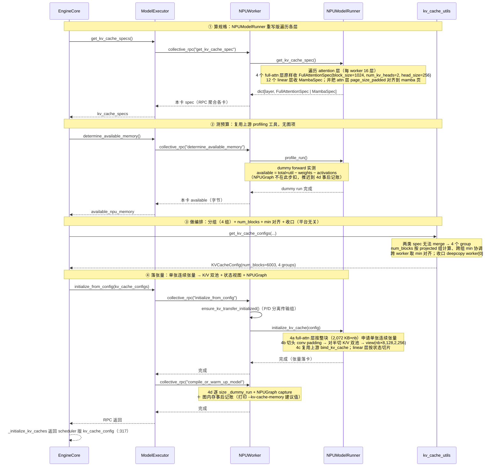
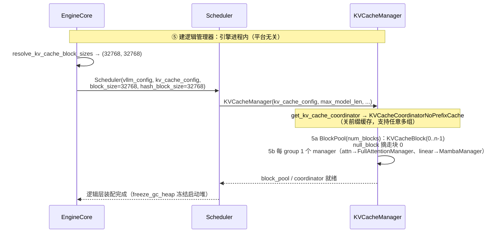

# vLLM-Ascend（NPU）系统启动期初始化（Qwen3.5-4B GDN 混合）

> 主线是 **vllm-ascend 在昇腾 NPU 上的实现**（`NPUWorker` / `NPUModelRunner` / `AscendAttentionBackend`），模型固定为 **GDN 混合模型 Qwen3.5-4B**。③ 做编排与 ⑤ 建逻辑管理器跑在引擎进程、平台完全无关。
>
> **为什么是 Qwen3.5-4B**：它是 Gated DeltaNet（线性注意力）与 Full Attention 的混合体——32 层里 **24 层 `linear_attention`（GDN，产出 `MambaSpec`，单张量状态）+ 8 层 `full_attention`（产出 `FullAttentionSpec`，1024-token 大页 K/V）**；两类 spec 无法 merge，且分组时要求**每组层数相等**（取 `min(8,24)=8`），于是把 24 层 mamba 平分成 3 组 → **全模型 4 个 KV cache group（1 组 attn + 3 组 mamba）**（多组编排 + 多组协调器 + 两种物理形态），是启动链最完整、最能暴露"混合"差异的样本。

**统一示例环境**：切分策略 **pp2tp2，4 卡 Ascend NPU**；Qwen3.5-4B 两类层各产出一种 spec，最终**分组成 4 个 KV group（1 组 attn + 3 组 linear）**：

| Spec 类型 | 层类型（层数） | Spec（NPU 实际产出） | 分组结果 | 物理形态（NPU） |
|----------|--------|----------------------|----------|------------------|
| full-attn | `full_attention`（8 层） | `FullAttentionSpec`（1024-token 大页） | **1 组**（8 层） | K/V 双池 `(nb×8,128,2,256)` bf16 |
| linear（GDN） | `linear_attention`（24 层） | `MambaSpec`（单张量状态） | **3 组**（各 8 层） | conv/temporal 状态视图 |

**章节顺序**：全文按「总览 → 两侧逐个详解 → 衔接 → 物理分布 → 速查」推进：

| 章节 | 标题 | 内容主题 |
|------|------|----------|
| §1 | 启动期初始化总览 | 进程拓扑 → 时序图 → 调用链（均按物理侧 / 逻辑侧分述） |
| §2 | 物理侧：物理张量初始化 | ① 算规格 → ② 测预算 → ③ 做编排 → ④ 落张量（横跨引擎与 worker） |
| §3 | 逻辑侧：逻辑管理器初始化 | ⑤ 建逻辑管理器（引擎进程，平台无关） |
| §4 | 两侧对应关系 | 交付物对照 + 一份配置 + 编号约定 |
| §5 | PP/TP 物理分布 | 切分策略下的 NPU 张量布局（含本仓库实测数字） |
| §6 | 关键公式速查 | 容量/尺寸/拆分公式汇总 |
| §7 | 设计要点小结 | 设计取舍与结论 |

---

## 1. 系统启动期初始化总览

启动期的 KV cache 初始化分为**两侧**（对齐 [`0_kvcache_arch.md`](./0_kvcache_arch.md) §4 的两部分——物理张量初始化 / 逻辑管理器初始化）：

- **物理侧 —— 物理张量初始化**：`EngineCore._initialize_kv_caches()` 完成的四步（① 算规格 → ② 测预算 → ③ 做编排 → ④ 落张量），**横跨引擎进程与 worker 进程**——①②④ 经 collective RPC 落在各 **NPUWorker**（vllm-ascend 插件）实测/执行，③ 在引擎进程做纯 Python 编排。前三步**全程不申请任何 KV 显存**，只产出容量仲裁结果 `KVCacheConfig`；第四步才把层 KV cache 物化为真正驻留 NPU 显存的张量。混合模型下**同一模型两种物理形态并存**：full-attn 层是**单张连续张量 `2,072 KB × num_blocks`**（切头 padding 后对半切成 K 池 / V 池，各自 `view` 成 4D），linear 层走**单张量路径**（按 `MambaSpec.shapes` 切成 conv/temporal 状态视图）；随后触发编译预热（NPUGraph）。**物理侧的产物是"张量 + 配置"**；
- **逻辑侧 —— 逻辑管理器初始化**：④ 的 RPC 全部返回后，⑤ 在引擎进程装配 `Scheduler → KVCacheManager → Coordinator → BlockPool + Manager×2`，**全部是纯元数据对象**（不含任何 K/V 数据）、**与平台完全无关**。**逻辑侧的产物是"管理对象"**。

两侧之间没有任何对象引用：同一份 `KVCacheConfig`（收口时 deepcopy 出 scheduler 版）保证两侧 `num_blocks` 容量对齐，靠"`block_id` 即物理张量行号"的编号约定，逻辑链凭整数 `block_id` 直接索引物理行——这正是上层零拷贝调度的物理基座。

**小步编号约定**：两侧管线的①～⑤是**大阶段**（算规格/测预算/编排/落张量/建逻辑层）。§2.3 编排内部另有五个小子步也用①～⑤标注；文中引用写作"§2.3⑤"时指**编排内部第⑤小步（多 worker 对齐）**，不带节号的"⑤"一律指大阶段（建逻辑层）。

> ①②④ 的实现主体由 vllm-ascend 提供：①在 `NPUModelRunner`（§2.1.1）、②在 `NPUWorker`（§2.2.1）、④在 worker/model_runner（§2.4.1），三者的实现经 collective RPC 落在各 NPU worker 进程内执行；③ 做编排与 ⑤ 建逻辑管理器都在引擎进程、平台无关（纯 Python 对象装配）。

> **零拷贝调度的物理基础**：物理张量与逻辑块都就绪后，上层 `BlockPool` 只持有 `block_id`，所有调度决策（分配/释放/共享/驱逐）均不触碰物理显存——调度层与物理层完全解耦，`block_id` 是唯一的交互接口。

本节按「**进程拓扑 → 时序图 → 调用链**」三层展开，后两者均**按两侧分述**；§2 / §3 再逐侧详解（物理侧 ①→④、逻辑侧 ⑤），§4 收于两侧对应关系。

### 1.1 vllm serve 服务启动全栈与进程拓扑（1 API server + 1 EngineCore + N × worker）

> **进程拓扑**（gggtest3 实测，日志 pid 前缀逐一直接佐证，共 **6 个进程**）：

| 进程 | 实测 pid | 谁拉起的 | 跑什么 |
|---|---|---|---|
| **[P0] API server 主进程** | 20424（APIServer） | shell | **CLI 入口也在此进程**（`vllm serve` 命令不单开进程，uvicorn 常驻到退出）；config 期、路由注册 |
| **[P1] EngineCore 进程** | 20736（EngineCore） | P0 spawn | 引擎调度 busy-loop；再 spawn workers |
| **[P2..P5] worker ×N**（N=PP×TP=4） | 20829-20832（Worker_PP0_TP0…PP1_TP1） | P1 的 executor spawn | ①算规格/②测预算/④落张量/⑤执行——全部 [vllm-ascend] 实现体 |

```text
$ vllm serve <qwen3.5-4b> --pipeline-parallel-size 2 --tensor-parallel-size 2 --port 8100   （完整命令 = 部署篇 §2.3）
│
▼ 一、CLI 分派 ════════════════ 进程 [P0 20424]（CLI 与 API server 同进程）═══════  [vllm]
│  ServeSubcommand.cmd(args)                  cli/serve.py:74                [P0]
│  └─ 单 server 分支（DP=1 → api_server_count 默认 1）
│     uvloop.run(run_server(args))             cli/serve.py:148              [P0]
│
▼ 二、API server async 启动 ══════════ 仍进程 [P0 20424] ═══════════════════════  [vllm]
│  run_server(args) / setup_server(args)（绑端口）         api_server.py:652/664  [P0]
│  └─ run_server_worker(...)                              api_server.py:665     [P0]
│     ├─ build_async_engine_client(args)                  api_server.py:679      [P0] [vllm]
│     │  └─ build_async_engine_client_from_engine_args(...) api_server.py:99      [P0] [vllm]
│     │     ├─ AsyncEngineArgs.from_cli_args(args)（参数搬移，block_size=None） api_server.py:94   [P0]
│     │     ├─ engine_args.create_engine_config()  ★config 期整个栈        api_server.py:123 → §2.0.1 逐帧树
│     │     └─ AsyncLLM.from_vllm_config(vllm_config, ...)                api_server.py:135  [P0] [vllm]
│     │        └─ ★进程边界 1：P0 spawn 子进程 →
│     │           ══ 进程 [P1 EngineCore 20736] ══ EngineCoreProc.run_engine_core
│     │           EngineCore.__init__               v1/engine/core.py:119          [P1] [vllm]
│     │           ├─ Executor选型 + spawn N=4 worker 子进程             core.py:122  [P1] [vllm]
│     │           │  └─ ★进程边界 2：P1 spawn N 个 →
│     │           │     ══ 进程 [P2..P5 workers 20829-20832] ══
│     │           │     NPUWorker 设备初始化/模型加载/①②实现体      vllm_ascend/worker/  [P2-P5] [vllm-ascend]
│     │           └─ _initialize_kv_caches ①②③④⑤        v1/engine/core.py:132    [P1] [vllm]
│     │              ②③④ RPC 逐 worker 下发；④在 P2-P5 内执行
│     │              （展开 = §1.3 总调用链；时间线 07:52:45→07:55:17 = 部署篇 §2.4）
│     └─ build_and_serve(engine_client, ...)             api_server.py:683        [P0] [vllm]
│        └─ serve_http(app, ...)（uvicorn）              api_server.py:585 → launcher.py  [P0]
│
▼ 三、服务就绪 ══════════════════ 进程 [P0]（uvicorn 常驻）═════════════
│  "Started server process → Application startup complete"（07:55:17；P2-P5 headless 无此日志属正常）
│
└─ 请求期跨进程链：chat 路由（P0）→ 队列 → EngineCore 调度（P1）→ workers 执行（P2-P5）→ 回包（P0）
   全生命周期 = 2_runtime_sequence.md
```

### 1.2 启动期时序图（物理侧 / 逻辑侧）

`EngineCore.__init__` 内先调 `_initialize_kv_caches`（core.py:132，定义见 :236），由它完成**物理侧①②③④**（:290），并返回 scheduler 版 `kv_cache_config`（:317）；随后引擎凭该 `kv_cache_config` 进行**逻辑侧⑤**初始化（core.py:145-157）。以主线 Qwen3.5-4B pp2tp2 为例（每 worker 16 层 = 12 linear + 4 full attn、full attn 2 KV 头；**本仓库 NPU 实测**：`Available KV cache memory: 51.90 GiB`、attn `block_size=1024`、`num_blocks≈6003`）。

#### 物理侧（物理张量初始化 · ① 算规格 → ② 测预算 → ③ 做编排 → ④ 落张量）



#### 逻辑侧（逻辑管理器初始化 · ⑤，引擎进程，物理侧 RPC 全部返回后）



### 1.3 总调用链（物理侧 / 逻辑侧）

以混合模型 Qwen3.5-4B pp2tp2（每 worker 16 层 = 12 linear + 4 full attn、full attn 2 KV 头，合并后全模型 **4 个 group**：1 组 attn 8 层 + 3 组 linear 各 8 层）为例。

#### 物理侧（引擎进程发起 · ① 算规格 → ② 测预算 → ③ 做编排 → ④ 落张量）

```text
EngineCore.__init__                                     # engine/core.py:119 起
│
├─ model_executor = executor_class(vllm_config)         # core.py:122 拉起 worker 进程（平台插件选 NPUWorker）
│
├─ kv_cache_config = _initialize_kv_caches(vllm_config)  # core.py:132，内部跑完物理侧①②③④
│    │
│    ├─ ※  register_all_kvcache_specs(vllm_config)       # FullAttentionSpec↔FullAttentionManager 等注册表
│    │
│    ├─ √ ① §2.1.1 算规格  model_executor.get_kv_cache_specs()
│    │     ├─ RPC 到 NPUWorker.get_kv_cache_spec()（worker.py:891，一行转发）
│    │     │    → NPUModelRunner.get_kv_cache_spec()（model_runner_v1.py:4909，重写：分流表见 §2.1.1）
│    │     │      · 4 个 full-attn 层 → FullAttentionSpec（block_size=1024）
│    │     │      · 12 个 linear 层 → MambaSpec，并把 attn 层 page_size_padded 对齐到 mamba 页
│    │     └─ 返回 -> list[dict[str, KVCacheSpec]]，每个 worker 上每层 Attention KV cache 类型
│    │
│    ├─ ※  扫描 spec.non_causal                          # 非因果层，关闭 chunked prefill / 前缀缓存（平台无关）
│    │
│    ├─ √ ② §2.2.1 测预算  model_executor.determine_available_memory()
│    │     ├─ RPC 到 NPUWorker.determine_available_memory()（worker.py:527）
│    │     │    → NPUModelRunner.profile_run()（model_runner_v1.py:3684：预热 + super()）
│    │     └─ 返回每个 worker 的 available_kv_cache_memory_bytes 字节数 -> list[int]
│    │        （NPUGraph 内存推迟到 4d 事后记账，见 worker.py:734-771）
│    │
│    ├─ √ ③ §2.3 做编排  get_kv_cache_configs(...)       # 平台无关，引擎进程
│    │     ├─ 合并各 worker 的 spec → 生成 global groups（1 组 attn 8 层 + 3 组 linear 各 8 层 = 4 组）
│    │     ├─ _project 到每 worker 的 projected groups（1 组 attn 4 层 + 3 组 linear 各 4 层）
│    │     ├─ 基于 projected groups 算 num_blocks → 跨组/跨 worker 对齐 min num_blocks
│    │     ├─ 返回 -> list[KVCacheConfig]，每个 worker 上的 KVCacheConfig（统一 num_blocks）
│    │     └─ 收口：generate_scheduler_kv_cache_config（deepcopy）→ 回写 num_gpu_blocks
│    │          → validate_block_size（core.py:279-287；core.py:317 返回 scheduler 版配置）
│    │
│    └─ √ ④ §2.4 物理侧落张量  model_executor.initialize_from_config(...)
│          ├─ collective_rpc("initialize_from_config") → NPUWorker.initialize_from_config()（worker.py:907）
│          │    ├─ ensure_kv_transfer_initialized()（worker.py:909，P/D 分离）
│          │    ├─ sleep mode：CaMemAllocator kv_cache 内存池（worker.py:910-912）
│          │    └─ NPUModelRunner.initialize_kv_cache()（model_runner_v1.py:3843）
│          │         ├─ 4a _allocate_kv_cache_tensors（:4082）
│          │         │      full-attn：整块单张连续张量；linear：单张量（命中 linear_attn 分支 :4118）
│          │         ├─ 4b _reshape_kv_cache_tensors（:4353）
│          │         │      full-attn：切头 padding → 对半切 K/V 双池 → view(nb×8,128,2,256)
│          │         ├─ 4c bind_kv_cache                复用上游（:3950-3953），block_id == 张量行号
│          │         └─ 有 KV 传输组时 register_kv_caches（:3883-3884）
│          └─ collective_rpc("compile_or_warm_up_model") → NPUWorker.compile_or_warm_up_model()（worker.py:706）
│                └─ 4d 逐 size _dummy_run（:728）+ NPUGraph capture（:732）
│                      + 图内存事后记账与 --kv-cache-memory 建议（:734-771）+ ATB 预热（:775-776）
│
└─ （物理侧结束：返回 scheduler 版 kv_cache_config，交给逻辑侧 ⑤）
```

#### 逻辑侧（⑤，引擎进程内，物理侧 RPC 全部返回后）

```text
EngineCore.__init__（承上，:145 起）                    # engine/core.py:145
│
└─ √ ⑤ §3 逻辑侧逻辑管理器（平台无关）
       ├─ resolve_kv_cache_block_sizes(kv_cache_config, vllm_config)  # core.py:145 → (32768, 32768)
       ├─ Scheduler(vllm_config, kv_cache_config, block_size=32768, hash_block_size=32768)  # core.py:149
       │     └─ KVCacheManager(kv_cache_config, max_model_len, ...)   # sched/scheduler.py:231
       │           ├─ get_kv_cache_coordinator → KVCacheCoordinatorNoPrefixCache
       │           │     （关前缀缓存：工厂第一分支，支持任意多组）
       │           │     ├─ 5a BlockPool(num_blocks)：KVCacheBlock(0..n-1)，null_block 摘走块 0
       │           │     └─ 5b 每 group 1 个 manager（attn→FullAttentionManager、linear→MambaManager）
       │           └─ self.block_pool = coordinator.block_pool
       ├─ request_block_hasher（前缀缓存开启时才生成请求级哈希器；本模型关闭 → 不装配）
       └─ freeze_gc_heap() / enable_envs_cache()（core.py:228 / :233，启动装配冻结，运行期进入定态）
```

**※ 前置 · 注册 spec ↔ manager 映射**

进入①之前，`EngineCore` 进程内先执行 `register_all_kvcache_specs(vllm_config)`，把各 spec 注册到对应 manager：

```python
# single_type_kv_cache_manager.py:1349
def register_all_kvcache_specs(vllm_config):
    """Built-in spec registration"""
    KVCacheSpecRegistry.register(
        FullAttentionSpec,
        FullAttentionManager,
        uniform_type_base_spec=FullAttentionSpec,
    )
```

> 这是一张"spec 类型 → 管理类"的查表：③ 分组完成后，⑤ 建逻辑层时按 `KVCacheGroupSpec.kv_cache_spec` 的类型查表实例化对应 manager（§3.6，与这里形成同进程闭环）。混合模型 4 个 group 各查一次：1 个 attn 组 → `FullAttentionManager`、3 个 linear 组 → `MambaManager`。vllm-ascend 的 NPU 特有 spec（`AscendMLAAttentionSpec` 等）也会在插件侧注册到对应 manager，注册闭环对插件同样成立。

## 2. 物理侧：物理张量初始化（① 算规格 → ② 测预算 → ③ 做编排 → ④ 落张量）

物理侧的四步横跨两侧进程：①②④ 的实现主体经 collective RPC 落在各 worker 进程（vllm-ascend 的 `NPUWorker` / `NPUModelRunner`），③ 做纯 Python 编排跑在引擎进程 `_initialize_kv_caches`（core.py:236-317）内。前三步全程不申请任何 KV 显存，产出**唯一的容量仲裁结果** `KVCacheConfig`：一份完整版 list（供 ④ 逐卡落张量）+ 一份 scheduler 版（供逻辑侧 ⑤ 装配）；第四步才把张量落到 NPU 显存。而四步开始**之前**，`cache_config.block_size` 与两族页大小已在更早的 VllmConfig 构造期定型（§2.0.1）。

### 2.0 装配前置：block size 装配链与 page_size_bytes 统一（Qwen3.5-4B 实测）

block size 定**每块装多少 token**（attn 组三级跳 16 → 128 → 1024，2.0.1）；page_size_bytes 统一定**每块占多少字节**（两族 spec 全等 2,072 KB，2.0.2）。两步都在 §1.1 全栈图中的 config 期完成，先于 §2.1-§2.4 物理侧各步。

#### 2.0.1 block size 装配链——attn 组 16 → 128 → 1024

vllm 上游给出默认 **16**；vllm-ascend 对混合（attn+mamba）模型经 mamba 页对齐抬到 **128 的整数倍**（Qwen3.5-4B 实测 attn 组 **1024**），而 **mamba 组** 的 `mamba_block_size` 在前缀缓存关闭下被设为 **`max_model_len`（32768）**。①算规格读到的 `block_size` 只是这条链的结果。完整执行时序（按真实先后）：

```text
│（承接 §1.1 全栈图：run_server_worker → build_async_engine_client 帧内，config 期细目）

└─ engine_args = AsyncEngineArgs.from_cli_args(args)                                              vllm/entrypoints/api_server.py:117
   └─ vllm_config = engine_args.create_engine_config(usage_context)                               vllm/v1/engine/async_llm.py:242
      ├─ current_platform.pre_register_and_update()                                               vllm/engine/arg_utils.py:1712
      │  └─ adapt_patch(is_global_patch=True)                                                     vllm_ascend/platform.py:188
      ├─ model_config = self.create_model_config()                                                vllm/engine/arg_utils.py:1735
      ├─ cache_config = CacheConfig(block_size=self.block_size, ...)                              :1759
      │  └─ _apply_block_size_default（pydantic validator 自动触发）                              vllm/config/cache.py:231-244
      │     └─ block_size = DEFAULT_BLOCK_SIZE = 16                                               :46
      └─ config = VllmConfig(...)                                                                 vllm/engine/arg_utils.py:2229
         │
         └─ VllmConfig.__post_init__（pydantic 自动触发）                                          vllm/config/vllm.py:847
            ├─ self.try_verify_and_update_config()                                                :856
            │  └ 混合（Qwen3.5-4B）：is_hybrid=True
            │     └─ HybridAttentionMambaModelConfig.verify_and_update_config(self)               :1903
            │        └─ verify_and_update_config（patch 版）                                      vllm-ascend/patch/platform/patch_mamba_config.py:31
            │           ├─ kernel_block_size = 128                                                :58
            │           ├─ cache_config.block_size = attn_block_size (=1024)                      :103
            │           ├─ cache_config.mamba_page_size_padded = attn_page_size + conv_page_size  :117
            │           └─ 前缀缓存关闭 → cache_config.mamba_block_size = model_config.max_model_len :146
            └─ current_platform.check_and_update_config(self)                                     vllm/config/vllm.py:1335
               └─ refresh_block_size(vllm_config)                                                 vllm_ascend/platform.py:671
                  └─ 混合：is_hybrid=True → return，1024 保留（平台层不覆盖）                       vllm-ascend/utils.py:1397-1400

（__post_init__ 返回 = config 期结束；以下进入 worker 进程初始化期（P1 core.py:132 → executor → P2-P5）的 kernel 分档链）
└─ initialize_kv_cache(kv_cache_config)                                                           vllm-ascend/worker/model_runner_v1.py:3843
   ├─ initialize_attn_backend(kv_cache_config)                                                    :3857
   └─ may_reinitialize_input_batch(kv_cache_config)                                               :3864
      └─ selected_kernel_size = select_common_block_size(kv_manager_block_size, backends)         :4759
```

**select_common_block_size 选档算法（vllm 主线 `vllm/v1/worker/utils.py:262-328`）**：为每个 attn group 选一个**所有 backend 都支持、且整除 manager 大块**的 kernel 粒度（虚拟块切分，两档从大到小宁可取大以压缩 slot 映射开销）——

```text
Case 1（:303-306）：kv_manager_block_size(=1024) 本身被所有 backend 支持 → 直接返回（免切分）
Case 2（:308-327）：否则收集全部 backend 的 int 档位，从大到小逐个试：
    ① kv_manager_block_size % size == 0（必须整除，一个大块才能均分成 N 个 kernel 小块）
    ② size 被所有 backend 支持（档位两种格式：int 精确值 / MultipleOf(base) 任意倍数）
    返回第一个命中 → 最大的公共分档
都不满足 → ValueError（:328）
```

- **Qwen3.5-4B 实测命中**：GDN 后端不直接吃 1024 粒度 → 走 Case 2，命中 **128**（1024 % 128 == 0 ✓、128 被支持 ✓）→ `kernel_block_size = 128`——**manager 以 1024 大块管理显存、kernel 以 128 粒度读写，一个大块虚拟切分为 8×128**，即下文 hybrid 布局 `view(nb×8, 128, 2, 256)` 的 8 倍展开来源。
- **Mamba group 不进此函数**：`may_reinitialize_input_batch` 的 else 分支直接给 `kernel_block_sizes = [0]`（:4769，无切分、不参与 slot 映射）——attn(128) 与 mamba(0) 双粒度分档。

**三层粒度对照**：

| 粒度 | 层 | 谁消费 | 表现 |
|---|---|---|---|
| **1024**（attn `block_size`） | attn 组管理/调度层 | BlockPool、KVCacheManager、`block_id` 编号 | 一个 attn 逻辑块 = 1024 token = 2,072 KB |
| **32768**（mamba `block_size`） | linear 组管理/调度层 | BlockPool、`block_id` 编号 | 一个 mamba 块 = 整序列状态（= `max_model_len`），每组每请求 1 块 |
| **128**（attn `kernel_block_size`） | 计算/算子层 | attn kernel 写读（`reshape_and_cache` / `npu_fused_infer_attention_score`）、slot mapping | 算子按 128-token 行寻址；`view(nb×8, 128, 2, 256)`，一个大块展开 8×128 细块 |
| **0**（mamba `kernel_block_size`） | linear 组计算层 | GDN 状态算子 | 无 kernel 子粒度，状态按整块处理、不走 block_table 细寻址 |

- 整除约束 `1024 % 128 == 0` 是选档前提；`kernel_block_sizes = [128]` 记录的就是 attn group 的计算粒度。
- 两类层 block_size 不同 → `scheduler_block_size = LCM(1024, 32768) = 32768`、`hash_block_size` 因前缀缓存关闭退回同为 **32768**（§3.2）。

#### 2.0.2 page_size_bytes 统一——两族 spec 全等 2,072 KB

**为什么是 1024：Qwen3.5-4B 页统一数字链**（TP2 / KV bf16 / ssm fp32；单位 1024 进制——1 KB = 1024 B、1 MB = 1024 KB；推导与部署日志逐字对齐）：

| 量 | 计算 | 值 |
|---|---|---|
| 每 token K 页 | head_dim(256) × num_kv_heads(TP2 后 4÷2=2) × bf16(2B) | 1 KB |
| temporal 状态页（ssm） | value 头(32÷TP2=16) × 128 × 128 × fp32(4B) | 1 MB（1,024 KB） |
| conv 状态页 | (16×128) × (conv_kernel−1 = 3) × 4B | 24 KB |
| **attn 块大小** | 128 × ⌈1 MB ÷ (128 × 1 KB)⌉ = 128 × 8 | **1024 token** |
| attn 原生页 | 2(K/V) × 1024 × 2 头 × 256 × 2B | 2 MB（2,048 KB） |
| mamba 原生页 | conv(24 KB) + ssm(1 MB) | 1,048 KB（= 1 MB + 24 KB） |
| **统一页（两族 `page_size_bytes` 全等）** | **attn 页 + conv 页**（patch :113-117） | **2,072 KB（= 2 MB + 24 KB）** |
| padding 比例 | conv 24 KB ÷ 2,072 KB | **1.16%**（= 日志原值） |

页统一的落点与机制意义：patch 把 `cache_config.mamba_page_size_padded = attn 页 + conv 页 = 2,072 KB` 写入 config 层之后——mamba 层在 ① 算规格构造 `MambaSpec(..., page_size_padded=cache_config.mamba_page_size_padded)`（`model_executor/layers/mamba/abstract.py:44-60`），其 `page_size_bytes` 断言 padded ≥ 原生页（1,048 KB ✓）后返回 padded（`kv_cache_interface.py:616-625`）；attn 层 real 页（2 MB）< 2,072 KB → NPU 侧对齐三行把 attn spec 的 `page_size_padded` 也垫到同一值（model_runner_v1.py:5027-5036），其 `page_size_bytes` 同样返回 padded（:177-180）——**两族 spec 对外 `page_size_bytes` 全等 = 2,072 KB（= 2 MB + 24 KB）**。③编排据此按**统一页**给两类 group 算 `num_blocks`（`get_uniform_page_size` 断言页唯一；每层 `KVCacheTensor.size = 2,072 KB × num_blocks`）——`BlockPool` 唯一账本、`block_table` 按组独立，这是混合模型多组共存的基础（32 层 = 24 linear 单张量 + 8 full-attn 双池，4 组共享同一 block 空间）。

**页统一调用链**：

```text
（config 期真源：cache_config.mamba_page_size_padded = 2,072 KB；config 经 IPC 已带入各进程）

└─ P1 EngineCore._initialize_kv_caches(vllm_config)（def :236）                                              vllm/v1/engine/core.py:236
   ├─ kv_cache_specs = self.model_executor.get_kv_cache_specs()                                              :243
   │  └─ get_kv_cache_spec(self)（vllm-ascend 覆写版）                                                       vllm-ascend/worker/model_runner_v1.py:4909
   │     ├─ spec := attn_module.get_kv_cache_spec(self.vllm_config)（8 × full-attn 层）                       :4944
   │     │  └─ spec.page_size_bytes → real 2,048 KB（page_size_padded 未设）
   │     ├─ spec := mamba_module.get_kv_cache_spec(self.vllm_config)（24 × GDN 层）                           :5030
   │     │  └─ page_size_padded = vllm_config.cache_config.mamba_page_size_padded                            vllm/model_executor/layers/mamba/abstract.py:45-48
   │     │     └─ MambaSpec(..., page_size_padded=page_size_padded, block_size=mamba_block_size=32768)       :51
   │     │        └─ spec.page_size_bytes（断言 padded ≥ 原生 1,048 KB → 返回 2,072 KB）                      vllm/v1/kv_cache_interface.py:616-625
   │     │           └─ mamba_page_size_padded = spec.page_size_bytes                                        vllm-ascend/worker/model_runner_v1.py:5032
   │     └─ object.__setattr__(kv_cache_spec[layer_name], "page_size_padded", mamba_page_size_padded)         :5035-5036
   │        （attn 帧被垫后同样返回 2,072 KB —— 两族 spec.page_size_bytes 全等，统一完成）
   ├─ kv_cache_configs = get_kv_cache_configs(vllm_config, kv_cache_specs, available_gpu_memory)              :268
   │  └─ global_kv_cache_groups = get_kv_cache_groups(vllm_config, merged_kv_cache_specs)                    vllm/v1/core/kv_cache_utils.py:2011
   │     └─ common_page = get_uniform_page_size([g.kv_cache_spec for g in groups])                           :1688
   │        └─ assert len(page_sizes) == 1（断言页唯一 = 2,072 KB）                                           :977
   └─ self.model_executor.initialize_from_config(kv_cache_configs)                                           vllm/v1/engine/core.py:290
      └─ kv_caches = self.initialize_kv_cache_tensors(kv_cache_config)（def :3917）                          vllm-ascend/worker/model_runner_v1.py:3865
         ├─ page_stride = page_size_padded // dtype_size（每块 2,072 KB 步长）                                 :4522-4531
         ├─ full-attn 层：raw[24KB×nb:]（切头部 conv padding）→ K 池 = raw[:attn 页]；V 池 = raw[attn 页:]      :4576-4579
         │              → view(num_blocks×8, 128, 2, 256)                                                    :4561-4570
         └─ linear 层：单张量 → 按 MambaSpec.shapes 切成 conv / temporal 状态视图
```

**统一页的浪费结构（attn 空洞 / mamba 空洞，对称设计）**：统一页 2,072 KB 可分解为三个"子位"——**K 池位（1,024 KB）、V 池位（1,024 KB）、conv 位（24 KB）**，patch 断言（patch_mamba_config.py:95）保证 `K 池位 == ssm 状态页`（1,024 KB），即 mamba 的 ssm 恰好**顶替 K 池位**。两族的"使用 / 空洞"矩阵：

| 子位（每块） | attn full-attn 层（8 层） | mamba GDN 层（24 层） |
|---|---|---|
| K 位 1,024 KB | ✓ 使用（K 池） | ✓ 使用（ssm 状态顶替此位） |
| V 位 1,024 KB | ✓ 使用（V 池） | ✗ **空洞（浪费 1,024 KB/块）** |
| conv 位 24 KB | ✗ **空洞（浪费 24 KB/块，= 1.16%）** | ✓ 使用（conv 状态） |

- **attn 层每块浪费 conv 大小的 24 KB；mamba 层每块浪费 V 池大小的 1,024 KB**（占该层账单 2,072 KB 的 49.4%）——这是 NPU"所有 cache 张量同格式、连续排布"约束的必要代价。
- **为什么 mamba 不能摊用 K+V 两段省掉空洞（设计取舍）**：① ssm 状态视图 `(16,128,128)` 要求**单段连续嵌入**（GDN 算子 state buffer 布局）；② V 段语义被双池算子 API 固化（`reshape_and_cache` 双池入参、`slot→偏移` 线性）；③ 两族同构三段式 `[24KB | 1,024KB | 1,024KB]` 使块级操作（swap/注册/清零/块表）跨层一套逻辑；④ 摊用方案仅省 24 KB/块（空洞 37.3%→36.6%），不划算。**V 位 1,024 KB 空洞本身谁也省不掉**——账单被 attn 的 K+V（2,048）钉死，mamba 只要 1,048。
- **为什么双池（NPU）**：NPU 双池的直接动机是 **PD 分离 KV 传输注册**——`model_runner_v1.py:4087-4088` 注释原文："To support prefill disaggregation, we need to split kvcache tensor into k cache and v cache, and the addr of both are aligned by 2M"：传输层注册 buffer 要求 **dim0 = num_blocks + 地址 2MiB 对齐**；且 Ascend 注意力算子链（`reshape_and_cache` → `npu_fused_infer_attention_score`）的生态本来就是 K、V 两张独立 4D 入参。单机无 KV 传输时不强制 2MiB，但双池布局形态保留（含 `swap_blocks`/`copy_blocks` 双池搬行，attention_v1.py:114-140）。
- **物理布局（hybrid 专用格式，model_runner_v1.py:4495-4579）**：混合模式下 full-attn 层**不走纯 FA 的"K/V 双独立池"两次独立申请**——而是**单张连续张量 `2,072 KB × num_blocks`**（:4503），reshape 时先切掉头部 conv padding（`raw[24KB×nb:]`，:4576-4577）再对半切成 K 池（`:attn页`）与 V 池（`[attn页:]`，:4578-4579），各自 `view` 成 `(num_blocks×8, 128, 2, 256)` bf16（:4561-4570）——管理块 1024-token、物理 block_table **展开 8 份 128-token 细块**；mamba 层同张量格式按状态切片成视图。头部集中的 padding 字节与 mamba 尾部 V 位空洞**物理分配但永不访问**。

**gggtest3 实测**（容器内 `verify_bs.py` + `verify_page.py`，2026-10-16/17）：

```
[1] vllm CacheConfig() default block_size = 16
[2] refresh_block_size(hybrid, block=16) untouched -> 16           # is_hybrid 跳过，交给模型层
[3] attn_block_size = 1024 | attn_page = 2 MB | conv_page = 24 KB | padding = 1.16%
[4] mamba_block_size = 32768 (= max_model_len，前缀缓存关闭)

# verify_page.py（用 vllm 真实 spec 类的 page_size_bytes property 验证统一页）：
[P1] MambaSpec 原生页(conv+ssm)            = 1,048 KB（= 1 MB + 24 KB）
[P2] MambaSpec.page_size_bytes (padded)     = 2,072 KB（= 2 MB + 24 KB）
[P3] FullAttentionSpec real 页（1024 块）   = 2,048 KB = 2 MB
[P4] FullAttentionSpec.page_size_bytes（NPU ① 垫页后）= 2,072 KB（= 2 MB + 24 KB）
[P5] 两族全等: True | 统一页 = 2,072 KB（= 2 MB + 24 KB） | padding = 1.16%
```

### 2.1 第 ① 步 · 算规格：各层产出 KVCacheSpec

这一步遍历本 worker 模型里的每个 Attention 层，问出"你需要什么形状的 KV cache"。RPC 骨架平台无关（同一个 `ModelExecutor.get_kv_cache_specs()`，core.py:243），Worker / ModelRunner 的实现由 vllm-ascend 提供（§2.1.1）；对本模型，最终产出的是**两类 spec**：full-attn 层的上游 `FullAttentionSpec` + linear 层的 `MambaSpec`。

#### 2.1.1 NPU 主线（vllm-ascend）：Worker 直接转发，Runner 有重写且分流两类 spec

**调用链**：`EngineCore` → `ModelExecutor.get_kv_cache_specs()`（core.py:243）→ RPC 到各 worker（平台插件选到 `NPUWorker`）→ `NPUWorker.get_kv_cache_spec()`（vllm_ascend/worker/worker.py:891）——**一行转发，自身零逻辑**：

```python
# worker.py:891
def get_kv_cache_spec(self) -> dict[str, KVCacheSpec]:
    return self.model_runner.get_kv_cache_spec()
```

`NPUModelRunner.get_kv_cache_spec()`（vllm_ascend/worker/model_runner_v1.py:4909）**重写**了上游 Runner 的同名方法。遍历骨架（`AttentionLayerBase` → 逐层问 spec → kv_sharing 跳过）沿用上游，多出的是 NPU 特有的分流：

| 层类型 | NPU 分支（model_runner_v1.py） | 产出 spec |
|---|---|---|
| decoder 普通 `Attention`（**full-attn 层走此路**） | :4943-4946 `if spec := attn_module.get_kv_cache_spec(...)` 后**原样存入** | 上游 **`FullAttentionSpec`**（block_size=1024、num_kv_heads=2、head_size=256、bf16） |
| `MambaBase`（**GDN linear 层走此路**） | :5002-5003 先收集、:5027-5036 后统一处理 | **`MambaSpec`**（GDN 状态页，`block_size=mamba_block_size=32768`、`page_size_padded=2,072 KB`）；并把同模型 attn 层的 `page_size_padded` 对齐到 mamba 页（:5034-5036 `object.__setattr__(..., "page_size_padded", ...)`） |
| `CacheOnlyAttentionLayer`（extract_hidden_states） | :5005-5025 | **`HiddenStateCacheSpec`**（重建为可 pickle 的新对象，单独成组） |
| MLA / sparse / `use_compress` | :4948-5000 / :4939-4942 | 各自 NPU spec（本模型不涉及） |

另有两个边界行为：EC 传输 producer 直接返回 `{}`（:4918-4919）；`kv_sharing_target_layer_name` 同样登记后跳过（:4928-4938）。

> **对 Qwen3.5-4B 的结论**：同一模型里两类层拿到两类 spec——full-attn 层是 dense 原类 `FullAttentionSpec`，linear 层是 `MambaSpec`；两者字段无法 merge，因此 §2.3 会把全模型拆成 **4 个 group**，并在 ① 阶段就完成 attn 层的页对齐（:5034-5036）。

**※ 边注 · 扫描 `non_causal`（平台无关）**——specs 收集齐后，EngineCore 检查是否有层标记 `non_causal=True`（如 Prefix LM attention），这段在 EngineCore 进程内生效：若命中，会关闭 chunked prefill 并**关闭前缀缓存**。本模型前缀缓存已被混合约束强制关闭，此分支不额外触发。

### 2.2 第 ② 步 · 测预算：profile 量出可用显存

这一步在每个 worker 上跑一次 dummy forward，量出权重+激活之外还剩多少字节给 KV cache。RPC 骨架相同（`ModelExecutor.determine_available_memory()`，core.py:257），Worker 实现即 `NPUWorker`（§2.2.1），核心特性在**图内存推迟记账**。

#### 2.2.1 测预算实现（vllm-ascend）：复用上游 profiling 工具，图内存推迟到 4d 记账

`NPUWorker.determine_available_memory()`（vllm_ascend/worker/worker.py:527）整体结构沿用上游框架，多处直接复用上游工具：

1. **快路径 `--kv-cache-memory`**（worker.py:540-553）：用户显式指定 KV 字节数时，仍跑一次 `profile_run()`（触发编译），但跳过整个记账计算，直接返回用户指定值；
2. **同一套快照/上下文工具**：`MemorySnapshot` 与 `memory_profiling` 直接从上游 `vllm.utils.mem_utils` 导入（worker.py:47）——快照内部走 `current_platform` 平台抽象，NPU 下即 torch.npu 的设备统计；
3. **同一次 dummy forward**：`NPUModelRunner.profile_run()`（model_runner_v1.py:3684）只在前后加 NPU 专属预热，核心调用 **`super().profile_run()`**（:3696）即上游那套 max-token dummy forward（含 EPLB / MC2 / PCP 分支，本模型走 `super()` 主路径）；
4. **torch 峰值改走 npu API**：`torch.npu.memory_stats(self.device)["allocated_bytes.all.peak"]`（worker.py:567），取图捕获**之前**的预捕获值并覆写 `torch_peak_increase`（:571）。

**核心公式——没有图内存项**（worker.py:572-574 / :590）：

```
available_kv_cache_memory = requested_memory                （total × gpu_memory_utilization）
                           − (non_torch_increase
                              + torch_peak_increase          （预捕获峰值）
                              + weights_memory)
```

NPUGraph 此刻还没 capture（它发生在 4d `compile_or_warm_up_model()`，worker.py:732），自然无法在这一步预留。图内存改为**事后记账**：4d capture 拿到 `npugraph_memory_bytes` 后，worker.py:734-771 打印一条建议日志，把 `权重 + 峰值激活 + non-torch + NPUGraph + 150 MiB 余量`重算一遍，给出两种 `--kv-cache-memory` 建议值——这正是 NPU 上推荐用 `--kv-cache-memory` 而非只调利用率的原因。

其余细节：

- 快照一致性断言用严格大于（`init.free > profile 后 free`，worker.py:581）；
- 结果日志用 `logger.info_once("Available KV cache memory: %.2f GiB", ..., scope="local")`（worker.py:593-595）——本仓库实验启动日志里的 `[worker.py:593] Available KV cache memory: 51.90 GiB` 即此行。

### 2.3 第 ③ 步 · 做编排：合并 / 分组 / num_blocks / 对齐 / 收口（平台无关）

**调用链**：`EngineCore` → `get_kv_cache_configs()`（kv_cache_utils.py:1956），顶层入口，依次五步（PP 下含投影），最后在 EngineCore 侧收口生成 scheduler 版配置。**本节全部跑在引擎进程**（①② 上报的 spec / 预算是什么，它就编排什么）。本节内部小步①～⑤指编排的五小子步（见 §1 引言「小步编号约定」）。

**① 合并全 worker spec**

```python
# kv_cache_utils.py:1994（节选）
merged_kv_cache_specs: dict[str, KVCacheSpec] = {}
for kv_cache_spec_one_worker in kv_cache_specs:
    for layer_name, layer_spec in kv_cache_spec_one_worker.items():
        merged_kv_cache_specs[layer_name] = layer_spec  # 跨 worker 合并
```

> 不同 PP stage 层名不同，合并天然不覆盖；同 PP stage 的不同 TP rank 提交同层 spec，断言检查必须等值。**NPU 的 Mamba 层在①阶段已是 `MambaSpec`、"平台特有 spec"从这一步就进入平台无关的编排管线——编排对 spec 的具体类型不感知，只按 `page_size_bytes` 等抽象接口工作。**

**② 分组 `get_kv_cache_groups()`** —— 混合模型两类 spec **无法 merge** → `is_kv_cache_spec_uniform()` 返回 False → 走通用多组路径（先 `unify_kv_cache_spec_page_size` 统一页，再 `_get_kv_cache_groups_uniform_page_size` 分组），得到 **4 个 group**：

```python
# kv_cache_utils.py:874
def is_kv_cache_spec_uniform(kv_cache_spec) -> bool:
    if not kv_cache_spec:
        return True  # encoder-only 模型
    try:
        kv_cache_spec_values = list(kv_cache_spec.values())
        _ = kv_cache_spec_values[0].merge(kv_cache_spec_values)  # 尝试合并
    except AssertionError:
        return False
    return True
```

> `merge()` 检查所有层 spec 字段是否一致。本模型 8 层 `FullAttentionSpec` 彼此可 merge、24 层 `MambaSpec` 彼此可 merge，但**两类之间 merge 失败** → 进入通用多组分组 `_get_kv_cache_groups_uniform_page_size()`（kv_cache_utils.py:1074）。
>
> **为什么是 4 组（而不是 2 组）**：该函数有一条硬约束——**每个 group 的层数必须相等**（注释原文："Number of layers per group: Currently assumed the same for all layers"，目的是让 PP 各 stage 的 group 均衡、避免 padding 浪费）。它先按 spec 类型聚成两组（attn 8 层、mamba 24 层），再取组大小 `group_size = min(8, 24) = 8`，于是：
>
> - **attn**：`cdiv(8, 8) = 1` 组（8 层）；
> - **mamba**：`cdiv(24, 8) = 3` 组，按 `layers[i::3]` **交错切分**（每组 8 层）——交错而非顺序切片，是为 PP 下各 stage 的 group 仍均衡（注释给出的 stage 0/1 例子）。
>
> 合计 **1 组 attn + 3 组 mamba = 4 个 group**；页大小经 §2.0.2 统一，故 4 组的页相等，满足 `get_uniform_page_size` 的页唯一断言。

**③ 投影到各 worker：按 projected groups 计算 num_blocks**

`num_blocks` 是 **per-worker 容量**——每个 worker 只物化本 rank 负责的层（PP 切层；TP 切头已折进各 worker spec 的 `page_size_bytes`）。`get_kv_cache_configs()` 先执行 `_project_kv_cache_groups_to_worker()`，把 global groups（4 组：1 attn 8 层 + 3 linear 各 8 层）投影为各 worker 的 **projected groups**（仍 4 组：1 attn 4 层 + 3 linear 各 4 层），再传入 `get_kv_cache_config_from_groups()`（kv_cache_utils.py:1247）：

```python
# kv_cache_utils.py:1309-1326（节选）
group_size = max(len(group.layer_names) for group in kv_cache_groups)  # projected 后每 worker 最大组层数
num_blocks = available_memory // page_size // group_size
# group_size = projected group 的层数（pp2tp2 下 attn 4 / linear 12）
# page_size = get_uniform_page_size() = 2,072 KB（两族页统一后的唯一页字节）
# 生成若干张量，每个 size = page_size × num_blocks，shared_by 为组内各层
```

> 混合模型下 `num_blocks` 是**跨组 + 跨 worker 协同**的结果：attn 大页与 mamba 状态页在**统一 block 空间**下协调、取最小可行值——本仓库实测最终 **`num_blocks ≈ 6003`**（≈ 6,147,276 tokens ÷ 1024），即 mamba 状态占用与 attn 大页共享同一 51.9 GiB 预算后的结果（部署篇 §3③ 的粗算差值即 mamba 状态占用）。

**④ 校验 `_check_enough_kv_cache_memory()`**

```python
# kv_cache_utils.py:713（节选）
needed_memory = get_needed_memory()  # max_model_len 下需要的 KV cache
if needed_memory > available_memory:
    estimated_max_len = estimate_max_model_len(available_memory)
    raise ValueError(...)  # 建议调大 util 或调小 max_model_len
```

**⑤ 多 worker 对齐**——集中式调度下，同一请求的 4 组 `block_table` 由所有 worker 共用：PP 各 stage 按段索引本 rank 的层，TP 各 rank 只读写本 rank 的 KV 头子集，因此 `block_id` 必须在任意 rank 上都对应有效物理行。对齐策略：取各 worker `num_blocks` 的最小值作为全局统一值：

```python
# kv_cache_utils.py:2074（节选）
min_num_blocks = min(cfg.num_blocks for cfg in kv_cache_configs)
for kv_cache_config in kv_cache_configs:
    num_blocks_old = kv_cache_config.num_blocks
    kv_cache_config.num_blocks = min_num_blocks
    for tensor in kv_cache_config.kv_cache_tensors:   # 等比例缩小 tensor，避免浪费
        tensor.size = tensor.size // num_blocks_old * min_num_blocks
```

**收口 · 生成 scheduler 版配置并回写（core.py:265-287）**

`list[KVCacheConfig]` 就绪后，`_initialize_kv_caches` 在发起④之前做三件收口的事：

1. **max_model_len 自适应同步**（core.py:265-277）：若③的预算校验触发了 max_model_len 自动调小，需 `collective_rpc("update_max_model_len")` 把新值同步下去（NPUWorker 的实现见 worker.py:894-905）；
2. **生成 scheduler 版配置**（core.py:279）——`generate_scheduler_kv_cache_config(kv_cache_configs)`（kv_cache_utils.py:1698）：断言各份 `num_blocks` 相等后 `deepcopy(kv_cache_configs[0])`，`UniformTypeKVCacheSpecs` 组折叠为组内任一 spec（本模型4 组分别是 `FullAttentionSpec` / `MambaSpec`，不触发折叠）；
3. **回写与校验**（core.py:280-287）：`vllm_config.cache_config.num_gpu_blocks = scheduler_kv_cache_config.num_blocks`（容量对外可见）；`cache_config.block_size` 回写为各组最小 block_size；`vllm_config.validate_block_size()` 终检。

**产出数据结构**（`KVCacheConfig` / `KVCacheTensor` / `KVCacheGroupSpec`，kv_cache_interface.py:854 起）：`kv_cache_groups` 本模型为 **2 个**，分别持 `FullAttentionSpec`（8 层）与 `MambaSpec`（24 层）；`kv_cache_tensors` 的 `size = 2,072 KB × num_blocks`（统一页）。

### 2.4 第 ④ 步 · 落张量 + 编译预热（NPU worker 进程）

①算规格、②测预算、④落张量的实现主体都是 vllm-ascend 的 `NPUWorker` / `NPUModelRunner`（①②已展开，本节是④）；③做编排跑在 EngineCore 进程内、平台无关。第④步与前两步走相同的 RPC 骨架——`ModelExecutor.initialize_from_config()`（core.py:290）内部**连续两个 `collective_rpc`**：先 `initialize_from_config` 完成 4a/4b/4c 落张量，再 `compile_or_warm_up_model` 完成 4d 编译预热。

#### 2.4.1 NPU 实现：两种物理形态并存

物理侧由 vllm-ascend 插件实现：`NPUWorker(WorkerBase)`（worker.py:89）与 `NPUModelRunner`（model_runner_v1.py:268）——**重写张量分配/reshape，但复用上游 RPC 框架、`KVCacheConfig` 编排与 `bind_kv_cache` 绑定**。

**调用链**：`collective_rpc("initialize_from_config")` → **`NPUWorker.initialize_from_config()`（worker.py:907）**，先做两件 NPU 特有的事再委托 model_runner：

```python
# worker.py:907-918（节选）
def initialize_from_config(self, kv_cache_config: KVCacheConfig) -> None:
    """Allocate NPU KV cache with the specified kv_cache_config."""
    ensure_kv_transfer_initialized(self.vllm_config, kv_cache_config)   # :909 拉起 KV 传输组（P/D 分离）
    if self.vllm_config.model_config.enable_sleep_mode:
        allocator = CaMemAllocator.get_instance()                        # :910-912 sleep mode 内存池
        context = allocator.use_memory_pool(tag="kv_cache")
    else:
        context = nullcontext()
    with context:
        self.model_runner.initialize_kv_cache(kv_cache_config)           # :918 落张量主体
```

`NPUModelRunner.initialize_kv_cache()`（model_runner_v1.py:3843）本体顺序：`deepcopy(config)`（:3850）→ `initialize_attn_backend`（:3857）→ `may_reinitialize_input_batch`（:3864，选 kernel 粒度）→ `initialize_kv_cache_tensors`（:3865 = 4a+4b+4c）→ 有传输组时 `register_kv_caches`（:3883-3884）。

**4a. 分配：full-attn 单张连续张量 / linear 单张量 `_allocate_kv_cache_tensors()`（model_runner_v1.py:4082）**

混合模式下 full-attn 层按**整块尺寸**申请单张连续张量（`page_stride = page_size_padded // dtype_size`，每块 2,072 KB），不再走纯 FA 的"K/V 两次独立申请"；linear 层按层名 `"linear_attn" in layer_name` 命中**单张量路径**（:4118-4134），与状态的 conv/temporal 视图对应。

> 函数头注释直说双池拆分的动机（纯 FA 场景）：`# NOTE: To support prefill disaggregation, we need to split kvcache tensor into k cache and v cache, and the addr of both are aligned by 2M`（:4087-4088）。混合模式把"拆分"从分配阶段挪到 reshape 阶段（见 4b）。

**4b. reshape：切头 → 对半切 K/V 双池 → view 4D `_reshape_kv_cache_tensors()`（:4353）**

full-attn 层（混合专用格式，:4495-4579）：

```python
# model_runner_v1.py:4561-4579（节选，混合 full-attn）
raw = ...                                        # 单张连续张量，2,072 KB × num_blocks
attn = raw[24KB * nb:]                           # :4576-4577 切掉头部 conv padding
k_pool = attn[:attn_page]                        # :4578 K 池
v_pool = attn[attn_page:]                        # :4579 V 池
k_cache = k_pool.view(bf16).view((nb*8, 128, 2, 256))   # :4561-4570 8 倍展开
v_cache = v_pool.view(bf16).view((nb*8, 128, 2, 256))
kv_caches[layer_name] = (k_cache, v_cache)       # 每层 = (K, V) 二元组
```

- 逻辑 `block_size=1024`、算子 `kernel_block_size=128` → 物理 block_table **展开 8 份 128-token 细块**；
- 全程只有 `view`（int8 → bf16 → 4D），**无 `permute`**；
- **linear 层**：同张量格式，按 `MambaSpec.shapes` 切出 conv / temporal 状态视图。

**4c. 绑定：直接复用上游 `bind_kv_cache`**

绑定发生在 `initialize_kv_cache_tensors()` 内部（:3950-3953），以同一上游函数把每层对象按层序填入 `self.kv_caches` 并绑进 `static_forward_context`。forward 时：
- **full-attn 层**：`AscendAttentionBackendImpl.reshape_and_cache`（attention_v1.py:1430-1454）取 `kv_cache[0]/[1]` 分发给 NPU 双池算子（`DeviceOperator.reshape_and_cache(key, value, key_cache, value_cache, slot_mapping)`，:1444）+ `notify_kv_cache_written()`（:1453）；
- **linear 层**：GDN 状态算子读状态视图、就地步进。

同后端类还提供双池版 `swap_blocks`（:114-126）/`copy_blocks`（:128-140）——NPU 上块级 KV 搬移（P/D 传输、offload）的算子层入口。

**4d. 编译与预热：NPUGraph `NPUWorker.compile_or_warm_up_model()`（worker.py:706）**

逐 size `_dummy_run`（:728）触发编译 → `capture_model()`（:732）捕获 NPUGraph → **图内存事后记账**（:734-771）：把 `权重 + 峰值激活 + non-torch + NPUGraph + 150 MiB` 从 requested（或整机 free）里扣掉，打印两种 `--kv-cache-memory` 建议值 → ATB 首算预热（:775-776）→ 绑核（:779-783）→ 重置随机种子（:786）。

至此 NPU 物理侧就绪：每 worker **两种形态并存**——full-attn 4 层的 K/V 双池（各 `(nb×8,128,2,256)` bf16）+ linear 12 层的状态张量。

**不变的存储契约**（所以上层零改动）：同一份 `KVCacheConfig` 与跨 worker `min(num_blocks)` 对齐；一律从字节池起步、与 dtype 解耦；都用同一个 `bind_kv_cache` 绑定；逻辑侧 `block_id == 物理张量 dim0 行号` 的约定恒成立——⑤逻辑层（§3）、`BlockPool`、`KVCacheManager` 的分配/释放逻辑对此完全无感。

## 3. 逻辑侧：逻辑管理器初始化（引擎进程 · 纯元数据装配）

④的 RPC 全部返回后，`_initialize_kv_caches`（core.py:317）把收口生成的 scheduler 版 `KVCacheConfig` 返回给 `EngineCore.__init__`，引擎进程随即执行⑤——装配逻辑四层（协调器 / 单类型管理 / 块池 / 门面）。本侧特点：**全部对象都是纯元数据**（`KVCacheBlock` 只含 `block_id` 与引用计数等）、**启动期一次性建好**、**与平台完全无关**。

### 3.1 装配时点：物理先于逻辑

`EngineCore.__init__` 后半段（core.py:135-233）：

```python
# core.py:145-157（节选）
scheduler_block_size, hash_block_size = resolve_kv_cache_block_sizes(
    kv_cache_config, vllm_config
)
Scheduler = vllm_config.scheduler_config.get_scheduler_cls()
self.scheduler: SchedulerInterface = Scheduler(
    vllm_config=vllm_config,
    kv_cache_config=kv_cache_config,
    ...
    block_size=scheduler_block_size,
    hash_block_size=hash_block_size,
)
```

装配完成后两道"封门"动作：`freeze_gc_heap()`（core.py:228）与 `enable_envs_cache()`（core.py:233）——都以"⑤装配完成"为前提，印证**物理先于逻辑**的顺序约束：④的编译预热（dummy run、NPUGraph capture）必须先于堆冻结完成。

> 若模型没有任何 KV cache（encoder-only），`kv_cache_config.kv_cache_groups` 为空，EngineCore 会关掉 chunked prefill（core.py:138-143）后再走同一条装配路径；此场景下编排返回 `num_blocks=1` 作占位（"BlockPool always needs a null_block"）。

### 3.2 推导调度粒度：`resolve_kv_cache_block_sizes()`

混合模型**多 group**（attn block_size=1024、mamba block_size=32768），走多组路径（kv_cache_utils.py:620-656）：

```python
# kv_cache_utils.py:626-644（节选）
group_block_sizes = [g.kv_cache_spec.block_size for g in groups]   # [1024, 32768]
scheduler_block_size = math.lcm(*group_block_sizes)               # 32768
connector_enabled = vllm_config.kv_transfer_config is not None
if not (cache_config.enable_prefix_caching or connector_enabled):
    return scheduler_block_size, scheduler_block_size             # 前缀缓存关闭 → (32768, 32768)
```

- **`scheduler_block_size`** = 各组 block_size 的 **LCM** = `LCM(1024, 32768) = 32768`（调度侧 `num_computed_tokens` 取整、chunked prefill 分片粒度）；
- **`hash_block_size`**：前缀缓存关闭、且无 connector → 退回等于 scheduler_block_size = **32768**（哈希粒度实际不使用）；
- 若开启前缀缓存（`mamba_cache_mode="align"`、`mamba_block_size == block_size`），则 hash_block_size 取各组 block_size 的 **GCD**，二者允许不同——本模型不适用。

### 3.3 `Scheduler.__init__` → 创建 `KVCacheManager`（第 5 层门面）

`Scheduler.__init__`（sched/scheduler.py:66）中创建逻辑侧顶层门面：

```python
# sched/scheduler.py:231-244（节选）
self.kv_cache_manager = KVCacheManager(
    kv_cache_config=kv_cache_config,
    max_model_len=self.max_model_len,
    enable_caching=self.cache_config.enable_prefix_caching,   # False
    ...
    scheduler_block_size=self.block_size,   # 32768
    hash_block_size=hash_block_size,        # 32768
)
```

三个联动点：

1. `enable_caching` 接 `cache_config.enable_prefix_caching`（False）——决定协调器选型（见 §3.4 工厂分支）；
2. KV connector 在场时 `connector.bind_gpu_block_pool(self.kv_cache_manager.block_pool)`（scheduler.py:247-248）；
3. Scheduler 接收运行标志 `has_mamba_layers` / `needs_kv_cache_zeroing`（scheduler.py:259-260，来自 `kv_cache_config`）——**本模型 `has_mamba_layers=True`**，据此调整调度。

### 3.4 协调器：工厂三分支与基类装配（第 4 层）

`KVCacheManager.__init__`（kv_cache_manager.py:111）核心动作是经工厂创建协调器并把句柄提级缓存。工厂 `get_kv_cache_coordinator()`（kv_cache_coordinator.py:689-741）按"是否开前缀缓存 × group 数"分三路：

```python
# kv_cache_coordinator.py:702-729（节选）
if not enable_caching:
    return KVCacheCoordinatorNoPrefixCache(...)   # 关前缀缓存：支持任意多组，无前缀缓存特性
if len(kv_cache_config.kv_cache_groups) == 1:
    return UnitaryKVCacheCoordinator(...)          # 单 group + 开前缀缓存
return HybridKVCacheCoordinator(...)               # 多组 + 开前缀缓存：多组间命中求交
```

> **本模型走第一分支 `KVCacheCoordinatorNoPrefixCache`**（前缀缓存关闭——即使它是多组）。该类注释原文："supports arbitrary numbers of KV cache groups (including 0 groups). Does not implement any features related to prefix caching."，即**多组结构照常装配（4 组各一个 manager），但前缀查找恒空、不做任何缓存**（§3.6 与运行期篇 §4.1.2）。

协调器基类 `KVCacheCoordinator.__init__`（kv_cache_coordinator.py:65-127）完成两件装配动作：

```python
# kv_cache_coordinator.py:84-119（节选）
assert scheduler_block_size % hash_block_size == 0 and all(
    scheduler_block_size % g.kv_cache_spec.block_size == 0
    for g in kv_cache_config.kv_cache_groups
)                                                        # 粒度整除终检：32768%32768==0 ✓、32768%1024==0 ✓
self.block_pool = BlockPool(                             # 5a 建块池（§3.5）
    num_gpu_blocks=kv_cache_config.num_blocks,           # ≈6003
    enable_caching=enable_caching,
    hash_block_size=hash_block_size,
)
self.single_type_managers = tuple(                       # 5b 每 group 一个（§3.6）→ 本模型 2 个
    get_manager_for_kv_cache_spec(kv_cache_spec=kv_cache_group.kv_cache_spec, ...)
    for kv_cache_group in kv_cache_config.kv_cache_groups
)
```

> 三条断言全过：`32768 % 32768 == 0`、`32768 % 1024 == 0`、`32768 % 32768 == 0`——正是③编排"4 组 + 统一页"在逻辑侧的呼应。

### 3.5 `BlockPool.__init__`：一次建 num_blocks 个逻辑块（第 2 层）

`BlockPool`（block_pool.py:149）是逻辑侧唯一持有"块"的地方，全部启动期一次性装配：

```python
# block_pool.py:162-177（节选）
self.blocks: list[KVCacheBlock] = [
    KVCacheBlock(idx) for idx in range(num_gpu_blocks)   # ≈6003 个块，block_id = 序号 0..n-1
]
self.free_block_queue = FreeKVCacheBlockQueue(self.blocks)
self.cached_block_hash_to_block: BlockHashToBlockMap = BlockHashToBlockMap()
# To represent a placeholder block with block_id=0.
# The ref_cnt of null_block is not maintained, needs special care to
# avoid freeing it.
self.null_block = self.free_block_queue.popleft()        # 摘走队头（block_id=0）
self.null_block.is_null = True
```

| 属性 | 启动期值 | 运行期角色 |
|---|---|---|
| `blocks` | `[KVCacheBlock(0) … KVCacheBlock(6002)]`，每块仅含 `block_id`、`ref_cnt=0` 等元数据 | 全量预建，运行期永不 new 新块——分配只是改指针/计数 |
| `free_block_queue` | 全部块按 **block_id 升序**串成双向链表 | 分配 `popleft`、驱逐后回插；自研双向链表支持 O(1) 摘中间块，队序即驱逐序 |
| `cached_block_hash_to_block` | **空** dict（`BlockHashToBlockMap`） | 前缀缓存查表——**本模型 enable_caching=False，此表运行期始终为空** |
| `null_block` | 队头 pop 出的 `block_id=0`，`is_null=True` | 占位块，不维护引用计数、永不再分配 |

摘走 `null_block` 后实际可分配块为 **6002**，编号 1..6002——与物理侧"张量 dim0 的 0 号行闲置无人写"一一对应（§4）。**NPU 上逻辑块只有这一份：一个 `block_id` 同时命名 K/V 双池的行，以及 linear 层状态张量的对应块。**

### 3.6 `FullAttentionManager` + `MambaManager`：注册表查表实例化（第 3 层）

协调器基类为每个 group 调 `get_manager_for_kv_cache_spec()`（single_type_kv_cache_manager.py:1311），查①前置阶段 `register_all_kvcache_specs` 填充的注册表：

- 1 个 attn 组（`FullAttentionSpec`）→ **`FullAttentionManager`**（类定义同文件 :521）；
- 3 个 linear 组（`MambaSpec`）→ **`MambaManager`**（类定义同文件 :955，各实例化一次）。

两者共享同一 `BlockPool`，但**各自 `block_size` 不同**（基类装配，single_type_kv_cache_manager.py:64-95）：

```python
# single_type_kv_cache_manager.py:64-95（基类 __init__ 节选）
self.scheduler_block_size = scheduler_block_size          # 32768（4 组相同）
self.block_size = kv_cache_spec.block_size                # attn 组=1024；linear 组=32768
self.kv_cache_spec = kv_cache_spec                        # FullAttentionSpec / MambaSpec
self.block_pool = block_pool                             # 共享的同一个块池（4 组共享第 2 层）
self.enable_caching = enable_caching                      # False
self.req_to_blocks: defaultdict[str, list[KVCacheBlock]] = defaultdict(list)
                                                          # 每组各持一份：request_id → 本组块序列（= 本组 block_table）
```

> 4 个 manager 共享同一 `BlockPool`，但 `req_to_blocks` **各持一份** → 运行期同一请求有**4 组 block_table**（见运行期篇 §4.1.2）。`MambaManager` 的核心运行期方法（`find_longest_cache_hit`、`cache_blocks` 等）在本模型前缀缓存关闭时不产生额外行为；`FullAttentionManager.find_longest_cache_hit` 等同样不执行（协调器恒返回空）。

### 3.7 逻辑侧交付物与运行期消费方

| 交付物 | 消费方 | 用途 |
|---|---|---|
| `Scheduler.kv_cache_manager`（门面 + 协调器 + 块池 + manager×4） | Scheduler 运行期 | `get_computed_blocks / allocate_slots / free` 统一 API（第 5 层门面唯一入口） |
| `BlockPool.blocks[i]`（`KVCacheBlock`，n 个全量预建） | 块池 / manager×4 | 分配、释放全部只在块对象上改计数与链表位置 |
| `FullAttentionManager.req_to_blocks[req_id]`（attn 组 block_table） | Scheduler → SchedulerOutput | 运行期拼 attn 组 `block_table`（1024-token 块号列表） |
| `MambaManager.req_to_blocks[req_id]`（3 个 linear 组各一份 block_table） | Scheduler → SchedulerOutput | 运行期拼 3 个 linear 组各自的状态块号列表（每组每请求 1 块） |
| `null_block`（`block_id=0`） | manager 占位/对齐逻辑 | 无效 slot 的占位目标 |
| `scheduler_block_size` / `hash_block_size`（32768/32768） | Scheduler | 调度 token 对齐；哈希粒度（前缀缓存关闭时实际不使用） |
| `kv_cache_config.needs_kv_cache_zeroing` / `has_mamba_layers` | Scheduler → NPUModelRunner | 决定每步是否清零新物理块；标记本模型含 mamba 层 |

至此两侧全部装配完成：物理侧两类张量就绪、逻辑侧 n 个块与 4 个 manager（1 attn + 3 linear）就绪、两侧靠 `block_id == 行号` 约定桥接，引擎进入接收请求的定态。

## 4. 两侧对应关系：一份配置、一个编号约定

两侧的衔接不依赖任何对象引用，由**配置分发**与**编号约定**共同保证；先看两侧交付物与消费方的对应关系，再展开三条约定。

**两侧交付物与消费方（对应关系一览）**：

| 交付物 | 生产（侧 · 阶段） | 消费方 | 用途 |
|--------|------------------|--------|------|
| `kv_cache_configs`（list，每 worker 一份） | 物理侧 ③ | 物理侧 ④：各 NPUWorker | Worker 遍历 `kv_cache_tensors`，full-attn 层分 K/V 双池、linear 层按状态切片绑定 |
| `num_blocks`（跨 worker 对齐） | 物理侧 ③ | 逻辑侧 ⑤ 的 `BlockPool` | `BlockPool.__init__` 建出 `KVCacheBlock(0 .. num_blocks-1)`（块 0 开池即留作 `null_block` 占位，实际可分配 `num_blocks-1`） |
| scheduler 版 `KVCacheConfig`（deepcopy 单份） | 物理侧 ③ 收口（`_initialize_kv_caches` 返回值） | 逻辑侧 ⑤：Scheduler / KVCacheManager / Coordinator | 分组信息、`num_blocks`、`has_mamba_layers` / `needs_kv_cache_zeroing` 等运行标志 |
| `cache_config.num_gpu_blocks` 回写 | 物理侧 ③ | EngineCore / Scheduler / KV connector | KV 容量对外可见，供准入与 connector 握手 |
| `kv_caches[layer]` | 物理侧 ④ | Ascend attention 算子 + GDN 状态算子 + NPUModelRunner | **full-attn 层**：`(k_cache, v_cache)` 两张 `(nb×8,128,2,256)`——forward 时 `reshape_and_cache` 按 `slot_mapping` 写新 K/V 各自进池、注意力核按 `block_table` 沿第 0 维 gather 读历史；**linear 层**：状态张量，每步就地步进 |
| `KVCacheManager` 全套（Coordinator + BlockPool + manager×4） | 逻辑侧 ⑤ | Scheduler 运行期 | `get_computed_blocks` / `allocate_slots` / `free` 统一 API，产出 4 组 `block_table` |

1. **同一份配置定义容量**：③收口产出完整版 `list[KVCacheConfig]`（每 worker 一份、`num_blocks` 已 min 对齐）交给④；deepcopy 出的 scheduler 版单份交给⑤。`generate_scheduler_kv_cache_config` 的入口断言兜底保证两侧看到的 `num_blocks` 必然相等——物理侧各张量的 block 轴大小、逻辑侧 `BlockPool.blocks` 长度都由同一个数字推出。NPU 特有的一层保障：`NPUModelRunner.initialize_kv_cache` 还会 `deepcopy(config)`（model_runner_v1.py:3850），确保 worker 侧的任何配置增补不污染引擎进程共享的对象。
2. **从 0 顺序编号的约定**：逻辑侧 `BlockPool.__init__` 一次性建出 `num_blocks` 个 `KVCacheBlock`，`block_id` 取序号 `0 … n-1`；物理侧 reshape 后每张张量的 block 轴大小恰为同一 `num_blocks`。两侧在 block 轴上"位置等同"——`block_id` 即张量行号，fancy index 直接取行，无查表、无拷贝。
3. **NPU 的两种物理形态，同一套编号约定**：
   - **full-attn 层**（K/V 双池）：K 池与 V 池**各有一套同序号的行空间**——同一个 `block_id` 同时命中两池各自的第 `block_id` 行；索引方式 `kv_caches[layer][0][block_ids]`（K）/ `[1][block_ids]`（V）；
   - **linear 层**（单张量状态）：`block_id` 定位状态张量的对应块（conv + temporal 视图）；
   - 逻辑侧对形态差异完全无感，`block_table` 按组各一份。

**双池形式下 block 轴恒为 dim0，无需哨兵值运行时探测**——这是 KV 传输注册约束（buffer dim0 = num_blocks、地址 2MiB 对齐）的直接副产物。

forward 伪代码（NPU，`block_ids` 即该请求**本组**的 `block_table`）：

```python
# full-attn 层（K/V 双池）：
block_ids = fm_blocks(request_id)                 # attn 组 block_id 列表，来自 FullAttentionManager.req_to_blocks
k = kv_caches[layer][0][block_ids]                # K 池：dim0 fancy indexing（每块 8 个 128 细块）
v = kv_caches[layer][1][block_ids]                # V 池：dim0 fancy indexing（同一批行号）
# 写路径入口：DeviceOperator.reshape_and_cache 按 slot_mapping scatter（attention_v1.py:1444）
# slot_mapping = block_id * 128 + 细块内偏移（每 token 一个槽位，同一值同时定位两张池）

# linear 层（单张量状态）：
state_blocks = gm_blocks(request_id)              # 3 个 linear 组各自 block_id 列表（每组每请求 1 块）
state = state_cache[layer][state_blocks]          # 按状态视图读写，每步就地步进（无 block_table 读历史）
```

> 4 组的 `req_to_blocks[request_id]` 分别来自 `FullAttentionManager` / `MambaManager`（⑤装配的产物，§3.6）。`null_block`（`block_id=0`）在 `BlockPool.__init__` 立即摘走作占位，实际可分配数为 `num_blocks-1`，物理 0 号行因此闲置。

## 5. Qwen3.5-4B PP / TP 下 KV cache 的 NPU 物理分布

- **PP 按层切分**：`config/model.py:1307-1320` `get_layers_start_end_indices()` 按 `pp_rank` 切层范围，`get_kv_cache_spec()` 只返回本 worker 负责的层（NPU 的 `NPUModelRunner.get_kv_cache_spec` 同样只遍历本 worker 层，model_runner_v1.py:4922）。
- **TP 按 KV 头切分**（仅 full-attn 组）：`config/model.py:1284-1295` `get_num_kv_heads()` 除以 `tensor_parallel_size`，同一 PP stage 的不同 TP rank 存同层但不同头子集；linear 组的 GDN 状态另按 value 头切分。

**关键推论**：同一 PP stage 的不同 TP rank `num_kv_heads` 相同 → `FullAttentionSpec` 相等 → §2.3① 合并断言通过。但 **spec 相等 ≠ 物理相同**：每个 TP rank 独立分配自己的 `1/tensor_parallel_size` 份张量；调度器只管 `block_id`，对 TP 内部头分布透明。

**主线部署 · PP2 × TP2 = 4 卡（Ascend NPU）**（Qwen3.5-4B：32 层 = 24 linear + 8 full attn，`full_attention_interval=4`）

PP2 按层切成两段，每段 16 层（**12 linear + 4 full attn**）：

| worker | PP rank | TP rank | 负责层 | 组内层数 | full attn KV 头数（4 ÷ TP2） |
|--------|---------|---------|--------|----------|-------------------------------|
| W0 | 0 | 0 | L0–L15 | 12 linear + 4 full attn | 2 |
| W1 | 0 | 1 | L0–L15 | 12 linear + 4 full attn | 2 |
| W2 | 1 | 0 | L16–L31 | 12 linear + 4 full attn | 2 |
| W3 | 1 | 1 | L16–L31 | 12 linear + 4 full attn | 2 |

**本仓库 NPU 实测走查**（Qwen3.5-4B，pp2tp2，attn block_size=1024，启动日志真实数字）：

| 量 | 计算式 | 实测值 |
|---|---|---|
| 每卡 KV 可用显存 | `worker.py:593 info_once` 日志 | **51.90 GiB** |
| attn 统一页（两族全等） | attn 页 2 MB + conv 页 24 KB | **2,072 KB**（padding 1.16%） |
| attn 组 block_size | patch 页对齐 | **1024** |
| mamba 组 block_size | `patch_mamba_config.py:146`（前缀缓存关闭） | **32768**（= max_model_len） |
| `num_blocks` | 混合多组协调 + 跨 worker min 对齐 | **≈6003**（≈ 6,147,276 tokens ÷ 1024） |
| scheduler / hash block_size | `resolve_kv_cache_block_sizes`（多组 LCM / 关缓存退回） | **32768 / 32768** |
| 每 worker 张量 | full-attn 4 层（K/V 双池）+ linear 12 层（状态单张量） | 8 张 K/V + 12 张状态 |
| full-attn 单张 shape | `view(num_blocks×8, 128, 2, 256)` bf16 | 逻辑块 1024-token、物理 8 细块 |

沿两侧五阶段走一遍（实测数字贯穿）：

- **※ 前置**：`register_all_kvcache_specs` 注册4 组 spec↔manager 映射；扫描 `non_causal`——本模型不触发额外关闭。
- **物理侧 ① 算规格**：每个 NPUModelRunner 各产出 4 个 `FullAttentionSpec`（`num_kv_heads=2`，TP 已切，block_size=1024）+ 12 个 `MambaSpec`（`block_size=32768`）；并对 attn 层做页对齐（:5034-5036）。
- **物理侧 ② 测预算**：各卡 `profile_run` 实测 KV 可用显存 = 总显存 × 利用率 − 权重 − 激活（公式无图项）→ `51.90 GiB`（worker.py:593）。
- **③·合并**：合并出 32 个层名不同的 spec——W0/W1 层名同、字段全等 → 合并断言通过；W2/W3 同理。
- **③·分组**：8 层 `FullAttentionSpec` 与 24 层 `MambaSpec` 无法 merge → **4 个 group**（1 组 attn 8 层 + 3 组 linear 各 8 层；切分规则见 §2.3②）。
- **③·投影**：`_project_kv_cache_groups_to_worker()` 把 global groups 投影到每 worker → 仍 4 组：1 attn 4 层 + 3 linear 各 4 层。
- **③·num_blocks + 对齐**：按 projected groups 在**统一 block 空间**协调出 `num_blocks ≈ 6003`，再取 4 个 worker 的 `min_num_blocks` 统一（§2.3⑤）。
- **③·收口**：`generate_scheduler_kv_cache_config` deepcopy 出 scheduler 版配置；`cache_config.num_gpu_blocks≈6003` 回写、`validate_block_size` 终检。
- **物理侧 ④ 落张量**：full-attn 4 层各申请单张连续张量（`2,072 KB × 6003`）→ 切头 padding → 对半切 K/V 双池 → `view(6003×8,128,2,256)`；linear 12 层各申请单张量 → 状态视图；bind 后第二个 RPC 完成编译预热（4d：逐 size `_dummy_run` + NPUGraph capture + 事后建议日志）。
- **逻辑侧 ⑤ 建逻辑层**：RPC 返回后，`resolve_kv_cache_block_sizes → (32768, 32768)` → Scheduler → KVCacheManager → **`KVCacheCoordinatorNoPrefixCache`**（关前缀缓存分支）+ `BlockPool(6003)`（建块 0..6002，null_block 摘走 0 号）+ **2 个 manager**（`FullAttentionManager` + `MambaManager`）→ freeze_gc_heap 封门。

**物理分布（关键）**：4 张卡各存 16 层（12 linear 状态 + 4 full-attn K/V 双池）；同一 PP stage 的两个 TP rank 存**同层、不同 KV 头子集**（full attn 各 2 头）。同一请求的 KV 被切成多段：`block_table` 跨 PP 按阶段分段索引，跨 TP 各 rank 只读自己的头子集。调度器仍只认 `block_id`（且**4 组各一份 block_table**），对 PP/TP 布局与两种物理形态完全透明；`BlockPool` 在引擎进程**只有一份**。

## 6. 关键公式汇总（速查）

沿两侧管线顺序排列（Qwen3.5-4B pp2tp2 实测口径；单位 1024 进制）：

| 公式 | 所属阶段/侧 | 含义 | Qwen3.5-4B 实测 | 出处 |
|------|------------|------|------------------|------|
| `attn_block_size = kernel_block_size × cdiv(ssm_page, kernel_block_size × attn_k_page)` | 前置 patch | 按 mamba ssm 状态页反推 attn 块 token 数 | `128 × cdiv(1MB, 128×1KB) = 128×8 = 1024` | patch_mamba_config.py:94 |
| `统一页 = attn 页 + conv 页` | 前置 patch | 两族 `page_size_bytes` 全等（多组共享 block 账本的前提） | `2 MB + 24 KB = 2,072 KB`（padding 1.16%） | patch_mamba_config.py:113-117 |
| `mamba_block_size = max_model_len`（前缀缓存关闭） | 前置 patch | mamba 组每请求只占 1 个整序列状态块 | `32768` | patch_mamba_config.py:146 |
| `available = total × util − weights − activations` | ② 物理侧 | 单卡 KV 显存预算（profile_run 实测）；**NPU 无图项** | **51.90 GiB** | §2.2.1 |
| `num_blocks = 多组统一 block 空间协调 → min 对齐` | ③ 物理侧 | per-worker 容量：attn 大页与 mamba 状态页共享预算后取 min | ≈ **6003** | §2.3③ |
| `KVCacheTensor.size = page_size_bytes × num_blocks` | ③ 物理侧 | 每层一张张量的字节数（统一页） | `2,072 KB × 6003` | §2.3③ |
| `scheduler_block_size = LCM(各组 block_size)` | ⑤ 逻辑侧 | 调度对齐粒度（多组） | `LCM(1024, 32768) = 32768` | kv_cache_utils.py:627 |
| `hash_block_size = scheduler_block_size`（关缓存无 connector） | ⑤ 逻辑侧 | 哈希粒度；关前缀缓存时退回 | `32768` | kv_cache_utils.py:633-634 |
| `num_new(attn 组) = max(cdiv(num_tokens, 1024) − 已持块数, 0)` | ⑤ 逻辑侧 | attn 组每步新块数 | prefill 1 / decode 0~1 | §3.6、运行期篇 §4.1.3 |
| `num_new(mamba 组) = max(cdiv(num_tokens, 32768) − 已持块数, 0)` | ⑤ 逻辑侧 | mamba 组每步新块数 | 恒 0~1（3 组各 1 块） | §3.6、运行期篇 §4.1.3 |
| `non_kv_memory = weights + peak_activation + non_torch + npugraph + 150MiB` | 4d 物理侧 | 图内存事后记账：给出两种 `--kv-cache-memory` 建议值 | 启动日志建议行 | worker.py:741-771 |
| `逻辑块数 == 每张张量行数 == num_blocks` | ⑤ ↔ ④ | 同一份配置保证两侧容量一致（断言兜底） | 6002 个可分配块（0 号为 null_block） | §3.5/§4 |

---

## 7. 设计要点小结

1. **规格先行且平台透明**：所有显存计算源自 spec 的 `page_size_bytes`；NPU 的 Runner 重写负责两类 spec 分流与页对齐，③编排因此完全平台无关。
2. **五阶段单向管线、每卡并行、物理先于逻辑**：`spec → profile → 编排 → 落张量 → 建逻辑层`，①②④ 经 collective RPC 执行；④编译预热完成后⑤才装配逻辑层，随后 `freeze_gc_heap` 封门。
3. **多 group 是 GDN 混合模型的核心特征**：两类 spec 无法 merge → 全模型 **4 个 KV group**（1 组 attn 8 层 + 3 组 linear 各 8 层；切分规则 `group_size = min(8,24) = 8`，见 §2.3②）；⑤因此走"每 group 一个 manager"路径（4 个 manager），且因前缀缓存关闭命中 **`KVCacheCoordinatorNoPrefixCache`**（支持多组但无缓存特性）。
4. **两类层 block_size 不同**：attn `1024`（页对齐产物）、mamba `32768`（= max_model_len）→ `scheduler_block_size = LCM = 32768`，且这一数字决定调度对齐与 hash 粒度。
5. **容量是 per-worker、且跨组协调的**：`num_blocks` 在统一 block 空间下由 attn 大页与 mamba 状态页共享预算后取 min，再跨 worker `min` 对齐并等比缩 `KVCacheTensor.size`；收口断言保证下发两侧的配置必然相等。
6. **两种物理形态并存**：full-attn 层单张连续张量 → 切头 padding → 对半切 K/V 双池 → `view(nb×8,128,2,256)`（逻辑 1024-token、物理 8×128 细块）；linear 层单张量 → 状态视图。**`block_id == dim0 行号` 契约在两种形态上同时成立**。
7. **`block_id == 行号` 桥接、物理-逻辑分离**：调度决策零显存拷贝，对 PP/TP 布局与两种物理形态完全透明（§4/§5）。
8. **配置是唯一权威**：`num_blocks` 等容量事实全部由物理侧一次性推导，物理侧与逻辑侧只消费、不自行计算。
9. **逻辑侧纯元数据、启动期一次装配、平台无关**：`BlockPool` 全量预建 n 个 `KVCacheBlock`、空闲队列是 O(1) 摘插的双向链表；装配完成后冻结启动堆。
10. **注册表闭环扩展点（插件同权）**：物理侧起点 `register_all_kvcache_specs` 注册 spec↔manager 映射，逻辑侧⑤ `get_manager_for_kv_cache_spec` 查表实例化——新增 spec（含 NPU 自定义）只需两头登记（§1.3/§3.6）。
11. **NPU 的两处"事后性"**：NPUGraph 内存不在②预算公式内（capture 发生在其后的 4d），靠事后建议日志补偿——因此 NPU 生产上推荐直接指定 `--kv-cache-memory`。

---
