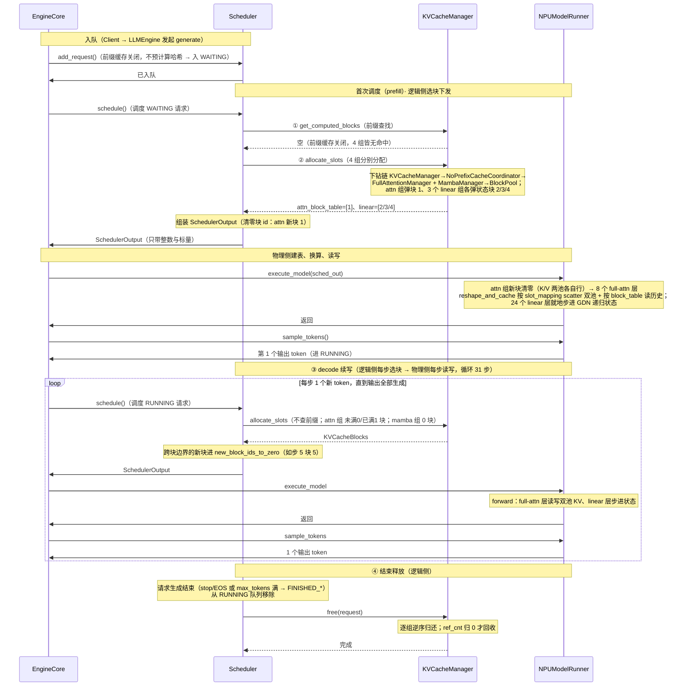
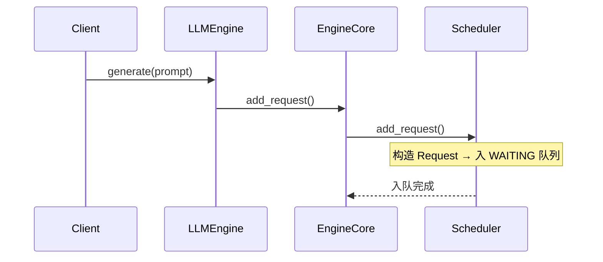
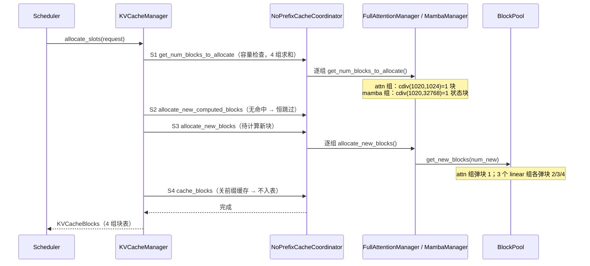
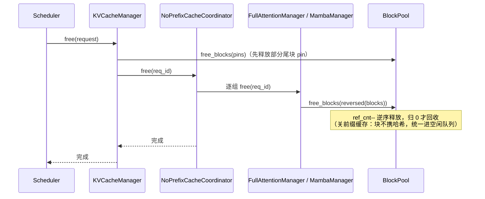
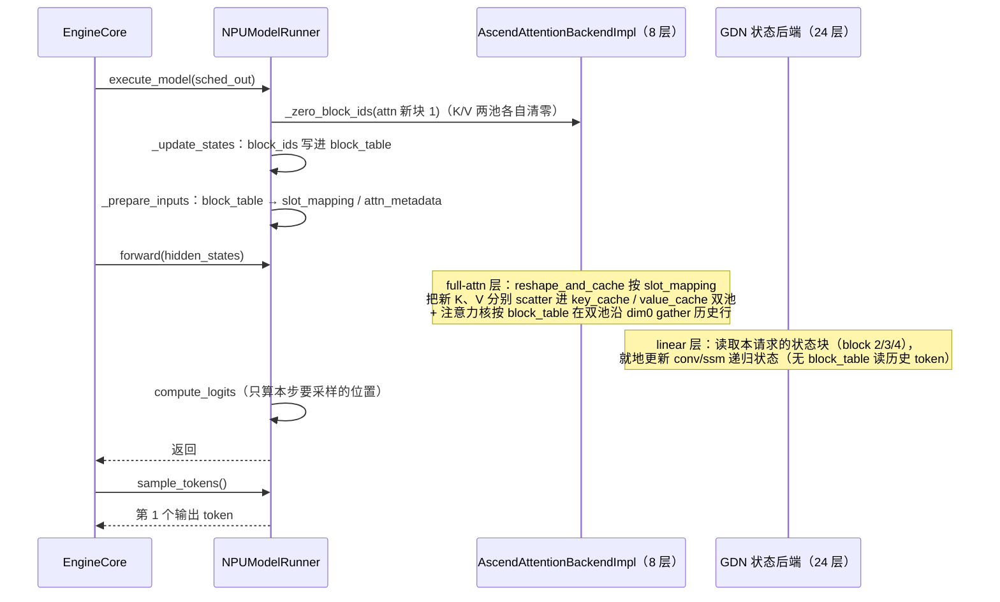

# 一条请求的 KVCache 管理端到端时序（NPU / vllm-ascend 视角 · Qwen3.5-4B GDN 混合 pp2tp2）

> 主线：**GDN 混合模型 Qwen3.5-4B（pp2tp2，4 卡 Ascend NPU 环境）**。它是 Gated DeltaNet（线性注意力）与 Full Attention 的混合体——32 层里 **24 层 `linear_attention`（GDN，产出 `MambaSpec`，单张量状态）+ 8 层 `full_attention`（产出 `FullAttentionSpec`，1024-token 大页 K/V）**，两类 spec 无法 merge，构成**4 个 KV cache group（1 组 attn + 3 组 linear，因分组要求"每组层数相等"）**，由同一个协调器统一编排、共享唯一 `BlockPool`。
>
> **本篇按「两侧」展开运行期**（对齐 [`0_kvcache_arch.md`](./0_kvcache_arch.md) §5）：**逻辑侧（引擎进程）负责"选块、下发"**——`Scheduler` 为请求选定 `block_id`；**物理侧（worker 进程）负责"建表、换算、读写"**——收到 `SchedulerOutput` 后对物理张量写入本步新 K/V、读取历史 K/V。两侧仅靠 `block_id` 与标量参数衔接。

> **部署拓扑**：PP2 × TP2 = 4 卡，每个 worker 负责 16 层（**12 linear + 4 full attn**）、full attn 的 KV 头 4→2（TP2 切分）。调度器视角下全模型是 **4 个 group（1 组 attn + 3 组 linear）**，对 PP/TP 布局透明。

> **实测数字（Qwen3.5-4B，2026-10-16，见部署篇 [`3_deploy_qwen35_pp2tp2.md`](./3_deploy_qwen35_pp2tp2.md)）**：attn 组 `block_size = 1024`、`num_blocks ≈ 6003`（= 6,147,276 tokens ÷ 1024）、每卡 KV 可用 **51.90 GiB**；full-attn 每 rank 2 KV 头 / head_dim 256；mamba 组 `block_size = max_model_len = 32768`（前缀缓存关闭 → 整序列压进一个状态块，见 §1）。

> **混合模型约束（本篇贯穿）**：
> ① **前缀缓存强制关闭**（`enable_prefix_caching=False`）——GDN 递归状态没有"逐 token 增量"，链式哈希前缀复用不成立：逻辑侧前缀查找恒空、S2 touch 恒跳过，全流程只走新块分配 / 释放；
> ② **两类层 block_size 不同**（attn 1024 / mamba 32768）——逻辑侧对4 组分别下钻各自的 manager；
> ③ **执行路径分叉**：8 个 full-attn 层在物理侧走 `reshape_and_cache` 写 K/V 双池 + 按 `block_table` 读历史，24 个 linear 层只做**状态原地步进**、无"读历史 token"路径；
> ④ attn 块是 **1024-token 大页**（16 → 128 → 1024 三级跳与页统一全链见启动篇 [`1_start_init.md`](./1_start_init.md) §2.0）。

---

## 1. 模型配置与框架配置

下文所有阶段共用同一请求示例，模型固定为 Qwen3.5-4B（架构 `Qwen3_5ForConditionalGeneration`），部署于 pp2tp2（4 卡 Ascend NPU）。

`config.json` 的 `text_config` 里 `layer_types` 显示 **24 × `linear_attention` + 8 × `full_attention`**（`full_attention_interval=4`，即每 3 层 GDN 插 1 层全注意力）：

| 参数 | 值 | 说明 |
|---|---|---|
| `num_hidden_layers` | 32 | 24 linear + 8 full attn；**两类层各成一个 KV group**，共享同一套 `block_id` |
| full attn：`num_attention_heads` / `num_key_value_heads` / `head_dim` | 16 / 4 / 256 | GQA，4 个 KV 头 |
| GDN：`linear_num_key_heads` / `linear_num_value_heads` / `head_dim` / `conv_kernel` | 16 / 32 / 128 / 4 | 门控 DeltaNet 递归状态；块内**存 state 而非 token K/V** |
| `hidden_size` / `intermediate_size` / `vocab` | 2560 / 9216 / 248320 | 4B 级小模型 |
| `mamba_ssm_dtype` | float32 | GDN 状态精度 |
| `mtp_num_hidden_layers` | 1 | 含 1 层 MTP（本次未启投机解码） |

**pp2tp2 部署切分**：

| 切分维度 | 全模型 | 每 worker | 说明 |
|----------|--------|-----------|------|
| PP2（按层切） | 32 层（24 lin + 8 attn） | 16 层（12 lin + 4 attn） | `get_layers_start_end_indices()` 按 `pp_rank` 切层范围 |
| TP2（按 KV 头切） | full attn 4 KV 头 | 2 KV 头 | `get_num_kv_heads()` 除以 `tensor_parallel_size`；GDN 状态另按 value 头切 |

vLLM 侧 KV cache 配套参数：

| 参数 | 值 | 说明 |
|---|---|---|
| `block_size`（attn 组） | **1024** | 每块容纳 token 数；混合模型经 mamba 页对齐定为 1024（`patch_mamba_config.py:103`） |
| `mamba_block_size`（mamba 组） | **32768**（= `max_model_len`） | 前缀缓存关闭时 `patch_mamba_config.py:146` 把 mamba 块设为整序列长度——**每请求只占 1 个状态块** |
| `scheduler_block_size` | **32768** | 4 组 block_size 的 **LCM**（`resolve_kv_cache_block_sizes`，kv_cache_utils.py:627） |
| `hash_block_size` | **32768** | 前缀缓存关闭 → 退回等于 scheduler_block_size（kv_cache_utils.py:633-634） |
| `kernel_block_size`（attn 组） | **128** | 算子寻址粒度；一个大块虚拟切成 8×128 |
| `enable_prefix_caching` | **False** | 混合模型强制关闭 |
| `mamba_cache_mode` | `none` | 前缀缓存关闭时随之（`patch_mamba_config.py:137-138` 仅在 kv_transfer 场景升为 `align`） |

**`page_size_bytes`（统一页）**：patch 把两族 spec 的对外页垫到全等 **2,072 KB（= attn 页 2 MB + conv 页 24 KB，padding 1.16%）**——这是4 组能共享同一 `BlockPool`（同一个 block 账本）的前提（数字链见启动篇 §2.0.2）。

基于上述参数，**每 worker** 的 KV cache 物理规模：

| 派生量 | 值 | 说明 |
|---|---|---|
| `num_blocks` | ≈ **6003** | 混合编排结果（6,147,276 tokens ÷ 1024）；跨 worker `min` 对齐后的逻辑块总数，`BlockPool` 建 `KVCacheBlock(0..6002)`（块 0 开池即摘作 `null_block`，实际可分配 6002） |
| full-attn 层（4 层/rank）形态 | 单张连续张量 `2,072 KB × num_blocks`，`view` 成 K/V 各 `(6003×8, 128, 2, 256)` bf16 | 每层 K 池 + V 池；**同一 `block_id` 命中两池同序号行** |
| linear 层（12 层/rank）形态 | 单张量路径，按 `MambaSpec.shapes` 切成 conv / temporal 状态视图 | `"linear_attn" in layer_name` 命中单张量分支（model_runner_v1.py:4118） |

---

## 2. 示例请求

示例以 **Qwen3.5-4B（pp2tp2，NPU）** 为主线。

> 注：下文块号即真实 `block_id`。块 0 开池即被 `BlockPool` 摘作 `null_block`（不分配、不释放），因此示例中所有分配从块 1 起。

**前置说明**：混合模型**前缀缓存关闭**，逻辑侧 `get_computed_blocks` 恒返回空——不存在"命中其他请求缓存"的路径，每个请求都从空块池开始分配。

**示例请求 R**：

```
prompt     = 1020 token
max_tokens = 32
attn 组 block_size = 1024；mamba 组 block_size = 32768
```

R 的 prompt 1020 token：
- **attn 组**：`cdiv(1020, 1024) = 1` 块（块 1，装 1020/1024）；
- **3 个 linear 组**：各 `cdiv(1020, 32768) = 1` 块（块 2/3/4，整序列状态块，此后原地步进、不再增长）。

宏观路径：**入队（WAITING）→ 首次调度 prefill（逻辑侧 4 组各分配各自的块并下发，物理侧写入）→ 每步 decode 续写 1 token（逻辑侧 attn 组跨块边界时申请新块、mamba 组恒 0 块；物理侧步进状态 / 写读双池）→ 结束释放**。

## 3. 端到端两侧分工总览

`EngineCore.step()`（core.py:443）每步驱动 `schedule → execute_model → sample_tokens`。运行期两侧各司其职——**分配在逻辑侧**（Scheduler 为请求选定 block id），**读写在物理侧**（worker 收到 block table 后，对物理张量写入本步新 K/V、读取历史 K/V 各一次）。一条请求 R 从入队到结束，两侧配对如下（阶段 × 两侧）：

| 阶段 | 逻辑侧（引擎进程） | 物理侧（worker 进程） |
|---|---|---|
| 入队 | WAITING；`Request` 构造（前缀缓存关，**不预计算哈希**） | —（尚未涉及任何块） |
| 首次调度 prefill | ① `get_computed_blocks`（恒空）→ ② `allocate_slots`（4 组各 1 块）→ 下发 `SchedulerOutput`（attn 新块 1） | `_zero_block_ids` 清零 attn 块 1 → forward：8 层写双池 1020 token KV、24 层状态初始化 → 采样第 1 个 token |
| 续步 decode | `allocate_slots`：attn 组 0/1 块（跨块边界）、mamba 组恒 0 块 → 下发增量新块 | forward：full-attn 层读写双池 KV、linear 层就地步进 → 采样下一个 token |
| ⋮ | 重复续步，直到 EOS 或 max_tokens | — |
| 结束 | `free()`：逐组逆序归还，`ref_cnt` 归 0 才回收 | —（此后不再读写） |

**一条请求的端到端过程（编号速览）**（示例 R：prompt = 1020 token / max_tokens = 32）：

<div style="font-family:ui-monospace,Consolas,'Courier New',monospace;line-height:1.55;font-size:13px">
<div style="white-space:pre;background-color:#f0f0f0">入队 → 请求进入 WAITING 队列</div>
<div style="white-space:pre">├─ 首次调度进行 prefill</div>
<div style="white-space:pre;background-color:#e8f5e9">│  ├─ <span style="color:#1565c0">KVCacheManager.get_computed_blocks</span>（①）# 前缀查找：enable_prefix_caching=False → 恒返回空
│  │  └─ <span style="color:#2e7d32">KVCacheCoordinatorNoPrefixCache.find_longest_cache_hit</span> # 4 组皆返回空块列表</div>
<div style="white-space:pre;background-color:#e3f2fd">│  ├─ <span style="color:#1565c0">KVCacheManager.allocate_slots</span>（②）# 对 4 个 group 分别下钻
│  │  ├─ <span style="color:#2e7d32">Coordinator.get_num_blocks_to_allocate</span> # attn 组 + mamba 组求和，检查空闲块
│  │  │  ├─ <span style="color:#e65100">FullAttentionManager</span>（attn 组）# cdiv(1020,1024)=1 → 需 1 块
│  │  │  └─ <span style="color:#e65100">MambaManager</span>（mamba 组）# cdiv(1020,32768)=1 → 需 1 状态块
│  │  ├─ <span style="color:#2e7d32">Coordinator.allocate_new_computed_blocks</span> # 无命中 → 恒跳过（touch 不发生）
│  │  ├─ <span style="color:#2e7d32">Coordinator.allocate_new_blocks</span> # 为待计算 token 分配
│  │  │  └─ <span style="color:#6a1b9a">BlockPool.get_new_blocks</span> # attn 组弹块 1；3 个 linear 组各弹块 2/3/4 → attn=[1]、linear=[2/3/4]
│  │  └─ <span style="color:#2e7d32">Coordinator.cache_blocks</span> # 前缀缓存关闭 → 不入哈希表（no-op）</div>
<div style="white-space:pre">│  ├─ SchedulerOutput # 下发：清零块 id 仅 attn 组新块 1（mamba 块不进 new_block_ids）</div>
<div style="white-space:pre;background-color:#fff3e0">│  └─ <span style="color:#c62828">NPUModelRunner.execute_model</span>（物理侧）：8 个 full-attn 层写双池 1020 token KV + 读历史；24 个 linear 层状态步进 → sample → 第 1 token</div>
<div style="white-space:pre;background-color:#f0f0f0">→ 请求进入 RUNNING 队列</div>
<div style="white-space:pre;background-color:#f3e5f5">├─ decode（③）# 续写 31 步：attn 块 1 占 1020/1024 → 步 1~4 填满块 1（0 分配）；步 5 申请块 5；步 5~31 落块 5（27/1024 未满）
│  ├─ <span style="color:#1565c0">KVCacheManager.allocate_slots</span> # 逻辑侧每步：attn 组 未满 0 块 / 已满 1 块；mamba 组恒 0 块（原地步进）
│  │  └─ <span style="color:#2e7d32">Coordinator.allocate_new_blocks</span> # 跨块边界步才给 attn 组弹 1 块（步 5）
│  ├─ SchedulerOutput # 下发清零块 id（步 5 的块 5）；0 分配步无清零
│  └─ <span style="color:#c62828">NPUModelRunner.execute_model</span> # 物理侧每步：full-attn 层写/读双池 KV、linear 层步进状态 → sample → 1 个输出 token</div>
<div style="white-space:pre;background-color:#f0f0f0">→ 请求生成结束（stop/EOS 或 max_tokens 满了 → FINISHED_*）→ 从 RUNNING 队列移除</div>
<div style="white-space:pre;background-color:#ffebee">└─ 结束释放（④）# 逻辑侧：attn 组块 1/5、3 个 linear 组块 2/3/4 全部归还空闲队列
   └─ <span style="color:#1565c0">KVCacheManager.free</span>
      └─ <span style="color:#2e7d32">KVCacheCoordinatorNoPrefixCache.free</span> # 逐组下放
         └─ <span style="color:#e65100">FullAttentionManager.free / MambaManager.free</span>
            └─ <span style="color:#6a1b9a">BlockPool.free_blocks</span> # ref_cnt--，归 0 才回收</div>
</div>

**总览时序图**（逻辑侧选块下发 → 物理侧建表读写）：



---

## 4. 分阶段详解（按侧）

### 4.1 逻辑侧（引擎进程）：选块与下发

逻辑侧全程**只认 `block_id`**（不触张量、零显存拷贝），负责入队、前缀查找、分配、下发与释放。编排链固定为 **`KVCacheManager → KVCacheCoordinatorNoPrefixCache →（attn 组）FullAttentionManager +（mamba 组）MambaManager → BlockPool`**（引擎进程内同一份代码、平台无关）。

#### 4.1.1 入队



**要点**：
- 混合模型前缀缓存关闭，Request **不生成** `block_hashes` 前缀哈希链；入队只需构造 `Request` 并置入 WAITING；
- 哈希与 NPU 的"双形态物理布局"无关——它只由 token 序列决定，且本模型根本不参与前缀查找。

#### 4.1.2 首次调度（prefill）：① 前缀查找（恒空）→ ② 分配 → 下发

`schedule()`（scheduler.py:340）每步**先遍历 RUNNING（scheduler.py:378）再遍历 WAITING（scheduler.py:566）**；没有独立的 prefill / decode 全局阶段，只有一个共享 `token_budget`，按"先 running、后 waiting"填充。

**① 前缀缓存查找（get_computed_blocks）——恒空**。混合模型前缀缓存关闭，工厂（kv_cache_coordinator.py:702）在 `enable_caching=False` 时直接返回 **`KVCacheCoordinatorNoPrefixCache`**（注释原文："supports arbitrary numbers of KV cache groups (including 0 groups). Does not implement any features related to prefix caching."）——它支持任意多组，但**不实现任何前缀缓存特性**：`find_longest_cache_hit` 固定返回"每组一个空列表 + 命中长度 0"，不做任何查表；因此 **S2（touch 命中块）在每一步都跳过**。**结合请求 R**：① 返回空 → `hit_length = 0`，R 的全部 1020 token 都需现算。

**② 分配物理块（allocate_slots）——4 组分别下钻**。协调器把每一步**同时下发给 4 个 manager**（`single_type_managers` 是"每 group 一个"的元组，kv_cache_coordinator.py:106-119）；内部四步：



- **S1 容量检查**：遍历 4 组各自算需求并求和，`available_blocks = get_num_free_blocks() − reserved_blocks`，不够则 `return None` → 等待下轮调度。**attn 组** `num_new = max(cdiv(1020,1024) − 已持块数, 0) = 1`；**3 个 mamba 组** 各走基类逻辑 `cdiv(num_tokens, 32768)`，因 `mamba_block_size ≥ 序列长度` → **每组每请求恒 1 块**；
- **S2 处理命中块**：**本模型恒跳过**（无命中块、`num_external_computed_tokens=0`）；
- **S3 分配待计算块**：逐组 `get_new_blocks(num_new)`；**注意 mamba 组的块不进 `new_block_ids`**（基类只在 `FullAttentionSpec`/`MLAAttentionSpec` 等类型上登记，single_type_kv_cache_manager.py:284-289）——**mamba 状态块因此不参与"新块清零"**；
- **S4 缓存满块**：前缀缓存关闭时 `BlockPool(enable_caching=False)` 不往哈希表写条目，S4 不产生任何缓存动作。

**下发 SchedulerOutput**：② 分配完后，Scheduler 把"后处理指令"打包进 `SchedulerOutput`——**清零新块** `new_block_ids_to_zero`：新分配的 attn 块在 NPU 显存里可能残留上一请求的旧 K/V，必须先清零再写入；**只有 attn 组的新块进入该列表**。**结合请求 R**：attn 组新块 1 进 `new_block_ids_to_zero`（3 个 mamba 状态块 2/3/4 不清零）。

**4 组 block_table 并存**（混合模型与单组模型的直观差别）：

| 组 | manager | block_size | 每请求块数（R） | block_table | 物理落点 |
|---|---|---|---|---|---|
| attn 组（8 层） | `FullAttentionManager` | 1024 | `cdiv(1020,1024)=1` | `[1]` | K/V 双池 `(nb×8,128,2,256)` 的对应行 |
| linear 组 ×3（各 8 层） | `MambaManager` ×3 | 32768 | 各组 `cdiv(1020,32768)=1` | `[2]` / `[3]` / `[4]` | 单张量状态视图（conv + temporal），每层各一张 |

> **为什么线性层是 3 组而非 1 组**：分组要求「每组层数相等」（`_get_kv_cache_groups_uniform_page_size`，kv_cache_utils.py:1074），取 `group_size = min(8 层 attn, 24 层 mamba) = 8` → attn 1 组、mamba `cdiv(24,8)=3` 组（`layers[i::3]` 交错切分）。详见启动篇 §2.3②。

4 组**共享同一个 `BlockPool`**（唯一块账本、`num_blocks ≈ 6003` 的 `block_id` 空间），但**各持一份 `req_to_blocks[req_id]`**；`block_id` 在 4 组间不互通，物理层按组分别解释。**本步全程在引擎进程、零显存操作**。

#### 4.1.3 decode 续写（每步选块）

`schedule()` 每步**先遍历所有 RUNNING 请求**（`while req_index < len(running) and budget > 0`），每请求 append 1 token，全部处理完后**一次性** `execute_model + sample_tokens`（多请求共享同一 batch）。与 prefill 走**同一套** `allocate_slots`（内部 4 步 S1~S4），差异仅在量级：

- **attn 组**：当前块未满则 0 块、写满则 1 块；
- **mamba 组**：恒 0 块（整序列状态块只分一次，此后原地步进）；
- **前缀缓存关闭 → 无"满块入表"**：decode 每步的 `cache_blocks` 都不往哈希表写条目（对比可缓存模型的持续积累，这里始终为空）；
- 跨块边界的新块进 `new_block_ids_to_zero`（0 分配步无清零）。

**结合请求 R**：prefill 后 attn 块 1 装 1020 token，decode 步 1~4 填满块 1（0 分配）；步 5 申请块 5；步 5~31 的 27 个 token 落块 5（未满）；3 个 linear 组块 2/3/4 全程原地步进、块数不变。

#### 4.1.4 结束释放



**要点**：`free`（kv_cache_manager.py:438）内部由 `KVCacheCoordinator.free`（:446）**逐组下放**给 4 个 manager；每个 manager 在 `free(req_id)`（single_type_kv_cache_manager.py:363）内一次完成 `req_to_blocks.pop` + `free_blocks(reversed(blocks))`（**逆序释放**：尾块先归还）；`ref_cnt > 0` 的共享块仅减计数、归 0 才进空闲队列；**前缀缓存关闭 → 无"带哈希块 vs 无哈希块"的分流**，释放后统一回到空闲队列。**释放全程零显存操作**（NPU 上行内容原样留驻）。**结合请求 R**：逐组释放——attn 组块 5、1 逆序归还；3 个 linear 组块 2/3/4 归还。

### 4.2 物理侧（worker 进程）：建表、换算、读写

**这一节是设备执行链（NPU 特有部分）**：逻辑侧前驱（`SchedulerOutput` 已带4 组 block_table + 清零块 id）完成后，由 `NPUModelRunner.execute_model` 在 NPU 上执行。混合模型的关键点是**同一份 forward 里两类层走两条路径**。



**收到下发后按序完成四步**（与 [`0_kvcache_arch.md`](./0_kvcache_arch.md) §5 的一次前向全貌一致）：

- `_update_states`：把下发的 block_ids 写进 `block_table`（新请求首行全量写入，老请求 `append_row` 追加增量）；
- `_prepare_inputs`：由 `block_table` 换算 `slot_mapping` / `attn_metadata`，即 `slot = block_id × 128 + 细块内偏移`，padding 位填 `PAD_SLOT_ID`，且只覆盖本步新算的 token，历史不重算；
- `_model_forward`：逐层先算 Q/K/V，用 `reshape_and_cache` 按 slot 写入本步 K/V，再按 `block_table` 读取历史 K/V（含本步刚写入的行）——写与读相邻但并非两个阶段：第 l 层写完即读，随后才进第 l+1 层；
- `compute_logits`：只对本步要采样的位置算 logits，供后续采样。

**两类层两条路径（混合模型核心）**：

- **full-attn 层（8 层）**：`reshape_and_cache`（attention_v1.py:1430-1454）把新 token 的 K、V 按 `slot_mapping` **分别 scatter 进两池**，随后注意力核按 `block_table` 在两张池上各自 `gather` 历史行 → **写 + 读历史**都在这一步；
- **linear 层（24 层）**：GDN 只维护**每请求一个递归状态块**（每组块 2/3/4），每步在块内**原地步进**（conv 状态 + ssm 状态更新），**没有"按 block_table 读历史 token K/V"的路径**——这是混合模型解码只依赖定长状态、但前缀缓存不成立的根本原因；
- **`_zero_block_ids` 清零只针对 attn 组的 K/V 双池**：mamba 状态块不进 `new_block_ids`，无需清零；
- **attn 大块的 8 倍展开**：逻辑 `block_size=1024`、算子 `kernel_block_size=128`——一个逻辑大块物理上 `view` 成 8 个 128-token 细块（`get_supported_kernel_block_sizes()` 含 128），slot 映射走 128 粒度；
- **`slot_mapping` 与 `block_table` 的关系**：`slot = block_id * 128 + 细块内偏移`——每个 token 一个槽位，**同一个 slot 值同时定位 K 池与 V 池的同一位置**；
- **GDN 计算路径**：启动日志 `Using Triton/FLA GDN prefill kernel (head_k_dim=128)`；异步调度开启。

**结合请求 R**：attn 组新块 1 先清零（K/V 双池各自 8 个 128 细块）；一次 forward 里 8 个 full-attn 层写入 1020 token 的 K/V（无历史可读、全程新写），24 个 linear 层把 1020 token 压进块 2/3/4 的状态视图。

#### 4.2.1 prefill 与 decode 的统一

> 首次 prefill（4.1.2）与 ④ decode 续写（4.1.3）在物理侧共用同一套 **建表 → 换算 → 写入 → 读取** 骨架，只是规模不同。**唯一的阶段差异**在量级：prefill 一次算整段 prompt（attn 组一次多块、mamba 组 1 块），decode 每步 1 个 token（attn 组 0/1 块、mamba 组 0 块）。

| 维度 | prefill（WAITING 首次） | decode（RUNNING 续写） |
|---|------|------|
| 处理 token 数 | 一次整个 prompt（1020 个） | 每步 1 个 |
| 逻辑侧前缀查找 | 调用了但恒空（`NoPrefixCacheCoordinator`） | 同样恒空 |
| 逻辑侧 attn 组分配块数 | 一次 1 块（`cdiv(1020,1024)`） | 0 或 1 块 |
| 逻辑侧 mamba 组分配块数 | 1 状态块（整序列） | 0 块（原地步进） |
| 内部 4 步 | S1/S3/S4 走，S2 恒跳过 | 同左 |
| 物理侧 full-attn 层 | 写入 prompt K/V（无历史可读） | 写本步 + 读历史（`DecodeOnly`） |
| 物理侧 linear 层 | 状态初始化 | 状态原地步进 |
| 状态机 | `WAITING → RUNNING` | 保持 `RUNNING` 直到完成 |

---

## 5. 小结：一条请求的 KVCache 全生命周期（两侧视角）

全文以一条请求 R（Qwen3.5-4B pp2tp2 NPU，prompt 1020 token / max_tokens 32）为主线，按**两侧**串起 KVCache 管理的端到端时序。

**流程视角——五个阶段一气呵成**：

| 阶段 | 章节 | 逻辑侧（引擎进程） | 物理侧（worker 进程） |
|---|---|---|---|
| 入队 | 4.1.1 | `add_request` 入 WAITING（前缀缓存关、不生成哈希链） | — |
| 首次调度 prefill（①②） | 4.1.2 / 4.2 | 前缀查找（恒空）→ 4 组分配 → 下发 SchedulerOutput | 清零新块 → 写双池 / 状态初始化 → 采样第 1 token |
| decode 续写 | 4.1.3 / 4.2 | 每步选块（attn 组 0/1、mamba 组 0） | 每步写读双池 / 步进状态 → 采样 |
| 结束释放 | 4.1.4 | `free` 逐组逆序归还，`ref_cnt` 归零才回收 | —（不再读写） |

状态机全路径：`WAITING →(首次调度) RUNNING →(持续 decode) → 完成 → 释放`。

**结构视角——逻辑侧一条下钻链，物理侧两类张量**：

逻辑侧对 KV 的每一次操作（查、分、放）都走同一条链 `KVCacheManager → KVCacheCoordinatorNoPrefixCache → (FullAttentionManager + MambaManager) → BlockPool`：上层管编排时机，中层按 group **各管一摊**，底层 `BlockPool` 管唯一的逻辑块记账（free 队列 + `ref_cnt`）。**整条链只认 `block_id`、零显存拷贝**。物理侧是初始化时绑在各 NPU worker 上的两类张量（full-attn 的 K/V 双池 + linear 的单张量状态），靠 `block_id == 张量行号` 的约定与逻辑侧桥接。

**数据视角——R 的 4 个 group 各行其是**（块 0 开池即摘作 `null_block`）：

```
attn 组  块 1 承载 prompt 1020 token → decode 填满 → 块 5 承接 27 token（未满）→ 释放回收
linear 组×3 块 2/3/4 承载整序列 GDN 递归状态（各 1 块，全程原地步进）→ 释放回收
```

- **两类层块数口径不同**：attn 组随序列增长（1024-token 一块），mamba 组恒 1 块（`block_size = max_model_len`）；
- **前缀缓存关闭**：没有任何"满块入表 → 后续命中"的积累路径，块的复用只发生在**释放后重新分配**——这是混合 GDN 模型在 NPU 上的定态。