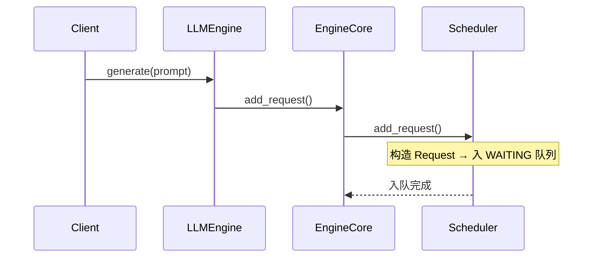
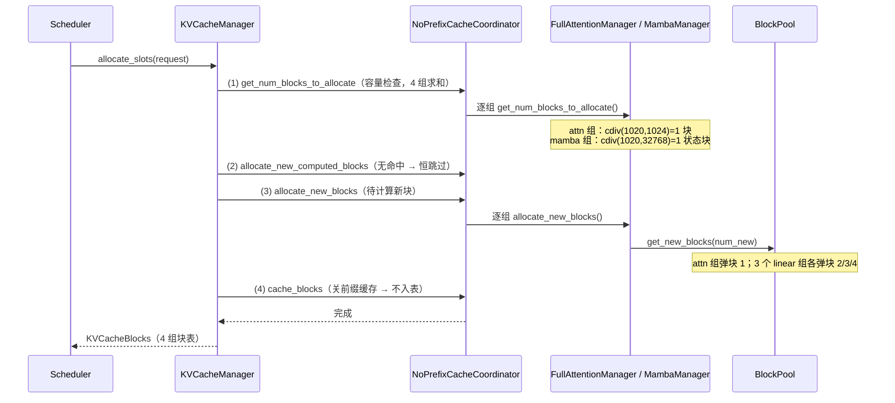
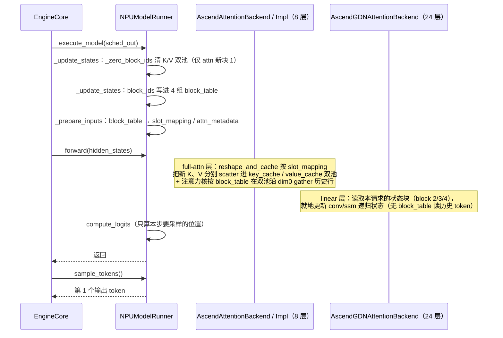
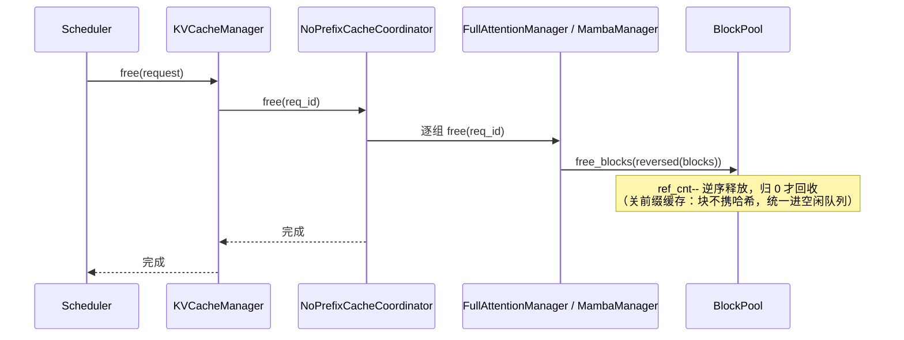

# vLLM-Ascend（NPU）系统运行期

本文讲 Ascend NPU 上**系统运行期的 KVCache 管理**，统一以 hybrid 模型 **Qwen3.5-4B**（架构 `Qwen3_5ForConditionalGeneration`）为例。

全文以一条真实请求 R（prompt 1020 token / max_tokens 32）为主线，分 **prefill（§4）** 与 **decode（§5）** 两章：prefill 从逻辑侧分配讲到物理侧写入；decode 则分**两种情形**——续写不申请新块、续写申请新块——各自给出从逻辑侧到物理侧的完整流程。

## 1. 模型与环境

**模型配置**：

| 配置项 | 值 | 含义 / 对 KVCache 的影响 |
|---|---|---|
| `num_hidden_layers` | **32** | 24 `linear_attention` + 8 `full_attention`（`full_attention_interval=4`，每 3 层 GDN 插 1 层全注意力） |
| full attn：`num_attention_heads` / `num_key_value_heads` / `head_dim` | 16 / 4 / 256 | GQA，4 个 KV 头；TP2 后每 rank 2 头（每 token K 页 = 2 × 256 × bf16 = 1 KB） |
| GDN：`linear_num_key_heads` / `linear_num_value_heads` / `head_dim` / `conv_kernel` | 16 / 32 / 128 / 4 | 递归状态；块内**存 state 而非 token K/V**（TP2 后 value 头 16） |
| `hidden_size` / `intermediate_size` / `vocab_size` | 2560 / 9216 / 248320 | 4B 级小模型 |
| `mamba_ssm_dtype` | float32 | GDN 状态精度（决定 temporal 状态页 = 1 MB） |
| `max_model_len` | 32768 | 前缀缓存关闭（`mamba_cache_mode=none`）时 mamba 组的 `mamba_block_size`；开启前缀缓存（`align`）后改为 `block_size` |
| `mtp_num_hidden_layers` | 1 | 含 1 层 MTP（本次未启投机解码） |

**环境一览**：

| 项 | 值 |
|---|---|
| vllm / vllm-ascend | 0.23.0 / 0.23.0 |
| 模型 | Qwen3.5-4B |
| 并行策略 | PP2 × TP2 |

服务启动命令如下：

```bash
vllm serve /xxx/qwen3-5-4b --pipeline-parallel-size 2 --tensor-parallel-size 2 --served-model-name qwen3.5-4b --port 8100 --max-model-len 32768 > vllm_qwen35_pp2tp2.log 2>&1 &
```

> **实测数字（Qwen3.5-4B，2026-10-16，见部署篇 [`3_deploy_qwen35_pp2tp2.md`](./3_deploy_qwen35_pp2tp2.md)）**：attn 组 `block_size = 1024`、`num_blocks ≈ 6003`（= 6,147,276 tokens ÷ 1024）、每卡 KV 可用 **51.90 GiB**；full-attn 每 rank 2 KV 头 / head_dim 256；mamba 组 `block_size = max_model_len = 32768`（前缀缓存关闭 → 整序列压进一个状态块，见启动篇 [`1_start_init.md`](./1_start_init.md) §2.1 0b）。

运行期始终由**两侧**接力完成一次 KV 操作：

- **逻辑侧（引擎进程）负责"选块、下发"**——`Scheduler` 为请求选定 `block_id`；
- **物理侧（worker 进程）负责"建表、换算、读写"**——收到 `SchedulerOutput` 后对物理张量写入本步新 K/V、读取历史 K/V。

两侧仅靠 `block_id` 与标量参数衔接，唯一耦合点是 **`block_id` → 组内块表 → 张量 dim0 行**（attn 组按 8 细块展开）。

---

## 2. 示例请求 R

> 注：下文块号即真实 `block_id`。块 0 开池即被 `BlockPool` 摘作 `null_block`（不分配、不释放），因此示例中所有分配从块 1 起。

**前置说明**：混合模型**默认不开启前缀缓存**（`mamba_cache_mode=none`、`mamba_block_size=max_model_len`），逻辑侧 `get_computed_blocks` 恒返回空——不存在"命中其他请求缓存"的路径。开启前缀缓存后模式切为 `align`，见 §6。

**示例请求 R**：

```
prompt     = 1020 token
max_tokens = 32
attn 组 block_size = 1024；mamba 组 block_size = 32768
```

- **attn 组**：`cdiv(1020, 1024) = 1` 块（块 1，装 1020/1024）；
- **3 个 linear 组**：各 `cdiv(1020, 32768) = 1` 块（块 2/3/4，整序列状态块，此后原地步进、不再增长）。

**编号约定**：用「**前向 k**」统一编号第 k 次 `execute_model`；`prefill` 是前向 1，`decode 第 n 轮` 是前向 n+1。R 的 32 个输出 token 由 32 次前向产出：前向 1 采样 token 1，之后每轮"追加上一 token → 采样下一 token"。

| 阶段 | 前向 | 本步新算 token | 步末序列长度 | attn 组块 | mamba 组块 |
|---|---|---|---|---|---|
| 入队 | — | — | 0 | — | — |
| prefill | 1 | 1020（整 prompt） | 1020 | 块 1（1020/1024） | 块 2/3/4 |
| decode 1–4（情形 A） | 2–5 | 1 | 1024 | 仍 1 块（满） | 不变 |
| decode 5（情形 B） | 6 | 1 | 1025 | 块 1 + **块 5** | 不变 |
| decode 6–31（情形 A） | 7–32 | 1 | 1051 | 块 1 + 块 5（27/1024） | 不变 |
| 释放 | — | — | — | 归还 | 归还 |

## 3. 运行期总览

### 3.1 两阶段 × 两侧

`EngineCore.step()`（core.py:443）每步驱动 `schedule → execute_model → sample_tokens`。一条请求 R 的四个阶段与两侧动作如下：

| 阶段 | 逻辑侧（引擎进程） | 物理侧（worker 进程） |
|---|---|---|
| 入队（步 0） | WAITING；构造 `Request`（前缀缓存关，**不预计算哈希**） | —（尚未涉及任何块） |
| prefill（§4） | `get_computed_blocks`（恒空）→ `allocate_slots`（4 组各 1 块）→ 下发 `SchedulerOutput`（attn 新块 1） | 清零 attn 块 1 → forward：full-attn 层写双池 1020 token KV、linear 层状态初始化 → 采样第 1 个 token |
| decode（§5） | 每步 `allocate_slots`：attn 组 0/1 块、mamba 组恒 0 块 → 下发增量或空增量 | forward：full-attn 层读写双池 KV、linear 层就地步进 → 采样下一个 token |
| 结束（§5.4） | `free()`：逐组逆序归还，`ref_cnt` 归 0 才回收 | —（此后不再读写） |

### 3.2 共用骨架与 decode 的两种情形

prefill 与 decode 走的是**同一条骨架**——逻辑侧"算需求 → 选块 → 下发"，物理侧"清零 → 建表 → 换算 → 写读 → 采样"；差别只在规模与增量方式。

**逻辑侧三步**（全程只认 `block_id`、零显存拷贝）：

1. **算需求**：`num_computed_tokens + num_scheduled_tokens` → 各组所需块数；
2. **选块**：`allocate_slots` 内依次做容量检查 → 命中块（恒空）→ 取新块 → 满块入哈希（no-op）；
3. **下发**：`SchedulerOutput` 带 `block_ids` / `new_block_ids`、`new_block_ids_to_zero`、`num_scheduled_tokens`。

**物理侧五步**（设备执行链，NPU 特有，§4.2 逐步展开）：

1. **清零**：`_update_states` 内先按 `new_block_ids_to_zero` 清 K/V 双池；
2. **建表**：再把 block_id 写进各组 `block_table`（首步全量写、此后 `append_row` 追加）；
3. **换算**：`_prepare_inputs` 由 `block_table` 算 `slot_mapping` / `attn_metadata`；
4. **写读**：forward 中逐层写本步 K/V（或步进状态），再读历史（或只读状态）；
5. **采样**：只对要采样的位置算 logits，交给 `sample_tokens()` 产出下一个 token。

**decode 的两把钥匙**：每步 decode 只追加 1 个 token，落在哪个情形只看容量检查算出的 `num_new`：

- **情形 A（续写不申请新块）**：`num_computed + 1` 仍在本块容量内 → `num_new = 0` → **无清零、块表不变、只算 1 个 slot**；R 的前向 2–5 与 7–32 都是这一种，占 decode 的绝大多数步；
- **情形 B（续写申请新块）**：本步 token 跨过 1024 边界 → `num_new = 1` → **多一步"清零 + 追加块表"**；R 只有前向 6 是这一种。

判据统一为：`cdiv(num_computed + num_scheduled_tokens, 1024) > 已持 attn 块数` 时才进入情形 B（`num_computed` 是本步首个新 token 的 0-based 序列偏移）。

### 3.3 prefill 与 decode 的差异（参数对照）

| 维度 | prefill（前向 1） | decode（前向 2–32） |
|---|---|---|
| 处理 token 数 | 一次整个 prompt（1020 个） | 每轮 1 个（投机解码为 K 或 1+K） |
| 逻辑侧前缀查找 | 调用但恒空（`NoPrefixCacheCoordinator`） | 不再调用 |
| 逻辑侧 attn 组分配块数 | 一次 1 块（`cdiv(1020,1024)`） | 0（情形 A）或 1 块（情形 B） |
| 逻辑侧 mamba 组分配块数 | 1 状态块（整序列） | 0 块（原地步进） |
| 下发字段 | `block_ids`（4 组全量） | `new_block_ids`（空 / 1 块） |
| 物理侧 full-attn 层 | 写入 prompt K/V（无历史可读） | 写本步 + 读历史（`DecodeOnly`） |
| 物理侧 linear 层 | 状态初始化 | 状态原地步进 |
| 状态机 | `WAITING → RUNNING` | 保持 `RUNNING` 直到完成 |

### 3.4 入队（步 0）



- **逻辑侧**：混合模型前缀缓存关闭，`Request` **不生成** `block_hashes` 前缀哈希链；入队只构造 `Request` 并置入 WAITING。尚未调用 `allocate_slots`，请求名下**一块未占**。
- **物理侧**：还没有 `SchedulerOutput` 下发到 worker，NPU 上无动作。
- **步末状态**：`WAITING`；序列长度 0；`req_to_blocks` 为空。

## 4. Prefill：逻辑侧分配 → 物理侧写入

一次 prefill 的两侧全貌：

```text
━━━━━━━━━━━━━━━━━━━━ 引擎进程 · 逻辑侧 ━━━━━━━━━━━━━━━━━━━━
Scheduler                                    只认 block_id，零显存拷贝、不触张量
  ├─ 选块（4 组同一步下发）
  │    ├─ get_computed_blocks()   仅新请求首步；前缀缓存关闭 → 恒空
  │    └─ allocate_slots()        (1) 容量检查 → (2) touch（恒跳过）→ (3) 弹块 → (4) 入哈希（no-op）
  │         attn 组 cdiv(1020,1024)=1；3 个 mamba 组各 1 状态块
  └─ 下发 SchedulerOutput
       · block_ids（4 组全量）· new_block_ids_to_zero（仅 attn 新块）
       · num_scheduled_tokens
                    │  只传整数与标量
                    ▼
━━━━━━━━━━━━━━━━━━━━ worker 进程 · 物理侧 ━━━━━━━━━━━━━━━━━━━━
NPUModelRunner.execute_model                  前向（本函数内不采样）
  ├─ _update_states    先 _zero_block_ids 清零（仅 attn 新块，K/V 双池）→ 再写 4 组 block_table
  ├─ _prepare_inputs   block_table → slot_mapping / attn_metadata
  │                    slot = 细块行号 × 128 + 行内偏移（≡ block_id × 1024 + 块内偏移）；PAD_SLOT_ID 填充
  ├─ _model_forward    full-attn 层（backend `AscendAttentionBackend` / impl `AscendAttentionBackendImpl`）
  │                    · reshape_and_cache scatter 双池 → 按 block_table 读
  │                    linear 层（backend `AscendGDNAttentionBackend`，层实现 `AscendGatedDeltaNetAttention`）
  │                    · 按状态块写入初始状态（conv / ssm）
  └─ compute_logits    只算本步要采样的位置 → sample 第 1 个 token

两侧唯一耦合：block_id → 组内块表行 → 张量 dim0
  · attn 组：block_id 展开成 8 个连续细块行（b×8 … b×8+7，每行 128 token）
  · linear 组：block_id 直接对应每层 [conv, ssm] 状态张量的首维切片
  · 4 组各一份 block_table，同一个 block_id 在不同组"同号不同义"
```

### 4.1 逻辑侧：查前缀 → 分配 → 下发

逻辑侧全程**只认 `block_id`**（不触张量、零显存拷贝），编排链固定为 **`KVCacheManager → KVCacheCoordinatorNoPrefixCache →（attn 组）FullAttentionManager +（mamba 组）MambaManager → BlockPool`**（引擎进程内同一份代码、平台无关）。

`schedule()`（scheduler.py:340）每步**先遍历 RUNNING（:378）再遍历 WAITING（:566）**，共享一个 `token_budget`，没有独立的 prefill / decode 全局阶段。R 首次被调度，走 WAITING 分支。

#### 4.1.1 前缀查找（恒空）

```text
EngineCore.step()
└─ Scheduler.schedule()                                     scheduler.py:340
   └─ KVCacheManager.get_computed_blocks(request)           kv_cache_manager.py:196
      └─ KVCacheCoordinatorNoPrefixCache.find_longest_cache_hit()
                                                            kv_cache_coordinator.py:370-378
         └─ return ([], [], [], []), hit_length = 0          每组空列表，不做任何查表
```

混合模型前缀缓存关闭，工厂（kv_cache_coordinator.py:704-706）在 `enable_caching=False` 时直接返回 **`KVCacheCoordinatorNoPrefixCache`**（注释原文："supports arbitrary numbers of KV cache groups (including 0 groups). Does not implement any features related to prefix caching."）——它支持任意多组，但**不实现任何前缀缓存特性**：`find_longest_cache_hit` 固定返回"每组一个空列表 + 命中长度 0"，不做任何查表；因此 **处理命中块（touch）在每一步都跳过**。

**结合请求 R**：前缀查找返回空 → `hit_length = 0`，R 的全部 1020 token 都需现算。

#### 4.1.2 分配：4 组分别下钻

```text
KVCacheManager.allocate_slots(req, num_new_tokens)       kv_cache_manager.py:238
├─ (1) 容量检查 → coordinator.get_num_blocks_to_allocate()  :385
│  ├─ FullAttentionManager.get_num_blocks_to_allocate()
│  ├─ MambaManager×3.get_num_blocks_to_allocate()
│  └─ BlockPool.get_num_free_blocks()
├─ (2) 处理命中块 → remove_skipped_blocks()                :381   ← 无命中，空转
├─ (3) 分配待计算块 → coordinator.allocate_new_blocks()     :413
│  ├─ FullAttentionManager → BlockPool.get_new_blocks(1) → block 1
│  └─ MambaManager×3 → BlockPool.get_new_blocks(1) → block 2 / 3 / 4
└─ (4) cache_blocks()                                      :434   ← enable_caching=False，不入哈希表
```

协调器把每一步**同时下发给 4 个 manager**（`single_type_managers` 是"每 group 一个"的元组，kv_cache_coordinator.py:106-119）：



> 记号：`(1)`–`(4)` 是 `allocate_slots` 的**函数内执行顺序**（`kv_cache_manager.py:381-434`），只在本节内引用；与启动篇 `S0`–`S5` 的阶段编号属于不同记号体系，无对应关系。

- **(1) 容量检查**：遍历 4 组各自算需求并求和，`available_blocks = get_num_free_blocks() − reserved_blocks`，不够则 `return None` → 等待下轮调度。**attn 组** `num_new = max(cdiv(1020,1024) − 已持块数, 0) = 1`；**3 个 mamba 组** 各走基类逻辑 `cdiv(num_tokens, 32768)`，因 `mamba_block_size ≥ 序列长度` → **每组每请求恒 1 块**；
- **(2) 处理命中块**：**本模型恒跳过**（无命中块、`num_external_computed_tokens=0`）；
- **(3) 分配待计算块**：逐组 `get_new_blocks(num_new)`；**注意 mamba 组的块不进清零清单 `new_block_ids_to_zero`**（基类只在 `FullAttentionSpec`/`MLAAttentionSpec` 等类型上登记，single_type_kv_cache_manager.py:284-289）——但块号本身仍随 `KVCacheBlocks.get_block_ids()` 按组下发，见 §4.2.4；
- **(4) 缓存满块**：前缀缓存关闭时 `BlockPool(enable_caching=False)` 不往哈希表写条目，此步不产生任何缓存动作。

**4 组 block_table 并存**（混合模型与单组模型的直观差别）：

| 组 | manager | block_size | 每请求块数（R） | block_table | 物理落点 |
|---|---|---|---|---|---|
| attn 组（8 层） | `FullAttentionManager` | 1024 | `cdiv(1020,1024)=1` | `[1]` | K/V 双池 `(nb×8,128,2,256)` 的对应行 |
| linear 组 ×3（各 8 层） | `MambaManager` ×3 | 32768 | 各组 `cdiv(1020,32768)=1` | `[2]` / `[3]` / `[4]` | 单张量状态视图（conv + temporal），每层各一张 |

> **为什么线性层是 3 组而非 1 组**：分组要求「每组层数相等」（`_get_kv_cache_groups_uniform_page_size`，kv_cache_utils.py:1074），取 `group_size = min(8 层 attn, 24 层 mamba) = 8` → attn 1 组、mamba `cdiv(24,8)=3` 组（`layers[i::3]` 交错切分）。详见启动篇 §3.3②。

4 组**共享同一个 `BlockPool`**（唯一块账本、`num_blocks ≈ 6003` 的 `block_id` 空间），但**各持一份 `req_to_blocks[req_id]`**；`block_id` 在 4 组间不互通，物理层按组分别解释。**本步全程在引擎进程、零显存操作**。

#### 4.1.3 下发 SchedulerOutput

```text
EngineCore.step()
├─ Scheduler.schedule()                                   scheduler.py:340
│  └─ 组装 SchedulerOutput
│     ├─ block_ids ← 4 组各自 req_to_blocks[req_id]
│     ├─ new_block_ids_to_zero ← [1]（仅 attn 组新块）
│     └─ num_scheduled_tokens = 1020
└─ NPUModelRunner.execute_model(scheduler_output)         model_runner_v1.py:1950
```

Scheduler 把"后处理指令"打包进 `SchedulerOutput`：

- `block_ids`：4 组全量块表（`[1]`、`[2]`、`[3]`、`[4]`），供 worker 建表；
- `new_block_ids_to_zero`：**清零新块**——新分配的 attn 块在 NPU 显存里可能残留上一请求的旧 K/V，必须先清零再写入；来源见下；
- `num_scheduled_tokens = 1020`。

**`new_block_ids_to_zero` 怎么得到**（四层收拢，`scheduler.py:926-930`）：

```text
BlockPool.get_new_blocks(n)                     block_pool.py:333
  └─ 返回 KVCacheBlock 对象（block_id，ref_cnt=1）
SingleTypeKVCacheManager.allocate_new_blocks()  single_type_kv_cache_manager.py:259-290
  ├─ req_blocks.extend(new_blocks)
  └─ if type(kv_cache_spec) ∈ {FullAttentionSpec, TQFullAttentionSpec, MLAAttentionSpec}:
        self.new_block_ids.extend(b.block_id …)      :284-289   ← mamba 组不登记
KVCacheManager.take_new_block_ids()             kv_cache_manager.py:570-575
  └─ 逐组 drain（取出后置空）→ list[int]
Scheduler.schedule() 末尾                       scheduler.py:926-930
  └─ (take_new_block_ids() or None) if self.needs_kv_cache_zeroing else None
     └─ needs_kv_cache_zeroing = has_mamba_layers   kv_cache_interface.py:873-879
→ SchedulerOutput.new_block_ids_to_zero          scheduler.py:947
```

- **只含"本步新增"**：`take_new_block_ids` 取完即把 `new_block_ids` 置空（single_type_kv_cache_manager.py:292-296），所以清单不会重复包含已持有的历史块。
- **两道过滤**：① manager 层只登记 `FullAttentionSpec` / `TQFullAttentionSpec` / `MLAAttentionSpec`，`MambaSpec` 不登记，mamba 状态块 2/3/4 因此永不清零；② scheduler 层再用 `needs_kv_cache_zeroing` 兜底，本模型有 mamba 层，该值为 True。
- **空清单归一为 `None`**：没有新块时 `take_new_block_ids()` 返回 `[]`，`or None` 把它变成 `None`；worker 端的 `if scheduler_output.new_block_ids_to_zero:` 于是直接跳过。

**结合请求 R**：prefill 步新弹块 1 → `new_block_ids_to_zero = [1]`；decode 续写步无新块 → `None`；跨块步新弹块 5 → `[5]`。

### 4.2 物理侧：清零 → 建表 → 换算 → 写读 → 采样

逻辑侧前驱完成后，由 `NPUModelRunner.execute_model` 在 NPU 上执行。混合模型的关键点是**同一份 forward 里两类层走两条路径**——两类层挂在**两个不同的 attention backend** 上：

| 层类型 | 层数 | attention backend | impl / 层实现 | metadata builder | KVCache 落点 |
|---|---|---|---|---|---|
| full-attn | 8 | `AscendAttentionBackend`（platform.py:824） | `AscendAttentionBackendImpl`（attention_v1.py:397） | `AscendAttentionMetadataBuilder`（:217） | K/V 双池 |
| linear（GDN） | 24 | `AscendGDNAttentionBackend`（gdn_attn_builder.py:933） | `AscendGatedDeltaNetAttention`（ops/gdn.py；patch_qwen3_5.py:199 替换原层） | `AscendGDNAttentionMetadataBuilder`（:223） | 单张量状态 `[conv, ssm]` |

> backend 由 `platform.get_attn_backend_cls` 选定：full-attn 走 `(False, False, False)` → `vllm_ascend.attention.attention_v1.AscendAttentionBackend`（platform.py:822-824）；GDN 层则直接由 `AscendGatedDeltaNetAttention.get_attn_backend()` 返回 `AscendGDNAttentionBackend`（ops/gdn.py:64-65）。



#### 4.2.1 清零：`_zero_block_ids`

 `needs_kv_cache_zeroing`= `has_mamba_layers`是开启清零操作的开关，是否需要清零主要由块池里会不会出现跨 dtype 域的旧比特决定，has_mamba_layers即存在mamba层，一般mamba层的ssm存储dtype是fp32，与full-attn层的K/V池dtype是bf16，所以需要清零K/V双池：

- **纯 full-attn / 纯 MLA 为 `False`，从不清零**：两条不变量保证脏数据无害——①**读范围 ⊆ 已写范围**：新块的第一次访问必然是写（prefill 顺着槽位写），此后读取止于 `actual_seq_lengths_kv`、早已写过；②**即使洞被整页取数碰到，旧值也是有限数**：纯注意力池子里每块历史上只被同 dtype 的注意力层写过，旧值是上一个请求真实算出的 K/V，乘零 mask 的湮灭对有限数成立（越界位 `score → −inf → pᵢ = 0`，`out = Σ pᵢ·vᵢ` 照算，`0 × 有限数 = 0`）。脏数据在数学上变不成 NaN。
- **Qwen3.5-4B 这类混合模型为 `True`，必须清**：mamba 层使块池**跨 dtype 域**——uniform page size 下第 i 个 `KVCacheTensor` 同时被"attn 组第 i 层 + 3 个 mamba 组各自的第 i 层"共用（`shared_by`，kv_cache_utils.py:1318-1326），同一块显存 attn 层按 bf16 解释、mamba 层按 fp32 写（`mamba_ssm_dtype=float32`）。mamba 用过的块释放回池、再被 attn 组弹出时，fp32 原始比特重解释成 bf16 即成 **Inf/NaN**（"leftover fp32 bit patterns can appear as NaN/Inf in the new dtype"）——不变量②失效：乘零 mask 挡不住 NaN（`0 × NaN = NaN`），NaN 进注意力输出 → 残差流 → 后续 GDN 层，被递归状态保留、逐轮放大（issue #35138 的现象即 GSM8K 精度随运行持续劣化）。清零就是在新块使用前重建不变量②（[PR #35219](https://github.com/vllm-project/vllm/pull/35219)，修 issue #35138，flash-attention [#1974](https://github.com/Dao-AILab/flash-attention/issues/1974) 的 workaround）。

**为什么只清 attn 组**：mamba 块的写是整块赋值、初态在前向内部显式清零（§4.2.4），自身安全、也不进清单；attn 块的写是 `reshape_and_cache` 按 `slot_mapping` **散点写**（一个 token 一个槽位），不是整块 memset——逻辑侧释放块不动显存，R 的 prefill 只写 1020 token，块 1 里 `2044…2047` 仍是旧值，这是"覆盖不到的洞"。洞如何变成 NaN：

| 序 | 环节 | 发生了什么 |
|---|---|---|
| 1 | 只读到最后一块 | 算子按 `actual_seq_kvlen`（即 `actual_seq_lengths_kv`）只取 `ceil(seq_len/128)` 个块——**seq_len 之后的整块根本不搬**；但**最后一块是整块搬运**的，`seq_len=1020` 时该块覆盖 896–1023，洞里是 1020–1023 这 4 个位置，随这块一起上片 |
| 2 | mask 的作用面 | mask 只改 score：越界位 `score → −inf` → 权重 `pᵢ = 0`；但 `out = Σ pᵢ·Vᵢ` 仍要做这项乘加，`0 × NaN = NaN`——mask 改的是权重，改不了数值 |
| 3 | K 坏 | `score = Q·Kᵀ` 先得 `Inf/NaN`：加法掩码 `Inf + (−∞) = NaN` 直接报废；覆盖掩码（select 成 −inf）能挡住，但只管 score 这一路 |
| 4 | V 坏 | 越界位 `p=0`，仍 `0 × NaN = NaN` → 整行 `out` 变 NaN，mask 无解 |
| 5 | NaN 传递 | `attn 输出 → 残差流 → 后续 GDN 层`，整段失效——`SchedulerOutput` 注释 "preventing stale NaN/data from corrupting attention or SSM computation"（output.py:238-240）即此意 |

> 清零不是"替代覆盖"，而是"补洞"：把整块（8 个细块行 × K/V 两池）先抹 0，被顺带读到的位置就是 0；代价是每分配一个新块一次 kernel，频次很低。

**一个常见误解：不是"把所有未满块读进来再 mask"**——体积上的"截断"与块内的"整块 + 掩码"是两层不同的事：

| 层次 | 行为 | 由谁决定 |
|---|---|---|
| 块粒度（block_table 有效行） | **截断**：按 `actual_seq_lengths_kv` 只取 `ceil(seq_len / 128)` 个块，其后的**整块不搬** | 算子的 `actual_seq_kvlen` |
| 块内（最后一块的尾部） | **整块搬运 + score 掩码**：尾部 `score → −inf`、`p = 0`，但 V 仍参与 `Σ pᵢ·Vᵢ` 的乘加 | 搬运粒度为页；mask 只改权重 |

所以脏数据的暴露面只有**最后一个不满块的尾部**（单请求最多 127 个位置），而不是"所有历史未满块"。

> **代码旁证**：`attention_v1.py:319-348` 处理 cudagraph / flashcomm 插入的 dummy padding request 时，给它补 `seq_lens = 1` 和一行 `block_table = 0`（指向 `null_block`），注释称"any valid positive KV length / zero block row is fine"。若算子不看 `seq_len` 而按块整读，这行零指向的块就会把整块拉进计算，"fine" 便不成立——反证 **seq_len 决定读几个块**。
>
> **待实证的一点**："最后一块整块参与 V 乘加"属算子内部行为，代码只能间接推断。最小验证实验：只把某请求最后一块尾部（如 1020–1023）写成 NaN、其余保持干净，看输出是否变 NaN。变 → 尾部确实参与乘加，清零必要性闭环；不变 → FIA 在 varlen 下连边界 tile 也裁掉了，清零动机需回到"块被跨 dtype 复用"（该条已由 issue #35138 证实）。

**何时清、清几次**——三个容易误解的点：

| 问题 | 答案 | 依据 |
|---|---|---|
| 只在"分配"时清吗？ | **是**。清单只在 `get_new_blocks()`（从空闲队列 pop）之后登记，共两处：本步新算 token 的块（:284-289）、给外部 KV 预留的空块（:246-257） | single_type_kv_cache_manager.py |
| 命中的前缀块也清吗？ | **不清**。命中块走 `block_pool.touch()`（:231）保活，不进清单——清了反而毁掉刚命中的有效 KV | :229-244 |
| 一个块一生只清一次？ | **不是**。`take_new_block_ids()` 是 drain 语义（docstring："allocated since the last call"，:292-296），所以**每分配一次清一次**：块释放回池、再被别的请求领走时会重新进一次清单 | :292-296 |

**怎么清**——调度器收清单、worker 清显存，两道过滤保证只有 attn 组新块进清零：

```text
调度器（引擎进程）
  scheduler.py:926-930   take_new_block_ids() 填 SchedulerOutput.new_block_ids_to_zero
                         （needs_kv_cache_zeroing=False 时恒 None）
  single_type_kv_cache_manager.py:284-289 / :246-257
                         只登记 FullAttentionSpec / TQFullAttentionSpec / MLAAttentionSpec
                         的新块（本步新算 token + 外部 KV 预留块），mamba 组不登记 ←—— 过滤 ①
worker（NPU 进程）
  worker.py:932-938 → model_runner_v1.py:5138-5144
                         启动期 _init_kv_zero_meta() 构造 AscendKVBlockZeroer
  model_runner_v1.py:1950 → gpu_model_runner.py:1125 → :1103
                         execute_model → _update_states → _zero_block_ids（在建表之前）
  vllm/v1/worker/utils.py:98-109
                         清零器只收集 AttentionSpec 的段，显式跳过 Mamba 层 ←—— 过滤 ②
  vllm/v1/worker/utils.py:191-216
                         块号拷上设备 → 一次 _zero_kv_blocks_kernel 清整批
                         grid = n_blocks × n_segs × (page_size_el / blk_size)
```

**结合 R**：prefill 步清单 `[1]` → 清块 1 的 8 个细块行 × K/V 两池；decode 续写步清单空、跳过；跨块步（§5.2）清单 `[5]` → 清块 5。块 2/3/4（mamba 组）永不动。

**attn 与 mamba 的对照**：

| 项 | attn 组 | mamba 组 |
|---|---|---|
| 写入方式 | `reshape_and_cache` 按 slot **散点写** | `ssm_state[indices] = last_recurrent_state` **整块赋值**（ops/gdn.py:415） |
| 是否留洞 | 会（未调度槽位保留旧值） | 不会（块要么被整块替换，要么只作写目标） |
| 新块保护 | 预先清零（`_zero_block_ids`） | 前向内部清初态拷贝（`clear_ssm_states`，§4.2.4） |
| 是否进清单 | 是 | 否（清单、清零器两道过滤） |

#### 4.2.2 建表：物理块展开成 8 个细块行，写入 4 组 block_table

```text
_update_states()                                          gpu_model_runner.py:1125
├─ 新请求（req_index is None）→ reqs_to_add
│  └─ InputBatch.add_request()                            gpu_input_batch.py:378
│     └─ MultiGroupBlockTable.add_row()                   vllm_ascend/worker/block_table.py:404
│        └─ 逐组 BlockTable.add_row()                      :125
│           └─ _convert_physical_to_logical_blocks()       :288-303（attn 组 ×8 展开）
└─ 老请求（已在 batch 内）
   └─ MultiGroupBlockTable.append_row()                   gpu_model_runner.py:1401
      └─ 逐组 BlockTable.append_row()                      vllm_ascend/worker/block_table.py:108-123
```

清零之后，`_update_states` 把本步块表写进各组的 `BlockTable`。混合模型下 attn 组要先把 `block_id` 展开（vllm_ascend/worker/block_table.py:288-303）：

```python
# vllm_ascend/worker/block_table.py:288-303（节选）
def _convert_physical_to_logical_blocks(self, physical_blocks):
    if not self.use_hybrid_blocks:
        return physical_blocks
    logical_blocks = []
    for phys_block in physical_blocks:
        base_logical = phys_block * self.blocks_per_phys_block
        logical_blocks.extend(range(base_logical, base_logical + self.blocks_per_phys_block))
    return np.array(logical_blocks, dtype=np.int32)
```

`blocks_per_phys_block = 1024 / 128 = 8` 来自构造期：`kernel_sizes=[128]` 中第一个能整除 `physical_block_size` 的值被选作 `block_size`（block_table.py:60-85）。展开后逐行写入（:108-123）：

```python
# vllm_ascend/worker/block_table.py:108-123（节选）
def append_row(self, block_ids, row_idx):
    if not block_ids:
        return
    block_ids = np.array(block_ids)
    if self.use_hybrid_blocks:
        block_ids = self._convert_physical_to_logical_blocks(block_ids)
    start = self.num_blocks_per_row[row_idx]
    self.block_table.np[row_idx, start : start + num_blocks] = block_ids
    self.num_blocks_per_row[row_idx] += num_blocks
```

- **行 / 列语义**：`row_idx` 是请求在 batch 里的槽位，列是逻辑块序号；`num_blocks_per_row[row_idx]` 记录该行已填到哪一列——prefill 首步从 0 开始全量写，decode 只把增量追加到末尾。
- **4 组各自独立**：attn 组 `use_hybrid_blocks=True`（写细块行号）；3 个 mamba 组是 `MambaSpec`，不触发拆分（:56-64），直接写 `block_id`。
- **结合 R**：attn 表第 0 行 = `[8, 9, …, 15]`；3 张 linear 组表 = `[2]` / `[3]` / `[4]`。后面换算读出的 `block_numbers` 就是这些细块行号。

#### 4.2.3 换算：`_prepare_inputs` 产出 slot_mapping

```text
_prepare_inputs()                                     model_runner_v1.py:862
├─ 组装 positions / input_ids / attn_metadata
└─ self.input_batch.block_table.compute_slot_mapping()   :931
   └─ MultiGroupBlockTable.compute_slot_mapping()      vllm_ascend/worker/block_table.py:420
      └─ BlockTable.compute_slot_mapping()             vllm/v1/worker/block_table.py:357-379
         └─ _compute_slot_mapping_kernel：pos → block_indices → block_numbers → slot_ids
```

块表写好后，`_prepare_inputs`（model_runner_v1.py:862）调 `BlockTable.compute_slot_mapping`，由 `_compute_slot_mapping_kernel` 按 position 逐 token 算出槽位（vllm/v1/worker/block_table.py:325-380）：

```python
# vllm/v1/worker/block_table.py:354-380（节选，省略 CP 交织分支）
pos = tl.load(positions_ptr + offsets, mask=mask, other=0)
block_indices = pos // virtual_block_size          # 第几个逻辑块
block_numbers = tl.load(block_table_ptr + row_offset + block_indices)  # 该块的细块行号
virtual_block_offsets = pos - block_indices * virtual_block_size       # 块内偏移
slot_ids = block_numbers * block_size + local_block_offsets            # 行号 × 128 + 行内偏移
slot_ids = tl.where(is_local, slot_ids, PAD_ID)
```

- **三步换算**：`pos // 128` 得逻辑块下标 → 查表得细块行号 → `行号 × 128 + 行内偏移`。因为行号 = `block_id × 8`，结果等价于 `block_id × 1024 + 块内偏移`，两种写法同一含义。
- **CP 分支**：`virtual_block_size = block_size × TOTAL_CP_WORLD_SIZE`；本例 pp2tp2、CP=1，退化为上面三行。
- **只算本步新 token**：kernel 循环范围是 `[query_start_loc[i], query_start_loc[i+1])`；历史 token 不重算，padding 位填 `PAD_ID`。
- **结合 R（prefill）**：positions 0…1019 → 逻辑块 0…7 → 表项 8…15 → slot **1024…2043**；同一批 slot 同时用于 K 池与 V 池（两池行空间同序）。

#### 4.2.4 写读：full-attn 写双池，linear 原地步进

```text
execute_model()                                  model_runner_v1.py:1950
└─ _model_forward()                              model_runner_v1.py:2834
   └─ for layer in 32 层
      ├─ Attention.forward()                     vllm/model_executor/layers/attention/attention.py:492
      │  └─ AscendAttentionBackendImpl.forward_impl()        attention_v1.py:1532
      │     ├─ reshape_and_cache()                        :1436-1453
      │     │  └─ DeviceOperator.reshape_and_cache(key, value, k_cache, v_cache, slots)
      │     └─ notify_kv_cache_written()                 vllm_ascend/attention/utils.py:459-476
      └─ AscendGatedDeltaNetAttention.forward()             ops/gdn.py:67
         └─ torch.ops.vllm.qwen_gdn_attention_core
            └─ _forward_core()                              ops/gdn.py:147
               └─ conv / ssm 状态按 state_indices 原地步进   qwen_gdn_linear_attn.py:1308-1316
```

`_model_forward`（model_runner_v1.py:2834）逐层执行；层类型决定读写方式，且**写与读在同一层内相邻完成**（第 l 层写完即读，随后才进第 l+1 层）。

**full-attn 层（`AscendAttentionBackendImpl`）**：`forward_impl`（attention_v1.py:1532）调 `reshape_and_cache`（:1436-1453）：

```python
# vllm_ascend/attention/attention_v1.py:1439-1453（节选）
if len(kv_cache) > 1:
    if self.key_cache is None:
        self.key_cache, self.value_cache = kv_cache[0], kv_cache[1]
    slots = attn_metadata.slot_mapping
    DeviceOperator.reshape_and_cache(
        key=key[: attn_metadata.num_actual_tokens],
        value=value[: attn_metadata.num_actual_tokens],
        key_cache=self.key_cache,
        value_cache=self.value_cache,
        slot_mapping=slots[: attn_metadata.num_actual_tokens],
    )
    notify_kv_cache_written()
```

- **写**：按 `slot_mapping` 把本步 K、V scatter 进两张池（两池共用同一批 slot）。
- **读**：注意力核立刻用同一份块表/ slot 在 dim0 上 gather 历史行（含刚写入的行）。prefill 时历史为空，等价"全写"；decode 时 `attn_state = DecodeOnly`，历史按块表增长。
- `notify_kv_cache_written()` 只给 KV connector 发"本步已写"信号（vllm_ascend/attention/utils.py:459-476），没有连接器时直接返回。
- 另一条等价入口是 `do_kv_cache_update`（attention_v1.py:1408-1428，走统一算子 `unified_kv_cache_update`）；Ascend backend 的 `forward_includes_kv_cache_update` 为默认 `True`（vllm/v1/attention/backend.py:66），所以实际走上面的快路径。

**linear 层（`AscendGatedDeltaNetAttention`，backend `AscendGDNAttentionBackend`）**：不写 K/V，只对状态块原地步进（qwen_gdn_linear_attn.py:1308-1316）：

```python
# qwen_gdn_linear_attn.py:1308-1316（节选）
self_kv_cache = self.kv_cache
conv_state = (self_kv_cache[0] if is_conv_state_dim_first()
              else self_kv_cache[0].transpose(-1, -2))
ssm_state = self_kv_cache[1]
```

随后按 `attn_metadata` 里的 state indices 定位本请求的状态块（表里的块 2/3/4），卷积与 SSM 递推**就地覆盖**——没有"按 block_table 读历史 token"的路径，这正是混合模型只靠定长状态解码、前缀缓存不成立的根本原因。

**GDN 的"清零"发生在 prefill 的前向内部，顺序是"读 → 清 → 算 → 写"，清的不是 cache 块**（NPU 路径 ops/gdn.py:384-415）：

```python
# vllm_ascend/ops/gdn.py:400-415（节选）
initial_state = ssm_state[prefill_state_indices].transpose(-1, -2).contiguous()
clear_ssm_states(initial_state, prefill_has_initial_state)   # 只把"无历史"的行写 0
(core_attn_out, last_recurrent_state) = chunk_gated_delta_rule(
    ..., initial_state=initial_state, output_final_state=True, ...)
ssm_state[prefill_state_indices] = last_recurrent_state.transpose(-1, -2).contiguous().to(ssm_state.dtype)
```

- **时序在同层 forward 内**：**(1) 读**——高级索引 `ssm_state[prefill_state_indices]` 把状态块**拷贝**成 `initial_state`；**(2) 清**——`clear_ssm_states` 就地对这份拷贝按行置 0；**(3) 算**——`chunk_gated_delta_rule(initial_state=initial_state)` 用这份初态做递推；**(4) 写**——`ssm_state[prefill_state_indices] = last_recurrent_state` 整块覆盖。清零夹在"读拷贝"和"整块写回"之间，所以它既不是 forward 前的独立步骤，也不会改到 cache 块。
- **触发条件**：只在 `num_prefills > 0` 的分支执行；`prefill_has_initial_state = context_lens_tensor > 0`（ops/gdn_attn_builder.py:912），即"该请求是否已有历史状态"。R 的首个 prefill 为 False（其行被清 0），后续 chunk 续算为 True（保留块内已有状态）。
- **清零对象是拷贝，不是块**：`ssm_state[indices].contiguous()` 由高级索引先复制出一份临时 `initial_state`，`clear_ssm_states` 启动 `_clear_ssm_states_kernel`，只把其中 `has_initial_state == False` 的行写 0（vllm_ascend/ops/triton/fla/utils.py:79-131）；cache 块里即使有旧值也不会被读到。
- **cache 由下一行整块覆盖**：`ssm_state[prefill_state_indices] = last_recurrent_state`。decode 分支则走 `fused_sigmoid_gating_delta_rule_update(initial_state=ssm_state, inplace_final_state=True)`，读的是本请求上一步写下的状态，不清零。
- **与 §4.2.1 的区别**：§4.2.1 的 `_zero_block_ids` 是 forward 之前对 **attn 块显存**的独立清零；GDN 这次清零发生在 forward 内部、作用于**初态拷贝**，mamba cache 块本身始终不清。

**取数路径**（两类层都按 dim0 索引）：

```python
# full-attn：dim0 = nb×8 个 128-token 细块行
rows = expand_8x(fm_blocks(request_id))   # 块表里已是 b×8 … b×8+7
k = kv_caches[layer][0][rows]             # K 池 fancy index
v = kv_caches[layer][1][rows]             # V 池同一批行号
# slot = 细块行号 × 128 + 行内偏移 ≡ block_id × 1024 + 块内偏移

# linear：单张量状态，无 block_table 读历史
state = state_cache[layer][gm_blocks(request_id)][state_indices]
```

- **block 轴恒为 dim0**：KV 传输注册要求 buffer dim0 = `num_blocks`、地址 2 MiB 对齐，因此运行时不需要哨兵探测。
- **块级搬移**：同一 backend 的 `swap_blocks`（attention_v1.py:114-126）与 `copy_blocks`（:128-140）用 Python 索引赋值整块搬移，是 P/D、offload、前缀复用的底层落点。
- **结合 R**：full-attn 层把 1020 token 写进 slot 1024…2043；linear 层把状态写进块 2/3/4。

**mamba 组怎么知道用自己的哪个 `block_id`**（块号有两条独立通道，别和清零清单混淆）：

```text
逻辑侧
  MambaManager.req_to_blocks[req_id] = [2]（或 [3] / [4]，每组各自维护）
    └─ KVCacheBlocks.get_block_ids() → SchedulerOutput.block_ids 的第 2/3/4 项
物理侧：建表
  InputBatch.add_request → MultiGroupBlockTable.add_row(4 组 block_ids)   gpu_input_batch.py:378
    └─ 每个 mamba 组各有一行 BlockTable，行首就是状态块号（none 模式下每请求 1 块）
物理侧：取索引
  block_table_tensor = mamba_get_block_table_tensor(m.block_table_tensor, …)   gdn_attn_builder.py:553
  non_spec_state_indices_tensor = block_table_tensor[:, 0]                     :600
  prefill_state_indices = non_spec_state_indices_tensor[num_decodes:]          :735
物理侧：读写
  ssm_state[prefill_state_indices] = last_recurrent_state                      ops/gdn.py:415
```

- **两条通道**：`SchedulerOutput.block_ids`（每组一份，经 `NewRequestData.block_ids` / `CachedRequestData.new_block_ids` 下发）是**块号通道**，4 组都有；`new_block_ids_to_zero` 只是**清零清单**，只含 attn 组；
- **`none` 模式每请求恰好 1 个状态块**：`mamba_get_block_table_tensor` 输出行宽为 `1 + num_spec`（vllm/v1/attention/backends/utils.py:871-911），所以 `block_table_tensor[:, 0]` 就是该请求的状态块号；decode 与 prefill 共用这一列，`prefill_state_indices` 只是按 decode 段做了偏移切分；`align` 模式下该函数先按 `(seq_len−1)//block_size` 定位、再 gather 最后 `1+num_spec` 块（:899-911），行首仍是"当前"状态块号（§6）；
- **运行时只认 `state_indices`**：GDN kernel 不出现 `block_id` 概念，`state_indices` 就是 mamba 组块号在层内的化身，直接作用于 `ssm_state` / `conv_state` 的 dim0。

#### 4.2.5 采样：只算要采样的位置

```text
execute_model()                                  model_runner_v1.py:1950
├─ _model_forward()                              model_runner_v1.py:2834
└─ self.model.compute_logits(sample_hidden_states)   gpu_model_runner.py:4316
   └─ 只取 logits_indices 指向的行（本步 = position 1019）
EngineCore.step()
└─ NPUModelRunner.sample_tokens()                gpu_model_runner.py:4384
   └─ self._sample(logits, spec_decode_metadata)     :4420 → token 1
```

forward 结束后，`execute_model` 只对本步要采样的位置算 logits（`logits_indices`，model_runner_v1.py:1307-1310），EngineCore 再调 `sample_tokens()`（gpu_model_runner.py:4384）完成采样。

- **为什么要 `logits_indices`**：prefill 一次有 1020 个位置，但只需要最后一个位置的 logits；只算这一行可省掉一次 `[1020, 248320]` 的投影。
- **结合 R**：本步只算 position 1019 → 采样出 **token 1**；`num_computed_tokens` 从 0 变 1020，请求转 RUNNING。

#### 4.2.6 结合请求 R：步末状态

一次 forward 里 full-attn 层写入 1020 token 的 K/V（无历史可读、全程新写），24 个 linear 层把 1020 token 压进块 2/3/4 的状态视图，采样得到 **token 1**，请求转入 RUNNING。

| 项 | 值 |
|---|---|
| 逻辑 `block_ids`（attn / 3 个 linear 组） | `[1]` / `[2]`、`[3]`、`[4]` |
| 物理 `block_table`（attn 行） | `[8, 9, …, 15]`（块 1 展开成 8 个细块行） |
| 物理 `block_table`（3 个 linear 组） | `[2]` / `[3]` / `[4]`（各 1020/32768 状态） |
| 序列长度（已算 KV） | 1020 |
| 已产出 token | token 1 |
| 状态机 | `WAITING → RUNNING` |

## 5. Decode：每步增量 → 两种情形

decode 复用 §4 的同一套骨架（`allocate_slots` 四步、物理五步、两类层路径），差别在于**每步只追加 1 个 token**，并由容量检查的结果分成两种情形——**情形 A 续写不申请新块**、**情形 B 续写申请新块**。下面两节各自给出从逻辑侧到物理侧的完整流程。

| 情形 | 触发条件 | 逻辑侧新增动作 | 物理侧新增动作 | R 中对应的前向 |
|---|---|---|---|---|
| A 续写、不申请新块 | 本步 token 未跨 1024 边界 | 无（不取新块） | 无（块表不变、只算 1 个 slot） | 2–5、7–32 |
| B 续写、申请新块 | 本步 token 越过 1024 边界 | attn 组分配 1 块 + 下发清零清单 | 清零新块 + `append_row` 追加块表 | 6 |

### 5.1 情形 A：续写、不申请新块

#### 5.1.1 逻辑侧：0 新块、下发空增量

```text
Scheduler.schedule()                                      scheduler.py:340
└─ KVCacheManager.allocate_slots()                        kv_cache_manager.py:238
   ├─ (1) 容量检查 → num_new = 0（attn 组未跨界 + 3 个 mamba 组已持块）
   ├─ (2) 命中块 → 跳过
   ├─ (3) get_new_blocks(0) → 不弹块
   └─ (4) cache_blocks() → 无动作
→ SchedulerOutput{new_block_ids=[], new_block_ids_to_zero=[], num_scheduled_tokens=1}
```

`schedule()` 每步**先遍历所有 RUNNING 请求**（`while req_index < len(running) and budget > 0`），每请求 append 1 token，全部处理完后**一次性** `execute_model + sample_tokens`（多请求共享同一 batch）。每步都走同一套 `allocate_slots`：

- **(1)**：attn 组 `num_new = max(cdiv(num_computed + num_scheduled_tokens, 1024) − 已持块数, 0)`，本情形下恒为 **0**；3 个 mamba 组因整序列状态块只分一次 → **0**；
- **(2)**：无命中，恒跳过；
- **(3)**：`get_new_blocks(0)` 不弹块；
- **(4)**：前缀缓存关闭 → 无"满块入表"（`cache_blocks` 不往哈希表写条目）；
- **下发**：`new_block_ids` 为空、`new_block_ids_to_zero` 为空，只带 `num_scheduled_tokens = 1`。

#### 5.1.2 物理侧：块表不变 → 1 个 slot → 写读 / 步进 → 采样

```text
execute_model()                                       model_runner_v1.py:1950
├─ _update_states()  无 new_block_ids_to_zero → 不清零
│  └─ block_table.append_row([]) → 空操作，表不变
├─ _prepare_inputs()  → 只算 1 个 slot（R：2044…2047）
├─ _model_forward()   full-attn 写 1 token K/V + 读块 1 历史；GDN 原地步进
└─ compute_logits → sample_tokens → 下一个 token
```

- **清零**：本步无新块，`_zero_block_ids` 不触发；
- **建表**：老请求走 `append_row`，但本步没有新增 block id → `block_table` 原样保持（R：attn `[1]`、linear `[2]/[3]/[4]`）；
- **换算**：`_prepare_inputs` 只为这 1 个新 token 算 slot，历史 token 不重算——R 前向 2–5 依次落在块 1 的偏移 1020…1023，`slot = 1×1024 + offset = 2044…2047`（等价细块行 15、行内偏移 124…127）；
- **写读**：full-attn 层（`AscendAttentionBackendImpl`）`reshape_and_cache` 写 1 个 token 的 K/V，随后注意力核按 `block_table`（块 1 的 8 行）读历史（`attn_state = DecodeOnly`，形状命中走 PA，否则走 FIA）；linear 层（`AscendGDNAttentionBackend` / `AscendGatedDeltaNetAttention`）不分配新块、不读历史 token，直接在状态块（块 2/3/4）内**原地步进** conv / ssm 状态，块数恒 1；
- **采样**：`compute_logits` → `sample_tokens`，产出下一个 token。

#### 5.1.3 结合请求 R

- **前向 2–5**：每步 0 新块，块 1 由 1020 填到 **1024**；依次采样 token 2/3/4/5；步末序列 1024、块 1 写满、mamba 组原地步进 4 次。
- **前向 7–32**：块表固定 `[1, 5]`，26 个 token 依次落在块 5 的偏移 1…26（`slot = 5×1024 + offset = 5121…5146`）；前向 7…32 依次采样 token 7…32；步末序列 **1051**、块 5 占 **27/1024**（token 5…31），采样出 token 32 即达到 `max_tokens = 32`，请求完成（`FINISHED`）。

### 5.2 情形 B：续写、申请新块（跨块步）

#### 5.2.1 逻辑侧：attn 组分配 1 块

```text
Scheduler.schedule()                                      scheduler.py:340
└─ KVCacheManager.allocate_slots()                        kv_cache_manager.py:238
   ├─ (1) 容量检查 → attn 组 num_new = 1，mamba 组 = 0
   ├─ (2) 命中块 → 跳过
   ├─ (3) FullAttentionManager → BlockPool.get_new_blocks(1) → block 5
   └─ (4) cache_blocks() → 无动作
→ SchedulerOutput{new_block_ids(attn)=[5], new_block_ids_to_zero=[5], num_scheduled_tokens=1}
```

`num_computed = 1024`、`num_scheduled_tokens = 1` → attn 组 `required = cdiv(1025,1024) = 2`、已持 1 → `num_new = 1`；三个 mamba 组仍 0。

- **(1)**：容量检查通过（空闲块充足）；
- **(2)**：仍无命中，跳过；
- **(3)**：attn 组从 `BlockPool` 空闲队列**队头**弹出 **块 5**；mamba 组 `get_new_blocks(0)`；
- **(4)**：仍不入哈希表（前缀缓存关闭）；
- **下发**：`new_block_ids`（attn 组）= `[5]`，`new_block_ids_to_zero = [5]`（mamba 组新块恒为 0、不进清单），`num_scheduled_tokens = 1`。

> 为什么是块 5：4 组共享同一个 `BlockPool` 的 `block_id` 空间，块 1 属 attn 组、块 2/3/4 已被 3 个 linear 组占用，队头下一个空闲块就是块 5。

#### 5.2.2 物理侧：清零块 5 → 追加建表 → 新 slot → 写读 → 采样

```text
execute_model()                                       model_runner_v1.py:1950
├─ _update_states()
│  ├─ _zero_block_ids([5]) → 清零块 5 的 8 细块行 × K/V
│  └─ block_table.append_row([5]) → attn 表变 [1, 5]
├─ _prepare_inputs()  → slot 5120（块 5 偏移 0）
├─ _model_forward()   full-attn 写 slot 5120 + 读块 1 全部 8 行、块 5 第 0 行；GDN 原地步进
└─ compute_logits → sample_tokens → token 6
```

- **清零**：`_zero_block_ids` 按 `new_block_ids_to_zero` 清零块 5 的 K/V 双池（8 个 128-token 细块行 × 2 池）——这是情形 B 比情形 A 多出的**唯一设备动作**；
- **建表**：`append_row` 把 5 追加进 attn 组块表 → `[1, 5]`（mamba 组无新增，表不变）；
- **换算**：本步 token 是序列第 1025 个（0-based 偏移 1024），落在块 5 的偏移 0 → `slot = 5×1024 + 0 = 5120`（等价细块行 40、行内偏移 0）；
- **写读**：full-attn 层（`AscendAttentionBackendImpl`）写入 slot 5120，注意力核读**块 1 的 8 行 + 块 5 的第 1 行**（新块刚写的那行）；linear 层（`AscendGDNAttentionBackend`）照旧在块 2/3/4 内原地步进；
- **采样**：产出 **token 6**。

#### 5.2.3 结合请求 R：步末状态

前向 6 之后：序列长度 **1025**；attn 块表 `[1, 5]`，块 1 满、块 5 占 1/1024；mamba 组块数不变；已产出 6 个 token。此后每步回到情形 A，直到序列再次跨过 2048 边界。

### 5.3 请求 R 的完整 decode 步序

| decode 轮 | 前向 | 情形 | 序列长度（步末） | 逻辑侧 | 物理侧结果 | 采样 |
|---|---|---|---|---|---|---|
| 1–4 | 2–5 | A | 1021…1024 | 0 新块、空增量 | 块 1 偏移 1020…1023（slot 2044…2047） | token 2…5 |
| 5 | 6 | B | 1025 | attn 组申请块 5、清零清单 | 清零块 5 → `append_row` → slot 5120 | token 6 |
| 6–31 | 7–32 | A | 1026…1051 | 0 新块、空增量 | 块 5 偏移 1…26（slot 5121…5146） | token 7…32 |

### 5.4 结束释放



`free`（kv_cache_manager.py:438）内部由 `KVCacheCoordinator.free`（:446）**逐组下放**给 4 个 manager；每个 manager 在 `free(req_id)`（single_type_kv_cache_manager.py:363）内一次完成 `req_to_blocks.pop` + `free_blocks(reversed(blocks))`（**逆序释放**：尾块先归还）；`ref_cnt > 0` 的共享块仅减计数、归 0 才进空闲队列；**前缀缓存关闭 → 无"带哈希块 vs 无哈希块"的分流**，释放后统一回到空闲队列。**释放全程零显存操作**（NPU 上行内容原样留驻）。

**结合请求 R**：attn 组 `[5, 1]` 逆序归还；3 个 linear 组块 2/3/4 各归还。归还后块 1/5、2/3/4 回到 `BlockPool` 空闲队列（`free_blocks` 默认 append **队尾**，而 `get_new_blocks` 从**队头** pop，block_pool.py:419-441、:347），块上留存的旧 K/V 不作清理，等下一次分配时由 `new_block_ids_to_zero` 统一清零。请求从 RUNNING 集合移除，`req_to_blocks` 清空。

## 6. 开启前缀缓存后：`align` 模式下 mamba 状态块的 prefill / decode

> `mamba_cache_mode` 由**前缀缓存开关**决定（`MambaModelConfig.verify_and_update_config`，model_executor/models/config.py:350-395）：**不开启前缀缓存（默认）→ `none`**，`mamba_block_size = max_model_len`；**开启前缀缓存 → `align`**（本模型不支持 mamba 前缀缓存的 `all` 模式，自动回落），`mamba_block_size = block_size`。另外接入 KV store 连接器（AscendStore 及其 MultiConnector）时，NPU patch 会再强制 `align`（patch_mamba_config.py:12-27、:136-142）。三模式语义与"谁持有块"见启动篇 [`1_start_init.md`](./1_start_init.md) §2。`align` 复用逻辑侧同一套 `allocate_slots` 骨架（§4.1.2 的四步），差异集中在 mamba 组——状态块的分配、快照与回收随前向逐轮推进。为便于算术，下表设 `block_size = 64`（实际等于 attn 组 `block_size`）、无投机解码（只说明机制）。

**prefill 阶段（前向 1 起，逐 chunk 推进）**：

| 轮次 | num_computed | 新分配 | 状态块 | 发生的事 | 机制细节（出处） |
|---|---|---|---|---|---|
| 首 chunk 写入 | 0 → 64 | 块 A（idx0） | A | 状态写在 A（恰落在对齐位置 64）；A 满块入哈希表 | 同一块内**原地覆盖写**：`allocate_new_blocks` 首句即 `if num_required_blocks <= len(req_blocks): return []`（single_type_kv_cache_manager.py:1148-1149） |
| 跨界 chunk 拷贝（每越过一个对齐位置重复） | 64 → 100 | 块 B（idx1） | A → B | `preprocess_mamba` 把 A 的运行态拷入 B；**A 保留“位置 64 的快照”**——这正是它可被命中的原因 | 只有跨块边界才“分配 + 拷贝”，拷贝以 `prev_state_idx != curr_state_idx` 为门（mamba_utils.py:690）；`preprocess_mamba` 仅在 `align` 模式被调用（gpu_model_runner.py:4159-4177） |

**decode 阶段（每步续写，跨界步触发“释放 → 分配 → 拷贝”）**：

| 轮次 | num_computed | 新分配 | 状态块 | 发生的事 | 机制细节（出处） |
|---|---|---|---|---|---|
| 稳态步（未跨界，即 §5.1 情形 A） | 每步 +1（未越界） | 0 块 | B | 状态在当前块内原地覆盖写，无分配、无拷贝 | 同 prefill 首 chunk：块内原地覆盖写（single_type_kv_cache_manager.py:1148-1149） |
| 跨界步 · 释放旧块（即 §5.2 情形 B） | 127 → 128（越过 64 的倍数边界） | 块 C（idx2） | B | `remove_skipped_blocks` 释放 A（`ref_cnt→0`，`req_to_blocks[0]=null_block`）；**A 仍在哈希表里可被命中** | **释放滞后一步**：`allocate_slots` 里 `remove_skipped_blocks`（kv_cache_manager.py:381）排在 `allocate_new_blocks`（:413）之前，上一轮记下的 `last_state_block_idx` 要等下一轮才回收（single_type_kv_cache_manager.py:1034-1046 与 :1154-1163 注释互见）→ **旧块与新块短暂并存**，`align` 内存上界 = `page_size_bytes × (2 + num_spec)`（kv_cache_interface.py:633-634，启动篇 §2 三模式表“峰值”列的出处） |
| 跨界步 · 拷贝运行态（同一步） | 同上 | — | B → C | 分配 C 后 `preprocess_mamba` 把 B 的运行态拷入 C | 同 prefill 跨界 chunk：拷贝以 `prev_state_idx != curr_state_idx` 为门（mamba_utils.py:690） |
| 旧块去向（每轮释放后） | — | — | — | A 不是丢弃，而是退回块池当缓存条目（**best-effort prefix-cache entries**）：既可能被前缀命中复用，也可能被当普通块取走 | `free_blocks` 只 `ref_cnt--` 并入队：默认 append **队尾**，而 `get_new_blocks` 从**队头** pop（block_pool.py:419-441、:347）；哈希要等真正复用时才清（:350-352、:365）；无哈希的 scratch 块 `prepend` 队头优先复用（single_type_kv_cache_manager.py:497-501、:764） |
| `none` 模式对照 | — | — | — | `none` 完全不参与本机制：kernel 侧直接原地读写同一批块，无快照（即 §5.1 / §5.2 主线的 mamba 组行为） | 注释原文 "Without caching, read and write in-place to the same blocks"，判据 `is_mamba_cache_all = mamba_cache_mode == "all"`（mamba_mixer2.py:985-988、:689）；`postprocess_mamba_all` 只在 `all` 模式调用（gpu_model_runner.py:1542-1551），`preprocess_mamba` 只在 `align`（见 prefill 跨界 chunk 行） |

---

## 7. 小结：一条请求的 KVCache 全生命周期

全文以一条请求 R（Qwen3.5-4B pp2tp2 NPU，prompt 1020 token / max_tokens 32）为主线，按 **prefill / decode** 两章、decode 再分**两种情形**串起 KVCache 管理：

| 阶段 | 章节 | 逻辑侧（引擎进程） | 物理侧（worker 进程） |
|---|---|---|---|
| 入队 | §3.4 | `add_request` 入 WAITING（前缀缓存关、不生成哈希链） | — |
| prefill | §4 | 查前缀（恒空）→ 4 组分配 → 下发 SchedulerOutput | 清零新块 → 建 4 组表 → 换算 → 写双池 / 状态初始化 → 采样 token 1 |
| decode · 情形 A | §5.1 | 每步 `allocate_slots` 得 0 新块 → 空增量下发 | 块表不变 → 1 slot → 写读双池 / 原地步进 → 采样 |
| decode · 情形 B | §5.2 | attn 组申请 1 块 → 下发新块 + 清零清单 | 清零新块 → `append_row` 追加 → 新 slot → 写读 → 采样 |
| 结束释放 | §5.4 | `free` 逐组逆序归还，`ref_cnt` 归零才回收 | —（不再读写） |

状态机全路径：`WAITING →(prefill) RUNNING →(decode 情形 A/B 交替) → 完成 → 释放`。

**两侧视角**：逻辑侧对 KV 的每一次操作（查、分、放）都走同一条链 `KVCacheManager → KVCacheCoordinatorNoPrefixCache → (FullAttentionManager + MambaManager) → BlockPool`：上层管编排时机，中层按 group **各管一摊**，底层 `BlockPool` 管唯一的逻辑块记账（free 队列 + `ref_cnt`）。**整条链只认 `block_id`、零显存拷贝**。物理侧是初始化时绑在各 NPU worker 上的两类张量（full-attn 的 K/V 双池 + linear 的单张量状态），靠 `block_id → 组内块表行 → 张量 dim0 行` 的约定与逻辑侧桥接。

**数据视角——R 的 4 个 group 各行其是**（块 0 开池即摘作 `null_block`）：

```
attn 组  块 1 承载 prompt 1020 token → 前向 2–5 填满 → 块 5 承接 27 token（未满）→ 释放回收
linear 组×3 块 2/3/4 承载整序列 GDN 递归状态（各 1 块，全程原地步进）→ 释放回收
```

**三条不变量**（贯穿每个时点）：

- **block 轴恒为 dim0**：逻辑 `block_id` 按组映射到块表行，attn 组再展开成 8 个 128-token 细块行（`slot = 细块行号×128 + 行内偏移`）；mamba 组直接切每层 `[conv, ssm]` 张量的首维；
- **两类层块数口径不同**：attn 组随序列增长（1024-token 一块、跨块才申请），mamba 组恒 1 块（`block_size = max_model_len`）；
- **前缀缓存关闭**：没有任何"满块入表 → 后续命中"的积累路径，块的复用只发生在**释放后重新分配**——这是混合 GDN 模型在 NPU 上的定态。

**`align` 模式对照**：以上主线为 `none`（前缀缓存关闭）；开启前缀缓存后 `mamba_cache_mode` 自动切到 `align`，mamba 组按“每对齐位置快照 + 跨界步分配、滞后释放”循环推进，逐轮流程见 §6。
