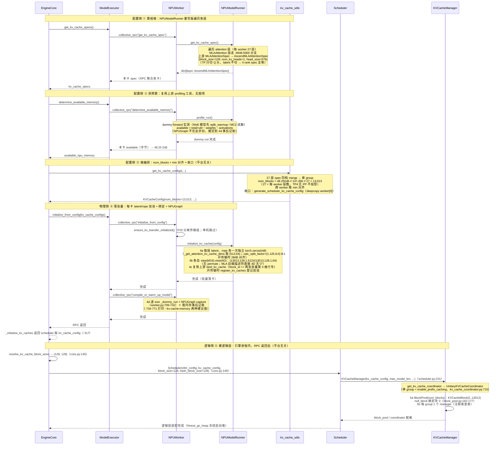

# vLLM-Ascend（NPU）系统启动期初始化（MLA 路线 · DeepSeek-V2-Lite 实战）

> 主线是 **vllm-ascend 在昇腾 NPU 上的实现**（`NPUWorker` / `NPUModelRunner` / `AscendMLABackend`）。③ 做编排与 ⑤ 建逻辑层跑在引擎进程、平台完全无关；MLA 特有落点集中在 ① 算规格的 spec 类型（`AscendMLAAttentionSpec`）与 ④ 落张量的双池语义（latent/rope 8:1）。
>
> 文中统一示例环境：**切分策略 TP4，4 卡（Ascend NPU）环境**；三种 Attention 类型各配一个示例模型：

| Attention 类型 | Spec（NPU 实际产出） | 示例模型 | 模型链接 |
|----------------|------|----------|----------|
| **MLA（本系列实战主线）** | **`AscendMLAAttentionSpec`（latent/rope 拆分）** | **DeepSeek-V2-Lite** | https://www.modelscope.cn/models/deepseek-ai/DeepSeek-V2-Lite |
| Full Attention | `FullAttentionSpec`（上游原类） | Meta-Llama-3-8B | https://www.modelscope.cn/models/LLM-Research/Meta-Llama-3-8B |
| GDN | `MambaSpec`（单张量路径） | Qwen3.5-4B | https://www.modelscope.cn/models/Qwen/Qwen3.5-4B |

> **主线说明**：DeepSeek-V2-Lite 为本系列实战主线模型（2026-10-18 于 a3 4 卡 pod `gggtest2` TP4 全流程实测，见部署篇 [`3_deploy_deepseekv2lite_tp4.md`](./3_deploy_deepseekv2lite_tp4.md)）；Llama-3-8B 为纯 Full Attention 架构示例线，用于对照。MLA 的 **block size 装配链（16 → 128 直通，无级跳）与页数字链（147,456 B → 13,013 块 → 1,665,664 tokens 一字不差）** 专述于 §2.0。

**章节顺序**：全文按「总览 → 三侧逐个详解 → 衔接 → 物理分布 → 速查」推进，各章如下：

| 章节 | 标题 | 内容主题 |
|------|------|----------|
| §1 | 启动期初始化总览 | 三侧五阶段 |
| §2 | 配置侧详解 | ① 算规格 → ② 测预算 → ③ 做编排（①② 以 NPU 实现为主线） |
| §3 | 物理侧详解 | ④ 落张量（NPU 实现） |
| §4 | 逻辑侧详解 | ⑤ 建逻辑层（平台无关） |
| §5 | 三侧衔接 | `block_id == 张量行号`（NPU 恒 dim0） |
| §6 | TP 物理分布 | 切分策略下的 NPU 张量布局（含本仓库实测数字） |
| §7 | 关键公式速查 | 容量/尺寸/拆分公式汇总 |
| §8 | 设计要点小结 | 设计取舍与结论 |

---

## 1. 系统启动期初始化总览（三侧视角）

系统启动期的 KV cache 初始化横跨**引擎进程**与 **worker 进程**，按运行位置与职责分为三侧：

- **配置侧**（引擎进程发起、NPU worker 实测响应）：依次 ① 算规格、② 测预算、③ 做编排，产出唯一的容量仲裁结果 `KVCacheConfig`（含 `num_blocks`、分组方案、张量尺寸）——这一侧**全程不申请任何 KV 显存**；①② 的实现主体经 collective RPC 落在各 **NPUWorker**（vllm-ascend 插件），③ 做纯 Python 编排跑在引擎进程（上游代码）；
- **物理侧**（worker 进程 · 每卡 NPU）：④ 落张量，按配置把每层 KV cache 物化为真正驻留在 NPU 显存上的张量——**MLA 层整池按 8:1 拆 latent、rope 两条独立 int8 字节池**（开 KV 传输时 2MiB 对齐）→ 零拷贝 `view` 成两张 4D → 绑定到 attention 层，并触发编译预热（NPUGraph）；
- **逻辑侧**（引擎进程）：④ 的 RPC 全部返回后，⑤ 建逻辑层——`Scheduler → KVCacheManager → Coordinator → BlockPool + FullAttentionManager`，全部是纯元数据对象，**与平台完全无关**（MLA 单 group，形态与纯 FA 逐字同）。

物理侧与逻辑侧之间没有任何对象引用：同一份 `KVCacheConfig`（收口时 deepcopy 出 scheduler 版，见 §2.3 收口）保证两侧 `num_blocks` 容量对齐，靠"`block_id` 即物理张量行号"的编号约定，逻辑链凭整数 `block_id` 直接索引物理行——这正是上层零拷贝调度的物理基座。

### 1.1 三侧五阶段管线

从 `EngineCore` 启动起步（core.py:122 建 ModelExecutor → core.py:132 调 `_initialize_kv_caches`），初始化沿**五阶段单向管线**推进：前三阶段属配置侧（产出 `KVCacheConfig`，尚未触及设备显存），第四阶段落物理，RPC 返回后第五阶段建逻辑：

```
           ┌──────────────────────────────────────────────────────┐
           │ 配置侧（引擎进程发起 · 全程不申请 KV 显存）           │
           │ ① 算规格 → 每层一个 AscendMLAAttentionSpec           │
           │ ② 测预算 → 每卡 KV 可用显存字节数                    │
           │ ③ 做编排 → KVCacheConfig(num_blocks) + 收口下发       │
           └──────────────────────┬───────────────────────────────┘
                                  │ 同一份配置
              ┌───────────────────┴───────────────────┐
              ▼ 物理侧 ④（NPU worker 进程 · 每卡）    ▼ 逻辑侧 ⑤（引擎进程，RPC 返回后）
   latent/rope 双 int8 字节池（8:1 拆,2MiB 条件对齐）   Scheduler → KVCacheManager
   → view 成两张 4D → bind                            → Coordinator → BlockPool + Manager
   → 编译预热 + NPUGraph capture（图内存此处实测
     并事后建议 --kv-cache-memory）
              └─────── block_id == 张量行号 桥接 ──────┘
```

| 阶段 | 侧 | 职责 | 入口调用 | 输入 → 产出 |
|------|------|------|----------|-------------|
| ① 算规格 | 配置侧 | 遍历全模型 Attention 层，采集 spec，推导单页字节量 `page_size_bytes`；同类层合并为 `KVCacheGroupSpec` | `ModelRunner.get_kv_cache_spec()`（`NPUModelRunner` 重写，MLA 层走 `MLAAttention` 分支产 `AscendMLAAttentionSpec`） | `vllm_config` → `dict[layer, AscendMLAAttentionSpec]` |
| ② 测预算 | 配置侧 | profile dummy forward，量出 KV cache 可用显存（总显存 × 利用率 − 权重 − 激活；**NPU 公式无图项**，NPUGraph 推迟到 ④ 事后记账） | `ModelRunner.profile_run()` | 设备显存快照 → `available_memory: int` |
| ③ 做编排 | 配置侧 | 合并全 worker spec → 分组 → 导出 `num_blocks`（`available // page_size // num_layers`）→ 预算校验 → 跨 worker `min(num_blocks)` 对齐 → 收口：生成 scheduler 版配置、回写 `num_gpu_blocks`（**平台无关，引擎进程**） | `get_kv_cache_configs()` | specs + budget → `list[KVCacheConfig]` + scheduler 版单份 |
| ④ 落张量 | 物理侧 | MLA 层整池**两次独立** `torch.int8` 字节池申请（`calc_split_factor([512,64])=(1.125,9.0)` 8:1 拆；开传输时 2MiB 对齐）→ 各自 `view`（无 permute）成两张 4D → bind（复用上游 `bind_kv_cache`）→ `_dummy_run` 编译 + **NPUGraph** capture，图内存实测后给出 `--kv-cache-memory` 建议 | `ModelRunner.initialize_kv_cache()` | `KVCacheConfig` → `kv_caches[layer] = (latent_cache, rope_cache)` |
| ⑤ 建逻辑层 | 逻辑侧 | RPC 全部返回后引擎进程装配：推导 scheduler/hash 粒度 → 建 `Scheduler` → `KVCacheManager` → 工厂选 `UnitaryKVCacheCoordinator` → `BlockPool`（一次建 num_blocks 个逻辑块、摘 null_block）+ 每 group 一个 manager（注册表查表）——**引擎进程内平台无关** | `EngineCore.__init__`（core.py:145-157）+ `Scheduler.__init__` | scheduler 版 `KVCacheConfig` → 逻辑四层对象 |

**小步编号约定**：三侧管线的①～⑤是**大阶段**（算规格/测预算/编排/落张量/建逻辑层）。§2.3 编排内部另有五个小子步也用①～⑤标注；文中引用写作"§2.3⑤"时指**编排内部第⑤小步（多 worker 对齐）**，不带节号的"⑤"一律指大阶段（建逻辑层）。

> ①②④ 的实现主体由 vllm-ascend 提供：①在 `NPUModelRunner`（§2.1.1）、②在 `NPUWorker`（§2.2.1）、④在 worker/model_runner（§3.1）。③ 编排平台无关，⑤ 逻辑侧更是与平台完全无关（引擎进程内纯 Python 对象装配）。①③⑤ 跑在引擎进程，①② 的实现主体经 collective RPC 落在各 NPU worker 进程执行。

> **零拷贝调度的物理基础**：物理张量与逻辑块都就绪后，上层 `BlockPool` 只持有 `block_id`，所有调度决策（分配/释放/共享/驱逐）均不触碰物理显存——调度层与物理层完全解耦，`block_id` 是唯一的交互接口。

### 1.2 启动期三侧时序图（NPU 视角）

`EngineCore.__init__` 内先调 `_initialize_kv_caches`（core.py:132，定义见 :236），由它完成配置侧①②③与物理侧④（:290），并返回 scheduler 版 `kv_cache_config`（:317）；随后引擎凭该 `kv_cache_config` 进行逻辑侧⑤初始化（core.py:145-157）。以主线 DeepSeek-V2-Lite TP4 为例（每 worker 27 层全 MLA；**本仓库 NPU 实测数字见 §6**：`Available KV cache memory: 48.25 GiB`、`num_blocks=13,013`、`block_size=128`；图中 MLA 层 spec 数字即实测冻结值）：



### 1.3 总调用链（NPU 视角）

以 MLA 模型（DeepSeek-V2-Lite TP4，每 worker 27 层，TP 后 4 Q 头/卡、latent 头不切，合并后 27 层**单 group**）为例。

```text
EngineCore.__init__                                     # engine/core.py:119 起
│
├─ model_executor = executor_class(vllm_config)         # core.py:122 拉起 worker 进程（平台插件选 NPUWorker）
│
├─ kv_cache_config = _initialize_kv_caches(vllm_config)  # core.py:132，内部跑完配置侧①②③+物理侧④
│    │
│    ├─ ※  register_all_kvcache_specs(vllm_config)       # FullAttentionSpec ↔ FullAttentionManager 注册表
│    │     （vllm-ascend 在插件侧另行注册 AscendMLAAttentionSpec → FullAttentionManager，
│    │      见 register_ascend_kv_cache_specs，kv_cache_interface.py:305-315）
│    │
│    ├─ √ ① §2.1.1 算规格  model_executor.get_kv_cache_specs()
│    │     ├─ RPC 到 NPUWorker.get_kv_cache_spec()（worker.py:891，一行转发）
│    │     │    → NPUModelRunner.get_kv_cache_spec()（model_runner_v1.py:4909，重写：分流表见 §2.1.1）
│    │     └─ 返回 -> list[dict[str, KVCacheSpec]]，每个 worker 上每层一个 AscendMLAAttentionSpec
│    │
│    ├─ ※  扫描 spec.non_causal                          # 非因果层，关闭 chunked prefill / 前缀缓存（平台无关）
│    │     （MLA 全因果 → 不触发 → 实测 enable_prefix_caching=True）
│    │
│    ├─ √ ② §2.2.1 测预算  model_executor.determine_available_memory()
│    │     ├─ RPC 到 NPUWorker.determine_available_memory()（worker.py:527）
│    │     │    → NPUModelRunner.profile_run()（model_runner_v1.py:3684：eplb_warmup + MC2 + super()）
│    │     └─ 返回每个 worker 的 available_kv_cache_memory_bytes 字节数 -> list[int]
│    │        实测 48.25 GiB（NPUGraph 内存推迟到 4d 事后记账，见 worker.py:734-771）
│    │
│    ├─ √ ③ §2.3 做编排  get_kv_cache_configs(...)       # 平台无关，引擎进程
│    │     ├─ 合并各 worker 的 spec → global groups（27 层）→ _project 到每 worker 的 projected groups（PP=1 不变 27 层）
│    │     ├─ 基于 projected groups 算 num_blocks = 48.25GiB // 147,456 // 27 = 13,013 → 对齐 min num_blocks
│    │     ├─ 返回 -> list[KVCacheConfig]，每个 worker 上的 KVCacheConfig（统一 num_blocks）
│    │     └─ 收口：generate_scheduler_kv_cache_config（deepcopy）→ 回写 num_gpu_blocks
│    │          → validate_block_size（core.py:279-287；core.py:317 返回 scheduler 版配置）
│    │
│    └─ √ ④ §3.1 物理侧落张量  model_executor.initialize_from_config(...)
│          ├─ collective_rpc("initialize_from_config") → NPUWorker.initialize_from_config()（worker.py:907）
│          │    ├─ ensure_kv_transfer_initialized()（worker.py:909，P/D 分离；单机跳过）
│          │    ├─ sleep mode：CaMemAllocator kv_cache 内存池（worker.py:910-912）
│          │    └─ NPUModelRunner.initialize_kv_cache()（model_runner_v1.py:3843）
│          │         ├─ 4a _allocate_kv_cache_tensors（:4082） MLA 层 latent、rope 各一次 int8 申请
│          │         │      （_get_attention_kv_cache_dims 取 (512,64) :4213；calc_split_factor 维宽
│          │         │        拆分 :4224 → (1.125, 9.0)；2MiB 条件对齐 :4004）
│          │         ├─ 4b _reshape_kv_cache_tensors（:4353） 各自 view 成两张 4D（无 permute）
│          │         │      （MLA 分支 :4605-4629：k_cache=nope/latent 512 宽、v_cache=rope 64 宽）
│          │         ├─ 4c bind_kv_cache                复用上游（:3950-3953），block_id == 各张量行号
│          │         └─ 有 KV 传输组时 register_kv_caches（:3883-3884）
│          └─ collective_rpc("compile_or_warm_up_model") → NPUWorker.compile_or_warm_up_model()（worker.py:706）
│                └─ 4d 逐 size _dummy_run（:728）+ NPUGraph capture（:732）
│                      + 图内存事后记账与 --kv-cache-memory 建议（:734-771）+ ATB 预热（:775-776）
│                      （实测：graph 0.57~0.58 GiB，建议 51,040,165,068 / 55,875,203,072 两组值）
│
└─ √ ⑤ §4 逻辑侧建逻辑层（引擎进程内，④ 的 RPC 全部返回后；平台无关）
       ├─ resolve_kv_cache_block_sizes(kv_cache_config, vllm_config)  # core.py:145 → (128, 128)
       ├─ Scheduler(vllm_config, kv_cache_config, block_size=128, hash_block_size=128)  # core.py:149
       │     └─ KVCacheManager(kv_cache_config, max_model_len, ...)   # sched/scheduler.py:231
       │           ├─ get_kv_cache_coordinator → UnitaryKVCacheCoordinator  # kv_cache_coordinator.py:715
       │           │     ├─ 5a BlockPool(num_blocks)：KVCacheBlock(0..13012)，null_block 摘走块 0  # block_pool.py:149
       │           │     └─ 5b 每 group 1 个 manager（注册表查表）  # single_type_kv_cache_manager.py:1311
       │           └─ self.block_pool = coordinator.block_pool          # kv_cache_manager.py:156
       ├─ request_block_hasher（前缀缓存开启时生成请求级哈希器，core.py:206-215）
       │    （实测 enable_prefix_caching=True → 哈希器生效，运行期命中见 2_runtime_sequence.md §4）
       └─ freeze_gc_heap() / enable_envs_cache()（core.py:228 / :233，启动装配冻结，运行期进入定态）
```

**※ 前置 · 注册 spec ↔ manager 映射**

进入①之前，`EngineCore` 进程内先执行 `register_all_kvcache_specs(vllm_config)`，把 `FullAttentionSpec` 注册到 `FullAttentionManager`：

```python
# single_type_kv_cache_manager.py:1349
def register_all_kvcache_specs(vllm_config):
    """Built-in spec registration"""
    KVCacheSpecRegistry.register(
        FullAttentionSpec,
        FullAttentionManager,
        uniform_type_base_spec=FullAttentionSpec,
    )
```

> 这是一张"spec 类型 → 管理类"的查表：③ 分组完成后，⑤ 建逻辑层时按 `KVCacheGroupSpec.kv_cache_spec` 的类型查表实例化对应 manager（§4.6，与这里形成同进程闭环）。vllm-ascend 的 NPU 特有 spec（**`AscendMLAAttentionSpec`** 等）在插件侧经 `register_ascend_kv_cache_specs()`（`vllm_ascend/core/kv_cache_interface.py:305-315`）注册到对应 manager——**MLA 的 `AscendMLAAttentionSpec` 注册到的正是 `FullAttentionManager`**（单组逐 token 因果语义与 FA 同族），注册闭环对插件同样成立。

### 1.4 交付物与消费方（按侧）

| 交付物 | 生产（侧 · 阶段） | 消费方 | 用途 |
|--------|------------------|--------|------|
| `kv_cache_configs`（list，每 worker 一份） | 配置侧 ③ | 物理侧 ④：各 NPUWorker | Worker 遍历 `kv_cache_tensors`，MLA 层按 split factor 8:1 拆 latent/rope 申请字节池、按 `shared_by` 绑定到层 |
| `num_blocks`（跨 worker 对齐） | 配置侧 ③ | 逻辑侧 ⑤ 的 `BlockPool` | `BlockPool.__init__` 建出 `KVCacheBlock(0 .. 13,012)`（块 0 开池即留作 `null_block` 占位，实际可分配 13,012） |
| scheduler 版 `KVCacheConfig`（deepcopy 单份） | 配置侧 ③ 收口（`_initialize_kv_caches` 返回值） | 逻辑侧 ⑤：Scheduler / KVCacheManager / Coordinator | 分组信息、`num_blocks`、`has_mamba_layers` / `needs_kv_cache_zeroing` 等运行标志 |
| `cache_config.num_gpu_blocks` 回写 | 配置侧 ③ | EngineCore / Scheduler / KV connector | KV 容量对外可见，供准入与 connector 握手 |
| `kv_caches[layer_name] = (latent_cache, rope_cache)` | 物理侧 ④ | Ascend MLA 算子 + NPUModelRunner | 每层两张物理张量 `(13013, 128, 1, 512)` / `(13013, 128, 1, 64)` bf16：forward 时 `unified_mla_kv_cache_update` 按 `slot_mapping` 把新 (c_KV, k_rope) 分别写进两池、注意力核按 `block_table` 沿第 0 维 gather 物理行读历史；ModelRunner 侧引用用于清零本轮新块 |
| `KVCacheManager` 全套（Coordinator + BlockPool + manager） | 逻辑侧 ⑤ | Scheduler 运行期 | `get_computed_blocks` / `allocate_slots` / `free` 统一 API，产出 `block_table` |

## 2. 配置侧：算规格 → 测预算 → 做编排（引擎进程发起）

配置侧三步在 `EngineCore._initialize_kv_caches`（core.py:236-317）内依序执行：①② 的实现主体经 collective RPC 落在各 worker 进程（vllm-ascend 的 `NPUWorker` / `NPUModelRunner`），③ 做纯 Python 编排跑在引擎进程。三步全程不申请任何 KV 显存，产出**唯一的容量仲裁结果** `KVCacheConfig`：一份完整版 list（供④物理侧逐卡执行）+ 一份 scheduler 版（供⑤逻辑侧装配）。而三步开始**之前**，`cache_config.block_size` 已在更早的 VllmConfig 构造期定型（§2.0）。

### 2.0 前置一步：block size 装配链——16 → 128（MLA 直通，实测数字链一字不差）

vllm 上游给出默认 **16**，vllm-ascend 把它抬到 **128**（平台层）。对 MLA 模型这条链**只有两级、无分叉**——对照混合（attn+mamba）模型的 16 → 128 → 1024 三级跳（兄弟系列 `../npu_hybrid/1_start_init.md` §2.0），MLA 直通的关键是**无第二种 spec 族需要对齐**（27 层同构）。①算规格读到的 `block_size` 只是这条链的结果。完整执行时序（按真实先后，三个分叉点逐一标注 MLA 的走向）：

```text
vllm serve CLI（引擎入口）
 │
 ▼
EngineArgs.from_cli_args（--block-size 未传 → block_size = None）                          [vllm]
 │
 ▼
EngineArgs.create_engine_config()（vllm/engine/arg_utils.py:1706）                          [vllm]
 │ 内部依次调用：
 ├→ current_platform.pre_register_and_update()（arg_utils.py:1712）                        [vllm 调用点]
 │   ★ 分叉点 1：current_platform 实例即 NPUPlatform，调用直接跨入插件
 │   └→ NPUPlatform.pre_register_and_update（vllm_ascend/platform.py）                      [vllm-ascend]
 │        └→ adapt_patch(is_global_patch=True)（vllm_ascend/utils.py）                      [vllm-ascend]
 │             └→ import patch/platform/*（patch/__init__.py:17-24）                        [vllm-ascend]
 │                  └→ monkey 替换 mamba 页对齐 patch——【MLA：不改本链，monkey 目标
 │                     是 HybridAttentionMambaModelConfig，DeepSeek-V2 不触发】
 │
 ├→ :1714 DeviceConfig(device=current_platform.device_type) → npu                        [vllm]
 │   :1716 envs.validate_environ（环境变量校验）
 │   :1723 maybe_override_with_speculators（投机模型检测/覆盖）
 │
 ├→ model_config = self.create_model_config()（arg_utils.py:1735）                          [vllm]
 │   └→ 加载 HF config.json → ModelConfig：DeepSeek-V2-Lite 的 kv_lora_rank=512、
 │        qk_rope_head_dim=64、first_k_dense_replace=1（FFN 侧首层 dense，不影响注意力）
 │        等 MLA 参数在此进入视野；26 层 MoE + 1 层 dense 均为 MLAAttention → is_hybrid=False
 │
 ├→ :1740 _check_feature_supported()（特性支持检查）                                       [vllm]
 │   :1741 _set_default_chunked_prefill_and_prefix_caching_args(model_config)
 │   └→ V1 默认开 chunked prefill——"纯 FA 强制 128"的触发条件即来源于此
 │   :1744-1748 sliding_window 解析（仅全滑窗模型生效）
 │   :1751-1753 resolve_kv_cache_dtype_string："auto" → 模型 dtype（本例 bf16）
 │
 ├→ cache_config = CacheConfig(block_size=self.block_size(=None), ...)                     [vllm]
 │   └→ pydantic validator _apply_block_size_default（cache.py:231-244）
 │        → block_size = DEFAULT_BLOCK_SIZE = 16（cache.py:46）                             [vllm]
 │
 ▼
VllmConfig.__post_init__（vllm/config/vllm.py:847）                                         [vllm]
 │ 内部依次调用：
 ├→ self.try_verify_and_update_config()（vllm.py:856，def 于 :1880）                       [vllm]
 │    ├ 纯 FA / MLA（Llama-3-8B、DeepSeek-V2-Lite）：is_hybrid=False → mamba verify 分支不触发
 │    │   【MLA：与纯 FA 同路，16 原样带过】
 │    └ 混合（Qwen3.5-4B）：is_hybrid=True → mamba 页对齐 patch 抬到 1024
 │        【对比：GDN 系列在这里分岔出 1024 大页；MLA 全程无此分岔】
 │
 └→ current_platform.check_and_update_config(self)（vllm.py:1335）                          [vllm 调用点]
       ★ 分叉点 3：平台钩子重写
       └→ NPUPlatform.check_and_update_config（vllm_ascend/platform.py，:671 处内调）      [vllm-ascend]
            └→ refresh_block_size（vllm_ascend/utils.py:1369）                             [vllm-ascend]
                 ├ 混合：is_hybrid → return（:1397-1400）→ 1024 保留
                 └ 纯 FA / MLA：≠128 且开 prefix caching / chunked prefill（V1 默认开）
                    → 强制 128（:1402-1406，日志"Block size is set to 128 ..."）
                    【MLA：block_size 16 → 128 就此定型，无第三级】
 │
 ▼（此后进入 worker 进程）
initialize_attn_backend → select_common_block_size（model_runner_v1.py:4759）              [vllm-ascend]
   管理块（128）与 AscendMLABackend.get_supported_kernel_block_sizes()=[128]（mla_v1.py:117-118）
   求公共分档 → 物理 kernel 128 粒度寻址
   【MLA：管理块 == 物理块 == 128，无"两层粒度分离"现象（对照 GDN 的 1024/128 分离）】
```

**为什么 MLA 无级跳**：block size 级跳的动机是"多 spec 族 页字节统一"（mamba 状态页 vs attn token 页）；MLA 是**单一 spec 族**（27 层同构 `AscendMLAAttentionSpec`），无第二族可对齐，平台层 128 即终值。相应地：**无页 padding、无空洞账单、无 `Padding mamba page size` 日志、前缀缓存不被强制关闭**——这四条"混合税"MLA 全免（实测启动日志里均不存在）。

**MLA 页字节与容量数字链**（TP4 / bf16；数字与 gggtest2 启动日志逐字对齐；与类型篇速查段同源）：

| 量 | 计算 | 值 |
|---|---|---|
| 每 token 每层 latent+rope | (kv_lora_rank 512 + qk_rope 64) × 2B | **1,152 B** |
| 等价 MHA 直存（对照） | 16 头 × (128 nope + 64 rope + 128 v) × 2B | 10,240 B（**压缩 8.89×**） |
| **page_size（层 · 块）** | 128 × num_kv_heads 1 × head_size 576 × 2B | **147,456 B** |
| 每块全模型（27 层同构摊账本） | 27 × 147,456 | **3,981,312 B** |
| 每 token 全模型 KV | 27 × 1,152 | **31,104 B** |
| **num_blocks** | 48.25 GiB ÷ 3,981,312 | **13,013** |
| **GPU KV cache size（日志原文）** | 13,013 × 128 | **1,665,664 tokens**（一字不差） |
| KVCacheTensor.size（每层） | 13,013 × 147,456 | 1,918,844,928 B ≈ 1.79 GiB |

反向验证：`13,013 × 27 × 147,456 = 51,808,813,056 B = 48.25 GiB` 与日志一分不差。**这是三次实测（FA 51.96 GiB/GDN 51.90 GiB/MLA 48.25 GiB）中 spec→运维数字链路最短的一次**：无页对齐 patch、无多组 min 协调、图项不进②公式——MLA 的容量可纯手算复现。

**gggtest2 实测**（2026-10-18；产物归档 [`./logs/startup_markers_1018.txt`](./logs/startup_markers_1018.txt) 等 9 件）：链上三处日志分叉点全部按上述走向出现——`Resolved architecture: DeepseekV2ForCausalLM`（无 `is_hybrid`、无 `Setting attention block size to 1024`/`Padding mamba page size` 行）→ `Block size is set to 128` 路径——最终 `GPU KV cache size: 1,665,664 tokens`。启动早期仅有的两条已知免责/告警：`Breakable cudagraph is force disabled … DeepSeek V4 PIECEWISE not supported`（平台对 V4 特性预防，不作用于本模型）与 yarn `rope_parameters' factor ... got 40` 序列化告警（无功能影响）。

### 2.1 第 ① 步 · 算规格：各层产出 KVCacheSpec

这一步遍历本 worker 模型里的每个 Attention 层，问出"你需要什么形状的 KV cache"。RPC 骨架平台无关（同一个 `ModelExecutor.get_kv_cache_specs()`，core.py:243），Worker / ModelRunner 的实现由 vllm-ascend 提供（§2.1.1）；对 MLA 模型，最终产出的是 **NPU 特有 `AscendMLAAttentionSpec`**（上游 `MLAAttentionSpec` 的重包装）。

#### 2.1.1 NPU 主线（vllm-ascend）：Worker 直接转发，Runner 有重写、MLA 层走专门分支

**调用链**：`EngineCore` → `ModelExecutor.get_kv_cache_specs()`（core.py:243）→ RPC 到各 worker（平台插件选到 `NPUWorker`）→ `NPUWorker.get_kv_cache_spec()`（vllm_ascend/worker/worker.py:891）——**一行转发，自身零逻辑**：

```python
# worker.py:891
def get_kv_cache_spec(self) -> dict[str, KVCacheSpec]:
    return self.model_runner.get_kv_cache_spec()
```

`NPUModelRunner.get_kv_cache_spec()`（vllm_ascend/worker/model_runner_v1.py:4909）**重写**了上游 Runner 的同名方法。遍历骨架（`AttentionLayerBase` → 逐层问 spec → kv_sharing 跳过）沿用上游，多出的是 NPU 特有 spec 类型的分流：

| 层类型 | NPU 分支（model_runner_v1.py） | 产出 spec |
|---|---|---|
| **`MLAAttention`（DeepSeek 系，本主线）** | **:4948-5000** | **`AscendMLAAttentionSpec`**：non-sparse 路径取上游 spec 转包装（**:4987-4999**）；sparse（DSA/SFA）路径另带 `sparse_head_dim`、`cache_sparse_sfa_c8`、`sfa_dcp_replicated_indexer_size` 等字段（:4949-4986） |
| decoder 普通 `Attention`（Llama 走此路） | :4943-4946 原样存入 | 上游 **`FullAttentionSpec`**（模型层自产） |
| `MambaBase` | :5002-5003 先收集、:5027-5036 后统一处理 | 各 Mamba 自身 spec；并把同模型 attn 层 `page_size_padded` 对齐到 mamba 页（**MLA 模型无 mamba 层 → patch 不触发，27 层 spec 直通**） |
| `CacheOnlyAttentionLayer`（extract_hidden_states） | :5005-5025 | **`HiddenStateCacheSpec`**（单独成组） |
| `use_compress` 压缩 KV | :4939-4942 | 模块自身 spec 原样收 |

**MLA dense 路径源码（本主线实际走到）**：

```python
# model_runner_v1.py:4987-4999（dense 路径，节选）
elif spec := attn_module.get_kv_cache_spec(self.vllm_config):     # 上游产 MLAAttentionSpec
    if getattr(attn_module.impl, "fa_quant_layer", False):
        head_size = attn_module.head_size + attn_module.qk_rope_head_dim
        dtype, cache_dtype_str = attn_module.impl.dtype, None
    else:
        head_size, dtype, cache_dtype_str = spec.head_size, spec.dtype, spec.cache_dtype_str
    kv_cache_spec[layer_name] = AscendMLAAttentionSpec(
        block_size=spec.block_size,          # 128（平台层装配链结果，§2.0）
        num_kv_heads=spec.num_kv_heads,      # 1：latent 是每层唯一"头"，头在权重里
        head_size=head_size,                 # 576 = 512 latent + 64 rope 拼接语义
        dtype=dtype,                         # bf16（kv_cache_dtype auto → 模型 dtype）
        cache_dtype_str=cache_dtype_str,
    )
    attn_layer_names.add(layer_name)
```

由实测 config.json（[`./logs/dsv2lite_config.json`](./logs/dsv2lite_config.json)）可推出 spec 冻结值：上游 `MLAAttention.get_kv_cache_spec` 对 V2-Lite 产出 `num_kv_heads=1, head_size=kv_lora_rank+qk_rope_head_dim=576`——**TP4 只切 Q 头（16→每卡 4）不切 latent**（`c_KV = W_DKV·h` 与头无关），4 rank 同层 spec 字段全等 → §2.3① 跨 worker 合并断言天然通过。**`q_lora_rank=null` 的影响**：Q 不低秩压缩，q_c 直接经 `W_Q` 投影（V2 全量版才有 q_lora），只影响计算路径不影响 cache spec。

另有两个边界行为：EC 传输 producer 直接返回 `{}`（:4918-4919）；`kv_sharing_target_layer_name` 同样登记后跳过（:4928-4938）。

> **对 MLA 主线的结论**：NPU 这层重写对 MLA 是"**包装而不改写**"——`AscendMLAAttentionSpec` 的 block_size/num_kv_heads/dtype 均取自上游 spec（fa_quant 关闭时 head_size 也取原值 576），§2.3 的合并/分组/`page_size_bytes` 推导与上游逻辑逐字节一致；**物理差异（latent/rope 8:1 双池）要到 §3 物理侧落张量时才出现**。

**※ 边注 · 扫描 `non_causal`（平台无关）**——specs 收集齐后，EngineCore 检查是否有层标记 `non_causal=True`（如 Prefix LM attention），这段在 EngineCore 进程内生效：

```python
# core.py:263（vllm-study 主线；releases/v0.23.0 尚无此检查）
if any(getattr(spec, "non_causal", False)
       for worker_specs in kv_cache_specs
       for spec in worker_specs.values()):
    vllm_config.scheduler_config.enable_chunked_prefill = False  # 非因果层：关闭 chunked prefill
    vllm_config.cache_config.enable_prefix_caching = False       # 前缀缓存一并关闭
```

> 非因果层与 chunked prefill / 前缀缓存依赖的"因果注意力"假设冲突，会破坏 prefill 正确性；MLA 与纯 FA 同为全因果 → 此分支不触发（**实测 `enable_prefix_caching=True` 印证**——这是 MLA 与 GDN（递归状态被 mamba 分支强关前缀缓存）在启动配置上的关键分野）。这个开关会一路传导到⑤：`Scheduler.__init__` 里 `KVCacheManager(enable_caching=cache_config.enable_prefix_caching)`（§4.3）据此决定协调器走哪个分支。

### 2.2 第 ② 步 · 测预算：profile 量出可用显存

这一步在每个 worker 上跑一次 dummy forward，量出权重+激活之外还剩多少字节给 KV cache。RPC 骨架相同（`ModelExecutor.determine_available_memory()`，core.py:257），Worker 实现即 `NPUWorker`（§2.2.1），核心特性在**图内存推迟记账**。

#### 2.2.1 测预算实现（vllm-ascend）：复用上游 profiling 工具，图内存推迟到 4d 记账

`NPUWorker.determine_available_memory()`（vllm_ascend/worker/worker.py:527）整体结构沿用上游框架，多处直接复用上游工具：

1. **快路径 `--kv-cache-memory`**（worker.py:540-553）：用户显式指定 KV 字节数时，仍跑一次 `profile_run()`（触发编译），但跳过整个记账计算，直接返回用户指定值，并提示该值不受 `gpu_memory_utilization` 约束：

```python
# worker.py:540-553（节选）
if kv_cache_memory_bytes := self.cache_config.kv_cache_memory_bytes:
    self.model_runner.profile_run()
    logger.info("Initial free memory %.2f GiB, reserved %.2f GiB for KV Cache "
                "as specified by kv_cache_memory_bytes, skipping memory profiling. "
                "This does not respect the gpu_memory_utilization config. ...", ...)
    return kv_cache_memory_bytes
```

2. **同一套快照/上下文工具**：`MemorySnapshot` 与 `memory_profiling` 直接从上游 `vllm.utils.mem_utils` 导入（worker.py:47）——快照内部走 `current_platform` 平台抽象，NPU 下即 torch.npu 的设备统计：

```python
# worker.py:557-561（节选）
with memory_profiling(
    self.init_snapshot,
    weights_memory=int(self.model_runner.model_memory_usage),
) as profile_result:
    self.model_runner.profile_run()
```

3. **同一次 dummy forward（MLA+MoE 模型的新增预热）**：`NPUModelRunner.profile_run()`（model_runner_v1.py:3684）只在前后加 NPU 专属预热，核心调用 **`super().profile_run()`**（:3696）即上游那套 max-token dummy forward：

```python
# model_runner_v1.py:3684-3697（节选）
def profile_run(self) -> None:
    self.eplb_warmup()                                   # :3685 EPLB 专家负载均衡 warmup
    mc2_tokens_capacity = get_mc2_tokens_capacity()
    if self.max_num_tokens > mc2_tokens_capacity and select_moe_comm_method(...):   # MC2 MoE 通信容量试跑
        self._dummy_run(mc2_tokens_capacity, with_prefill=True, is_profile=True)
    if self.pcp_size > 1:                                # PCP 切分序列
        self.max_num_tokens = math.ceil(self.max_num_tokens / (self.pcp_size * 2)) * 2
    super().profile_run()                                # :3696 主 dummy forward
    self.max_num_tokens = origin_max_num_tokens
```

DeepSeek-V2-Lite **是 MoE 模型**（64 routed + 2 shared experts），`eplb_warmup` 与 MC2 容量检查真实执行（对照 Llama 纯 dense 只走 `super()` 路径）；但实测引擎配置 `Dynamic EPLB is False`、`redundant experts 0`——warmup 为通信路径预检，不改记账。

4. **torch 峰值改走 npu API**：`torch.npu.memory_stats(self.device)["allocated_bytes.all.peak"]`（worker.py:567），同样取图捕获**之前**的预捕获值并覆写 `torch_peak_increase`（:571）——避免把图池重复计成激活。

**核心公式——没有图内存项**（worker.py:572-574 / :590）：

```
available_kv_cache_memory = requested_memory                （total × gpu_memory_utilization）
                           − (non_torch_increase
                              + torch_peak_increase          （预捕获峰值）
                              + weights_memory)
```

NPUGraph 此刻还没 capture（它发生在 4d `compile_or_warm_up_model()`，worker.py:732），自然无法在这一步预留。图内存改为**事后记账**：4d capture 拿到 `npugraph_memory_bytes` 后，worker.py:734-771 打印一条建议日志，把 `权重 + 峰值激活 + non-torch + NPUGraph + 150 MiB 余量`重算一遍，给出两种 `--kv-cache-memory` 建议值（贴 requested / 贴整机 free），供下次启动直接指定——这正是 NPU 上推荐用 `--kv-cache-memory` 而非只调利用率的原因。

**gggtest2 实测账**（4d 事后记账日志原文，worker.py:771 输出）：

| 项 | 实测值 |
|---|---|
| Free memory on device | 60.87 ~ 61.11 / 61.27 GiB（4 卡微差） |
| Desired GPU memory utilization (0.92) | 56.37 GiB |
| weights | **7.45 GiB**（15.7B bf16 ÷ TP4） |
| peak activation | 0.15 GiB |
| non-torch | 0.51 GiB |
| NPU graph memory（4d 实测回补） | **0.57~0.58 GiB** |
| **② 实测 available（worker.py:593）** | **48.25 GiB** |
| 4d 建议 | `--kv-cache-memory=51040165068`（47.53 GiB）/ `55875203072`（52.04 GiB） |

其余细节：快照一致性断言用严格大于（`init.free > profile 后 free`，worker.py:581）；结果日志用 `logger.info_once`（worker.py:593-595）——本仓库实验启动日志里的 `[worker.py:593] Available KV cache memory: 48.25 GiB` 即此行。

### 2.3 第 ③ 步 · 做编排：合并 / 分组 / num_blocks / 对齐 / 收口（平台无关）

**调用链**：`EngineCore` → `get_kv_cache_configs()`（kv_cache_utils.py:1956），顶层入口，依次五步（PP 下含投影），最后在 EngineCore 侧收口生成 scheduler 版配置。**本节全部跑在引擎进程**（①② 上报的 spec / 预算是什么，它就编排什么）。本节内部小步①～⑤指编排的五小子步（见 §1.1 编号约定）。

**① 合并全 worker spec**

```python
# kv_cache_utils.py:1994（节选）
merged_kv_cache_specs: dict[str, KVCacheSpec] = {}
for kv_cache_spec_one_worker in kv_cache_specs:
    for layer_name, layer_spec in kv_cache_spec_one_worker.items():
        merged_kv_cache_specs[layer_name] = layer_spec  # 跨 worker 合并
```

> 同 PP stage 的不同 TP rank 提交同层 spec，断言检查必须等值（原因：**TP 切分后 MLA 的 `num_kv_heads=1`/`head_size=576` 仍全等**——TP 不切 latent，详见 §6）。**NPU 的 MLA 层在①阶段已经是 `AscendMLAAttentionSpec`**，也就是说"平台特有 spec"从这一步开始就进入平台无关的编排管线——编排对 spec 的具体类型不感知，只按 `page_size_bytes` 等抽象接口工作。

**② 分组 `get_kv_cache_groups()`** —— MLA 走 `is_kv_cache_spec_uniform()` → `_get_kv_cache_groups_uniform_spec()` → 全模型**单 group**（与纯 FA 同路）。

```python
# kv_cache_utils.py:874
def is_kv_cache_spec_uniform(kv_cache_spec) -> bool:
    if not kv_cache_spec:
        return True  # encoder-only 模型
    try:
        kv_cache_spec_values = list(kv_cache_spec.values())
        _ = kv_cache_spec_values[0].merge(kv_cache_spec_values)  # 尝试合并
    except AssertionError:
        return False
    return True
```

> `merge()` 检查所有层 spec 字段（block_size / num_kv_heads / head_size / dtype 等）是否一致——MLA 27 层同构（`AscendMLAAttentionSpec.merge`，kv_cache_interface.py:191）→ **单 group**。对照：GDN 混合模型两类 spec merge 失败 → 多组 Hybrid；**MLA 在分组形态上与纯 FA 逐字同**——这是⑤逻辑层零改动的前提。

**③ 投影到各 worker：按 projected groups 计算 num_blocks**

`num_blocks` 是 **per-worker 容量**。`get_kv_cache_configs()` 先执行 `_project_kv_cache_groups_to_worker()`，把 global groups 投影为各 worker 的 **projected groups**（MLA 主线 PP=1：投影后仍 27 层全量），再传入 `get_kv_cache_config_from_groups()`（kv_cache_utils.py:1247，单组 spec 走通用 else 路径）：

```python
# kv_cache_utils.py:1309-1326（节选）
group_size = max(len(group.layer_names) for group in kv_cache_groups)  # = 27（TP4 无 PP）
num_blocks = available_memory // page_size // group_size
# group_size = projected group 的层数（MLA 主线 27，不是"合并前的 27"——TP 不减层）
# page_size = get_uniform_page_size() = AscendMLAAttentionSpec.page_size_bytes = 147,456 B
# 生成 group_size 个张量（每 worker 27 个），每个 size = 147,456 × 13,013，shared_by 为单层
```

**实测**：`51,808,813,056 B // 147,456 // 27 = 13,013`；四卡 spec 逐层全等（TP 不切 latent）→ 各卡独立计算结果同为 13,013，min 对齐后不变。

**④ 校验 `_check_enough_kv_cache_memory()`**

```python
# kv_cache_utils.py:713（节选）
needed_memory = get_needed_memory()  # max_model_len 下需要的 KV cache
if needed_memory > available_memory:
    estimated_max_len = estimate_max_model_len(available_memory)
    raise ValueError(...)  # 建议调大 util 或调小 max_model_len
```

MLA 主线 `--max-model-len 32768` → 单请求峰值 KV = 32,768 × 27 × 1,152 B ≈ 1.0 GiB，远小于 48.25 GiB 预算 → 校验通过（对照：同规格下无压缩等价模型需 32,768 × 27 × 10,240 B ≈ 8.8 GiB，也过，但并发容量差 8.89 倍）。

**⑤ 多 worker 对齐**——集中式调度下同一请求的 `block_table` 由所有 worker 共用：TP 各 rank 只读写本 rank 的张量子集，因此 `block_id` 必须在任意 rank 上都对应有效物理行。对齐策略：取各 worker `num_blocks` 的最小值作为全局统一值：

```python
# kv_cache_utils.py:2074（节选）
min_num_blocks = min(cfg.num_blocks for cfg in kv_cache_configs)
for kv_cache_config in kv_cache_configs:
    num_blocks_old = kv_cache_config.num_blocks
    kv_cache_config.num_blocks = min_num_blocks
    for tensor in kv_cache_config.kv_cache_tensors:   # 等比例缩小 tensor，避免浪费
        tensor.size = tensor.size // num_blocks_old * min_num_blocks
```

**收口 · 生成 scheduler 版配置并回写（core.py:265-287）**：`list[KVCacheConfig]` 就绪后做三件事——① max_model_len 自适应同步（`collective_rpc("update_max_model_len")`，本主线未触发）；② `generate_scheduler_kv_cache_config(kv_cache_configs)`（kv_cache_utils.py:1698）：入口断言各 worker `num_blocks` 相等后 `deepcopy(kv_cache_configs[0])`（各 worker 配置仅层名不同；UniformType 组折叠不触发）；③ 回写 `cache_config.num_gpu_blocks = 13,013`、`block_size` 回写为各组最小（128）、`validate_block_size()` 终检。

**产出数据结构**

```python
# kv_cache_interface.py:854（节选）
@dataclass
class KVCacheConfig:
    num_blocks: int                         # 13,013（对齐后）
    kv_cache_tensors: list[KVCacheTensor]   # 27 条（每层 1.79 GiB 整池；物理侧再 8:1 拆两池）
    kv_cache_groups: list[KVCacheGroupSpec] # 1 组（27 层 MLA）

@dataclass
class KVCacheTensor:
    size: int              # 1,918,844,928 B（NPU 上是 latent+rope 合计：物理侧按维宽 8:1 拆分）
    shared_by: list[str]   # 哪些层共享（packed layout 下多个）

@dataclass
class KVCacheGroupSpec:
    layer_names: list[str]       # model.layers.0..26.self_attn（27 层）
    kv_cache_spec: KVCacheSpec   # AscendMLAAttentionSpec
```

## 3. 物理侧：落张量 + 编译预热（NPU worker 进程）

①算规格、②测预算、④落张量的实现主体都是 vllm-ascend 的 `NPUWorker` / `NPUModelRunner`（①②已展开，本节是④）；③做编排跑在 EngineCore 进程内、平台无关。第④步与前两步走相同的 RPC 骨架——`ModelExecutor.initialize_from_config()`（core.py:290 / abstract.py:118）内部**连续两个 `collective_rpc`**：先 `initialize_from_config` 完成 4a/4b/4c 落张量，再 `compile_or_warm_up_model` 完成 4d 编译预热。**实现见 §3.1。**

### 3.1 NPU 实现：MLA latent/rope 双独立池，开传输时 2MiB 对齐

物理侧由 vllm-ascend 插件实现：`NPUWorker(WorkerBase)`（vllm_ascend/worker/worker.py:89）与 `NPUModelRunner`（vllm_ascend/worker/model_runner_v1.py:268，继承上游基类）——**重写张量分配/reshape，但复用上游 RPC 框架、`KVCacheConfig` 编排与 `bind_kv_cache` 绑定**。

**调用链**：平台插件选到 NPUWorker（`collective_rpc` 广播 `list[KVCacheConfig]`，各卡按 `global_rank` 取本 rank 的配置，worker_base.py:315-319）：

1. `collective_rpc("initialize_from_config")` → **`NPUWorker.initialize_from_config()`（worker.py:907）**，先做两件 NPU 特有的事再委托 model_runner：

```python
# worker.py:907-918（节选）
def initialize_from_config(self, kv_cache_config: KVCacheConfig) -> None:
    """Allocate NPU KV cache with the specified kv_cache_config."""
    ensure_kv_transfer_initialized(self.vllm_config, kv_cache_config)   # :909 拉起 KV 传输组（P/D 分离；单机跳过）
    if self.vllm_config.model_config.enable_sleep_mode:
        allocator = CaMemAllocator.get_instance()                        # :910-912 sleep mode：
        context = allocator.use_memory_pool(tag="kv_cache")              #  在专用内存池上下文内分配
    else:
        context = nullcontext()
    with context:
        self.model_runner.initialize_kv_cache(kv_cache_config)           # :918 落张量主体
```

   注意 config 路径下 NPUWorker **不回写** `cache_config.num_gpu_blocks`（旧 profile 路径的回写在 `initialize_cache()`，worker.py:391）；`eagle3 + num_speculative_tokens>1` 的 mamba 混合场景还会在 :930-937 检查 `_init_kv_zero_meta`（MLA 主线不涉及）。

2. `collective_rpc("compile_or_warm_up_model")` → `NPUWorker.compile_or_warm_up_model()`（worker.py:706），完成 4d 编译预热（见下）。

`NPUModelRunner.initialize_kv_cache()`（model_runner_v1.py:3843）本体：

```text
deepcopy(KVCacheConfig)（:3850，防止改动跨 worker 共享的配置对象）
→ may_add_encoder_only_layers_to_kv_cache_config / maybe_add_kv_sharing_layers_to_kv_cache_groups（:3854-3855）
→ initialize_attn_backend(kv_cache_config)（:3857，先于使用 attn_groups；
   select_common_block_size 在此把 128 与 AscendMLABackend 分档 [128] 对齐——无分离）
→ may_reinitialize_input_batch(kv_cache_config)（:3864）
→ initialize_kv_cache_tensors(kv_cache_config)（:3865 调 :3917，内部 = 4a 分配 + 4b reshape + 4c 绑定）
→ 存在 KV 传输组时 register_kv_caches(kv_caches)（:3883-3884，把双池登记给传输层）
```

**4a. 每层分配 latent、rope 两张独立 int8 池 `_allocate_kv_cache_tensors()`（model_runner_v1.py:4082）**

函数头注释直说双池拆分动机（KV 传输注册要求 dim0=num_blocks、地址 2MiB 对齐）：

```python
# model_runner_v1.py:4087-4088 函数头注释（原文）
# NOTE: To support prefill disaggregation, we need to split kvcache tensor into
# k cache and v cache, and the addr of both are aligned by 2M
```

dense attention 分支的拆分流程（:4147-4309）——MLA 与 Llama 走**同一段代码**，差异只在 `(k_dim, v_dim)` 的取值与拆分比例：

```python
# model_runner_v1.py:4082/4101/4213-4232/4249-4254（节选）
alignment = 2 * 1024 * 1024                                   # :4101 2MiB 对齐宽度
...
k_dim, v_dim = self._get_attention_kv_cache_dims(layer_name, spec)     # :4213
#     MLA: (kv_lora_rank, qk_rope_head_dim) = (512, 64)   ← :3987-3989，注释原文
#     Llama: (head_size, head_size_v) = (128, 128)         ← :3997-3998
kv_head_dim_list = [k_dim, v_dim]
k_factor, v_factor = calc_split_factor(kv_head_dim_list)       # :4224；vllm_ascend/utils.py:1611
k_tensor_size = int(kv_cache_tensor.size // k_factor)          # :4227 整池字节量按维宽比例拆
v_tensor_size = int(kv_cache_tensor.size // v_factor)          # :4228
k_tensor = self._allocate_int8_cache_tensor(k_tensor_size, alignment)  # :4249 第一次独立 torch.zeros（latent 池）
v_tensor = self._allocate_int8_cache_tensor(v_tensor_size, alignment)  # :4254 第二次独立 torch.zeros（rope 池）
kv_cache_raw_tensors[layer_name] = (k_tensor, v_tensor)        # :4309 登记为二元组
```

**`_get_attention_kv_cache_dims` 的 MLA 分支**（:3979-3998）——dim 的来源不同是 MLA 与 dense 的关键分叉点（dense 层读 spec 的 head_size/head_size_v，MLA 层直接问 attention 模块要 lora 维度）：

```python
# model_runner_v1.py:3980-3989（节选）
if isinstance(kv_cache_spec, AscendMLAAttentionSpec):
    attn_layers = get_layers_from_vllm_config(self.vllm_config, AttentionLayerBase, [layer_name])
    attn_layer = attn_layers[layer_name]
    if isinstance(attn_layer, MLAAttention):
        # DeepSeek MLA: K=kv_lora_rank, V=qk_rope_head_dim     ← 源码注释原文（:3988）
        return attn_layer.kv_lora_rank, attn_layer.qk_rope_head_dim    # (512, 64)
    if isinstance(attn_layer, CacheOnlyAttentionLayer):       # HiddenState 层的兜底
        return kv_cache_spec.head_size, kv_cache_spec.head_size
    raise TypeError(...)
```

其中 `calc_split_factor`（vllm_ascend/utils.py:1611-1613）就是"总宽度 / 各自宽度"：

```python
def calc_split_factor(num_list: list[int]):
    total = sum(num_list)
    return [total / num for num in num_list]
```

- MLA `[512, 64] → (1.125, 9.0)`：**latent 池占 8/9（≈1.59 GiB/层）、rope 池占 1/9（≈0.20 GiB/层）**——"V 池"按名义只分到 1/9，因为它装的是 64 维 k_rope 而非 512 维 latent，更非传统 value；
- dense 等宽层 `[128, 128] → (2.0, 2.0)`：对半拆（Llama 对照）；
- 断言兜底：分配完成后 `assert layer_names == set(kv_cache_raw_tensors.keys())`（:4316，"Some layers are not correctly initialized"）。

对齐本身是条件性的（`_allocate_int8_cache_tensor`，model_runner_v1.py:4004；对齐切片助手 `_align_memory` 在 :3911-3915：`data_ptr` 向上取整再切片），**但 K/V 拆分对所有 dense 层无条件生效**：

```python
# model_runner_v1.py:4004（节选）
def _allocate_int8_cache_tensor(self, numel, alignment):
    if self.vllm_config.kv_transfer_config is None:
        return torch.zeros(numel, dtype=torch.int8, device=self.device)          # 无传输：普通 int8 申请
    raw = torch.zeros(numel + alignment, dtype=torch.int8, device=self.device)   # 开传输：预留 2MiB
    return self._align_memory(raw, alignment)[:numel]                            # 地址对齐后切片
```

同样先按 int8 字节申请、reshape 时再 `view(dtype)`——"dtype 与存储解耦"的动机与主线一致。例外分支（不走 K/V 双分、仍是单张量）：`linear_attn`/mamba/`cache_only_layers`/hidden-state（:4118-4134）与 `use_compress` 压缩注意力（:4135-4146）——**MLA 主线的 27 层全部走 K/V 双分路径**；sparse MLA（DSA/SFA）在此之外还会额外分配 indexer/scale 张量（`_allocate_sparse_c8_indexer_tensors` 等，:4259-4276；登记形态为 2～4 元组，:4646-4680）——dense MLA（V2-Lite）不涉及。

**4b. 两张 4 维张量 `_reshape_kv_cache_tensors()`（:4353）——MLA 分支：nope/latent + rope 不等维双池**

```python
# model_runner_v1.py:4605-4629（MLA 分支，节选；dense 对照见 :4592-4644）
kv_cache_shape = attn_backend.get_kv_cache_shape(        # AscendMLABackend：mla_v1.py:99-106
    num_blocks, current_kv_cache_spec.block_size,
    current_kv_cache_spec.num_kv_heads, current_kv_cache_spec.head_size)
#     MLA 后端直接返回 4D (num_blocks, block_size, num_kv_heads, head_size)
#     ——无 dense 后端描述符 dim0 的"2"（attention_v1.py:104-112 对照）
...
else:
    # k_cache: nope_cache    v_cache: rope_cache          ← 源码注释原文（:4606）
    mla_num_blocks, mla_block_size, num_kv_heads, _ = kv_cache_shape
    k_dim, v_dim = self._get_attention_kv_cache_dims(layer_name, current_kv_cache_spec)  # (512, 64)
    k_shape = (mla_num_blocks, mla_block_size, num_kv_heads, k_dim)   # (13013, 128, 1, 512)
    v_shape = (mla_num_blocks, mla_block_size, num_kv_heads, v_dim)  # (13013, 128, 1, 64)
k_cache = raw_k_tensor.view(k_cache_dtype).view(k_shape)  # 纯 view，无 permute
v_cache = raw_v_tensor.view(v_cache_dtype).view(v_shape)
kv_caches[layer_name] = (k_cache, v_cache)                # 每层绑定对象 = (latent, rope) 二元组
```

要点：

- **k_cache 是 nope/latent 池**（宽 512 = `kv_lora_rank`）、**v_cache 是 rope 池**（宽 64 = `qk_rope_head_dim`）——两张**不等维** 4D 张量，**"V 池"装的绝不是 value 值**：V 在 decode 由 latent 经 `W_UV` 即时上采样（`_v_up_proj`，mla_v1.py:898-906）；
- 全程只有 `view`（int8 → bf16 → 4D），**无 `permute` 布局翻转**；
- `block_id == 双池各自行号`：K 池、V 池各有一套 13,013 行的同序号行空间，同一个 `block_id` 同时命中两张张量各自的同一行；
- dense 对照（Llama）：描述符 `(2, num_blocks, block_size, num_kv_heads, head_size)` 里的"2"在 dim0、且不落成物理维——被拆成两张等宽 4D；MLA 描述符从源头就是 4D（后端差分：`AscendMLABackend.get_kv_cache_shape` 直接返回 `(N, B, H, D)`，mla_v1.py:99-106）；
- 跨层 KV 复用层在此挂共享引用（:3933-3935，`shared_kv_cache_layers`）；`deepseek_v4` 类型走专门排序装填（:3937-3948），主线不涉及。

**4c. 绑定：直接复用上游 `bind_kv_cache`**

NPU 没有自己的绑定函数——绑定发生在 `initialize_kv_cache_tensors()` 内部：:3950 `from vllm.v1.worker.utils import bind_kv_cache`、:3953 以同一上游函数把 `(latent_cache, rope_cache)` 按层序填入 `self.kv_caches`（`list[层序 → (latent, rope)]`）并绑进 `static_forward_context`。forward 时 MLA 实现拿到二元组，写路径 `unified_mla_kv_cache_update` 取下标分发给 NPU 算子；同一后端的双池版 `swap_blocks`/`copy_blocks`（P/D 传输、offload 的算子层入口）对 MLA 双池同样按 `[0]`/`[1]` 分别搬行——**MLA 写路径的入参是 `(c_KV, k_rope)`**：`AscendMLAImpl.forward` 先做 `W_DKV/W_KR` 投影与缓存写入，再走注意力（吸收式展开见 [`2_runtime_sequence.md`](./2_runtime_sequence.md) §4.3）。

**4d. 编译与预热：NPUGraph 替代 CUDAGraph `NPUWorker.compile_or_warm_up_model()`（worker.py:706）**

```python
# worker.py:706-776（节选）
def compile_or_warm_up_model(self) -> CompilationTimes:
    for size in sorted(warmup_sizes, reverse=True):
        self.model_runner._dummy_run(size)                  # :728 各 batch size dummy forward，触发编译
    npugraph_memory_bytes = 0
    if not self.model_config.enforce_eager:
        npugraph_memory_bytes = self.model_runner.capture_model()   # :732 NPUGraph capture
    ...
    if self.cache_config.kv_cache_memory_bytes is None and hasattr(self, "peak_activation_memory"):
        redundancy_buffer = 150 * (1 << 20)                 # :742 150 MiB 安全余量
        non_kv_memory = (weights + peak_activation + non_torch + npugraph_memory_bytes)
        suggested_to_requested = requested_memory − non_kv_memory − redundancy_buffer
        suggested_to_gpu_limit = init_snapshot.free_memory − non_kv_memory − redundancy_buffer
        logger.info("... Replace gpu_memory_utilization with "
                    f"`--kv-cache-memory={suggested_to_requested}` ... or "
                    f"`--kv-cache-memory={suggested_to_gpu_limit}` ...")   # :741-771 事后记账
    if get_ascend_device_type() != AscendDeviceType.A5:
        self._warm_up_atb()                                 # :775-776 ATB 首算预热（防 ReshapeAndCache 首次卡顿）
    if get_ascend_config().enable_cpu_binding:
        bind_cpus(self.local_rank)                          # :779-783 热分配落定后再绑核
    set_random_seed(self.model_config.seed)                 # :786 重置随机种子
```

> 图内存"事后记账"的原理：②测预算发生在 NPUGraph capture **之前**（公式里没有图项），此时 4d 已经拿到实测 `npugraph_memory_bytes`（**gggtest2 实测 0.57~0.58 GiB**），于是在这里把"建议 KV 预算"重算一遍打印出来——`权重 7.45 + 峰值激活 0.15 + non-torch 0.51 + NPUGraph 0.58 + 150 MiB 余量` 从 requested（或整机 free）里扣掉，给出两种 `--kv-cache-memory` 建议值（实测 **47.53 / 52.04 GiB**）。150 MiB 余量吸收 profiling 对 ACL context / HCCL buffer / driver 层的低估。

> **MLA 专属编译图证据**（gggtest2 实测，`compilation_config.splitting_ops`）：`vllm::unified_mla_attention_with_output`（MLA 注意力前向）、`vllm::unified_mla_kv_cache_update`（写 KV）、`vllm::mla_forward`（吸收式 decode）——同列表还共存 DSA 路线算子（`dsa_forward / deepseek_v4_attention / sparse_attn_indexer`），据此可判断"dense MLA 还是 sparse DSA"路线。实测 `init engine took 35.27 s (compilation: 7.26 s)`；编译融合开关 `Enabled custom fusions: norm_quant, act_quant`（pass_config 含 `fuse_rope_kvcache_cat_mla=False`）。

至此 NPU 物理侧就绪。以本仓库 DeepSeek-V2-Lite 实验为例（详见 §6）：每 worker 27 层 → **54 张张量（27 个 latent 池 + 27 个 rope 池）**，`k_cache=(13013, 128, 1, 512)`、`v_cache=(13013, 128, 1, 64)` bf16。

**不变的存储契约**（所以上层零改动）：同一份 `KVCacheConfig` 与跨 worker `min(num_blocks)` 对齐；一律从 int8 字节池起步、与 dtype 解耦；都用同一个 `bind_kv_cache` 绑定；逻辑侧 `block_id == 物理张量 dim0 行号` 的约定恒成立（latent 池/rope 池各有一套同序号的行空间）——⑤逻辑层（§4）、`BlockPool`、`KVCacheManager` 的分配/释放/哈希/驱逐逻辑对此完全无感。

## 4. 逻辑侧：建逻辑层（引擎进程 · 纯元数据装配）

④的 RPC 全部返回后，`_initialize_kv_caches`（core.py:317）把收口生成的 scheduler 版 `KVCacheConfig` 返回给 `EngineCore.__init__`，引擎进程随即执行⑤——装配逻辑四层（协调器 / 单类型管理 / 块池 / 门面，架构编号第 2～5 层，见 [`0_kvcache_arch.md`](./0_kvcache_arch.md)）。本侧特点：**全部对象都是纯元数据**（`KVCacheBlock` 只含 `block_id` 与引用计数等，不含任何 latent/rope 数据）、**启动期一次性建好**、**与平台完全无关**——**MLA 与纯 FA 在本侧逐字相同**。

### 4.1 装配时点：物理先于逻辑

`EngineCore.__init__` 的后半段（core.py:135-233）：

```python
# core.py:145-157（节选）
scheduler_block_size, hash_block_size = resolve_kv_cache_block_sizes(
    kv_cache_config, vllm_config
)
Scheduler = vllm_config.scheduler_config.get_scheduler_cls()
self.scheduler: SchedulerInterface = Scheduler(
    vllm_config=vllm_config,
    kv_cache_config=kv_cache_config,
    structured_output_manager=self.structured_output_manager,
    ...
    block_size=scheduler_block_size,
    hash_block_size=hash_block_size,
)
```

装配完成后还有两道"封门"动作：`freeze_gc_heap()`（core.py:228，把启动堆标记为静态、GC 不再扫描）与 `enable_envs_cache()`（core.py:233，此后环境变量视为不再变更）——两者都以"⑤装配完成"为前提，侧面印证了**物理先于逻辑**的顺序约束。实测日志时序：`init engine (profile, create kv cache, warmup model) took 35.27 s`（④）→ `Asynchronous scheduling is enabled`（⑤ 后）→ `Application startup complete`。

### 4.2 推导调度粒度：`resolve_kv_cache_block_sizes()`

Scheduler 构造之前，先从 `kv_cache_config` 推导两个粒度参数（core.py:145 调用，kv_cache_utils.py:593）：

```python
# kv_cache_utils.py:616-618（单组路径，MLA 主线走此路）
if len(groups) <= 1:  # Single group: block_size * dcp * pcp
    bs = cache_config.block_size * dcp * pcp
    return bs, bs
```

- **`scheduler_block_size`**：调度器的 token 对齐不变量（`num_computed_tokens` 取整、chunked prefill 分片粒度）。MLA 单 group 且 dcp/pcp 均为 1 → **128**；
- **`hash_block_size`**：`Request.block_hashes` 的计算粒度（前缀缓存哈希链的步长）。单 group 时与 scheduler_block_size 相同 → **128**；
- 多 group（混合模型）时分别取各组 block_size 的 LCM 与 GCD，此时二者允许不同——**MLA 单组无此问题**（对照 GDN 系列 1024 vs 128 的 LCM 推导）。

### 4.3 `Scheduler.__init__` → 创建 `KVCacheManager`（第 5 层门面）

`Scheduler.__init__`（core/sched/scheduler.py:66）中请求队列等调度器常规设施就绪后，创建逻辑侧的顶层门面：

```python
# sched/scheduler.py:231-244（节选）
self.kv_cache_manager = KVCacheManager(
    kv_cache_config=kv_cache_config,
    max_model_len=self.max_model_len,
    max_num_batched_tokens=self.scheduler_config.max_num_batched_tokens,
    enable_caching=self.cache_config.enable_prefix_caching,     # MLA 主线实测 True
    use_eagle=self.use_eagle,
    log_stats=self.log_stats,
    scheduler_block_size=self.block_size,   # 128
    hash_block_size=hash_block_size,         # 128
    ...
)
```

三个联动点值得注意：

1. `enable_caching` 接的是 `cache_config.enable_prefix_caching`——①算规格阶段的 `non_causal` 扫描（§2.1 边注）若关掉了前缀缓存，这里会一路传导下去，最终改变协调器的选型（见 §4.4 工厂分支）。**MLA 全因果 → 不触发 → 实测保持 True**（运行期前缀命中 61.3%→68.9% 即此开关的收益）；
2. KV connector 在场时，紧接其后 `connector.bind_gpu_block_pool(self.kv_cache_manager.block_pool)`（scheduler.py:247-248）——P/D 分离等传输组件复用同一逻辑块池做衔接；NPU 上 4a 双池张量即由 `register_kv_caches`（model_runner_v1.py:3884）登记给同一传输层。**MLA P/D 分离下双池即 (latent 池, rope 池)**——KV 传输搬运的就是这两段；
3. Scheduler 还顺带接收配置上的运行标志：`has_mamba_layers` / `needs_kv_cache_zeroing`（scheduler.py:259-260，来自 `kv_cache_config` 字段）——**MLA 主线 has_mamba_layers=False**；`needs_kv_cache_zeroing` 决定运行期每步是否要物理侧清零新块（latent+rope 两张都要清）。

### 4.4 协调器：工厂三分支与基类装配（第 4 层）

`KVCacheManager.__init__`（core/kv_cache_manager.py:111）核心动作是经工厂创建协调器，并把句柄提级缓存：

```python
# kv_cache_manager.py:142-156（节选）
self.coordinator = get_kv_cache_coordinator(
    kv_cache_config=kv_cache_config,
    max_model_len=self.max_model_len,
    max_num_batched_tokens=max_num_batched_tokens,
    use_eagle=self.use_eagle,
    enable_caching=self.enable_caching,
    scheduler_block_size=scheduler_block_size,
    hash_block_size=hash_block_size,
    ...
)
self.num_kv_cache_groups = len(kv_cache_config.kv_cache_groups)   # :155 MLA 主线 = 1
self.block_pool = self.coordinator.block_pool                      # :156 句柄提级
```

工厂 `get_kv_cache_coordinator()`（kv_cache_coordinator.py:689-729）按"是否开前缀缓存 × group 数"分三路：

```python
# kv_cache_coordinator.py:702-715, 729（节选）
if not enable_caching:
    return KVCacheCoordinatorNoPrefixCache(...)          # 关前缀缓存：直通版，find_longest_cache_hit 恒空
if len(kv_cache_config.kv_cache_groups) == 1:
    return UnitaryKVCacheCoordinator(...)                # 主线：单 group + 开前缀缓存（MLA 走此路）
return HybridKVCacheCoordinator(...)                     # 混合模型：多组间命中求交（GDN 系列路线）
```

MLA 主线走 **`UnitaryKVCacheCoordinator`**（kv_cache_coordinator.py:379）——与纯 FA **完全同路**。其基类 `KVCacheCoordinator.__init__`（kv_cache_coordinator.py:65-110）完成两件装配动作（粒度整除终检 + 5a 建块池[§4.5] + 5b 每 group 一个 manager[§4.6]）；Unitary 在基类之上追加两条断言（kv_cache_coordinator.py:413-428）：`assert not enable_caching or (hash_block_size == self.block_size)`、`assert len(...kv_cache_groups) == 1`。

> 主线下三条断言全过：`128 % 128 == 0`、`hash_block_size == block_size == 128`、group 数为 1——这三条正是③编排"全模型单 group + uniform MLA spec"在逻辑侧的呼应。

### 4.5 `BlockPool.__init__`：一次建 num_blocks 个逻辑块（第 2 层）

`BlockPool`（core/block_pool.py:149）是逻辑侧唯一持有"块"的地方，全部启动期一次性装配：

```python
# block_pool.py:162-177（节选）
self.blocks: list[KVCacheBlock] = [
    KVCacheBlock(idx) for idx in range(num_gpu_blocks)   # n 个块，block_id = 序号 0..n-1
]
self.free_block_queue = FreeKVCacheBlockQueue(self.blocks)
self.cached_block_hash_to_block: BlockHashToBlockMap = BlockHashToBlockMap()
# To represent a placeholder block with block_id=0.
# The ref_cnt of null_block is not maintained, needs special care to
# avoid freeing it.
self.null_block = self.free_block_queue.popleft()        # 摘走队头（block_id=0）
self.null_block.is_null = True
```

逐项解读（以 MLA 实测 `num_blocks=13,013` 为例）：

| 属性 | 启动期值 | 运行期角色 |
|---|---|---|
| `blocks` | `[KVCacheBlock(0) … KVCacheBlock(13012)]`，每个块仅含 `block_id`、`ref_cnt=0` 等元数据 | 全量预建，运行期永不 new 新块——分配只是改指针/计数 |
| `free_block_queue` | 全部 13,013 块按 **block_id 升序**串成双向链表，`num_free_blocks=13,013` | 分配 `popleft`、驱逐后回插；自研双向链表而非 deque，支持 O(1) 摘中间块，队序即驱逐序（队头为 LRU 最旧） |
| `cached_block_hash_to_block` | **空** dict（`BlockHashToBlockMap`） | 前缀缓存查表，运行期由"写满的块回填哈希"逐步积累 |
| `null_block` | 队头 pop 出的 `block_id=0`，`is_null=True` | 占位块：供管理器在需要占位/对齐的场合使用，不维护引用计数、永不再分配 |

摘走 `null_block` 后实际可分配块为 **13,012**（编号 1..13012）——与物理侧"两张张量 dim0 的 0 号行闲置无人写"一一对应（§5）。**注意 NPU 上逻辑块只有这一份：一个 `block_id` 同时命名 latent 池行与 rope 池行，不存在"每张张量一套块池"**——运行期实测佐证：长请求峰值占用 12 块 → `GPU KV cache usage: 0.1%`（=12/13,013，一字不差，见 [`2_runtime_sequence.md`](./2_runtime_sequence.md) §5）。

### 4.6 `FullAttentionManager`：注册表查表实例化（第 3 层）

协调器基类为每个 group 调 `get_manager_for_kv_cache_spec()`（single_type_kv_cache_manager.py:1311）：

```python
# single_type_kv_cache_manager.py:1331-1345（节选）
manager_class = KVCacheSpecRegistry.get_manager_class(kv_cache_spec)
assert manager_class is not None, f"No manager registered for KVCacheSpec {type(kv_cache_spec)}"
...
manager = manager_class(kv_cache_spec, **kwargs)
```

查的正是①前置阶段 `register_all_kvcache_specs`（同文件 :1349，§1.3）与插件侧 `register_ascend_kv_cache_specs`（`vllm_ascend/core/kv_cache_interface.py:305-315`）填充的注册表：**`AscendMLAAttentionSpec → FullAttentionManager`**——**同一引擎进程内，先注册、后查表**，两头闭环。主线命中的 `FullAttentionManager`（类定义同文件 :521）没有自定义 `__init__`，直接复用基类装配（single_type_kv_cache_manager.py:38-82）：

```python
# single_type_kv_cache_manager.py:64-80（基类 __init__ 节选）
self.scheduler_block_size = scheduler_block_size          # 128：调度对齐粒度
self.block_size = kv_cache_spec.block_size                # 128：实际分配粒度
self.kv_cache_spec = kv_cache_spec                        # 组规格（page_size_bytes=147,456）
self.block_pool = block_pool                             # 共享的同一个块池（所有第3层共享第2层）
self.enable_caching = enable_caching                     # True（MLA 实测）
self.new_block_ids: list[int] = []                        # 本调度步新分配块暂存（运行期复用清空）
self.req_to_blocks: defaultdict[str, list[KVCacheBlock]] = defaultdict(list)
                                                          # request_id → 块序列，运行期 block_table 的唯一数据源
```

> `FullAttentionManager` 的核心运行期方法 `find_longest_cache_hit`（:521 起，前缀查找）等不在启动期执行，本篇不展开（见 `2_runtime_sequence.md`）。主线 manager 仅 1 个（单 group），混合模型下每 group 一个、共享同一 BlockPool——**MLA 复用 FA 的 manager 这件事本身就是"latent/rope 仍是逐 token 因果序列"的结构性证据**：前缀查找/分配/释放只依赖块语义，与池内装什么无关。

### 4.7 逻辑侧交付物与运行期消费方

| 交付物 | 消费方 | 用途 |
|---|---|---|
| `Scheduler.kv_cache_manager`（门面 + 协调器 + 块池 + manager） | Scheduler 运行期 | `get_computed_blocks / allocate_slots / free` 统一 API（第 5 层门面唯一入口） |
| `BlockPool.blocks[i]`（`KVCacheBlock`，13,013 个全量预建） | 块池 / manager | 分配、释放、共享、驱逐全部只在块对象上改计数与链表位置 |
| `FullAttentionManager.req_to_blocks[req_id]` | Scheduler → SchedulerOutput | 运行期拼 `block_table`（整数 block_id 列表）随调度输出下发物理侧 |
| `null_block`（`block_id=0`） | manager 占位/对齐逻辑 | 无效 slot 的占位目标，物理侧 0 号行（latent 与 rope 两张张量的 0 号行）闲置与之对应 |
| `scheduler_block_size` / `hash_block_size`（128/128） | Scheduler / 请求哈希预计算 | `num_computed_tokens` 取整；前缀缓存哈希链步长 |
| `kv_cache_config.needs_kv_cache_zeroing` 等标志 | Scheduler → NPUModelRunner | 决定每步是否清零新物理块（NPU 上即两张张量的对应行；与④的 `kv_caches` 引用配合） |

至此三侧全部装配完成：物理侧每层**两张** `(13013, 128, 1, 512)` / `(13013, 128, 1, 64)` 张量就绪、逻辑侧 13,013 个块与查表结构就绪、两侧靠 `block_id == 行号` 约定桥接，引擎进入接收请求的定态。

## 5. 三侧衔接：一份配置、一个编号约定

三侧的衔接不依赖任何对象引用，由**配置分发**与**编号约定**共同保证：

1. **同一份配置定义容量**：③收口产出完整版 `list[KVCacheConfig]`（每 worker 一份、`num_blocks` 已 min 对齐）交给④；deepcopy 出的 scheduler 版单份交给⑤。`generate_scheduler_kv_cache_config` 的入口断言（kv_cache_utils.py:1704-1706）兜底保证两侧看到的 `num_blocks` 必然相等——物理侧各张量的 `block_dim` 轴大小、逻辑侧 `BlockPool.blocks` 长度都由同一个数字推出。NPU 特有的一层保障：`NPUModelRunner.initialize_kv_cache` 还会 `deepcopy(config)`（model_runner_v1.py:3850），确保 worker 侧的任何配置增补不会污染引擎进程共享的对象。
2. **从 0 顺序编号的约定**：逻辑侧 `BlockPool.__init__` 一次性建出 `num_blocks` 个 `KVCacheBlock`，`block_id` 取序号 `0 … 13012`；物理侧 reshape 后每张张量的 `block_dim` 轴大小恰为同一 `num_blocks`。两侧在 `block_dim` 轴上"位置等同"——`block_id` 即张量行号，fancy index 直接取行，无查表、无拷贝。
3. **NPU 唯一的存储形态——latent/rope 双独立池**（详 §3.1）：**latent 池与 rope 池各有一套同序号的行空间**——同一个 `block_id` 同时命中两张张量各自的第 `block_id` 行；逻辑侧对此完全无感，`block_table` 只有一份。两张 `(num_blocks, block_size, 1, 512)` 与 `(num_blocks, block_size, 1, 64)`，`block_dim` 恒为每张张量的 dim0，索引方式 `kv_caches[layer][0][block_ids]`（latent）/ `[1][block_ids]`（rope）。

**双池形式下 `block_dim` 恒为 dim0，无需哨兵值运行时探测**——这是 KV 传输注册约束（buffer dim0 = num_blocks、地址 2MiB 对齐）的直接副产物；MLA 双池在 P/D 分离时即按 k=latent / v=rope 两段注册搬运。

forward 伪代码（NPU 双池形式，`block_ids` 即该请求的 `block_table`）：

```python
# NPU forward 前，Worker 已通过 get_block_ids() 拿到该请求的 block_id 列表
block_ids = get_block_ids(request_id)             # 形如 [1, 7, 512, ...]，来自 req_to_blocks
latent = kv_caches[layer][0][block_ids]          # latent 池：dim0 fancy indexing
rope   = kv_caches[layer][1][block_ids]          # rope 池：dim0 fancy indexing（同一批行号）
# 算子实际入口（写路径）：unified_mla_kv_cache_update 按 slot_mapping scatter
#   （attention_v1.py:1444 同型双池入参，MLA 层传 (c_KV, k_rope)）
# slot_mapping = block_id * block_size + 块内偏移（每 token 一个槽位，同一个值同时定位两池）
```

> `block_table`（即 `block_ids`）不是 `Request` 的字段，而是 `FullAttentionManager.req_to_blocks[request_id]` 里的块号列表（⑤装配的产物，§4.6）。`null_block`（`block_id=0`）在 `BlockPool.__init__` 立即摘走作占位，实际可分配数为 `num_blocks-1`，物理 0 号行（latent、rope 两张张量各自的 0 号行）因此闲置——`block_id=0` 出现在 `block_table` 中即表示该位置是占位、无有效数据。

## 6. DeepSeek-V2-Lite TP 下 KV cache 的 NPU 物理分布（实测走查）

- **TP 按 Q 头切分、latent 不切**：`config/model.py` 的 `get_num_kv_heads()` 除法只作用于 Q 头（16 → 每 rank 4）；MLA 的 `c_KV = W_DKV·h` 与头无关，**latent/rope 池在 TP 各 rank 上完全相同**——每个 TP rank 独立分配**全尺寸**的 latent/rope 池（对照 GQA：头子集 → 池减半）。MLA 用 TP 换来的是**每卡算力并行**（Q 头 4 个 + MoE 分片），不是 KV 分片。
- **`num_key_value_heads=16` 只是兼容字段**：物理上 MLA 没有 16 份 KV——`num_kv_heads=1` 是 spec 的冻结值。

**关键推论**：TP rank 的 spec `num_kv_heads=1 / head_size=576` 全等 → §2.3① 合并断言通过。**spec 相等 = 物理相同**（MLA 下四卡张量逐字节同构）；调度器只管 `block_id`，对 TP 内部布局透明。

**主线部署 · TP4 = 4 卡（Ascend NPU）**（DeepSeek-V2-Lite：27 层 MLA，TP4 切 Q 头 16→4，全模型单 group）

4 个 worker 的职责划分：

| worker | TP rank | 负责层 | Q 头（16÷4） | latent 池（全量，27 层） | rope 池（全量） |
|--------|---------|--------|-----------|--------------------------|------------------|
| W0 | 0 | L0–L26（27 层） | 4 | 每层 (13013, 128, 1, 512) | 每层 (13013, 128, 1, 64) |
| W1 | 1 | L0–L26（27 层） | 4 | 同上 | 同上 |
| W2 | 2 | L0–L26（27 层） | 4 | 同上 | 同上 |
| W3 | 3 | L0–L26（27 层） | 4 | 同上 | 同上 |

（PP=1：无层切分；HCCL `tcp://127.0.0.1:48609 backend=hccl` 单机互联，实测 rank0..3 init 于 16:14:00~08 UTC；cpu_binding global_slice 把 4 worker 各钉 NUMA[0]/[2]/[4]/[6]）

**本仓库 NPU 实测走查**（DeepSeek-V2-Lite bf16，TP4，block_size=128，gggtest2 启动日志真实数字）：

| 量 | 计算式 | 实测值 |
|---|---|---|
| 每卡 KV 可用显存 | `worker.py:593 info_once` 日志 | **48.25 GiB** |
| `page_size_bytes`（单层单块） | `128 × 1 × 576 × 2B` | **147,456 B** |
| `num_blocks` | `51,808,813,056 // 147,456 // 27` | **13,013**（日志 `GPU KV cache size: 1,665,664 tokens` = 13,013 × 128，一字不差） |
| 每 worker 张量数 | 27 层 × (latent + rope) | **54 张** |
| 单层 latent 池 shape | `(num_blocks, block_size, 1, kv_lora_rank)` | **(13013, 128, 1, 512) bf16** ≈ 1.59 GiB |
| 单层 rope 池 shape | `(num_blocks, block_size, 1, qk_rope_head_dim)` | **(13013, 128, 1, 64) bf16** ≈ 0.20 GiB |
| 权重每卡 | TP4 分片（MoE 64+2 experts 分片） | **7.4549 GB**（×4 worker 一致） |
| NPU graph | 4d capture 实测 | **0.57~0.58 GiB**（建议 `--kv-cache-memory=51040165068 / 55875203072`） |
| 启动总耗时 | 横幅→`Application startup complete` | **≈96 s**（init engine 35.27 s / compilation 7.26 s） |

沿三侧五阶段走一遍（实测数字贯穿）：

- **※ 前置**：注册 spec↔manager 映射（§1.3）；扫描 `non_causal`——MLA 全因果，不触发（实测 prefix_caching=True）。
- **配置侧 ① 算规格**：每个 NPUModelRunner 各产出 27 个 `AscendMLAAttentionSpec`（冻结四字段全等）。日志证据：splitting_ops 含 `unified_mla_attention_with_output / unified_mla_kv_cache_update / mla_forward`。
- **配置侧 ② 测预算**：各卡 `profile_run`（`eplb_warmup`+MC2 预检 + 主 dummy）实测 → **48.25 GiB**。
- **③·合并/分组/投影**：4 rank spec 全等 → 断言通过 → 27 层单 group → projected 仍 27 层（PP=1）。
- **③·num_blocks + 对齐**：每卡独立算 `51,808,813,056 // 147,456 // 27 = 13,013`，4 卡一致 → min 统一；`cache_config.num_gpu_blocks=13,013` 回写。
- **物理侧 ④ 落张量**：每卡遍历 27 个 `KVCacheTensor`（各 1.79 GiB）→ 按 `calc_split_factor([512,64])=(1.125,9.0)` 8:1 拆 latent/rope 两池（≈1.59/0.20 GiB）→ 各自 `view(bf16).view(4D)` → bind，每 worker 54 张；随后 4d 编译预热（NPUGraph capture 0.57~0.58 GiB + 事后建议日志）。
- **逻辑侧 ⑤ 建逻辑层**：`resolve_kv_cache_block_sizes → (128, 128)` → Scheduler → KVCacheManager → UnitaryKVCacheCoordinator → `BlockPool(13013)`（null_block 摘走 0 号）+ 1 个 FullAttentionManager → freeze_gc_heap 封门。实测：`Asynchronous scheduling is enabled`、`Dynamic EPLB is False`。

**物理分布（关键）**：4 张卡各存 27 层 KV 物理张量（每层 latent、rope 各一张，共 54 张/卡）；**4 个 TP rank 存逐字节同构的全尺寸双池**（MLA 不做头子集分片——相同 block_id 在 4 卡上对应同一段 latent/rope 数据的并行计算副本，不是数据分片）。同一请求的 KV 跨 TP 各 rank 冗余持有；调度器仍只认 `block_id`；`BlockPool` 在引擎进程**只有一份**。npu-smi 实测佐证：4 个 `VLLMWorker_TP` 进程（PID 1990-1993）分别持有 NPU3 die0/1 + NPU4 die0/1，进程内存 ≈58.66 GB/卡、HBM 61,498~61,744 / 65,536 MB（含 KV 48.25 GiB）——见 [`./logs/npu_smi_after_serve_1018.txt`](./logs/npu_smi_after_serve_1018.txt)。

**与 Llama-3-8B pp2tp2 对照（基线）**：Llama TP2 切 8 KV 头 → 4 头/卡 → 池减半；TP 越大池越小（容量随卡数线性放大）。MLA TP4 切 Q 头不切 latent → **每卡池尺寸恒定**（13,013 块不随 TP 变化）——同一预算下 Llama 加卡放更多 tokens/请求，MLA 加卡放更多**并发计算通道**（Q 头 + MoE 专家分片）而非容量。这是两族模型在扩容语义上的本质差异。

## 7. 关键公式汇总（速查）

沿三侧管线顺序排列；参数化示例（Llama-3-8B pp2tp2、block_size=16、num_kv_heads=4、head_size=128、bf16）与实测示例（**DeepSeek-V2-Lite TP4**）并列。

| 公式 | 所属阶段/侧 | 含义 | 参数化示例 | **MLA 实测示例** | 出处 |
|------|------------|------|----------|----------|------|
| `page_size_bytes = block_size × num_kv_heads × (head_size × dtype_size + scale维)` | ① 配置侧（MLA 形） | 一层一块的字节数；**与纯 FA 的 `2×B×H×D×dtype` 不同形——无 K/V 系数，576 已含 latent+rope** | （MLA 无参数化例） | `128 × 1 × 576 × 2B = 147,456 B` | kv_cache_interface.py:117-121 |
| `每 token 全模型 KV = num_layers × (kv_lora_rank + qk_rope) × dtype_size` | ① 配置侧（MLA 特征量） | 决定容量上限与压缩率 | — | `27 × 576 × 2 = 31,104 B`（压缩 8.89×） | 实测推演 |
| `available = total × util − weights − activations` | ② 配置侧 | 单卡 KV 显存预算；**NPU 无图项** | — | **48.25 GiB** | §2.2.1 |
| `num_blocks = available // page_size // group_size` | ③ 配置侧 | per-worker 容量：除数是 projected 后每 worker 层数 | `2GiB//32KB//16 = 4096` | **`48.25GiB//147,456//27 = 13,013`**（×128=1,665,664 tokens，日志一字不差） | §2.3③ |
| `k_factor, v_factor = calc_split_factor([k_dim, v_dim]) = [sum/num]` | ④ 物理侧（NPU 特有） | 整池字节量按维度宽比例拆分的因子 | `[128,128]→(2.0,2.0)` 对半 | **`[512,64]→(1.125,9.0)`——latent 8/9、rope 1/9** | utils.py:1611 |
| `k_dim, v_dim = (kv_lora_rank, qk_rope_head_dim)` | ④ 物理侧（**MLA 特有**） | `_get_attention_kv_cache_dims` 的 MLA 返回——**V 位装 rope 非传统 V** | （Llama (128,128)） | **(512, 64)** | model_runner_v1.py:3987-3989 |
| `k_tensor_size = size // k_factor`，`v_tensor_size = size // v_factor` | ④ 物理侧（NPU 特有） | 两张独立 int8 池各自的字节数 | 各 64MB | **latent ≈1.59 GiB / rope ≈0.20 GiB** | model_runner_v1.py:4227-4228 |
| `开 KV 传输：申请 size + 2MiB，data_ptr 向上对齐后切片` | ④ 物理侧（NPU 特有） | 传输注册要求 buffer 地址 2MiB 对齐 | — | 本主线单机未开 | :4004/:3911 |
| `KVCacheTensor.size = page_size_bytes × num_blocks` | ③ 配置侧 | 每层一张张量的字节数（NPU = latent+rope 合计） | `32KB × 4096 = 128MiB` | `147,456 × 13,013 ≈ 1.79 GiB` | §2.3③ |
| `min(num_blocks)` + 等比缩 `KVCacheTensor.size` | ③ 配置侧 | 多 worker 对齐 | 4 卡统一为最小值 | 4 卡同值 13,013（TP 不切 latent → 无差） | §2.3⑤ |
| `scheduler_block_size = block_size × dcp × pcp`（单组） | ⑤ 逻辑侧 | 调度对齐粒度；单 group 时亦即 `hash_block_size` | `16 × 1 × 1 = 16` | `128 × 1 × 1 = **128**` | §4.2 |
| `non_kv_memory = weights + peak_activation + non_torch + npugraph + 150MiB` | 4d 物理侧（NPU 特有） | 图内存事后记账：给出两种 `--kv-cache-memory` 建议值 | — | `7.45+0.15+0.51+0.58+0.15 → 47.53 / 52.04 GiB` 两条建议 | worker.py:741-771 |
| `逻辑块数 == 每张张量行数 == num_blocks` | ⑤ ↔ ④ | 同一份配置保证两侧容量一致（断言兜底） | 4095 个可分配块 | **13,012 个可分配块**（0 号为 null_block）；运行期复证 12 块=0.1% | §4.5/§5 |

---

## 8. 设计要点小结

1. **规格先行且平台透明**：所有显存计算源自 spec 的 `page_size_bytes`；MLA 的 spec 是上游 `MLAAttentionSpec` 的 NPU 重包装（`AscendMLAAttentionSpec` 冻结四字段），从①就进入平台无关管线——③编排对 spec 类型不感知（§2.1/§2.3）。
2. **五阶段单向管线、每卡并行、物理先于逻辑**：`spec → profile → 编排 → 落张量 → 建逻辑`，①②④ 经 collective RPC 执行、各卡只处理本 rank 的配置；④编译预热完成后⑤才装配逻辑层，随后 `freeze_gc_heap` 封门（§3/§4）。
3. **单 group 是 MLA 与纯 FA 的共同核心特征**：27 层同构 spec 可 merge → `is_kv_cache_spec_uniform=True` → 1 个 KV group（§2.3②）→ ⑤命中 `UnitaryKVCacheCoordinator` 分支且只建 1 个 manager（FullAttentionManager，MLA spec 注册指向它）（§4.4/§4.6）。
4. **容量是 per-worker 的**：`num_blocks = available // 147,456 // 27`，除数是 projected 后每 worker 层数；**TP 不切 latent → MLA 四卡 num_blocks 无差异、min 对齐恒等值**（§2.3③/§6）。
5. **min 对齐 + 断言兜底**：以 KV 预算最小的 worker 为基准统一 `num_blocks`；`generate_scheduler_kv_cache_config` 入口断言保证下发两侧的配置必然相等；NPU 侧 worker 再 deepcopy 一份（model_runner_v1.py:3850）杜绝配置对象交叉污染（§2.3⑤/收口、§5）。
6. **int8 字节池 + 零拷贝 reshape（双份 8:1）**：按字节申请与 dtype 解耦；MLA 层 `calc_split_factor([512,64])=(1.125,9.0)` 8:1 拆 latent/rope 两池、各自纯 `view` 成 4D **无 permute**；开 KV 传输时 2MiB 地址对齐（§3.1）。
7. **`block_id == 行号` 桥接、物理-逻辑分离**：逻辑块与物理行"位置等同"，一个 `block_id` 同时命名 latent 行与 rope 行（两套同序号行空间、恒 dim0），调度决策零显存拷贝，对 TP 布局完全透明（§5/§6）。
8. **配置是唯一权威**：`num_blocks` 等容量事实全部由配置侧一次性推导，物理侧与逻辑侧只消费、不自行计算——MLA 实测把这条做到极致：48.25 GiB → 13,013 → 1,665,664 tokens 手算与日志一字不差（§2.0/§6）。
9. **逻辑侧纯元数据、启动期一次装配、平台无关**：`BlockPool` 全量预建 13,013 个 `KVCacheBlock`、空闲队列是 O(1) 摘插的双向链表、哈希表空表起步由运行期回填；装配完成后冻结启动堆（§4.5）。
10. **注册表闭环扩展点（插件同权）**：配置侧起点 `register_all_kvcache_specs` 注册 spec↔manager 映射，逻辑侧⑤查表实例化——MLA 经 `register_ascend_kv_cache_specs` 注册 `AscendMLAAttentionSpec` → FullAttentionManager，中间管线无感（§1.3/§4.6）。
11. **NPU 的两处"事后性"**：NPUGraph 内存不在②预算公式内（capture 发生在其后的 4d），靠 worker.py:734-771 的建议日志事后补偿——因此 NPU 生产上推荐直接指定 `--kv-cache-memory`（§2.2.1/§3.1 4d）。MLA 实测建议对：47.53 / 52.04 GiB。

---

## 扩展：其他注意力类型（NPU 视角，MLA 主位）

- **四种 group 划分**（`_get_kv_cache_groups_*`）：`uniform_spec`（**MLA 主线**：27 层 spec 可 merge，全模型 1 组，kv_cache_utils.py:981）/ `uniform_type`（按 KV 类型分组，同类型各层合成 `UniformTypeKVCacheSpecs`、保留各自页大小，:998）/ `uniform_page_size`（跨类型对齐到统一页大小，:1074）/ `uniform_groups`（MLA 主组 + 层元组切分，:1504）。
- **num_blocks 三条配置路径**（`get_kv_cache_config_from_groups`，kv_cache_utils.py:1247）：① 单组 `UniformTypeKVCacheSpecs`（同类型异页大小）——不除层数，每层张量按自身页大小定尺寸；② DeepSeek V4 打包——各 group 同 slot 层共享一张张量；③ 通用路径（**MLA 主线**）——除以 projected 层数，组内第 i 层共享第 i 张张量。
- **三种 block_size（scheduler / hash / 物理页）**：MLA 下三者相等（§4.2 单组路径 128/128/128）；混合模型由 `resolve_kv_cache_block_sizes()` 经 LCM/GCD 统一（GDN 系列的 1024 管理块 vs 128 物理块分离）。
- **⑤ 工厂的其他分支**：`KVCacheCoordinatorNoPrefixCache`（关前缀缓存，前缀查找恒空——GDN 混合路线）与 `HybridKVCacheCoordinator`（多组命中求交集、共享同一 BlockPool，页大小必须统一），见 §4.4 工厂代码。
- **Mamba/混合布局协调**：上游 `_update_hybrid_attention_mamba_layout()`（`block_dim==1→0` 的 `as_strided_` 布局翻转）不参与 NPU 路径——NPU 所有张量恒 dim0，无需布局翻转（MLA 主线`has_mamba_layers=False`，调度侧不调整）。
- **NPU 特有 spec 的物理侧分流**：**`AscendMLAAttentionSpec`（本主线）→ latent/rope 双 4D 8:1（§3.1 4b）**；sparse（DSA/SFA）形态产生 2～4 元组张量登记（model_runner_v1.py:4646-4680，indexer/scale）；`HiddenStateCacheSpec` → 单张量路径（:4118-4134）；`use_compress` 压缩注意力 → 同组共享单张量（:4135-4146）。
- **V2 ModelRunner**：`NPUWorker.init_device` 支持切到 `v2/model_runner.py` 的 NPUModelRunnerV2（worker.py:514-518，警告"npu model runner v2 is in developing"），主线仍是 v1（model_runner_v1.py）。注意 `AscendMLABackend.get_name()` 在 V2 下返回 `"ASCEND_MLA"`、V1 下返回 `"FLASH_ATTN"`（mla_v1.py:84-88，规避上游名称断言的历史 hack）。
- **sleep mode 与 KV 传输**：开 sleep mode 时④在 `CaMemAllocator` 的 `kv_cache` 内存池上下文内分配（worker.py:910-912）；开 KV 传输（P/D 分离）时 `ensure_kv_transfer_initialized` 先拉起传输组（:909）、张量按 2MiB 对齐、4c 后 `register_kv_caches` 登记双池（model_runner_v1.py:3883-3884）——**MLA P/D 分离搬运的"k/v 池"实为 latent 池/rope 池**，三件事共同构成 NPU 双池布局的动机闭环（§3.1）。
