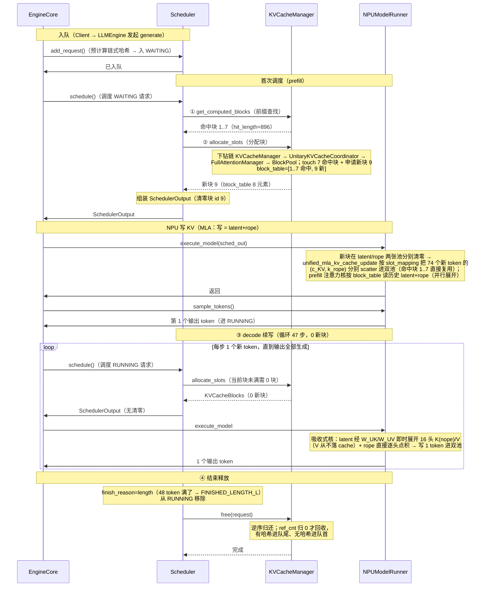
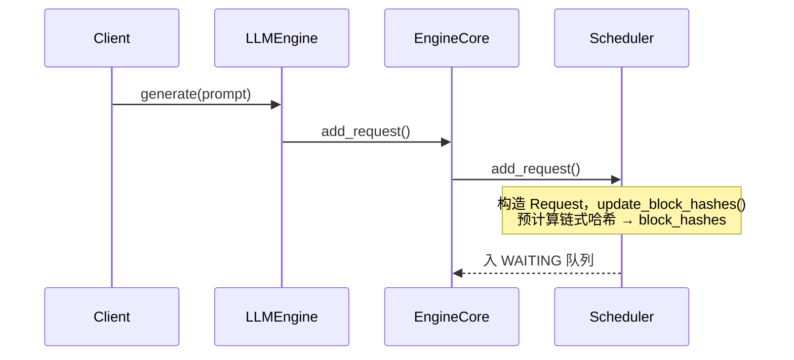
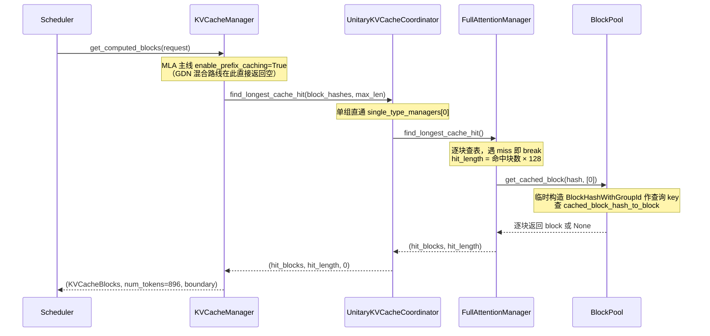
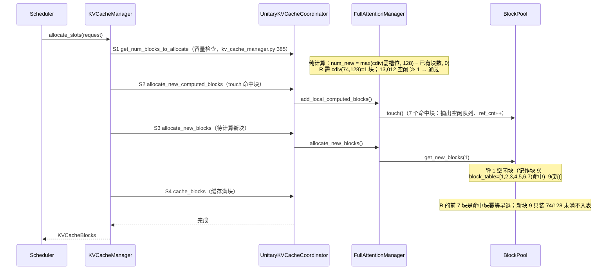
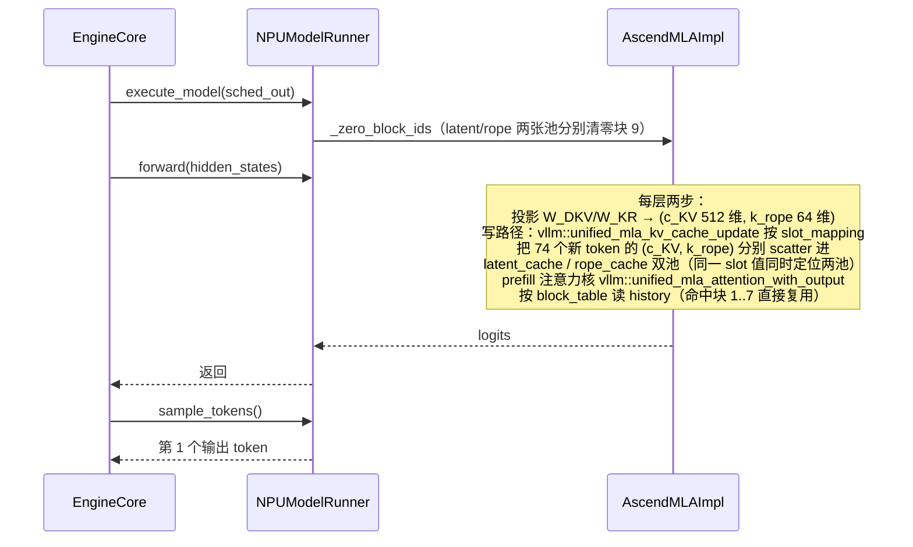
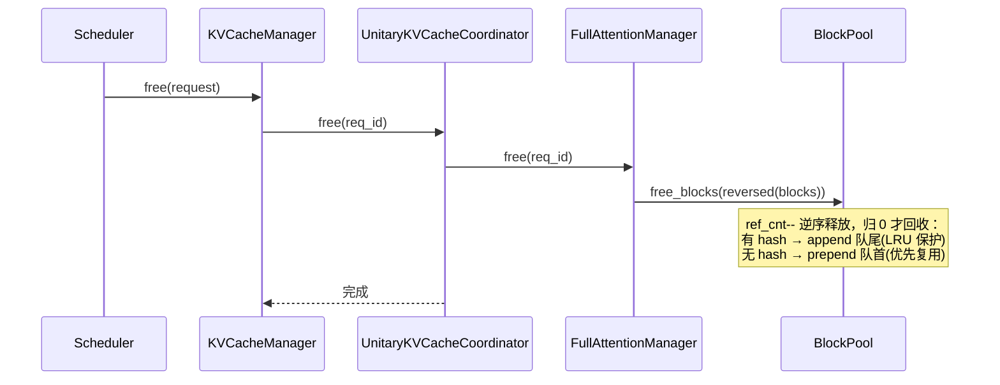

# 一条请求的KVCache管理端到端时序（NPU / vllm-ascend 视角 · DeepSeek-V2-Lite MLA TP4 实测）

> 主线：**MLA 模型 DeepSeek-V2-Lite（TP4，4 卡 Ascend NPU 环境，gggtest2 pod 2026-10-18 实测）**，一个 KVCacheGroupSpec，类型为 `AscendMLAAttentionSpec`。用时序图串起一条请求从进入 Scheduler 到最终释放的全过程。
>
> **编排与逻辑侧（引擎进程）平台无关，且与纯 Full Attention 逐字相同**，本篇照主线展开；**设备执行链是 NPU + MLA 实现**（`NPUModelRunner` / `AscendMLAImpl`，latent/rope 双池张量）——分配决策层不碰显存，"写 KV / 读 KV"的算子层是 NPU 特有实现，**写的"K/V"实为 (c_KV latent, k_rope)，传统 value 不落池**。

> **部署拓扑**：TP4 = 4 卡，每个 worker 负责全部 27 层（PP=1）、4 个 Q 头；**latent/rope 池不切分**（TP 各 rank 全尺寸持有）。调度器视角下全模型仍为单 group（27 层），对 TP 布局透明。

> 数字约定：示例数字**全部取自 gggtest2 真实实验**（[`./logs/runtime_prefix_test_1018.txt`](./logs/runtime_prefix_test_1018.txt) 原始输出 + 服务端 metrics/stats；实验脚本 [`./logs/runtime_test_scripts_1018.py`](./logs/runtime_test_scripts_1018.py)）：`block_size=128`、`num_blocks=13,013`、每层 `k_cache=(13013,128,1,512)`（latent 池）与 `v_cache=(13013,128,1,64)`（rope 池）bf16——机制推导见 [`1_start_init.md`](./1_start_init.md) §6。

> **实战主线注记（与兄弟路线上四点差异）**：本篇按主线骨架讲时序（请求样本用 MLP 实测样本）；MLA 主线下四点特征——① **单 KV group**（27 层 `AscendMLAAttentionSpec` 同构 merge，Unitary 协调器直通，与 GDN 混合多组对照）；② **前缀缓存开箱可用**（`enable_prefix_caching=True`：latent+rope 逐 token 因果——§4.2.1 前缀查找正常走，实测命中 61.3%→68.9% token 级闭环，与 GDN 强关前缀对照）；③ **写的"K/V"= latent+rope**（`unified_mla_kv_cache_update` 把 (c_KV, k_rope) scatter 进双池；读历史=读 latent+rope 行，decode 吸收式：latent 经 `W_UK/W_UV` 即时展开 16 头 K(nope)/V，**value 从不落地 cache**）；④ **块粒度单一 128**（管理块==物理块==128，无 GDN 的 1024/128 两层粒度分离；运行期 KV usage 复证 0.1%=12 块/13,013 一字不差）。

---

## 1. 模型配置与框架配置

下文所有阶段共用同一组请求样本，模型参数固定为 DeepSeek-V2-Lite，部署于 TP4（4 卡 Ascend NPU）环境。

DeepSeek-V2-Lite 采用 **MLA（Multi-head Latent Attention）**，其模型级 KV cache 参数如下：

| 参数 | 值 | 说明 |
|---|---|---|
| `num_hidden_layers` | 27 | 全模型层数；每层各持一份 latent/rope 双张量，但**共享同一套 block_id**（27 层 spec 同构 merge 单 group） |
| `num_attention_heads` | 16 | 查询头数（TP4 后每 card 4） |
| `num_key_value_heads` | 16 | HF 兼容字段——MLA 的 KV 是**每层一个共享 latent**，不逐头存储 |
| `kv_lora_rank` | 512 | **latent 维度（c_KV）→ latent 池宽**，占每块容量 8/9 |
| `qk_rope_head_dim` | 64 | **rope 维度（k_rope）→ rope 池宽**，占 1/9；RoPE 旋转后的向量吸收不进 latent，必须逐 token 存 |
| `qk_nope_head_dim` / `v_head_dim` | 128 / 128 | K 的 nope 部分 / V 的逐头维度——**decode 由 latent 经 `W_UK/W_UV` 展开**，不占用 cache |
| `q_lora_rank` | null | Q 不低秩压缩（V2 全量版才有） |
| MoE | 64 routed + 2 shared，每 tok 6 | FFN 侧并行；`first_k_dense_replace=1` 只换首层 FFN 非 MoE，不影响注意力类型 |

**TP4 部署切分**：

| 切分维度 | 全模型 | 每 worker | 说明 |
|----------|--------|-----------|------|
| TP4（按 Q 头切） | 16 Q 头 | 4 Q 头 | `get_num_kv_heads()` 等价除法只作用于 Q 头；MLA 的 `c_KV=W_DKV·h` 与头无关 |
| latent/rope 池 | — | **不切分（全尺寸）** | 对照 GQA：TP 切 KV 头 → 池减半；MLA 池尺寸恒定，TP 只换并发算力 |
| PP | 27 层 | 27 层（PP=1） | 无层切分 |

vLLM 侧 KV cache 配套参数：

| 参数 | 值 | 说明 |
|---|---|---|
| `block_size` | 128 | 页粒度；`AscendMLABackend.get_supported_kernel_block_sizes()=[128]`（mla_v1.py:117-118），管理==物理无分离 |
| `dtype` | bf16 | KV 元素精度（2 字节/元素） |
| `enable_prefix_caching` | **True（默认生效）** | MLA latent+rope 逐 token 因果 → 链式哈希成立（实测命中） |

基于上述参数，**每 worker** 的 KV cache 物理规模可逐级推导（`num_kv_heads=1`、`num_layers=27`）：

| 派生量 | 计算式 | 值 | 说明 |
|---|---|---|---|
| `page_size_bytes` | `block_size × num_kv_heads × head_size × 2B = 128 × 1 × 576 × 2` | **147,456 B** | 单层单块字节数；576=512 latent+64 rope 拼接语义（**与 FA `2×B×H×D×dtype` 不同形，无 K/V 系数**） |
| `num_blocks` | `48.25 GiB ÷ 147,456 ÷ 27` | **13,013** | 4 卡同值（TP 不切 latent → min 对齐无差）；日志 `GPU KV cache size: 1,665,664 tokens` = 13,013 × 128 一字不差 |
| `kv_caches[layer]` | **二元组** `(latent_cache, rope_cache)`，两张**不等维** 4D | K 池 `(13013, 128, 1, 512)`；V 池 `(13013, 128, 1, 64)` | 每层两张独立张量（`k_cache: nope_cache    v_cache: rope_cache`，model_runner_v1.py:4606）；**同一个 `block_id` 命中两张张量各自的同一行**；两池存储不连续（8:1 整池拆分申请） |
| 每 token 全模型 KV | `27 × 576 × 2B` | **31,104 B** | 对照等价 MHA 直存 16 头 × 320 元素 = 10,240 B/层 → **压缩 8.89×** |

---

## 2. 示例请求

示例以 **DeepSeek-V2-Lite（TP4，NPU · gggtest2 实测样本）** 为主线：实验 prompt 为「模板句 ×25 + 提问」，经服务端 usage 计数 **970 tokens**，`max_tokens=48`；三连发（cold1 / warm2 / warm3）+ 一次长请求（同前缀、975 tokens、max_tokens=512）。**下文块号即真实 block_id（叙事对应实测账本），数字全部可在 [`./logs/runtime_prefix_test_1018.txt`](./logs/runtime_prefix_test_1018.txt) 复核。**

> 注：block 0 开池即被 `BlockPool` 摘作 `null_block`（不分配、不释放，实际可分配 13,012 块），因此叙事中所有分配从块 1 起。

**前置请求 P（先于 R 服务、已结束）= 实测 cold1**：

```
prompt     = 模板句×25（958 token）+ 提问（12 token） → 970 tokens
block_size = 128 → 970 // 128 = 7 个满块（1..7 号）+ 尾块（块 8，装 70/128）
max_tokens = 48
```

P 服务时把 970 token 的 (c_KV, k_rope) 写进 8 块（7 满 + 尾 70），**写满的 7 块哈希入前缀缓存表**（`cache_full_blocks`：满块才有 hash；未满尾块不入）。P 结束后，块 1..7 作为**带哈希的缓存块**被保留：进 free 队列**队尾**（LRU 保护），记录在 `cached_block_hash_to_block` 映射表。**注意：P 缓存的"块 1"是 latent、rope 两张张量各自的第 1 行——逻辑上的一个块在 NPU 物理上横跨两张张量**，这对逻辑侧不可见。

decode 48 步的块命运（本样本的妙处）：**尾块 70 + 48 = 118 < 128**——48 步全程 **0 次新块分配**，48 个输出 token 的 (c_KV, k_rope) 只追加进尾块的槽位 70..117（两池的同一行内偏移！）。

**示例请求 R = 实测 warm2**：

```
prompt     = 与 P 相同的 970 tokens（模板句×25 + 同一提问）
max_tokens = 48
```

R 的 prompt 前缀与 P **完全相同** → prefill 时 `get_computed_blocks` 命中 P 缓存的块 1..7（`hit_length = 7×128 = 896`）；未满区域（896..969，74 token）为新内容，需重新计算分配 1 块。

宏观路径：**入队（WAITING）→ 首次调度 prefill（命中 896，只算剩余 74 token → RUNNING）→ 每步 decode 续写 1 token（至 48 个输出，尾块 74+47=121<128 全程 0 新块）→ 结束释放**。全过程实测墙钟 0.43 s（warm2）——**计算节省要看 token 账**：命中使 prefill 计算量降到 74/970 ≈ **7.6%**。

**验证请求（长 decode）= 实测 long**：同前缀、提问不同（975 tokens，前 896 与 P 相同）、`max_tokens=512`——用于抓取"运行中"时态（§5）。

---

## 3. 端到端过程速览与总览时序图

`EngineCore.step()`（core.py:443）每步驱动 `schedule → execute_model → sample_tokens`。

**一条请求的端到端过程（编号速览）**（示例 R：prompt = 970 token / max_tokens = 48 / block_size = 128）：

<div style="font-family:ui-monospace,Consolas,'Courier New',monospace;line-height:1.55;font-size:13px">
<div style="white-space:pre;background-color:#f0f0f0">入队 → 请求进入 WAITING 队列</div>
<div style="white-space:pre">├─ 首次调度进行 prefill</div>
<div style="white-space:pre;background-color:#e8f5e9">│  ├─ <span style="color:#1565c0">KVCacheManager.get_computed_blocks</span>（①）# 前缀查找，970//128=7 个 hash 查表 → 全命中 hit_length=896
│  │  └─ <span style="color:#2e7d32">UnitaryKVCacheCoordinator.find_longest_cache_hit</span>
│  │     └─ <span style="color:#e65100">FullAttentionManager.find_longest_cache_hit</span>
│  │        └─ <span style="color:#6a1b9a">BlockPool.get_cached_block</span> → 命中块 1..7（P 缓存的满块）</div>
<div style="white-space:pre;background-color:#e3f2fd">│  ├─ <span style="color:#1565c0">KVCacheManager.allocate_slots</span>（②）
│  │  ├─ <span style="color:#2e7d32">UnitaryKVCacheCoordinator.get_num_blocks_to_allocate</span> # 容量检查：需要 1 块新块（74 token ÷ 128）
│  │  ├─ <span style="color:#2e7d32">UnitaryKVCacheCoordinator.allocate_new_computed_blocks</span> # touch 命中块（7 个）
│  │  │  └─ <span style="color:#e65100">FullAttentionManager.add_local_computed_blocks</span>
│  │  │     └─ <span style="color:#6a1b9a">BlockPool.touch</span> # 命中块 ref_cnt++、摘出空闲队列
│  │  ├─ <span style="color:#2e7d32">UnitaryKVCacheCoordinator.allocate_new_blocks</span> # 为 74 个新 token 分 1 新块
│  │  │  └─ <span style="color:#6a1b9a">BlockPool.get_new_blocks</span> # 弹 1 空闲块（记作块 9），block_table=[7 命中块, 1 新块]
│  │  └─ <span style="color:#2e7d32">UnitaryKVCacheCoordinator.cache_new_blocks</span> # 尾块装 74/128 未满不入哈希
│  └─ SchedulerOutput # 调度输出，含清零块 id（1 个新块）</div>
<div style="white-space:pre;background-color:#fff3e0">│  └─ <span style="color:#c62828">NPUModelRunner.execute_model</span>: latent/rope 双池清零新块 → forward 一次算 74 token 写 KV → sample → 第 1 token</div>
<div style="white-space:pre;background-color:#f0f0f0">→ 请求进入 RUNNING 队列</div>
<div style="white-space:pre;background-color:#f3e5f5">├─ decode（③）# 续写 47 步：尾块 74 → 74+47=121 < 128 → 47 步全程 0 次块分配
│  ├─ <span style="color:#1565c0">KVCacheManager.allocate_slots</span> # 每步一次；当前块未满 → 0 块（token 直接续写）
│  ├─ SchedulerOutput # 0 分配步无清零
│  └─ <span style="color:#c62828">NPUModelRunner.execute_model</span> # 吸收式核：读 latent+rope 行 → W_UK/W_UV 展开 → 写 1 token 进双池</div>
<div style="white-space:pre;background-color:#f0f0f0">→ 请求生成结束（finish_reason=length，48 token 截满）→ 从 RUNNING 队列移除</div>
<div style="white-space:pre;background-color:#ffebee">└─ 结束释放（④）# 命中块 1..7 为共享块 → 仅减引用计数 · 带哈希（P 时填满 1..7）→ append 队尾 · 尾块 9 无哈希 → prepend 队首
   └─ <span style="color:#1565c0">KVCacheManager.free</span>
      └─ ... <span style="color:#6a1b9a">BlockPool.free_blocks</span> # ref_cnt--，归 0 才回收</div>
</div>

**总览时序图**：



---

## 4. 分阶段详解

### 4.1 入队



**要点（MLA 与纯 FA 逐字同）**：
- 入队即预计算：970 token → `970 // 128 = 7` 个满块有 hash（链式哈希），**未满的第 8 块（70 token）无 hash**
- `request.block_hashes` 存的是**纯 `BlockHash`**（不含 group id），group id 到 ① 前缀查找 / ② 分配落库时才临时拼上
- **哈希只由 token 序列决定，与 latent/rope 双池布局无关**——这是 MLA 前缀缓存可用的语义根基（块内容的"指纹"由 token 决定，块里存 latent 还是 K/V 对哈希层不可见）

**结合请求 R**：R 的 7 个满块 hash 在入队时算好，存于 `request.block_hashes`——与 P 服务时 `cache_full_blocks` 登记的 7 个哈希**逐位相同**（同 prompt）。

### 4.2 首次调度（WAITING → prefill）

`schedule()`（scheduler.py:340）每步**先遍历 RUNNING（scheduler.py:378）再遍历 WAITING（scheduler.py:566）**。

> **调度顺序要点**：没有独立的 prefill / decode 全局阶段，只有一个共享 `token_budget`，按"**先 running、后 waiting**"填充；MLA 主线开启 chunked prefill / asynchronous scheduling（实测日志双开），长 prompt 的 prefill 可分片（本实验 970 token 远小于 max_num_tokens 一片通过）。PD 分离由 KV 传输实现，NPU 上 P→D 的 KV 搬运靠注册过的 latent/rope 双池 buffer 完成。

KV 编排链固定为 `KVCacheManager → UnitaryKVCacheCoordinator → FullAttentionManager → BlockPool`（引擎进程内同一份代码——**MLA 单 group 直通，与纯 FA 同链**），下面三个子步骤都走这条链。

#### 4.2.1 ① 前缀缓存查找（get_computed_blocks）



**要点**：
- `max_cache_hit_length = request.num_tokens - 1`：即使全命中，最后 1 个 token 的 logits 仍需重算——**但本样本只命中 896 而非 969 的原因不止于此**：未满尾块（896..969）**没有 hash 不参与查找**；链式哈希从左到右**逐块比对，遇 miss 即 break**
- 本次查找**只读不写**：真正的 `ref_cnt++` 要等 ② 的 touch

**结合请求 R（实测账本）**：7 个 hash 逐块查表全命中（P 登记留存），`hit_length = 7 × 128 = 896`，剩余 `970 − 896 = 74` token 需重新计算。**服务端三级实测证据**（详见 §5 表）：Prometheus `vllm:prefix_cache_hits_total` 从 warm2 起累计 **1,792 = 896 × 2**（warm2 + warm3 各 7 满块；queries 2,925 = 970×3 + 15 冒烟）；stats 日志 `Prefix cache hit rate: 61.3%`（=1792/2925）；长请求后累计 `2,688 / 3,900 = 68.9%`——每次命中恰好 896（7 满块），**token 级账本与块叙事一字不差**。

#### 4.2.2 ② 分配物理块（allocate_slots）



**要点（S1-S4 为 `allocate_slots` 内部编号）**：

- **S1 容量检查** `get_num_blocks_to_allocate`（kv_cache_manager.py:385 → single_type_kv_cache_manager.py:101）：`num_new = max(cdiv(74, 128) − 已持块 0, 0) = 1`；`available = get_num_free_blocks() − reserved ≈ 13,012` ≫ 1 → 通过（若不足 → `return None` 等下轮调度）
- **S2 touch 命中块**：7 块从 free 队列摘出、`ref_cnt` 0→1——**摘出的是"块对象"，两张张量的行内容原样留驻（P 写入的 latent/rope 直接复用、不重算）**
- **S3 新块**：`get_new_blocks(1)` 弹空闲块（队首无哈希块优先——P 释放的尾块或新块号）
- **S4 缓存满块**：R 的命中块幂等早退，新块 9 未满不入哈希

**本步全程在引擎进程、零显存操作**——`allocate_slots` 到 `BlockPool` 为止只知道整数 `block_id`，不知道（也不需要知道）这个块在 latent 池/rope 池上对应第几行。

#### 4.2.3 组装 SchedulerOutput

**清零新块** `new_block_ids_to_zero`：新分配的块 9 进清零列表——**Worker 收到后在 latent 池与 rope 池两张张量分别清零块 9 对应行**（按 `block_id × block_size` 定位；MLA 同样按 `needs_kv_cache_zeroing` 策略执行），再执行 forward 写入。

#### 4.2.4 附：BlockHash 的三级演变

| 阶段 | 动作 | 哈希形态 | 位置 |
|---|---|---|---|
| 入队 | `update_block_hashes` 预计算链式哈希（request.py:233） | **纯 `BlockHash`** | `request.block_hashes`，只在此处生成 |
| ① 查表 | `make_block_hash_with_group_id(hash, 0)` **临时构造**查询 key | `BlockHashWithGroupId`（临时） | 仅作 `get_one_block(key)` 的查询 key，用完即弃，不回写 |
| ② 落库 | `set_block_hash(key)` 存入块字段 + `insert(key, block)` 写映射表 | `BlockHashWithGroupId`（持久） | `KVCacheBlock.block_hash` 与 `cached_block_hash_to_block` 映射表 |

记忆口诀：**入队造纯哈希 → ① 拼临时 key 查 → ② 真正落库带 group id**。MLA 主线 group_id 恒为 0（单组）。

### 4.3 NPU 写 KV（NPUModelRunner forward · MLA 双池）

**这一节是设备执行链（NPU + MLA 特有部分）**：逻辑侧前驱（SchedulerOutput 已带 block_table + 清零块 id）完成后，由 `NPUModelRunner` / `AscendMLAImpl` 在 latent/rope 双池张量上执行。



**要点（MLA 四特色 + 三通用）**：

- **写的不是 K/V 而是 (c_KV, k_rope)**：hidden_states 经 `W_DKV` 投影出 512 维 latent（每层唯一、全头共享）、经 `W_KR` 投影出 64 维 rope；`unified_mla_kv_cache_update` 双池入参 scatter——slot 公式 `slot = block_id × 128 + 块内偏移` 与纯 FA 全同
- **value 不落池**：cache 里没有传统 V——decode 时由 latent 经 `W_UV` 即时上采样（`_v_up_proj`，mla_v1.py:898-906）；prefill 并行注意力核同样只在 latent+rope 上展开（`unified_mla_attention_with_output`，头投影在算子内做）
- **`slot_mapping` 与双池对齐**：每 token 一个 slot，**同一个 slot 值同时定位 latent 池与 rope 池的同一位置**（两池按同序号行空间对齐——这正是 4a 8:1 拆分时"行号语义相同"的回报）；R 的 74 个新 token 全落块 9 的 0..73 槽
- **读路径（吸收式）**：注意力核按 `block_table`（8 元素）在两张张量上**各自沿第 0 维 gather 对应行**——`latent = kv_caches[l][0][block_ids]`、`rope = kv_caches[l][1][block_ids]`；同一 `block_id` 在 27 层对应同一逻辑块，全套层共用一份 block_table
- **命中块零 copy 复用**：R 读块 1..7 时**直接使用 P 写入的 latent/rope 行内容**（哈希保证 block 内容一致）——这是前缀缓存节省计算的物理实现
- **两级后端切换**：prefill 走非吸收式并行核（逐 spec 展开计算量大但吞吐高）、decode 走吸收式（`forward_mha/forward_mqa`：latent 一段大 GEMM 展开 16 头 K(nope)/V，mla_v1.py:1700-1721，按 batch 维两种转法）
- **NPUGraph（enforce_eager=False）**：capture 好的图按 token 数分档执行（`[128]` 分档），KV 读写路径被固化进图；实测图内存 0.57~0.58 GiB（启动期 4d 事后记账，见启动篇 §3.1 4d）

**结合请求 R**：块 9 清零（双池）→ 一次 forward 写 74 token 进块 9（双池同 slot）→ 第 1 个输出 token。

### 4.4 ③ decode 续写（RUNNING）

`schedule()` 每步先**遍历所有 RUNNING 请求**（scheduler.py:378），每请求 append 1 token，全部处理完后**一次性** `execute_model + sample_tokens`（多请求共享同一 batch）。与 prefill 走**同一套** `allocate_slots`（内部 4 步 S1~S4），差异仅在量级：无前缀命中（S2 跳过）、量级小。

**结合请求 R（MLA decode 的块账本）**：prefill 后尾块装 74 token，decode 步 1..47 每步 append 1 token：**74 + 47 = 121 < 128**——47 步全部 0 次块分配（S1 算 0、S3 跳过），每步的写 KV 走吸收式核（latent 大 GEMM 展开 + rope 逐头点积 + 写 1 token 进双池槽位 74..120）。第 48 个输出达到 max_tokens 仅采样（`finish_reason=length` 实测值）不再落 KV。

> **MLA decode 的算力画像**（吸收式路径）：每步每层 = 读 27 组 latent/rope 行 + `W_UK`(7168×512·rank) / `W_UV` 两个大 GEMM + flash attention 16 头（nope+rope 拼接 q）——计算被权重矩阵吸收，cache 侧零展开存储。这是 8.89× 压缩率的运行期代价与收益：**显存省 8.9 倍，decode 每 token 多两次 GEMM 投影**（与 GQA 的逐头 K/V 直读对照）。

#### prefill 与 decode 的统一

> 首次 prefill 与 decode 续写共用同一套 **`allocate_slots` 分配块 → forward 写 KV → 满块 `cache_blocks` 入哈希** 骨架，只是规模不同。**唯一的阶段差异**在前置：前缀查找 `get_computed_blocks` 是 prefill 独有的，decode 跳过它（续写的是全新 token，无前缀可查）。

| 维度 | prefill（WAITING 首次） | decode（RUNNING 续写） |
|---|------|------|
| 处理 token 数 | R 一次 74 个（命中 896 免算） | 每步 1 个 |
| 前缀查找 | 是（`get_computed_blocks`，实测命中 896） | 否 |
| 分配块数 | 1 块新块 + 7 块 touch | 0 块（尾块 121 < 128） |
| 内部 4 步 | S1~S4 全走 | S2 跳过，S1/S3/S4 照走 |
| MLA 核 | 非吸收式并行（`unified_mla_attention_with_output`） | 吸收式（`forward_mha/mqa`，mla_v1.py:1700-1721） |
| 状态机 | `WAITING → RUNNING` | 保持 `RUNNING` 直到完成 |

### 4.5 ④ 请求结束 → 释放



**要点**：
- **逆序释放**（`reversed`）：尾块先归还，最近用的块最先被重新分配
- `ref_cnt > 0` 的共享块仅减计数不回收；归 0 才进 free 队列
- 有哈希块 append 队尾（保护前缀缓存），无哈希块 prepend 队首（优先复用）
- **释放全程零显存操作**：**latent/rope 两张张量的行内容原样留驻**（"结束后张量内容保留，等待被同一 block_id 再次索引"），块池只改计数与链表

**结合请求 R + 实测闭环**：R 结束按释放顺序块 9 → 命中块 7..1 逆序：**块 9 无哈希（74/128 + 47 = 121 仍未满）prepend 队首**（下一个请求优先复用其残留槽位——写入会自动覆盖，因 `new_block_ids_to_zero` 清零）；命中块 1..7 `ref_cnt--` 归 0 后**带哈希 append 队尾**（哈希条目保留）——**复用同一前缀的后续请求（实测 warm3、long）仍可命中**。服务端证据：warm3 与 long 各再命中 896（hits 累计 1792 → 2688，命中率 61.3% → 68.9%）。

---

## 5. 小结：一条请求的 KVCache 全生命周期（MLA / NPU 实测视角）

全文以请求 R（warm2，prompt 970 token / 命中 896 / max_tokens 48，TP4 NPU）为主线串起 MLA 的端到端时序，可收拢为三个视角。

**流程视角——五个阶段一气呵成**：

| 阶段 | 章节 | 调度侧 | **MLA 物理侧（NPU）** | 产物 |
|---|---|---|---|---|
| 入队 | 4.1 | `add_request` 入 WAITING | — | 7 个满块 hash 备查 |
| 首次调度 prefill（①②） | 4.2 | ① 命中块 1..7（896）② S1~S4：touch 7 块 + 新块 9 | SchedulerOutput（清零块 9） | block_table 就绪 |
| NPU 写 KV | 4.3 | `execute_model` + `sample_tokens` | 双池清零块 9 → `unified_mla_kv_cache_update` 把 74 token 的 (c_KV, k_rope) 写进双池 → 注意力核按 block_table 读历史（命中复用） | 第 1 token，→ RUNNING |
| ③ decode 续写 | 4.4 | 每步 1 token 循环 | 吸收式：latent 经 `W_UK/W_UV` 即时展开 + rope 逐头点积；**47 步 0 新块（尾块 121<128）** | 48 token 全部生成 |
| ④ 结束释放 | 4.5 | 移出 RUNNING | **双池行内容留驻** | 命中块带哈希留缓存 |

状态机全路径：`WAITING →(首次调度) RUNNING →(持续 decode) → 完成FINISHED_LENGTH → 释放`。

**结构视角——固定的四层下钻链 + NPU latent/rope 双池底座**：

调度器对 KV 的每一次操作（查、分、存、放）都走同一条链 `KVCacheManager → UnitaryKVCacheCoordinator → FullAttentionManager → BlockPool`——**这条链与纯 FA 逐字相同、MLA 零定制**：上层管编排时机，中层按 KVCacheSpec 分派（MLA spec 注册指向 FA manager），底层 `BlockPool` 管逻辑块记账。**整条链都在逻辑侧**——调度全程只认 `block_id`、零显存拷贝；物理存储是初始化时绑在各 NPU worker 上的 latent/rope 双张量，靠 `block_id == 两张张量各自第 0 维行号` 桥接。

**数据视角——实测 token 级账本与 R 的 8 个块走完一生**（左列块一生，右列服务端计数器对账）：

```
块 1..7   P(cold1) 服务时 7 满块写入 + 哈希入表 → R 前缀查找命中(touch) →
          释放仅减计数归零、append 队尾留缓存 → warm3/long 继续命中    |
块 8(P尾) 70/128 未满无哈希 → P 释放 prepend 队首（复用覆盖）         |  queries_total  2,925 = 970×3 + 15
块 9(R尾) 74 + 47 = 121/128 未满无哈希 → 释放 prepend 队首             |  hits_total     1,792 = 896×2（warm2/warm3）
                                                                     |  hit rate       61.3% →（long 后）68.9% = 2688/3900
运行中时态（§ long 请求，峰值 12 块）：                                |  GPU KV cache usage: 0.1% = 12/13,013
  Running: 1 reqs, Waiting: 0 reqs,                                  |        （cdiv(975+512, 128) = 12 块，一字不差）
  Avg generation throughput: 49.5 tokens/s, AICore 起量               |
```

**三组一字不差的数字**贯穿全系列：1,665,664 tokens（启动编排）、0.1%（运行中块账本）、61.3%/68.9%（前缀命中）——逻辑侧主线（BlockPool/manager/哈希/LRU）的每一条公式在 MLA 部署上均**无需修改即可精确复算**，这就是"头落权重、cache 存 latent"设计的实证收束：**MLA 的全部新颖性都收在物理层两张 8:1 不等维的池里，管理框架对此一无所知。**
