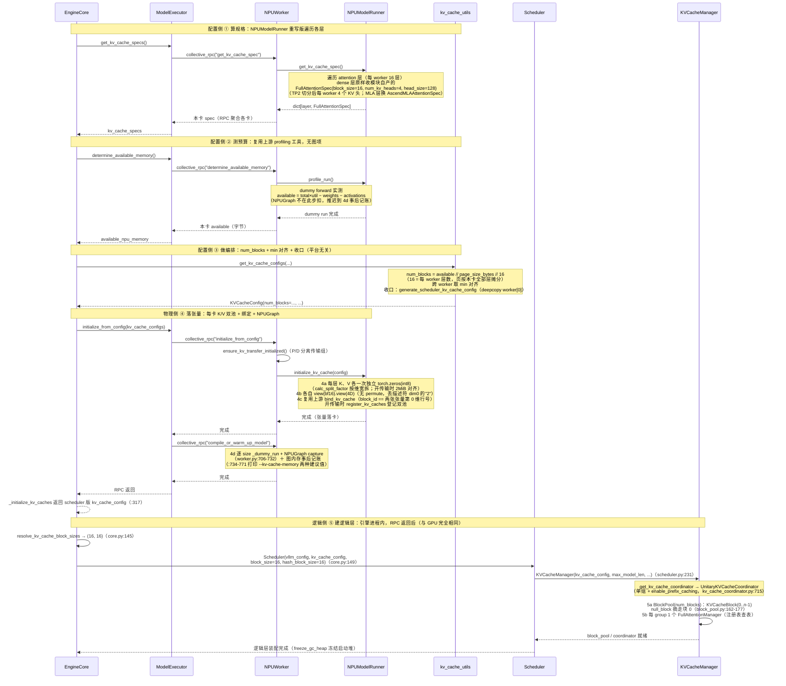

# vLLM-Ascend（NPU）系统启动期初始化

> 本篇是 [`docs_gpu/2_start_init.md`](../docs_gpu/2_start_init.md) 的 NPU 镜像版，主线换成 **vllm-ascend 在昇腾 NPU 上的实现**（`NPUWorker` / `NPUModelRunner` / `AscendAttentionBackend`），GPU（上游 vLLM）只在对照节出现。③ 做编排与 ⑤ 建逻辑侧跑在引擎进程、与平台完全无关，两版内容一致。

文中统一示例环境：**切分策略 pp2tp2，4 卡（Ascend NPU）环境**；三种 Attention 类型各配一个示例模型：

| Attention 类型 | Spec（NPU 实际产出） | 示例模型 | 模型链接 |
|----------------|------|----------|----------|
| Full Attention | `FullAttentionSpec`（上游原类） | Meta-Llama-3-8B | https://www.modelscope.cn/models/LLM-Research/Meta-Llama-3-8B |
| MLA | `AscendMLAAttentionSpec`（nope/rope 拆分） | DeepSeek-V2-Lite | https://www.modelscope.cn/models/deepseek-ai/DeepSeek-V2-Lite |
| GDN | `MambaSpec`（单张量路径） | Qwen3.5-4B | https://www.modelscope.cn/models/Qwen/Qwen3.5-4B |

**章节顺序**：全文按「总览 → 三侧逐个详解 → 衔接 → 物理分布 → 速查」推进，各章如下：

| 章节 | 标题 | 内容主题 |
|------|------|----------|
| §1 | 启动期初始化总览 | 三侧五阶段 |
| §2 | 配置侧详解 | ① 算规格 → ② 测预算 → ③ 做编排（①② 以 NPU 实现为主线） |
| §3 | 物理侧详解 | ④ 落张量 · NPU 主线 / GPU 对照 |
| §4 | 逻辑侧详解 | ⑤ 建逻辑层（平台无关） |
| §5 | 三侧衔接 | `block_id == 张量行号`（NPU 恒 dim0） |
| §6 | PP/TP 物理分布 | 切分策略下的 NPU 张量布局（含本仓库实测数字） |
| §7 | 关键公式速查 | 容量/尺寸/拆分公式汇总 |
| §8 | 设计要点小结 | 设计取舍与结论 |

---

## 1. 系统启动期初始化总览（三侧视角）

系统启动期的 KV cache 初始化横跨**引擎进程**与 **worker 进程**，按运行位置与职责分为三侧：

- **配置侧**（引擎进程发起、NPU worker 实测响应）：依次 ① 算规格、② 测预算、③ 做编排，产出唯一的容量仲裁结果 `KVCacheConfig`（含 `num_blocks`、分组方案、张量尺寸）——这一侧**全程不申请任何 KV 显存**；①② 的实现主体经 collective RPC 落在各 **NPUWorker**（vllm-ascend 插件），③ 做纯 Python 编排跑在引擎进程（上游代码）；
- **物理侧**（worker 进程 · 每卡 NPU）：④ 落张量，按配置把每层 KV cache 物化为真正驻留在 NPU 显存上的张量——**dense 层 K、V 各一张独立 int8 字节池**（开 KV 传输时 2MiB 对齐）→ 零拷贝 `view` 成两张 4D → 绑定到 attention 层，并触发编译预热（NPUGraph）；
- **逻辑侧**（引擎进程）：④ 的 RPC 全部返回后，⑤ 建逻辑层——`Scheduler → KVCacheManager → Coordinator → BlockPool + FullAttentionManager`，全部是纯元数据对象，**与平台完全无关**。

物理侧与逻辑侧之间没有任何对象引用：同一份 `KVCacheConfig`（收口时 deepcopy 出 scheduler 版，见 §2.3 收口）保证两侧 `num_blocks` 容量对齐，靠"`block_id` 即物理张量行号"的编号约定，逻辑链凭整数 `block_id` 直接索引物理行——这正是上层零拷贝调度的物理基座。

### 1.1 三侧五阶段管线

从 `EngineCore` 启动起步（core.py:122 建 ModelExecutor → core.py:132 调 `_initialize_kv_caches`），初始化沿**五阶段单向管线**推进：前三阶段属配置侧（产出 `KVCacheConfig`，尚未触及设备显存），第四阶段落物理，RPC 返回后第五阶段建逻辑：

```
           ┌──────────────────────────────────────────────────────┐
           │ 配置侧（引擎进程发起 · 全程不申请 KV 显存）           │
           │ ① 算规格 → 每层一个 FullAttentionSpec                │
           │ ② 测预算 → 每卡 KV 可用显存字节数                    │
           │ ③ 做编排 → KVCacheConfig(num_blocks) + 收口下发       │
           └──────────────────────┬───────────────────────────────┘
                                  │ 同一份配置
              ┌───────────────────┴───────────────────┐
              ▼ 物理侧 ④（NPU worker 进程 · 每卡）    ▼ 逻辑侧 ⑤（引擎进程，RPC 返回后）
   K/V 双 int8 字节池（2MiB 条件对齐）              Scheduler → KVCacheManager
   → view 成两张 4D → bind                         → Coordinator → BlockPool + Manager
   → 编译预热 + NPUGraph capture（图内存此处实测
     并事后建议 --kv-cache-memory）
              └─────── block_id == 张量行号 桥接 ──────┘
```

| 阶段 | 侧 | 职责 | 入口调用 | 输入 → 产出 |
|------|------|----------|----------|-------------|
| ① 算规格 | 配置侧 | 遍历全模型 Attention 层，采集 spec，推导单页字节量 `page_size_bytes`；同类层合并为 `KVCacheGroupSpec` | `ModelRunner.get_kv_cache_spec()`（NPU 由 `NPUModelRunner` 重写，dense 层产出与 GPU 同一个上游 spec） | `vllm_config` → `dict[layer, FullAttentionSpec]` |
| ② 测预算 | 配置侧 | profile dummy forward，量出 KV cache 可用显存（总显存 × 利用率 − 权重 − 激活；**NPU 公式无图项**，NPUGraph 推迟到 ④ 事后记账） | `ModelRunner.profile_run()` | 设备显存快照 → `available_memory: int` |
| ③ 做编排 | 配置侧 | 合并全 worker spec → 分组 → 导出 `num_blocks`（`available // page_size // num_layers`）→ 预算校验 → 跨 worker `min(num_blocks)` 对齐 → 收口：生成 scheduler 版配置、回写 `num_gpu_blocks`（**平台无关，引擎进程**） | `get_kv_cache_configs()` | specs + budget → `list[KVCacheConfig]` + scheduler 版单份 |
| ④ 落张量 | 物理侧 | dense 层 K/V **两次独立** `torch.int8` 字节池申请（开传输时 2MiB 对齐）→ 各自 `view`（无 permute）成两张 4D → bind（复用上游 `bind_kv_cache`）→ `_dummy_run` 编译 + **NPUGraph** capture，图内存实测后给出 `--kv-cache-memory` 建议 | `ModelRunner.initialize_kv_cache()` | `KVCacheConfig` → `kv_caches[layer] = (k_cache, v_cache)` |
| ⑤ 建逻辑层 | 逻辑侧 | RPC 全部返回后引擎进程装配：推导 scheduler/hash 粒度 → 建 `Scheduler` → `KVCacheManager` → 工厂选 `UnitaryKVCacheCoordinator` → `BlockPool`（一次建 num_blocks 个逻辑块、摘 null_block）+ 每 group 一个 `FullAttentionManager`（注册表查表）——**与 GPU 完全相同** | `EngineCore.__init__`（core.py:145-157）+ `Scheduler.__init__` | scheduler 版 `KVCacheConfig` → 逻辑四层对象 |

**小步编号约定**：三侧管线的①～⑤是**大阶段**（算规格/测预算/编排/落张量/建逻辑层）。§2.3 编排内部另有五个小子步也用①～⑤标注；文中引用写作"§2.3⑤"时指**编排内部第⑤小步（多 worker 对齐）**，不带节号的"⑤"一律指大阶段（建逻辑层）。

> ①②④ 均有 GPU（上游 vllm）与 NPU（vllm-ascend）两套实现：本篇以 **NPU 为主线**（§2.1.1 / §2.2.1 / §3.1），GPU 对照分别为 §2.1.2 / §2.2.2 / §3.2，各主题末尾 `.3` 为逐项对比。③ 编排平台无关，⑤ 逻辑侧更是与平台完全无关（引擎进程内纯 Python 对象装配）。①③⑤ 跑在引擎进程，①②的实现主体经 collective RPC 落在各 NPU worker 进程执行。

> **零拷贝调度的物理基础**：物理张量与逻辑块都就绪后，上层 `BlockPool` 只持有 `block_id`，所有调度决策（分配/释放/共享/驱逐）均不触碰物理显存——调度层与物理层完全解耦，`block_id` 是唯一的交互接口。
### 1.2 启动期三侧时序图（NPU 视角）

`EngineCore.__init__` 内先调 `_initialize_kv_caches`（core.py:132，定义见 :236），由它完成配置侧①②③与物理侧④（:290），并返回 scheduler 版 `kv_cache_config`（:317）；随后引擎凭该 `kv_cache_config` 进行逻辑侧⑤初始化（core.py:145-157）。以主线 Llama-3-8B pp2tp2 为例（每 worker 16 层 / 4 KV 头；GPU 版用了假想 `num_blocks=4096`，本图沿用该参数化数字以便对照，**本仓库 NPU 实测数字见 §6**：`Available KV cache memory: 51.96 GiB`、`num_blocks=13291`、`block_size=128`）：



### 1.3 总调用链（NPU 视角）

以纯 Full Attention 模型（Llama-3-8B pp2tp2，每 worker 16 层 / 4 KV 头，合并后全模型 32 层**单 group**）为例。

```text
EngineCore.__init__                                     # engine/core.py:119 起
│
├─ model_executor = executor_class(vllm_config)         # core.py:122 拉起 worker 进程（平台插件选 NPUWorker）
│
├─ kv_cache_config = _initialize_kv_caches(vllm_config)  # core.py:132，内部跑完配置侧①②③+物理侧④
│    │
│    ├─ ※  register_all_kvcache_specs(vllm_config)       # FullAttentionSpec ↔ FullAttentionManager 注册表
│    │
│    ├─ √ ① §2.1.1 算规格  model_executor.get_kv_cache_specs()
│    │     ├─ RPC 到 NPUWorker.get_kv_cache_spec()（worker.py:891，一行转发）
│    │     │    → NPUModelRunner.get_kv_cache_spec()（model_runner_v1.py:4909，重写：分流表见 §2.1.1）
│    │     └─ 返回 -> list[dict[str, KVCacheSpec]]，每个 worker 上每层 Attention KV cache 类型
│    │
│    ├─ ※  扫描 spec.non_causal                          # 非因果层，关闭 chunked prefill / 前缀缓存（平台无关）
│    │
│    ├─ √ ② §2.2.1 测预算  model_executor.determine_available_memory()
│    │     ├─ RPC 到 NPUWorker.determine_available_memory()（worker.py:527）
│    │     │    → NPUModelRunner.profile_run()（model_runner_v1.py:3684：预热 + super()）
│    │     └─ 返回每个 worker 的 available_kv_cache_memory_bytes 字节数 -> list[int]
│    │        （NPUGraph 内存推迟到 4d 事后记账，见 worker.py:734-771）
│    │
│    ├─ √ ③ §2.3 做编排  get_kv_cache_configs(...)       # 平台无关，引擎进程
│    │     ├─ 合并各 worker 的 spec → 生成 global groups（32层）→ _project 到每 worker 的 projected groups（16层）
│    │     ├─ 基于 projected groups 算 num_blocks → 对齐 min num_blocks
│    │     ├─ 返回 -> list[KVCacheConfig]，每个 worker 上的 KVCacheConfig（统一 num_blocks）
│    │     └─ 收口：generate_scheduler_kv_cache_config（deepcopy）→ 回写 num_gpu_blocks
│    │          → validate_block_size（core.py:279-287；core.py:317 返回 scheduler 版配置）
│    │
│    └─ √ ④ §3.1 物理侧落张量  model_executor.initialize_from_config(...)
│          ├─ collective_rpc("initialize_from_config") → NPUWorker.initialize_from_config()（worker.py:907）
│          │    ├─ ensure_kv_transfer_initialized()（worker.py:909，P/D 分离）
│          │    ├─ sleep mode：CaMemAllocator kv_cache 内存池（worker.py:910-912）
│          │    └─ NPUModelRunner.initialize_kv_cache()（model_runner_v1.py:3843）
│          │         ├─ 4a _allocate_kv_cache_tensors（:4082） dense 层 K、V 各一次 int8 申请
│          │         │      （calc_split_factor 维宽拆分 :4224；2MiB 条件对齐 :4004）
│          │         ├─ 4b _reshape_kv_cache_tensors（:4353） 各自 view 成两张 4D（无 permute）
│          │         ├─ 4c bind_kv_cache                复用上游（:3950-3953），block_id == 各张量行号
│          │         └─ 有 KV 传输组时 register_kv_caches（:3883-3884）
│          └─ collective_rpc("compile_or_warm_up_model") → NPUWorker.compile_or_warm_up_model()（worker.py:706）
│                └─ 4d 逐 size _dummy_run（:728）+ NPUGraph capture（:732）
│                      + 图内存事后记账与 --kv-cache-memory 建议（:734-771）+ ATB 预热（:775-776）
│
└─ √ ⑤ §4 逻辑侧建逻辑层（引擎进程内，④ 的 RPC 全部返回后；与 GPU 完全相同）
       ├─ resolve_kv_cache_block_sizes(kv_cache_config, vllm_config)  # core.py:145 → (16, 16)
       ├─ Scheduler(vllm_config, kv_cache_config, block_size=16, hash_block_size=16)  # core.py:149
       │     └─ KVCacheManager(kv_cache_config, max_model_len, ...)   # sched/scheduler.py:231
       │           ├─ get_kv_cache_coordinator → UnitaryKVCacheCoordinator  # kv_cache_coordinator.py:715
       │           │     ├─ 5a BlockPool(num_blocks)：KVCacheBlock(0..n-1)，null_block 摘走块 0  # block_pool.py:149
       │           │     └─ 5b 每 group 1 个 FullAttentionManager（注册表查表）  # single_type_kv_cache_manager.py:1311
       │           └─ self.block_pool = coordinator.block_pool          # kv_cache_manager.py:156
       ├─ request_block_hasher（前缀缓存开启时生成请求级哈希器，core.py:206-215）
       └─ freeze_gc_heap() / enable_envs_cache()（core.py:228 / :233，启动装配冻结，运行期进入定态）
```

**※ 前置 · 注册 spec ↔ manager 映射**

进入①之前，`EngineCore` 进程内先执行 `register_all_kvcache_specs(vllm_config)`，把 `FullAttentionSpec` 注册到 `FullAttentionManager`：

```python
# single_type_kv_cache_manager.py:1349
def register_all_kvcache_specs(vllm_config):
    """Built-in spec registration"""
    KVCacheSpecRegistry.register(
        FullAttentionSpec,
        FullAttentionManager,
        uniform_type_base_spec=FullAttentionSpec,
    )
```

> 这是一张"spec 类型 → 管理类"的查表：③ 分组完成后，⑤ 建逻辑层时按 `KVCacheGroupSpec.kv_cache_spec` 的类型查表实例化对应 manager（§4.6，与这里形成同进程闭环）；FullAttention 主线只用到 `FullAttentionManager`。vllm-ascend 的 NPU 特有 spec（`AscendMLAAttentionSpec` 等）也会在插件侧注册到对应 manager，注册闭环对插件同样成立。

### 1.4 交付物与消费方（按侧）

| 交付物 | 生产（侧 · 阶段） | 消费方 | 用途 |
|--------|------------------|--------|------|
| `kv_cache_configs`（list，每 worker 一份） | 配置侧 ③ | 物理侧 ④：各 NPUWorker | Worker 遍历 `kv_cache_tensors`，dense 层按 split factor 拆 K/V 申请字节池、按 `shared_by` 绑定到层 |
| `num_blocks`（跨 worker 对齐） | 配置侧 ③ | 逻辑侧 ⑤ 的 `BlockPool` | `BlockPool.__init__` 建出 `KVCacheBlock(0 .. num_blocks-1)`（块 0 开池即留作 `null_block` 占位，实际可分配 `num_blocks-1`） |
| scheduler 版 `KVCacheConfig`（deepcopy 单份） | 配置侧 ③ 收口（`_initialize_kv_caches` 返回值） | 逻辑侧 ⑤：Scheduler / KVCacheManager / Coordinator | 分组信息、`num_blocks`、`has_mamba_layers` / `needs_kv_cache_zeroing` 等运行标志 |
| `cache_config.num_gpu_blocks` 回写 | 配置侧 ③ | EngineCore / Scheduler / KV connector | KV 容量对外可见，供准入与 connector 握手 |
| `kv_caches[layer_name] = (k_cache, v_cache)` | 物理侧 ④ | Ascend attention 算子 + NPUModelRunner | Llama-3-8B 每层两张 `(num_blocks, block_size, num_kv_heads, head_dim)` 物理张量：forward 时 `reshape_and_cache` 按 `slot_mapping` 写新 K/V 各自进池、注意力核按 `block_table` 沿第 0 维 gather 物理行读历史 K/V；ModelRunner 侧引用用于清零本轮新块 |
| `KVCacheManager` 全套（Coordinator + BlockPool + manager） | 逻辑侧 ⑤ | Scheduler 运行期 | `get_computed_blocks` / `allocate_slots` / `free` 统一 API，产出 `block_table` |

## 2. 配置侧：算规格 → 测预算 → 做编排（引擎进程发起）

配置侧三步在 `EngineCore._initialize_kv_caches`（core.py:236-317）内依序执行：①②的实现主体经 collective RPC 落在各 worker 进程（NPU/GPU 两套），③ 做纯 Python 编排跑在引擎进程。三步全程不申请任何 KV 显存，产出**唯一的容量仲裁结果** `KVCacheConfig`：一份完整版 list（供④物理侧逐卡执行）+ 一份 scheduler 版（供⑤逻辑侧装配）。

### 2.1 第 ① 步 · 算规格：各层产出 KVCacheSpec

这一步遍历本 worker 模型里的每个 Attention 层，问出"你需要什么形状的 KV cache"。RPC 骨架平台无关（同一个 `ModelExecutor.get_kv_cache_specs()`，core.py:243），但 Worker / ModelRunner 的实现分 NPU（§2.1.1 主线）、GPU（§2.1.2 对照）两套；对纯 Full Attention 模型，两套最终产出的是**同一个上游 `FullAttentionSpec`**（对比见 §2.1.3）。
#### 2.1.1 NPU 主线（vllm-ascend）：Worker 直接转发，Runner 有重写但 dense 层原样收 spec

**调用链**：`EngineCore` → `ModelExecutor.get_kv_cache_specs()`（core.py:243）→ RPC 到各 worker（平台插件选到 `NPUWorker`）→ `NPUWorker.get_kv_cache_spec()`（vllm_ascend/worker/worker.py:891）——**一行转发，自身零逻辑**：

```python
# worker.py:891
def get_kv_cache_spec(self) -> dict[str, KVCacheSpec]:
    return self.model_runner.get_kv_cache_spec()
```

`NPUModelRunner.get_kv_cache_spec()`（vllm_ascend/worker/model_runner_v1.py:4909）**重写**了上游 Runner 的同名方法。遍历骨架（`AttentionLayerBase` → 逐层问 spec → kv_sharing 跳过）与 GPU 一致，多出的是 NPU 特有 spec 类型的分流：

| 层类型 | NPU 分支（model_runner_v1.py） | 产出 spec |
|---|---|---|
| decoder 普通 `Attention`（**Llama 走此路**） | :4943-4946 `if spec := attn_module.get_kv_cache_spec(...)` 后**原样存入** | 上游 **`FullAttentionSpec`**（模型层自产，与 GPU 完全相同） |
| `MLAAttention`（DeepSeek 系） | :4948-5000 | **`AscendMLAAttentionSpec`**：非 sparse 路径取上游 spec 的 block_size/num_kv_heads/dtype，`head_size` 按 fa_quant 与否选 `head_size + qk_rope_head_dim` 或原值（:4987-4999）；sparse（DSA/SFA）路径另带 `sparse_head_dim`、`cache_sparse_sfa_c8`、`sfa_dcp_replicated_indexer_size` 等字段（:4949-4986） |
| `MambaBase` | :5002-5003 先收集、:5027-5036 后统一处理 | 各 Mamba 自身 spec；并把同模型 attn 层的 `page_size_padded` 对齐到 mamba 页（:5034-5036 `object.__setattr__(..., "page_size_padded", ...)`） |
| `CacheOnlyAttentionLayer`（extract_hidden_states） | :5005-5025 | **`HiddenStateCacheSpec`**（重建为可 pickle 的新对象，注释明言"keep the HiddenStateCacheSpec type so get_kv_cache_groups isolates this cache-only layer into its own group"，单独成组） |
| `use_compress` 压缩 KV | :4939-4942 | 模块自身 spec 原样收 |

另有两个与 GPU 对齐的边界行为：EC 传输 producer 直接返回 `{}`（:4918-4919，GPU 是"非 consumer 返回空"）；`kv_sharing_target_layer_name` 同样登记后跳过（:4928-4938）。

> **对 Llama 主线的结论**：NPU 这层重写对 dense 模型是"透明"的——每层拿到的仍是 attention 模块自产的 `FullAttentionSpec(block_size=16, num_kv_heads=4, head_size=128, dtype=bf16)`，所以 §2.3 的合并/分组/`page_size_bytes` 推导在两个平台上逐字节相同；NPU 与 GPU 的**物理差异（K/V 双池、2MiB 对齐）要到 §3 物理侧落张量时才出现**。

#### 2.1.2 GPU（上游 vLLM）对照

**调用链**：RPC 方法名相同，平台插件选到 `GPUWorker`：`GPUWorker.get_kv_cache_spec()`（gpu_worker.py:547，仅一行转发）→ **`GPUModelRunner.get_kv_cache_spec()`（gpu_model_runner.py:7440）**：

```python
# gpu_model_runner.py:7440 GPUModelRunner 实例方法（用 self）
def get_kv_cache_spec(self) -> dict[str, KVCacheSpec]:
    kv_cache_spec: dict[str, KVCacheSpec] = {}
    layer_type = cast(type[Any], AttentionLayerBase)
    attn_layers = get_layers_from_vllm_config(self.vllm_config, layer_type)
    for layer_name, attn_module in attn_layers.items():
        if isinstance(attn_module, Attention) and (
            kv_tgt_layer := attn_module.kv_sharing_target_layer_name
        ):
            self.shared_kv_cache_layers[layer_name] = kv_tgt_layer  # kv_sharing 复用目标层 KV，跳过
            continue
        if spec := attn_module.get_kv_cache_spec(self.vllm_config):  # 跳过无 KV 的 encoder-only
            if isinstance(spec, AttentionSpec):
                backend = attn_module.get_attn_backend()
                with set_current_vllm_config(self.vllm_config):
                    indexes = backend.indexes_kv_by_block_stride()
                spec = replace(spec, indexes_kv_by_block_stride=indexes)
            kv_cache_spec[layer_name] = spec
    return kv_cache_spec
```

纯 Full Attention 模型产出 `FullAttentionSpec`——注意 spec 是**模型层自己产出的**（`Attention.get_kv_cache_spec()`，attention.py:603），与跑在 GPU 还是 NPU 无关：

```python
# model_executor/layers/attention/attention.py:603（decoder 普通分支）
return FullAttentionSpec(block_size=block_size, num_kv_heads=self.num_kv_heads,
                         head_size=self.head_size, head_size_v=self.head_size_v,
                         dtype=self.kv_cache_torch_dtype, kv_quant_mode=quant_mode)
```

#### 2.1.3 NPU 与 GPU 对比

| 维度 | NPU（vllm-ascend，主线） | GPU（上游 vLLM） |
|---|---|---|
| Worker 方法 | `NPUWorker.get_kv_cache_spec()`（worker.py:891），一行转发 | `GPUWorker.get_kv_cache_spec()`（gpu_worker.py:547），**同样一行转发** |
| Runner 方法 | `NPUModelRunner.get_kv_cache_spec()`（model_runner_v1.py:4909），**重写** | `GPUModelRunner.get_kv_cache_spec()`（gpu_model_runner.py:7440） |
| dense decoder 层产出 | **同一个 `FullAttentionSpec`**（模型层自产，runner 原样收，:4943-4946） | `FullAttentionSpec` |
| 特有 spec 类型 | 额外分流 `AscendMLAAttentionSpec` / `HiddenStateCacheSpec` / mamba 页对齐 patch | 由各模型/后端自行返回（SlidingWindow、TQ、MLA 等） |
| kv_sharing 跳过、encoder-only 跳过 | 有 | 有（相同语义） |
| EC 传输空返回 | producer → `{}`（:4918-4919） | 非 consumer → `{}` |

**※ 边注 · 扫描 `non_causal`（平台无关）**——specs 收集齐后，EngineCore 检查是否有层标记 `non_causal=True`（如 Prefix LM attention），这段在 EngineCore 进程内、GPU/NPU 都生效：

```python
# core.py:263（vllm-study 主线；releases/v0.23.0 尚无此检查）
if any(getattr(spec, "non_causal", False)
       for worker_specs in kv_cache_specs
       for spec in worker_specs.values()):
    vllm_config.scheduler_config.enable_chunked_prefill = False  # 非因果层：关闭 chunked prefill
    vllm_config.cache_config.enable_prefix_caching = False       # 前缀缓存一并关闭
```

> 非因果层与 chunked prefill / 前缀缓存依赖的"因果注意力"假设冲突，会破坏 prefill 正确性；纯 Full Attention 全因果，此分支不触发。注意这个开关会一路传导到⑤：`Scheduler.__init__` 里 `KVCacheManager(enable_caching=cache_config.enable_prefix_caching)`（§4.3）据此决定协调器走哪个分支。
### 2.2 第 ② 步 · 测预算：profile 量出可用显存

这一步在每个 worker 上跑一次 dummy forward，量出权重+激活之外还剩多少字节给 KV cache。RPC 骨架相同（`ModelExecutor.determine_available_memory()`，core.py:257），但 Worker 实现分 NPU（§2.2.1 主线）/ GPU（§2.2.2 对照）两套，核心差异在**图内存何时记账**（对比见 §2.2.3）。

#### 2.2.1 NPU 主线（vllm-ascend）：复用上游 profiling 工具，图内存推迟到 4d 记账

`NPUWorker.determine_available_memory()`（vllm_ascend/worker/worker.py:527）整体结构与 GPU 平行，多处直接复用上游：

1. **快路径 `--kv-cache-memory`**（worker.py:540-553）：用户显式指定 KV 字节数时，仍跑一次 `profile_run()`（触发编译），但跳过整个记账计算，直接返回用户指定值，并提示该值不受 `gpu_memory_utilization` 约束：

```python
# worker.py:540-553（节选）
if kv_cache_memory_bytes := self.cache_config.kv_cache_memory_bytes:
    self.model_runner.profile_run()
    logger.info("Initial free memory %.2f GiB, reserved %.2f GiB for KV Cache "
                "as specified by kv_cache_memory_bytes, skipping memory profiling. "
                "This does not respect the gpu_memory_utilization config. ...", ...)
    return kv_cache_memory_bytes
```

2. **同一套快照/上下文工具**：`MemorySnapshot` 与 `memory_profiling` 直接从上游 `vllm.utils.mem_utils` 导入（worker.py:47）——快照内部走 `current_platform` 平台抽象，NPU 下即 torch.npu 的设备统计，无需自己重写；

```python
# worker.py:557-561（节选）
with memory_profiling(
    self.init_snapshot,
    weights_memory=int(self.model_runner.model_memory_usage),
) as profile_result:
    self.model_runner.profile_run()
```

3. **同一次 dummy forward**：`NPUModelRunner.profile_run()`（model_runner_v1.py:3684）只在前后加 NPU 专属预热，核心调用 **`super().profile_run()`**（:3696）即 GPU 那套 max-token dummy forward：

```python
# model_runner_v1.py:3684-3697（节选）
def profile_run(self) -> None:
    self.eplb_warmup()                                   # :3685 EPLB 专家负载均衡 warmup
    mc2_tokens_capacity = get_mc2_tokens_capacity()
    if self.max_num_tokens > mc2_tokens_capacity and select_moe_comm_method(...):   # MC2 MoE 通信容量试跑
        self._dummy_run(mc2_tokens_capacity, with_prefill=True, is_profile=True)
    if self.pcp_size > 1:                                # PCP 切分序列
        self.max_num_tokens = math.ceil(self.max_num_tokens / (self.pcp_size * 2)) * 2
    super().profile_run()                                # :3696 主 dummy forward
    self.max_num_tokens = origin_max_num_tokens
```

Llama 无 MoE，实际走的就是 `super()` 路径。

4. **torch 峰值改走 npu API**：`torch.npu.memory_stats(self.device)["allocated_bytes.all.peak"]`（worker.py:567，GPU 对应 `torch.accelerator.memory_stats`），同样取图捕获**之前**的预捕获值并覆写 `torch_peak_increase`（:571）——避免把图池重复计成激活。

**核心公式——没有图内存项**（worker.py:572-574 / :590）：

```
available_kv_cache_memory = requested_memory                （total × gpu_memory_utilization）
                           − (non_torch_increase
                              + torch_peak_increase          （预捕获峰值）
                              + weights_memory)
```

NPUGraph 此刻还没 capture（它发生在 4d `compile_or_warm_up_model()`，worker.py:732），自然无法在这一步预留。图内存改为**事后记账**：4d capture 拿到 `npugraph_memory_bytes` 后，worker.py:734-771 打印一条建议日志，把 `权重 + 峰值激活 + non-torch + NPUGraph + 150 MiB 余量`重算一遍，给出两种 `--kv-cache-memory` 建议值（贴 requested / 贴整机 free），供下次启动直接指定——这正是 NPU 上推荐用 `--kv-cache-memory` 而非只调利用率的原因。

其余细节（对照 GPU）：

- 快照一致性断言 NPU 用严格大于（`init.free > profile 后 free`，worker.py:581，GPU 是 `≥`）；
- 结果日志 NPU 用 `logger.info_once("Available KV cache memory: %.2f GiB", ..., scope="local")`（worker.py:593-595）——本仓库实验启动日志里的 `[worker.py:593] Available KV cache memory: 51.96 GiB` 即此行。

#### 2.2.2 GPU（上游 vLLM）对照

**调用链**：`EngineCore` → `ModelExecutor.determine_available_memory()`（core.py:257）→ RPC 到各 worker → `GPUWorker.determine_available_memory()`（gpu_worker.py:372）→ 内部 `self.model_runner.profile_run()`（dummy forward 量峰值）→ 写回 `self.available_kv_cache_memory_bytes`（gpu_worker.py:461）→ 返回每个 worker 的 `available_memory` 字节数 `list[int]`。

**核心公式**：

```
requested_memory = total_memory × gpu_memory_utilization        (utils.py:405)

available_kv_cache_memory = requested_memory
                           − non_kv_cache_memory                (权重 + 激活 + 其他)
                           − cudagraph_memory_estimate_applied  (CUDA graph 预留)
```

其中 `non_kv_cache_memory = non_torch_increase + torch_peak_increase + weights_memory`（gpu_worker.py:431-435）。

图内存记账的两个细节：① `profile_cudagraph_memory()` 只在 `current_platform.is_cuda()` 且 cudagraph_mode ≠ NONE 时测量；② 测到的预估值**仅当环境变量 `VLLM_MEMORY_PROFILER_ESTIMATE_CUDAGRAPHS` 打开才真的从预算里扣**，默认 `applied=0`。

> 若显式设置 `cache_config.kv_cache_memory_bytes`（`--kv-cache-memory`），仍会跑一次 `profile_run()`（触发编译），但跳过整个记账计算，直接返回用户指定字节数——两平台同款快路径。

#### 2.2.3 NPU 与 GPU 对比

| 维度 | NPU（vllm-ascend，主线） | GPU（上游 vLLM） |
|---|---|---|
| Worker 方法 | `NPUWorker.determine_available_memory()`（worker.py:527），结构平行 | `GPUWorker.determine_available_memory()`（gpu_worker.py:372） |
| requested 公式 | `total × gpu_memory_utilization` | 相同（utils.py:405） |
| 显存快照/上下文 | **直接 import 复用同一工具**（worker.py:47，经 current_platform 落到 npu 统计） | `MemorySnapshot` + `memory_profiling`（vllm.utils.mem_utils） |
| 峰值统计 API | `torch.npu.memory_stats`（worker.py:567，取预捕获值并覆写 :571） | `torch.accelerator.memory_stats` |
| dummy forward | `NPUModelRunner.profile_run()`：EPLB/MC2/PCP 预热包一层后调 `super().profile_run()`（model_runner_v1.py:3684-3696） | `GPUModelRunner.profile_run()` |
| 图内存何时扣 | **本步不扣**；NPUGraph 在 4d capture 后实测，经"建议 --kv-cache-memory"日志事后记账（worker.py:734-771；150 MiB 余量 :742） | profile 阶段测量 CUDAGraph 预估（env `VLLM_MEMORY_PROFILER_ESTIMATE_CUDAGRAPHS` 打开才扣，默认不扣） |
| `--kv-cache-memory` 快路径 | profile_run 编译后直接返回指定值（worker.py:540-553） | 相同 |
| 快照一致性断言 | `init.free > 后 free`（worker.py:581，严格大于，PL 处 OOM 更早暴露） | `init.free ≥ 后 free`（:452） |
| 结果日志 | `info_once` 每进程一次（worker.py:593，实验实测 51.96 GiB） | `Available KV cache memory ...`（info/debug） |
### 2.3 第 ③ 步 · 做编排：合并 / 分组 / num_blocks / 对齐 / 收口（平台无关）

**调用链**：`EngineCore` → `get_kv_cache_configs()`（kv_cache_utils.py:1956），顶层入口，依次五步（PP 下含投影），最后在 EngineCore 侧收口生成 scheduler 版配置。**本节全部跑在引擎进程，与 NPU/GPU 无关**（①② 上报的 spec / 预算是什么，它就编排什么）。本节内部小步①～⑤指编排的五小子步（见 §1.1 编号约定）。

**① 合并全 worker spec**

```python
# kv_cache_utils.py:1994（节选）
merged_kv_cache_specs: dict[str, KVCacheSpec] = {}
for kv_cache_spec_one_worker in kv_cache_specs:
    for layer_name, layer_spec in kv_cache_spec_one_worker.items():
        merged_kv_cache_specs[layer_name] = layer_spec  # 跨 worker 合并
```

> 不同 PP stage 层名不同，合并天然不覆盖；同 PP stage 的不同 TP rank 提交同层 spec，断言检查必须等值（原因：TP 切分后 `num_kv_heads` 相同 → spec 字段全等，详见 §6）。**注意：NPU 的 MLA 层在①阶段已经是 `AscendMLAAttentionSpec`，也就是说"平台特有 spec"从这一步开始就进入平台无关的编排管线——编排对 spec 的具体类型不感知，只按 `page_size_bytes` 等抽象接口工作。**

**② 分组 `get_kv_cache_groups()`** —— 纯 FullAttention 走 `is_kv_cache_spec_uniform()` → `_get_kv_cache_groups_uniform_spec()` → 全模型**单 group**。

```python
# kv_cache_utils.py:874
def is_kv_cache_spec_uniform(kv_cache_spec) -> bool:
    if not kv_cache_spec:
        return True  # encoder-only 模型
    try:
        kv_cache_spec_values = list(kv_cache_spec.values())
        _ = kv_cache_spec_values[0].merge(kv_cache_spec_values)  # 尝试合并
    except AssertionError:
        return False
    return True
```

> `merge()` 检查所有层 spec 字段（block_size / num_kv_heads / head_size / dtype 等）是否一致。

**③ 投影到各 worker：按 projected groups 计算 num_blocks**

`num_blocks` 是 **per-worker 容量**——每个 worker 只物化本 rank 负责的层（PP 切层；TP 切头已折进各 worker spec 的 `page_size_bytes`），可用显存必须按 worker 实际承载的层数折算，不能以全局合并层数为除数。`get_kv_cache_configs()` 先执行 `_project_kv_cache_groups_to_worker()`，把 global groups（32 层）投影为各 worker 的 **projected groups**（16 层），再传入 `get_kv_cache_config_from_groups()`（kv_cache_utils.py:1247，单组 `FullAttentionSpec` 走通用 else 路径）：

```python
# kv_cache_utils.py:1309-1326（节选）
group_size = max(len(group.layer_names) for group in kv_cache_groups)  # = 16（projected 后每 worker 层数）
num_blocks = available_memory // page_size // group_size
# group_size = projected group 的层数（pp2tp2 下每 worker 16，不是合并的 32）
# page_size = get_uniform_page_size() = FullAttentionSpec.page_size_bytes（单层每页字节，TP2 后 = 32KB）
# 生成 group_size 个张量（每 worker 16 个），每个 size = page_size × num_blocks，shared_by 为单层
```

**④ 校验 `_check_enough_kv_cache_memory()`**

```python
# kv_cache_utils.py:713（节选）
needed_memory = get_needed_memory()  # max_model_len 下需要的 KV cache
if needed_memory > available_memory:
    estimated_max_len = estimate_max_model_len(available_memory)
    raise ValueError(...)  # 建议调大 util 或调小 max_model_len
```

**⑤ 多 worker 对齐**——集中式调度下，同一请求的 `block_table` 由所有 worker 共用：PP 各 stage 按段索引本 rank 的层，TP 各 rank 只读写本 rank 的 KV 头子集，因此 `block_id` 必须在任意 rank 上都对应有效物理行。对齐策略：取各 worker `num_blocks` 的最小值作为全局统一值（以 KV 预算最小的 worker 为基准）：

```python
# kv_cache_utils.py:2074（节选）
min_num_blocks = min(cfg.num_blocks for cfg in kv_cache_configs)
for kv_cache_config in kv_cache_configs:
    num_blocks_old = kv_cache_config.num_blocks
    kv_cache_config.num_blocks = min_num_blocks
    for tensor in kv_cache_config.kv_cache_tensors:   # 等比例缩小 tensor，避免浪费
        tensor.size = tensor.size // num_blocks_old * min_num_blocks
```

**收口 · 生成 scheduler 版配置并回写（core.py:265-287）**

`list[KVCacheConfig]` 就绪后，`_initialize_kv_caches` 在发起④之前做三件收口的事：

1. **max_model_len 自适应同步**（core.py:265-277）：若③的预算校验触发了 max_model_len 自动调小，因为各 worker 先于 profiling spawn、缓存的是原始值，需 `collective_rpc("update_max_model_len")` 把新值同步下去（NPUWorker 的实现见 worker.py:894-905）；
2. **生成 scheduler 版配置**（core.py:279）——`generate_scheduler_kv_cache_config(kv_cache_configs)`（kv_cache_utils.py:1698）：

```python
# kv_cache_utils.py:1698-1717（节选）
assert all(
    [cfg.num_blocks == kv_cache_configs[0].num_blocks for cfg in kv_cache_configs]
)                                # 编排⑤小步的 min 对齐在此处兜底断言
cfg = copy.deepcopy(kv_cache_configs[0])
# All workers have the same kv_cache_config except layer names, so use
# an arbitrary one to initialize the scheduler.
for group in cfg.kv_cache_groups:
    if isinstance(group.kv_cache_spec, UniformTypeKVCacheSpecs):
        group.kv_cache_spec = next(iter(group.kv_cache_spec.kv_cache_specs.values()))
        # UniformType 组折叠为组内任一 spec（主线单 FullAttentionSpec 组不触发）
return cfg
```

> 各 worker 配置仅层名不同，deepcopy 任意一份即可供逻辑侧使用——`num_blocks` 跨 worker 逐份相等由上面的断言保证。这份配置就是 `_initialize_kv_caches` 的返回值（core.py:317），⑤建 Scheduler 用的就是它；完整版 list 则原样传给④。

3. **回写与校验**（core.py:280-287）：`vllm_config.cache_config.num_gpu_blocks = scheduler_kv_cache_config.num_blocks`（容量对外可见）；`cache_config.block_size` 回写为各组最小 block_size；`vllm_config.validate_block_size()` 终检。

**产出数据结构**

```python
# kv_cache_interface.py:854（节选）
@dataclass
class KVCacheConfig:
    num_blocks: int                        # 对齐后的 block 总数
    kv_cache_tensors: list[KVCacheTensor]  # 每层如何初始化
    kv_cache_groups: list[KVCacheGroupSpec]  # 分组信息

@dataclass
class KVCacheTensor:
    size: int              # 字节大小（NPU 上是 K+V 合计：物理侧再按维宽拆分）
    shared_by: list[str]   # 哪些层共享（packed layout 下多个）

@dataclass
class KVCacheGroupSpec:
    layer_names: list[str]       # 该组包含哪些层
    kv_cache_spec: KVCacheSpec   # 该组的 spec
```
## 3. 物理侧：落张量 + 编译预热（NPU worker 进程）

三侧中①算规格、②测预算、④落张量都有 NPU / GPU 两套 Worker / ModelRunner 实现（①②已展开，本节是④），只有③做编排跑在 EngineCore 进程内、平台无关。第④步与前两步一样分平台实现，但 RPC 骨架相同——`ModelExecutor.initialize_from_config()`（core.py:290 / abstract.py:118）内部**连续两个 `collective_rpc`**：先 `initialize_from_config` 完成 4a/4b/4c 落张量，再 `compile_or_warm_up_model` 完成 4d 编译预热。**NPU（vllm-ascend 插件）实现见 §3.1（主线），GPU（上游 vLLM）对照见 §3.2，逐项对比见 §3.3。**

### 3.1 NPU 主线（vllm-ascend）：K/V 双独立池，开传输时 2MiB 对齐

NPU 侧由 vllm-ascend 插件实现：`NPUWorker(WorkerBase)`（vllm_ascend/worker/worker.py:89）与 `NPUModelRunner(GPUModelRunner)`（vllm_ascend/worker/model_runner_v1.py:268）——**重写张量分配/reshape，但复用上游 RPC 框架、`KVCacheConfig` 编排与 `bind_kv_cache` 绑定**。

**调用链**：RPC 方法名与 GPU 完全相同（平台插件选到 NPUWorker；`collective_rpc` 广播 `list[KVCacheConfig]`，各卡按 `global_rank` 取本 rank 的配置，worker_base.py:315-319）：

1. `collective_rpc("initialize_from_config")` → **`NPUWorker.initialize_from_config()`（worker.py:907）**，先做两件 NPU 特有的事再委托 model_runner：

```python
# worker.py:907-918（节选）
def initialize_from_config(self, kv_cache_config: KVCacheConfig) -> None:
    """Allocate NPU KV cache with the specified kv_cache_config."""
    ensure_kv_transfer_initialized(self.vllm_config, kv_cache_config)   # :909 拉起 KV 传输组（P/D 分离）
    if self.vllm_config.model_config.enable_sleep_mode:
        allocator = CaMemAllocator.get_instance()                        # :910-912 sleep mode：
        context = allocator.use_memory_pool(tag="kv_cache")              #  在专用内存池上下文内分配
    else:
        context = nullcontext()
    with context:
        self.model_runner.initialize_kv_cache(kv_cache_config)           # :918 落张量主体
```

   注意 config 路径下 NPUWorker **不回写** `cache_config.num_gpu_blocks`（旧 profile 路径的回写在 `initialize_cache()`，worker.py:391）；`eagle3 + num_speculative_tokens>1` 的 mamba 混合场景还会在 :930-937 检查 `_init_kv_zero_meta` 补充清零元数据。

2. `collective_rpc("compile_or_warm_up_model")` → `NPUWorker.compile_or_warm_up_model()`（worker.py:706），完成 4d 编译预热（见下）。

`NPUModelRunner.initialize_kv_cache()`（model_runner_v1.py:3843）本体：

```text
deepcopy(KVCacheConfig)（:3850，防止改动跨 worker 共享的配置对象）
→ may_add_encoder_only_layers_to_kv_cache_config / maybe_add_kv_sharing_layers_to_kv_cache_groups（:3854-3855）
→ initialize_attn_backend(kv_cache_config)（:3857，先于使用 attn_groups，注释明言）
→ may_reinitialize_input_batch(kv_cache_config)（:3864）
→ initialize_kv_cache_tensors(kv_cache_config)（:3865 调 :3917，内部 = 4a 分配 + 4b reshape + 4c 绑定）
→ 存在 KV 传输组时 register_kv_caches(kv_caches)（:3883-3884，把双池登记给传输层）
```

**4a. 每层分配 K、V 两张独立 int8 池 `_allocate_kv_cache_tensors()`（model_runner_v1.py:4082）**

函数头注释直说拆分动机：

```python
# model_runner_v1.py:4087-4088 函数头注释（原文）
# NOTE: To support prefill disaggregation, we need to split kvcache tensor into
# k cache and v cache, and the addr of both are aligned by 2M
```

dense attention 分支的拆分流程（:4147-4309）：

```python
# model_runner_v1.py:4082/4101/4213-4232/4249-4254（节选）
alignment = 2 * 1024 * 1024                                   # :4101 2MiB 对齐宽度
...
k_dim, v_dim = self._get_attention_kv_cache_dims(layer_name, spec)     # :4213，Llama: (128, 128)
kv_head_dim_list = [k_dim, v_dim]
k_factor, v_factor = calc_split_factor(kv_head_dim_list)       # :4224；vllm_ascend/utils.py:1611
k_tensor_size = int(kv_cache_tensor.size // k_factor)          # :4227 整池字节量按维宽比例拆
v_tensor_size = int(kv_cache_tensor.size // v_factor)          # :4228
k_tensor = self._allocate_int8_cache_tensor(k_tensor_size, alignment)  # :4249 第一次独立 torch.zeros
v_tensor = self._allocate_int8_cache_tensor(v_tensor_size, alignment)  # :4254 第二次独立 torch.zeros
kv_cache_raw_tensors[layer_name] = (k_tensor, v_tensor)        # :4309 登记为二元组（GPU 是单 tensor）
```

其中 `calc_split_factor`（vllm_ascend/utils.py:1611-1613）就是"总宽度 / 各自宽度"：

```python
def calc_split_factor(num_list: list[int]):
    total = sum(num_list)
    return [total / num for num in num_list]
```

- dense 等宽层 `[128, 128] → (2.0, 2.0)`：**对半拆**，K 池 = V 池 = `size/2` 字节；
- MLA `[512, 64] → (1.125, 9.0)`：nope 占 8/9、rope 占 1/9；
- 断言兜底：分配完成后 `assert layer_names == set(kv_cache_raw_tensors.keys())`（:4316，"Some layers are not correctly initialized"）。

对齐本身是条件性的（`_allocate_int8_cache_tensor`，model_runner_v1.py:4004；对齐切片助手 `_align_memory` 在 :3911-3915：`data_ptr` 向上取整再切片），**但 K/V 拆分对所有 dense 层无条件生效**：

```python
# model_runner_v1.py:4004（节选）
def _allocate_int8_cache_tensor(self, numel, alignment):
    if self.vllm_config.kv_transfer_config is None:
        return torch.zeros(numel, dtype=torch.int8, device=self.device)          # 无传输：普通 int8 申请
    raw = torch.zeros(numel + alignment, dtype=torch.int8, device=self.device)   # 开传输：预留 2MiB
    return self._align_memory(raw, alignment)[:numel]                            # 地址对齐后切片
```

同样先按 int8 字节申请、reshape 时再 `view(dtype)`，与 GPU 的"dtype 解耦"动机一致。例外分支（不走 K/V 双分、仍是单张量）：

- Mamba / linear_attn / attn-mamba hybrid / cache_only 层（:4118-4134）：按层名 `"linear_attn" in layer_name` 或 `is_hidden_state_cache_spec(...)` 命中单张量路径——GDN/线性注意力状态缓存与 GPU 同型；
- `use_compress` 压缩注意力（:4135-4146）：同组 self_attn 共享一张张量；
- sparse MLA 还会额外分配 indexer/scale 张量（`_allocate_sparse_c8_indexer_tensors` 等，:4259-4276；登记形态为 2～4 元组，:4646-4680）——Llama dense 主线不涉及。

**4b. 描述符里的"2"被拆成两张 4 维张量 `_reshape_kv_cache_tensors()`（:4353）**

```python
# model_runner_v1.py:4592-4644（dense 非 MLA 分支，节选）
kv_cache_shape = attn_backend.get_kv_cache_shape(           # Ascend 后端：attention_v1.py:104-112
    num_blocks, current_kv_cache_spec.block_size,
    current_kv_cache_spec.num_kv_heads, current_kv_cache_spec.head_size)
#          → (2, num_blocks, block_size, num_kv_heads, head_size)
k_shape = kv_cache_shape[1:]                                # :4600 丢掉 dim0 的"2"
v_shape = k_shape                                           # head_size_v 不同时只换最后一维（:4601-4604）
k_cache = raw_k_tensor.view(k_cache_dtype).view(k_shape)    # :4639 纯 view，无 permute
v_cache = raw_v_tensor.view(v_cache_dtype).view(v_shape)    # :4644
kv_caches[layer_name] = (k_cache, v_cache)                  # :4682 每层绑定对象 = (K, V) 二元组
```

要点：

- Ascend dense 后端描述符 `(2, num_blocks, block_size, num_kv_heads, head_size)` 里的 **"2" 在 dim0、且不落成物理维**——它被拆成两张独立的 4 维张量 `(num_blocks, block_size, num_kv_heads, head_dim)`，每张的 dim0 即 `num_blocks`；
- 全程只有 `view`（int8 → bf16 → 4D），**没有 GPU 的 `permute` 布局翻转**；
- MLA 分支（:4605-4629 / AscendMLABackend get_kv_cache_shape 返回 4D，mla_v1.py:98-106）：两张不等维——k_cache = nope_cache（`kv_lora_rank` 宽）、v_cache = rope_cache（`qk_rope_head_dim` 宽），仍是双池；
- 跨层 KV 复用层在此挂共享引用（:3933-3935，`shared_kv_cache_layers`）；`deepseek_v4` 类型走专门排序装填（:3937-3948），主线不涉及。

**4c. 绑定：直接复用上游 `bind_kv_cache`**

NPU 没有自己的绑定函数——绑定发生在 `initialize_kv_cache_tensors()` 内部：:3950 `from vllm.v1.worker.utils import bind_kv_cache`、:3953 以同一上游函数把 `(k_cache, v_cache)` 按层序填入 `self.kv_caches`（`list[层序 → (K, V)]`）并绑进 `static_forward_context`。forward 时 attention 实现拿到的是二元组，`AscendAttentionBackendImpl.reshape_and_cache`（attention_v1.py:1430）取下标分发给 NPU 算子：

```python
# attention_v1.py:1430-1454（节选）
def reshape_and_cache(self, query, key, value, kv_cache, attn_metadata, output):
    if len(kv_cache) > 1:                                        # :1439
        if self.key_cache is None:
            self.key_cache, self.value_cache = kv_cache[0], kv_cache[1]   # :1441 首次缓存引用
        DeviceOperator.reshape_and_cache(                        # :1444 双池入参
            key=key[...], value=value[...],
            key_cache=self.key_cache, value_cache=self.value_cache,   # 两张池分别 scatter
            slot_mapping=slots)
        notify_kv_cache_written()                                # :1453 通知 KV 传输层：本轮写入完成
```

同一后端类还提供了双池版的 `swap_blocks`（:114-126）/`copy_blocks`（:128-140）——都按 `kv_cache[0]`/`kv_cache[1]` 分别搬 K 行、V 行，这是 NPU 上块级 KV 搬移（P/D 传输、offload）的算子层入口。
**4d. 编译与预热：NPUGraph 替代 CUDAGraph `NPUWorker.compile_or_warm_up_model()`（worker.py:706）**

```python
# worker.py:706-776（节选）
def compile_or_warm_up_model(self) -> CompilationTimes:
    for size in sorted(warmup_sizes, reverse=True):
        self.model_runner._dummy_run(size)                  # :728 各 batch size dummy forward，触发编译
    npugraph_memory_bytes = 0
    if not self.model_config.enforce_eager:
        npugraph_memory_bytes = self.model_runner.capture_model()   # :732 NPUGraph capture
    ...
    if self.cache_config.kv_cache_memory_bytes is None and hasattr(self, "peak_activation_memory"):
        redundancy_buffer = 150 * (1 << 20)                 # :742 150 MiB 安全余量
        non_kv_memory = (weights + peak_activation + non_torch + npugraph_memory_bytes)
        suggested_to_requested = requested_memory − non_kv_memory − redundancy_buffer
        suggested_to_gpu_limit = init_snapshot.free_memory − non_kv_memory − redundancy_buffer
        logger.info("... Replace gpu_memory_utilization with "
                    f"`--kv-cache-memory={suggested_to_requested}` ... or "
                    f"`--kv-cache-memory={suggested_to_gpu_limit}` ...")   # :741-771 事后记账
    if get_ascend_device_type() != AscendDeviceType.A5:
        self._warm_up_atb()                                 # :775-776 ATB 首算预热（防 ReshapeAndCache 首次卡顿，:798-802）
    if get_ascend_config().enable_cpu_binding:
        bind_cpus(self.local_rank)                          # :779-783 热分配落定后再绑核
    set_random_seed(self.model_config.seed)                 # :786 重置随机种子
```

> 图内存"事后记账"的原理：②测预算发生在 NPUGraph capture **之前**（公式里没有图项），此时 4d 已经拿到实测 `npugraph_memory_bytes`，于是在这里把"建议 KV 预算"重算一遍打印出来——`权重 + 峰值激活 + non-torch + NPUGraph + 150 MiB` 从 requested（或整机 free）里扣掉，给出两种 `--kv-cache-memory` 建议值，供下次启动直接指定。150 MiB 余量吸收 profiling 对 ACL context / HCCL buffer / driver 层的低估。

至此 NPU 物理侧就绪。以本仓库 Llama-3-8B 实验为例（详见 §6）：每 worker 16 层 → **32 张张量（16 个 K 池 + 16 个 V 池）**，每张 `(13291, 128, 4, 128) bf16`，KVS 归档 .pt 即按 `"K"/"V"` 双独立张量池原样落盘。

### 3.2 GPU（上游 vLLM）对照：单层单池，K/V 落在同一张量

**调用链**：同名双 RPC，选到 `GPUWorker`：

1. `collective_rpc("initialize_from_config")` → `GPUWorker.initialize_from_config()`（gpu_worker.py:563，先把对齐后的 `num_blocks` 写回本卡 `cache_config.num_gpu_blocks`）→ `GPUModelRunner.initialize_kv_cache()`（gpu_model_runner.py:7284）完成 4a/4b/4c；
2. `collective_rpc("compile_or_warm_up_model")` → `GPUWorker.compile_or_warm_up_model()`（gpu_worker.py:592），完成 4d（CUDAGraph capture）。

GPU 的 4a/4b/4c 概要（与 NPU 的差异点全部在 §3.3 表格展开）：

```python
# 4a：每层只有一次 int8 申请（gpu_model_runner.py:6999 节选）
tensor = torch.zeros(kv_cache_tensor.size, dtype=torch.int8, device=self.device)

# 4b：int8 → dtype 后 permute 翻成后端逻辑布局（gpu_model_runner.py:7040 / attn_utils.py:169 起）
kv_cache_shape = attn_backend.get_kv_cache_shape(...)   # 如 FlashAttn: (N, 2, B, H, D)
kv_caches[layer] = raw.view(dtype).view(shape) ... .permute(*inv_order)
#   block_dim 探测：哨兵值 _S=1234567 再 shape.index(_S)（backend.py:99）

# 4c：同一个 bind_kv_cache（vllm/v1/worker/utils.py:462）——GPU/NPU 共用，只差每层元素是单张量还是二元组
```

GPU 的 4d：`_dummy_run`（gpu_worker.py:592 内）+ `capture_model()` = **CUDAGraph** capture。

### 3.3 NPU 与 GPU 对比

| 维度 | NPU（vllm-ascend，主线） | GPU（上游 vLLM） |
|---|---|---|
| Worker / Runner | `NPUWorker(WorkerBase)` / `NPUModelRunner(GPUModelRunner)`（vllm_ascend/worker/worker.py、model_runner_v1.py） | `GPUWorker` / `GPUModelRunner`（gpu_worker.py、gpu_model_runner.py） |
| ①②③ 编排与 RPC | **完全相同**（插件只换 Worker 实现，方法名/RPC 骨架不变；`KVCacheConfig`、双 RPC：initialize_from_config + compile_or_warm_up_model） | 同左 |
| Worker 入口差异 | 先 `ensure_kv_transfer_initialized`（P/D）、sleep mode 在 `CaMemAllocator` 池上下文分配、`deepcopy(config)`（worker.py:907-918；model_runner_v1.py:3850）；不回写 `num_gpu_blocks` | 直接委托；回写 `num_gpu_blocks`（gpu_worker.py:563） |
| 每层 int8 池数量 | **2 张**（K、V 两次独立、不连续的 `torch.zeros`；`calc_split_factor` 按维宽比例拆，dense 等宽对半、MLA 8:1） | **1 张**（K/V 共用一块原始内存） |
| raw 登记形态 | `kv_cache_raw_tensors[layer] = (k_tensor, v_tensor)` 二元组（model_runner_v1.py:4309） | `= tensor` 单张量 |
| 地址对齐 | KV 传输开启时每张池 **2MiB 对齐**（多申请 2MiB + `_align_memory` 切片，:4004/:3911） | 无特殊要求 |
| 后端 shape 描述符 | Ascend dense `(2, N, B, H, D)`（2 在 dim0，**不落成物理维**，attention_v1.py:104-112）；MLA 直接 4D（mla_v1.py:106） | FlashAttn/FlashInfer `(N, 2, B, H, D)`（2 在 dim1）；ROCm `(2, N, B, H, D)`（2 在 dim0 且落维） |
| reshape 方式 | int8→dtype 后纯 **`view`，无 permute**；"2"被拆，每层**两张** `(N, B, H, D)` 4 维张量 | int8→dtype 后 **`permute`** 翻成后端逻辑布局，每层**一张**张量 |
| 层绑定对象 | `kv_caches[layer]`: `(k_cache, v_cache)` 二元组（:4682） | `kv_caches[layer]`: 一张 Tensor |
| `block_dim` | 恒为每张 K/V 张量的 **dim0**（传输约束：注册 buffer 要求 dim0 = num_blocks），无需探测 | 随后端在 dim0 / dim1，哨兵值 `_S=1234567` 运行时探测（backend.py:99） |
| 写 KV 算子 | `DeviceOperator.reshape_and_cache(key, value, key_cache, value_cache, slots)` 双池入参（attention_v1.py:1444）+ `notify_kv_cache_written`（:1453） | 单张量入参（K/V 维或 packed 末维在内） |
| swap/copy | `kv_cache[0]`/`kv_cache[1]` 双池分别搬行（attention_v1.py:114-140） | 单张量整块操作 |
| 图编译预热 | `capture_model()` = **NPUGraph** capture（worker.py:732）；图内存 4d 实测 + 事后建议 `--kv-cache-memory`（:741-771）；另有 ATB 预热（:775）与 CPU 绑核（:779） | `capture_model()` = CUDAGraph capture；图内存②阶段预估（默认不扣） |
| 每 worker 张量数（Llama 16 层） | 32 张（16 K + 16 V） | 16 张 |
| 分叉/额外语义动机 | prefill/decode 分离（Mooncake / ADXL 传输）要求注册 buffer dim0 = num_blocks、地址 2MiB 对齐 | — |

**不变的平台契约**（所以上层零改动）：同一份 `KVCacheConfig` 与跨 worker `min(num_blocks)` 对齐；都是 int8 字节池起步、与 dtype 解耦；都用同一个 `bind_kv_cache` 绑定；逻辑侧 `block_id == 物理张量 dim0 行号` 的约定在两个平台都成立（NPU 上 K 池/V 池各有一套同序号的行空间）——⑤逻辑层（§4）、`BlockPool`、`KVCacheManager` 的分配/释放/哈希/驱逐逻辑对此完全无感。
## 4. 逻辑侧：建逻辑层（引擎进程 · 纯元数据装配）

④的 RPC 全部返回后，`_initialize_kv_caches`（core.py:317）把收口生成的 scheduler 版 `KVCacheConfig` 返回给 `EngineCore.__init__`，引擎进程随即执行⑤——装配逻辑四层（协调器 / 单类型管理 / 块池 / 门面，架构编号第 2～5 层，见 [`0_kvcache_arch.md`](./0_kvcache_arch.md)）。本侧特点：**全部对象都是纯元数据**（`KVCacheBlock` 只含 `block_id` 与引用计数等，不含任何 K/V 数据）、**启动期一次性建好**、**与平台（NPU/GPU）完全无关**——本节与 GPU 版逐字一致，仅保留以便单篇自洽。

### 4.1 装配时点：物理先于逻辑

`EngineCore.__init__` 的后半段（core.py:135-233）：

```python
# core.py:145-157（节选）
scheduler_block_size, hash_block_size = resolve_kv_cache_block_sizes(
    kv_cache_config, vllm_config
)
Scheduler = vllm_config.scheduler_config.get_scheduler_cls()
self.scheduler: SchedulerInterface = Scheduler(
    vllm_config=vllm_config,
    kv_cache_config=kv_cache_config,
    structured_output_manager=self.structured_output_manager,
    ...
    block_size=scheduler_block_size,
    hash_block_size=hash_block_size,
)
```

装配完成后还有两道"封门"动作：`freeze_gc_heap()`（core.py:228，把启动堆标记为静态、GC 不再扫描，压缩运行期 GC 暂停）与 `enable_envs_cache()`（core.py:233，此后环境变量视为不再变更）——两者都以"⑤装配完成"为前提，侧面印证了**物理先于逻辑**的顺序约束：④的编译预热（dummy run、NPUGraph capture）必须先于堆冻结完成，而逻辑侧对象正是冻结范围内最重的一块。

> 若模型没有任何 KV cache（encoder-only），`kv_cache_config.kv_cache_groups` 为空，EngineCore 会关掉 chunked prefill（core.py:138-143）后再走同一条装配路径；此场景下编排返回 `num_blocks=1` 作占位（kv_cache_utils.py:1265 注释原文："Return num_blocks=1 as BlockPool always needs a null_block"），`BlockPool` 按占位值建块，管理链无人使用。

### 4.2 推导调度粒度：`resolve_kv_cache_block_sizes()`

Scheduler 构造之前，先从 `kv_cache_config` 推导两个粒度参数（core.py:145 调用，kv_cache_utils.py:593）：

```python
# kv_cache_utils.py:616-618（单组路径，主线走此路）
if len(groups) <= 1:  # Single group: block_size * dcp * pcp
    bs = cache_config.block_size * dcp * pcp
    return bs, bs
```

- **`scheduler_block_size`**：调度器的 token 对齐不变量（`num_computed_tokens` 取整、chunked prefill 分片粒度）。主线单 group 且 dcp/pcp 均为 1 → **16**（参数化示例；NPU 实验部署见 §6，常用 128）；
- **`hash_block_size`**：`Request.block_hashes` 的计算粒度（前缀缓存哈希链的步长）。单 group 时与 scheduler_block_size 相同 → **16**；
- 多 group（混合模型）时分别取各组 block_size 的 LCM 与 GCD（详见"扩展"节），此时二者允许不同。

### 4.3 `Scheduler.__init__` → 创建 `KVCacheManager`（第 5 层门面）

`Scheduler.__init__`（core/sched/scheduler.py:66）中请求队列等调度器常规设施就绪后，创建逻辑侧的顶层门面：

```python
# sched/scheduler.py:231-244（节选）
self.kv_cache_manager = KVCacheManager(
    kv_cache_config=kv_cache_config,
    max_model_len=self.max_model_len,
    max_num_batched_tokens=self.scheduler_config.max_num_batched_tokens,
    enable_caching=self.cache_config.enable_prefix_caching,
    use_eagle=self.use_eagle,
    log_stats=self.log_stats,
    scheduler_block_size=self.block_size,   # 16
    hash_block_size=hash_block_size,        # 16
    ...
)
```

三个联动点值得注意：

1. `enable_caching` 接的是 `cache_config.enable_prefix_caching`——①算规格阶段的 `non_causal` 扫描（§2.1 边注）若关掉了前缀缓存，这里会一路传导下去，最终改变协调器的选型（见 §4.4 工厂分支）；
2. KV connector 在场时，紧接其后 `connector.bind_gpu_block_pool(self.kv_cache_manager.block_pool)`（scheduler.py:247-248）——P/D 分离等传输组件复用同一逻辑块池做衔接；NPU 上 4a 双池张量即由 `register_kv_caches`（model_runner_v1.py:3884）登记给同一传输层；
3. Scheduler 还顺带接收配置上的运行标志：`has_mamba_layers` / `needs_kv_cache_zeroing`（scheduler.py:259-260，来自 `kv_cache_config` 字段）——后者决定运行期每步是否要物理侧清零新块（NPUWorker 侧的 eagle3 增强见 §3.1）。

### 4.4 协调器：工厂三分支与基类装配（第 4 层）

`KVCacheManager.__init__`（core/kv_cache_manager.py:111）核心动作是经工厂创建协调器，并把句柄提级缓存：

```python
# kv_cache_manager.py:142-156（节选）
self.coordinator = get_kv_cache_coordinator(
    kv_cache_config=kv_cache_config,
    max_model_len=self.max_model_len,
    max_num_batched_tokens=max_num_batched_tokens,
    use_eagle=self.use_eagle,
    enable_caching=self.enable_caching,
    scheduler_block_size=scheduler_block_size,
    hash_block_size=hash_block_size,
    ...
)
self.num_kv_cache_groups = len(kv_cache_config.kv_cache_groups)   # :155 主线 = 1
self.block_pool = self.coordinator.block_pool                      # :156 句柄提级，供 Scheduler/connector 直接访问
```

工厂 `get_kv_cache_coordinator()`（kv_cache_coordinator.py:689-729）按"是否开前缀缓存 × group 数"分三路：

```python
# kv_cache_coordinator.py:702-715, 729（节选）
if not enable_caching:
    return KVCacheCoordinatorNoPrefixCache(...)          # 关前缀缓存：直通版，find_longest_cache_hit 恒空
if len(kv_cache_config.kv_cache_groups) == 1:
    return UnitaryKVCacheCoordinator(...)                # 主线：单 group + 开前缀缓存
return HybridKVCacheCoordinator(...)                     # 混合模型：多组间命中求交
```

主线走 **`UnitaryKVCacheCoordinator`**（kv_cache_coordinator.py:379）。其基类 `KVCacheCoordinator.__init__`（kv_cache_coordinator.py:65-110）完成两件装配动作：

```python
# kv_cache_coordinator.py:84-96, 106-110（节选）
assert scheduler_block_size % hash_block_size == 0 and all(
    scheduler_block_size % g.kv_cache_spec.block_size == 0
    for g in kv_cache_config.kv_cache_groups
)                                                        # 粒度整除关系终检
self.scheduler_block_size = scheduler_block_size
self.block_pool = BlockPool(                             # 5a 建块池（§4.5）
    num_gpu_blocks=kv_cache_config.num_blocks,           # 对齐后的块数
    enable_caching=enable_caching,
    hash_block_size=hash_block_size,
    ...
)
self.single_type_managers = tuple(                       # 5b 每 group 一个（§4.6）
    get_manager_for_kv_cache_spec(
        kv_cache_spec=kv_cache_group.kv_cache_spec, ...)
    for kv_cache_group in kv_cache_config.kv_cache_groups
)
```

`UnitaryKVCacheCoordinator` 在基类之上追加两条主线断言（kv_cache_coordinator.py:413-428）：

```python
# kv_cache_coordinator.py:413-428（节选）
self.kv_cache_spec = self.kv_cache_config.kv_cache_groups[0].kv_cache_spec
self.block_size = self.kv_cache_spec.block_size           # 16（dcp/pcp>1 时再乘）
assert not enable_caching or (hash_block_size == self.block_size)
assert len(self.kv_cache_config.kv_cache_groups) == 1
```

> 主线下三条断言全过：`16 % 16 == 0`、`hash_block_size == block_size == 16`、group 数为 1——这三条正是③编排"全模型单 group + uniform spec"在逻辑侧的呼应。

### 4.5 `BlockPool.__init__`：一次建 num_blocks 个逻辑块（第 2 层）

`BlockPool`（core/block_pool.py:149）是逻辑侧唯一持有"块"的地方，全部启动期一次性装配：

```python
# block_pool.py:162-177（节选）
self.blocks: list[KVCacheBlock] = [
    KVCacheBlock(idx) for idx in range(num_gpu_blocks)   # n 个块，block_id = 序号 0..n-1
]
self.free_block_queue = FreeKVCacheBlockQueue(self.blocks)
self.cached_block_hash_to_block: BlockHashToBlockMap = BlockHashToBlockMap()
# To represent a placeholder block with block_id=0.
# The ref_cnt of null_block is not maintained, needs special care to
# avoid freeing it.
self.null_block = self.free_block_queue.popleft()        # 摘走队头（block_id=0）
self.null_block.is_null = True
```

逐项解读（以参数化示例 `num_blocks=4096` 为例；NPU 实测数字见 §6）：

| 属性 | 启动期值 | 运行期角色 |
|---|---|---|
| `blocks` | `[KVCacheBlock(0) … KVCacheBlock(4095)]`，每个块仅含 `block_id`、`ref_cnt=0` 等元数据 | 全量预建，运行期永不 new 新块——分配只是改指针/计数 |
| `free_block_queue` | 全部 4096 块按 **block_id 升序**串成双向链表，`num_free_blocks=4096` | 分配 `popleft`、驱逐后回插；自研双向链表而非 deque，支持 O(1) 摘中间块，队序即驱逐序（队头为 LRU 最旧） |
| `cached_block_hash_to_block` | **空** dict（`BlockHashToBlockMap`） | 前缀缓存查表，运行期由"写满的块回填哈希"逐步积累 |
| `null_block` | 队头 pop 出的 `block_id=0`，`is_null=True` | 占位块：供管理器在需要占位/对齐的场合使用（如滑窗外块替换、`get_computed_blocks` 按跳过数补齐），不维护引用计数、永不再分配 |

摘走 `null_block` 后实际可分配块为 **4095**（`num_free_blocks=4095`），编号 1..4095——与物理侧"两张张量 dim0 的 0 号行闲置无人写"一一对应（§5）。**注意 NPU 上逻辑块只有这一份：一个 `block_id` 同时命名 K 池行与 V 池行，不存在"每张张量一套块池"。**

### 4.6 `FullAttentionManager`：注册表查表实例化（第 3 层）

协调器基类为每个 group 调 `get_manager_for_kv_cache_spec()`（single_type_kv_cache_manager.py:1311）：

```python
# single_type_kv_cache_manager.py:1331-1345（节选）
manager_class = KVCacheSpecRegistry.get_manager_class(kv_cache_spec)
assert manager_class is not None, f"No manager registered for KVCacheSpec {type(kv_cache_spec)}"
...
manager = manager_class(kv_cache_spec, **kwargs)
```

查的正是①前置阶段 `register_all_kvcache_specs`（同文件 :1349，§1.3）填充的注册表：`FullAttentionSpec → FullAttentionManager`——**同一引擎进程内，先注册、后查表**，两头闭环。主线命中的 `FullAttentionManager`（类定义同文件 :521）没有自定义 `__init__`，直接复用基类装配（single_type_kv_cache_manager.py:38-82）：

```python
# single_type_kv_cache_manager.py:64-80（基类 __init__ 节选）
self.scheduler_block_size = scheduler_block_size          # 16：调度对齐粒度
self.block_size = kv_cache_spec.block_size                # 16：实际分配粒度（dcp/pcp>1 时放大）
self.kv_cache_spec = kv_cache_spec                        # 组规格（含 page_size_bytes）
self.block_pool = block_pool                             # 共享的同一个块池（所有第3层共享第2层）
self.enable_caching = enable_caching
self.new_block_ids: list[int] = []                        # 本调度步新分配块暂存（运行期复用清空）
self.req_to_blocks: defaultdict[str, list[KVCacheBlock]] = defaultdict(list)
                                                          # request_id → 块序列，运行期 block_table 的唯一数据源
```

> NPU 特有 spec 同样经注册表闭环：vllm-ascend 为 `AscendMLAAttentionSpec` 等注册对应 manager，④⑤之间的对接方式与主线一致。`FullAttentionManager` 的核心运行期方法 `find_longest_cache_hit`（:521 起，前缀查找）等不在启动期执行，本篇不展开（见 `3_runtime_sequence.md`）。主线 manager 仅 1 个（单 group），混合模型下每 group 一个、共享同一 BlockPool。

### 4.7 逻辑侧交付物与运行期消费方

| 交付物 | 消费方 | 用途 |
|---|---|---|
| `Scheduler.kv_cache_manager`（门面 + 协调器 + 块池 + manager） | Scheduler 运行期 | `get_computed_blocks / allocate_slots / free` 统一 API（第 5 层门面唯一入口） |
| `BlockPool.blocks[i]`（`KVCacheBlock`，n 个全量预建） | 块池 / manager | 分配、释放、共享、驱逐全部只在块对象上改计数与链表位置 |
| `FullAttentionManager.req_to_blocks[req_id]` | Scheduler → SchedulerOutput | 运行期拼 `block_table`（整数 block_id 列表）随调度输出下发物理侧 |
| `null_block`（`block_id=0`） | manager 占位/对齐逻辑 | 无效 slot 的占位目标，物理侧 0 号行（K 与 V 两张张量的 0 号行）闲置与之对应 |
| `scheduler_block_size` / `hash_block_size`（16/16） | Scheduler / 请求哈希预计算 | `num_computed_tokens` 取整；前缀缓存哈希链步长 |
| `kv_cache_config.needs_kv_cache_zeroing` 等标志 | Scheduler → NPUModelRunner | 决定每步是否清零新物理块（NPU 上即两张张量的对应行；与④的 `kv_caches` 引用配合） |

至此三侧全部装配完成：物理侧每层**两张** `(num_blocks, block_size, num_kv_heads, head_dim)` 张量就绪、逻辑侧 n 个块与查表结构就绪、两侧靠 `block_id == 行号` 约定桥接，引擎进入接收请求的定态。
## 5. 三侧衔接：一份配置、一个编号约定

三侧的衔接不依赖任何对象引用，由**配置分发**与**编号约定**共同保证：

1. **同一份配置定义容量**：③收口产出完整版 `list[KVCacheConfig]`（每 worker 一份、`num_blocks` 已 min 对齐）交给④；deepcopy 出的 scheduler 版单份交给⑤。`generate_scheduler_kv_cache_config` 的入口断言（kv_cache_utils.py:1704-1706）兜底保证两侧看到的 `num_blocks` 必然相等——物理侧各张量的 `block_dim` 轴大小、逻辑侧 `BlockPool.blocks` 长度都由同一个数字推出。NPU 特有的一层保障：`NPUModelRunner.initialize_kv_cache` 还会 `deepcopy(config)`（model_runner_v1.py:3850），确保 worker 侧的任何配置增补（encoder-only 层、kv sharing 层）不会污染引擎进程共享的对象。
2. **从 0 顺序编号的约定**：逻辑侧 `BlockPool.__init__` 一次性建出 `num_blocks` 个 `KVCacheBlock`，`block_id` 取序号 `0 … n-1`；物理侧 reshape 后每张张量的 `block_dim` 轴大小恰为同一 `num_blocks`。两侧在 `block_dim` 轴上"位置等同"——`block_id` 即张量行号，fancy index 直接取行，无查表、无拷贝。
3. **NPU 上唯一需要记住的形态**：**K 池与 V 池各有一套同序号的行空间**——同一个 `block_id` 同时命中两张张量各自的第 `block_id` 行；逻辑侧对此完全无感，`block_table` 只有一份：

| 形式 | 平台 | layout | 逻辑 shape | `block_dim` | 索引方式 |
|------|------|--------|-----------|-------------|----------|
| 形式 C（**NPU 主线**） | NPU | K/V 双独立池（vllm-ascend，详 §3.1） | K、V 各一张 `(num_blocks, block_size, num_kv_heads, head_size)` | 每张张量 0 | `kv_caches[layer][0][block_ids]`（K）/ `[1][block_ids]`（V） |
| 形式 A（GPU） | GPU | K/V packed in content dim（FlashAttn / FlashInfer / CPU） | `(num_blocks, num_kv_heads, block_size, 2*head_size)` | 0 | `kv_caches[layer][block_ids]` |
| 形式 B（GPU） | GPU | K/V as separate dim（ROCm） | `(2, num_blocks, block_size, num_kv_heads, head_size)` | 1 | `kv_caches[layer][:, block_ids]` |

GPU 后端 `block_dim` 需要哨兵值 `_S=1234567` 运行时探测（backend.py:99-116）；**NPU 双池形式下恒为 dim0，无需探测**——这是 KV 传输注册约束的直接副产物。

forward 伪代码（以 NPU 形式 C 为例，`block_ids` 即该请求的 `block_table`）：

```python
# NPU forward 前，Worker 已通过 get_block_ids() 拿到该请求的 block_id 列表
block_ids = get_block_ids(request_id)             # 形如 [1, 7, 512, ...]，来自 req_to_blocks
k = kv_caches[layer][0][block_ids]                # K 池：dim0 fancy indexing
v = kv_caches[layer][1][block_ids]                # V 池：dim0 fancy indexing（同一批行号）
# 算子实际入口（写路径）：DeviceOperator.reshape_and_cache 按 slot_mapping scatter（attention_v1.py:1444）
# slot_mapping = block_id * block_size + 块内偏移（每 token 一个槽位，同一个值同时定位两张池）
```

> `block_table`（即 `block_ids`）不是 `Request` 的字段，而是 `FullAttentionManager.req_to_blocks[request_id]` 里的块号列表（⑤装配的产物，§4.6）。`null_block`（`block_id=0`）在 `BlockPool.__init__` 立即摘走作占位，实际可分配数为 `num_blocks-1`，物理 0 号行（K、V 两张张量各自的 0 号行）因此闲置——`block_id=0` 出现在 `block_table` 中即表示该位置是占位、无有效数据。

## 6. Llama-3-8B PP / TP 下 KV cache 的 NPU 物理分布

- **PP 按层切分**：`config/model.py:1307-1320` `get_layers_start_end_indices()` 按 `pp_rank` 切层范围，`get_kv_cache_spec()` 只返回本 worker 负责的层（NPU 的 `NPUModelRunner.get_kv_cache_spec` 同样只遍历本 worker 层，model_runner_v1.py:4922）。
- **TP 按 KV 头切分**：`config/model.py:1284-1295` `get_num_kv_heads()` 除以 `tensor_parallel_size`，同一 PP stage 的不同 TP rank 存同层但不同头子集。

**关键推论**：同一 PP stage 的不同 TP rank `num_kv_heads` 相同（都是切分后的值）→ `FullAttentionSpec` 相等 → §2.3① 合并断言通过。但 **spec 相等 ≠ 物理相同**：每个 TP rank 独立分配自己的 `1/tensor_parallel_size` 份 KV 张量（NPU 上是 K、V 双份）；调度器只管 `block_id`，对 TP 内部头分布透明。

**主线部署 · PP2 × TP2 = 4 卡（Ascend NPU）**（Llama-3-8B：32 层，GQA 8 个 KV 头，全模型单 group）

4 个 worker 的职责划分：

| worker | PP rank | TP rank | 负责层 | 每层 KV 头数（8 ÷ TP2） |
|--------|---------|---------|--------|--------------------------|
| W0 | 0 | 0 | L0–L15（16 层） | 4 |
| W1 | 0 | 1 | L0–L15（16 层） | 4 |
| W2 | 1 | 0 | L16–L31（16 层） | 4 |
| W3 | 1 | 1 | L16–L31（16 层） | 4 |

**参数化示例**（与 GPU 篇对照，沿用假想数字）：TP2 后 `page_size=32KB`（block_size=16），各卡 KV 可用 2GiB → `num_blocks = 2GiB // 32KB // 16 = 4096`。

**本仓库 NPU 实测走查**（Llama-3-8B bf16，pp2tp2，block_size=128，启动日志真实数字）：

| 量 | 计算式 | 实测值 |
|---|---|---|
| 每卡 KV 可用显存 | `worker.py:593 info_once` 日志 | **51.96 GiB** |
| `page_size_bytes`（单层单块，TP2 后 4 头） | `2 × 128 × 4 × 128 × 2B = 256KB` | 262,144 B |
| `num_blocks` | `51.96GiB // 256KB // 16` | **13291**（对齐后张量首维，见下） |
| 每 worker 张量数 | 16 层 × (K+V 各一) | **32 张** |
| 单张张量 shape | `(num_blocks, block_size, num_kv_heads, head_dim)` | **(13291, 128, 4, 128) bf16** |
| KVS 归档 `.pt` | 按 `"K"/"V"` 双独立张量池原样落盘 | 每层两组、各一张 4D |

沿三侧五阶段走一遍（实测数字贯穿）：

- **※ 前置**：`register_all_kvcache_specs` 注册 spec↔manager 映射；扫描 `non_causal`——纯 Full Attention 全因果，不触发。
- **配置侧 ① 算规格**：每个 NPUModelRunner 各产出 16 个 `FullAttentionSpec`，`num_kv_heads=4`（TP 已切），block_size=128。
- **配置侧 ② 测预算**：各卡 `profile_run` 实测 KV 可用显存 = 总显存 × 利用率 − 权重 − 激活（公式无图项）→ `51.96 GiB`（worker.py:593）。
- **③·合并**：`merged_kv_cache_specs` 合并出 32 个层名不同的 spec——W0/W1 层名同为 `layers.0`~`layers.15` 且字段全等 → 合并断言通过；W2/W3 同理（**注意**：NPU 上各 worker 的 spec dict 是 `NPUModelRunner.get_kv_cache_spec()` 产出，但 dense 层内容与 GPU 逐字节相同）。
- **③·分组**：32 层 `FullAttentionSpec` 字段一致 → `is_kv_cache_spec_uniform=True` → 全模型 1 个 group（32 层）。
- **③·投影**：`_project_kv_cache_groups_to_worker()` 把 global group（32 层）投影到每 worker 实际层 → projected group（16 层）。
- **③·num_blocks + 对齐**：每卡基于 projected group（16 层）独立算 `num_blocks = 51.96GiB // 256KB // 16 ≈ 13291`，再取 4 个 worker 的 `min_num_blocks` 统一（§2.3⑤）。
- **③·收口**：`generate_scheduler_kv_cache_config` deepcopy 出 scheduler 版配置；`cache_config.num_gpu_blocks=13291` 回写、`validate_block_size` 终检。
- **物理侧 ④ 落张量**：每卡遍历 16 个 `KVCacheTensor`（各 256KB × 13291 = 约 3.3GiB，合计 51.9GiB）→ **每张按 `calc_split_factor([128,128])=(2.0,2.0)` 对半拆 K/V**：`k_tensor_size = v_tensor_size ≈ 1.67GiB`，两次独立 `torch.zeros(int8)`（不开 KV 传输，无 2MiB 对齐）→ 各自 `view(bf16).view((13291,128,4,128))` → bind 到各 attention 层，每 worker 32 张；随后第二个 RPC 完成编译预热（4d：逐 size `_dummy_run` + NPUGraph capture + 事后建议日志）。
- **逻辑侧 ⑤ 建逻辑层**：RPC 返回后，`resolve_kv_cache_block_sizes → (128, 128)` → Scheduler → KVCacheManager → UnitaryKVCacheCoordinator → `BlockPool(13291)`（建块 0..13290，null_block 摘走 0 号）+ 1 个 FullAttentionManager → freeze_gc_heap 封门。

**物理分布（关键）**：4 张卡各存 16 层 KV 物理张量（每层 K、V 各一张，共 32 张/卡）；同一 PP stage 的两个 TP rank 存**同层、不同 KV 头子集**（各 4 头，占各自卡 `1/2` 头维）。同一请求的 KV 被切成多段：`block_table` 跨 PP 按阶段分段索引，跨 TP 各 rank 只读自己的头子集。调度器仍只认 `block_id`，对 PP/TP 布局完全透明；`BlockPool` 在引擎进程**只有一份**（不为每个 worker 复制）——多卡一致性完全由③的 min 对齐与收口断言保证。
## 7. 关键公式汇总（速查）

沿三侧管线顺序排列；参数化示例（Llama-3-8B pp2tp2、block_size=16、num_kv_heads=4、head_size=128、bf16）与实测示例（block_size=128）并列。

| 公式 | 所属阶段/侧 | 含义 | 参数化示例 | 实测示例 | 出处 |
|------|------------|------|----------|----------|------|
| `page_size_bytes = 2 × block_size × num_kv_heads × head_size × dtype_size` | ① 配置侧 | 一层一块（一页）的字节数；系数 2 对应 K/V 两份（NPU 对 `size` 合并记账） | `16×4×128×2×2 = 32KB` | `128×4×128×2×2B = 256KB` | §2.1 |
| `available = total × util − weights − activations` | ② 配置侧 | 单卡 KV 显存预算（profile_run 实测）；**NPU 无图项**（NPUGraph 4d 后事后记账） | — | **51.96 GiB** | §2.2.1 |
| `num_blocks = available // page_size // group_size` | ③ 配置侧 | per-worker 容量：除数是 **projected 后每 worker 层数**，非全局合并层数 | `2GiB//32KB//16 = 4096` | `51.96GiB//256KB//16 ≈ 13291` | §2.3③ |
| `k_factor, v_factor = calc_split_factor([k_dim, v_dim]) = [sum/num]` | ④ 物理侧（NPU 特有） | 整池字节量按 K/V 维宽比例拆分的因子 | `[128,128]→(2.0,2.0)` 对半 | 同左；MLA `[512,64]→(1.125,9.0)` | utils.py:1611 |
| `k_tensor_size = size // k_factor`，`v_tensor_size = size // v_factor` | ④ 物理侧（NPU 特有） | 两张独立 int8 池各自的字节数 | 各 64MB（128MiB/2） | 各 ≈1.67GiB | model_runner_v1.py:4227-4228 |
| `开 KV 传输：申请 size + 2MiB，data_ptr 向上对齐后切片` | ④ 物理侧（NPU 特有） | 传输注册要求 buffer 地址 2MiB 对齐 | — | — | :4004/:3911 |
| `KVCacheTensor.size = page_size_bytes × num_blocks` | ③ 配置侧 | 每层一张张量的字节数（NPU = K+V 合计） | `32KB × 4096 = 128MiB` | `256KB × 13291 ≈ 3.3GiB` | §2.3③ |
| `min(num_blocks)` + 等比缩 `KVCacheTensor.size` | ③ 配置侧 | 多 worker 对齐：以 KV 预算最小的 worker 为基准，统一 `block_id` 空间 | 4 卡统一为最小值 | 同左 | §2.3⑤ |
| `scheduler_block_size = block_size × dcp × pcp`（单组） | ⑤ 逻辑侧 | 调度对齐粒度；单 group 时亦即 `hash_block_size` | `16 × 1 × 1 = 16` | `128 × 1 × 1 = 128` | §4.2 |
| `non_kv_memory = weights + peak_activation + non_torch + npugraph + 150MiB` | 4d 物理侧（NPU 特有） | 图内存事后记账：给出两种 `--kv-cache-memory` 建议值（从 requested / 整机 free 扣减） | — | 启动日志建议行 | worker.py:741-771 |
| `逻辑块数 == 每张张量行数 == num_blocks` | ⑤ ↔ ④ | 同一份配置保证两侧容量一致（断言兜底） | 4095 个可分配块（0 号为 null_block） | 13290 个可分配块 | §4.5/§5 |

---

## 8. 设计要点小结

1. **规格先行且平台透明**：所有显存计算源自 spec 的 `page_size_bytes`；NPU 的 Runner 重写只影响 MLA/CacheOnly/mamba 页对齐等特有节点，dense 层 spec 与 GPU 逐字节相同——③编排因此完全平台无关（§2.1/§6）。
2. **五阶段单向管线、每卡并行、物理先于逻辑**：`spec → profile → 编排 → 落张量 → 建逻辑层`，①②④ 经 collective RPC 执行、各卡只处理本 rank 的配置；④编译预热（NPUGraph capture）完成后⑤才装配逻辑层，随后 `freeze_gc_heap` 封门（§3/§4）。
3. **单 group 是 FullAttention 核心特征**：`is_kv_cache_spec_uniform=True`，全模型 1 个 KV group（§2.3②），因此⑤命中工厂的 `UnitaryKVCacheCoordinator` 分支且只建 1 个 manager（§4.4）。
4. **容量是 per-worker 的**：`num_blocks = available // page_size // group_size`，除数是 projected 后每 worker 层数，不是全局合并层数（§2.3③）。
5. **min 对齐 + 断言兜底**：以 KV 预算最小的 worker 为基准统一 `num_blocks`，并等比缩 `KVCacheTensor.size`；`generate_scheduler_kv_cache_config` 入口断言保证下发两侧的配置必然相等；NPU 侧 worker 再 deepcopy 一份（model_runner_v1.py:3850）杜绝配置对象交叉污染（§2.3⑤/收口、§5）。
6. **int8 字节池 + 零拷贝 reshape（双份）**：按字节申请与 dtype 解耦；NPU dense 层按 `calc_split_factor` 维宽比例拆 K/V 两池（等宽对半、MLA 8:1）、各自纯 `view` 成 4D **无 permute**；开 KV 传输时 2MiB 地址对齐（§3.1）。
7. **`block_id == 行号` 桥接、物理-逻辑分离**：逻辑块与物理行"位置等同"，NPU 上一个 `block_id` 同时命名 K 行与 V 行（两套同序号行空间、恒 dim0 无需哨兵探测），调度决策零显存拷贝，对 PP/TP 布局完全透明（§5/§6）。
8. **配置是唯一权威**：`num_blocks` 等容量事实全部由配置侧一次性推导，物理侧与逻辑侧只消费、不自行计算——两侧连计算重复的机会都没有，天然不会漂移（§2.3/§5）。
9. **逻辑侧纯元数据、启动期一次装配、平台无关**：`BlockPool` 全量预建 n 个 `KVCacheBlock`、空闲队列是 O(1) 摘插的双向链表、哈希表空表起步由运行期回填；装配完成后冻结启动堆，运行期 KV 管理不再新增管理对象（§4.5）。
10. **注册表闭环扩展点（插件同权）**：配置侧起点 `register_all_kvcache_specs` 注册 spec↔manager 映射，逻辑侧⑤ `get_manager_for_kv_cache_spec` 查表实例化——新增注意力类型（含 vllm-ascend 的 NPU 自定义 spec）只需两头登记，中间管线无感（§1.3/§4.6）。
11. **NPU 的两处"事后性"**：NPUGraph 内存不在②预算公式内（capture 发生在其后的 4d），靠 worker.py:734-771 的建议日志事后补偿——因此 NPU 生产上推荐直接指定 `--kv-cache-memory`（§2.2.1/§3.1 4d）。

---

## 扩展：其他注意力类型（NPU 视角）

- **四种 group 划分**（`_get_kv_cache_groups_*`）：`uniform_spec`（主线：所有层 spec 可 merge，全模型 1 组，kv_cache_utils.py:981）/ `uniform_type`（按 KV 类型分组，同类型各层合成 `UniformTypeKVCacheSpecs`、保留各自页大小，:998）/ `uniform_page_size`（跨类型对齐到统一页大小，:1074）/ `uniform_groups`（MLA 主组 + 层元组切分，:1504）。
- **num_blocks 三条配置路径**（`get_kv_cache_config_from_groups`，kv_cache_utils.py:1247）：① 单组 `UniformTypeKVCacheSpecs`（同类型异页大小）——不除层数，每层张量按自身页大小定尺寸；② DeepSeek V4 打包——各 group 同 slot 层共享一张张量；③ 通用路径（主线）——除以 projected 层数，组内第 i 层共享第 i 张张量，层数不足的组补 padding 槽位。
- **三种 block_size（scheduler / hash / 物理页）**：纯 FullAttention 下三者相等（§4.2 单组路径 128/128/128）；混合模型由 `resolve_kv_cache_block_sizes()` 经 LCM/GCD 统一——协调器基类断言保证整除关系（§4.4）。
- **⑤ 工厂的其他分支**：`KVCacheCoordinatorNoPrefixCache`（关前缀缓存，前缀查找恒空）与 `HybridKVCacheCoordinator`（多组命中求交集、共享同一 BlockPool，页大小必须统一），见 §4.4 工厂代码。
- **Mamba/混合布局协调**：`_update_hybrid_attention_mamba_layout()`（gpu_model_runner.py:7167，上游）把 `block_dim==1` 的层 `as_strided_` 成 `block_dim==0`，纯 FullAttention 不触发；**NPU 天然无此问题——所有 dense 张量恒 dim0**。Mamba 组会置 `kv_cache_config.has_mamba_layers`，⑤里 Scheduler 据此调整调度（scheduler.py:259）；NPU 侧①还会把 attn 层 `page_size_padded` 对齐到 mamba 页（model_runner_v1.py:5027-5036）。
- **NPU 特有 spec 的物理侧分流**：`AscendMLAAttentionSpec` → nope/rope 双 4D（§3.1 4b）；sparse（DSA/SFA）形态产生 2～4 元组张量登记（model_runner_v1.py:4646-4680）；`HiddenStateCacheSpec` → 单张量路径（:4118-4134）；`use_compress` 压缩注意力 → 同组共享单张量（:4135-4146）。
- **V2 ModelRunner**：`NPUWorker.init_device` 支持切到 `v2/model_runner.py` 的 NPUModelRunnerV2（worker.py:514-518，警告"npu model runner v2 is in developing"），主线仍是 v1（model_runner_v1.py）。
- **sleep mode 与 KV 传输**：开 sleep mode 时④在 `CaMemAllocator` 的 `kv_cache` 内存池上下文内分配（worker.py:910-912，便于休眠换出）；开 KV 传输（P/D 分离）时 `ensure_kv_transfer_initialized` 先拉起传输组（:909）、张量按 2MiB 对齐、4c 后 `register_kv_caches` 登记双池（model_runner_v1.py:3883-3884）——三件事共同构成 NPU 双池布局的动机闭环（§3.1）。
