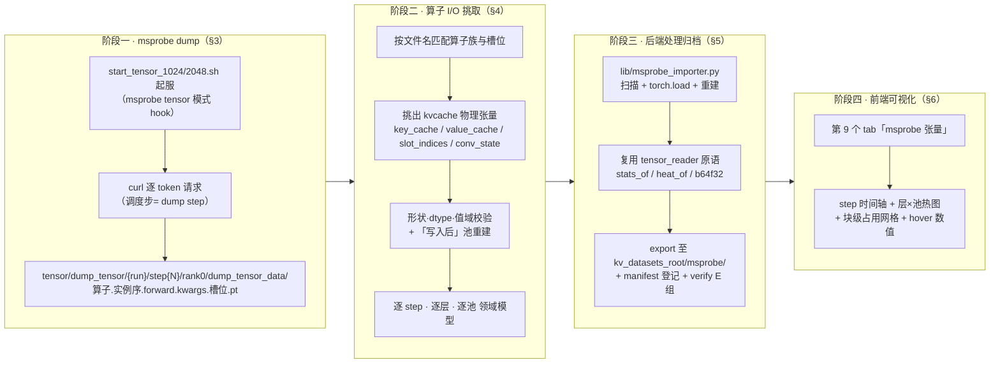
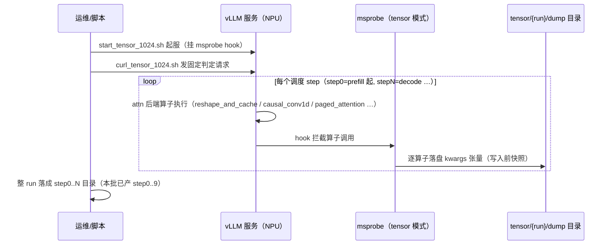
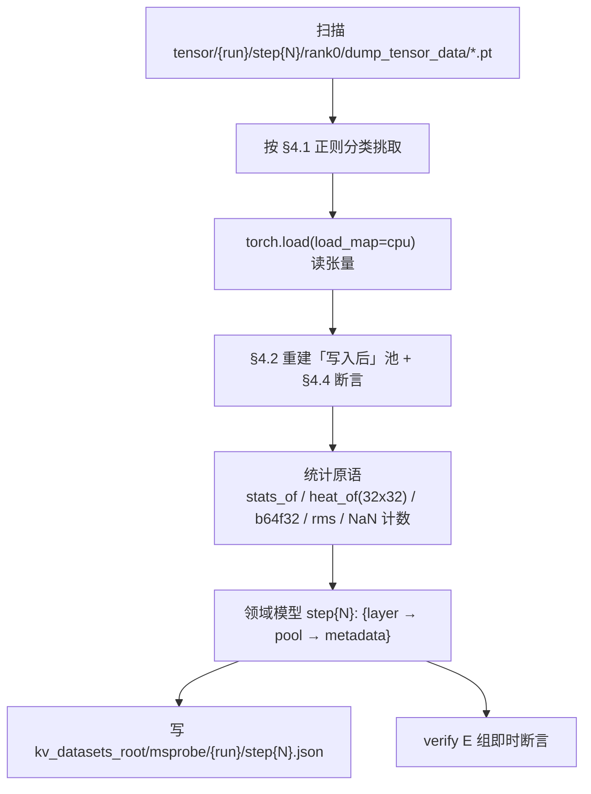
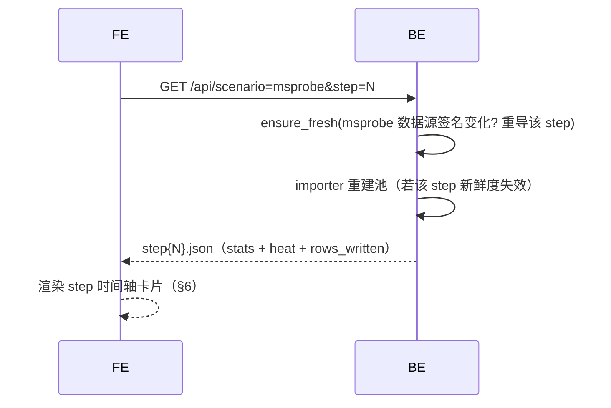
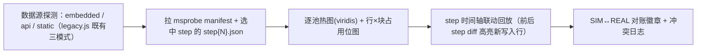

# 设计：msprobe dump tensor 驱动的 KVCache 物理张量可视化管线（2026-11-05）

> 目标：用 **msprobe 算子级 dump**（tensor 模式，已在 `kvcache_experiment/qwen35/scripts/msprobe/tensor/{1024,2048}_dump_tensor` 实跑验证）作为可视化工具的新数据源——从 attn 后端算子输入输出里挑出 **kvcache 物理张量**的本步快照，交给本目录的 FastAPI 后端解析归档，最后由 Vue 前端逐 step 可视化。全程**零代码插桩**（不改 vLLM、不打 mirror 补丁），与现有五场景导出链路并行共存。
>
> 依据文档：`../../kvcache_experiment/qwen35/scripts/msprobe/qwen35_attn_kvcache_callchain.md`（算子读写调用链 + §5.1 dump 挂点；下文简称「链路文档」）、`design-2026-10-21-q35-real-tensor-verify.md`（REAL 数据的既有分期先例）、`../README.md`（现有五场景架构）。

## 0. 背景与现状差距

现有可视化数据链路（README「数据链路」节）：

| 项 | 现有链路 | 本设计新链路 |
|---|---|---|
| 物理张量来源 | 实验脚本在 harness 里**手工插桩** `.pt` 归档（tensor_reader 加载） | **msprobe 算子级 dump**：vLLM/aten 算子 I/O 原生落盘，不改 vLLM、不打 patch |
| 覆盖对象 | 「收口后的池终态 + 复刻检查点」（PCM 六打点） | **每一步的写前快照 + 写入源 + 槽位**（读写全程逐 step 可观测） |
| 数据粒度 | 每 run 一份归档（终态/累计） | 每 step 一份目录（step0..9 已各 66+ 个算子 dump） |
| 换模型成本 | 需重写实验脚本插桩点 | 只换 hook 算子名与形状校验表（判据模型无关） |
| 依赖 | torch + 实验框架 | msprobe（已在用）+ torch/numpy（后端已有） |

四个阶段总口径见 §2；各阶段细则 §3~§6。

## 1. 决策记录

| # | 决策 | 简述 | 依据 |
|---|---|---|---|
| D1 | 数据采集方式 | msprobe **tensor 模式**算子级 dump（非 statistics 模式、非 Python 手工插桩） | `tensor/1024_dump_tensor`、`2048_dump_tensor` step0..9 已实测产出；链路文档 §5.1 |
| D2 | 挑选锚点 | **写路径**：full-attn 取 `NPU._npu_reshape_and_cache.{N}`，GDN conv 取 `_C_ascend.npu_causal_conv1d_custom.{N}`；**读路径**：decode 的 `_npu_paged_attention`（待核）；全部按 **kwargs 槽位**挑选 | 实测文件命名（§3.3）；链路文档 §2.1/§3.1 |
| D3 | 原地写语义 | `_npu_reshape_and_cache` / `npu_causal_conv1d_custom` dump 的是**调用时刻快照 = 写入前**；「写入后」池由 `key/value(+cache_indices)` **重建合成**，并用读路径快照做 ground-truth 核验 | 链路文档 §5.1「原地写的坑」；§4.2 重建公式 |
| D4 | 数据落位 | `kv_datasets_root/msprobe/{1024,2048}/step{N}.json` **文件式归档**（不内嵌进 manifest——逐 step 逐池体积大）；manifest 只登记索引 | 与 kvc/p1d 同方式（README「数据链路」）；qwen35 才内嵌 |
| D5 | 解析原语 | 后端新增 `lib/msprobe_importer.py`，统计/热图/缩略复用 `tensor_reader.py` 既有 `stats_of / heat_of / b64f32 / pearson / rms` | README lib 清单 + requirements 已含 torch/numpy |
| D6 | 前端形态 | 现有 8 tab 之外**新增第 9 个 tab「msprobe 张量」**，三模式数据源（embedded/api/static）与 step 时间轴回放沿用现框架 | README「页面内容」+ `src/lib/legacy.js` 三模式机制 |
| D7 | 正确性核验 | verify 增加 **E 组断言**（挑出、重建、读↔写一致性、零区），与既有 A~D 60 项并列 | `lib/verify.py` 先例（A~D 各自独立实现） |

## 2. 总体管线



阶段衔接：

| 从 → 到 | 交接物 | 所在目录 |
|---|---|---|
| 一 → 二 | 原始算子 dump（`.pt` 按算子实例/槽位命名） | `kvcache_experiment/qwen35/scripts/msprobe/tensor/{1024,2048}_dump_tensor/step{0..9}/rank0/dump_tensor_data/` |
| 二 → 三 | 领域模型（层/池/step 归一结构，纯内存 dict） | importer 内部 |
| 三 → 四 | 归档 JSON（step{N}.json + manifest 条目） | `kvcache_visualizer/kv_datasets_root/msprobe/` |

## 3. 阶段一：msprobe dump tensor

### 3.1 hook 目标与实测产物结构

msprobe 本配置按 **调度步** 切目录：`tensor/{1024,2048}_dump_tensor/step{N}/rank0/dump_tensor_data/`，每文件以 `算子类.实例序.forward.kwargs.槽位.pt` 命名、内容为 torch save 的单张量（**实测 `.pt`，不是 `.npy`**）。

实测确定的挑选锚点（2026-11-05 盘点 `1024_dump_tensor`）：

| 分支 | 算子（文件名前缀） | 挑出的槽位 | 形状（本模型） | 语义 |
|---|---|---|---|---|
| full-attn · **写** | `NPU._npu_reshape_and_cache.{N}` | `.kwargs.key_cache` / `.kwargs.value_cache` | `[num_blocks, block_size, num_kv_heads, head_size]`（链路文档 §2.1/§4） | **写入前**整池快照（原地写） |
| full-attn · **写** | 同上 | `.kwargs.slot_indices` | 与本步写入 token 数相关（一维索引） | 本步要写入的池行号（= block_id × block_size + 槽内偏移的行寻址） |
| GDN conv · **写** | `_C_ascend.npu_causal_conv1d_custom.{N}` | `.kwargs.conv_state` / `.kwargs.cache_indices_opt` | conv 状态池 + 状态行索引 | 18 层 GDN 各一实例，同理为写入前快照 |
| full-attn · **读**（decode） | `NPU._npu_paged_attention.{N}` | `.kwargs.key_cache` / `.kwargs.value_cache`（待核） | 同整池 | **本步读时刻**整池快照（= 上一步写完后的真值） |
| GDN ssm · 写/读 | mamba scan / state-update 类算子（预留） | 待实测确认（未在本批 dump 中出现） | `[(nb,16,128,128)]`（链路文档 §4） | ssm 状态池 |

> **why kwargs 不是 input**：链路文档 §5.1 的槽位名按 `.input.*` 描述是按调用形参口语化记的；msprobe 实测落盘用 **kwargs 通道**（`…forward.kwargs.key_cache.pt`）——importer 文件名解析两通道都兼容，以实测为准。

### 3.2 dump 时序（mermaid）



### 3.3 本模型实测盘点（1024_dump_tensor 为准）

| 目录 | 实测内容 |
|---|---|
| `step0/rank0/dump_tensor_data/` | 66 个 `.pt`：`NPU._npu_reshape_and_cache.{0..5}` ×（key_cache/value_cache/slot_indices）= 18 个，其余 48 个为**推理主算子**（FIA 类）挂点；无 paged、无 GDN → step0 前缀计（pipeline 与链路文档 §2 呼应） |
| `step1/rank0/dump_tensor_data/` | 出现 `_C_ascend.npu_causal_conv1d_custom.{N}` ×（conv_state/cache_indices_opt）——GDN conv 写入首现；decode 步 |
| `step0../rank0/` | 只有 `dump_tensor_data/` 一个子目录，**没有元数据 json**（实例序与槽位全部从文件名解析） |
| 实例序 | `NPU._npu_reshape_and_cache.{0..5}` ↔ 6 个 attn 层（0.8B hybrid：24 层 = 6 attn + 18 GDN，visualizer 卡③口径）；conv 算子 {N} ↔ GDN 层号（核对边界见 §9 R3） |

### 3.4 已知坑（沿用链路文档 §5.1，逐条给出对策）

| 坑 | 事实 | 本设计的对策 |
|---|---|---|
| **原地写** | dump 到的是写入前快照 | §4.2 重建「写入后」+ 读路径快照核验（§4.4） |
| **槽位命名口径** | 文档写 `.input.*`、实测 `.kwargs.*` | importer 对两种通道名都兼容（D2） |
| **切片 vs 整池** | cache 槽位每次都是整张池（非视图切片） | 同一池的逐 step 快照天然可比；体积见 §9 R2 |
| **无元数据** | rank0 下无 json | 文件名即元数据（正则解析 + 形状/值域断言兜底） |
| **step 语义** | step0..9 与调度步对应关系未逐个核对 | 对齐 08 脚本 SEG 先例（real-tensor-verify §3.1），E6 断言 step0 全零区可反证是「第一写入步之前」 |

## 4. 阶段二：从 attn 后端算子 I/O 挑出 kvcache 物理张量

### 4.1 挑选规则（importer 的文件名正则即本表）

| 规则 | 匹配 | 挑什么 | 产出 |
|---|---|---|---|
| R-attn-write | `^NPU\._npu_reshape_and_cache\.(\d+)\.forward\.kwargs\.(key_cache|value_cache|slot_indices)\.pt$` | 组(1)=attn 层序 N，组(2)=槽位 | `attn_write[step][N][slot]` |
| R-gdn-conv | `^_C_ascend\.npu_causal_conv1d_custom\.(\d+)\.forward\.kwargs\.(conv_state|cache_indices_opt)\.pt$` | 组(1)=conv/GDN 层序 N，组(2)=槽位 | `gdn_conv[step][N][slot]` |
| R-gdn-ssm | mamba scan/state 类（待实测定名） | 同上 | `gdn_ssm[step][N][slot]` |
| R-attn-read | `^NPU\._npu_paged_attention\.(\d+)\.forward\.kwargs\.(key_cache|value_cache)\.pt$`（待核） | 读时刻整池 | `attn_read[step][N][slot]` |
| 其余 | 不匹配的文件（FIA 等 48 个之类） | 跳过，记入 manifest.uncovered 计数 | — |

### 4.2 「写入后」重建公式

每 step、每 attn 层 N：以 `key_cache`（写入前整池）为底，把**本步写入源**按 `slot_indices` 写进对应池行：

```python
# 伪码（与链路文档 §2.1 的 DeviceOperator.reshape_and_cache(key, value, key_cache, value_cache, slot_mapping) 语义对齐）
pool_k_after = key_cache_pt.clone()          # [num_blocks, block_size, num_kv_heads, head_size]
rows = slot_indices_pt                       # 本步写入的池行号（每 token 一行）
pool_k_after[rows] = to_pool_layout(key_pt)  # key: [tokens, H, D] → 展平到头部维成为 [tokens, H*D]，逐行写入
pool_v_after[rows] = ...                     # value 同理
# GDN conv：pool_conv_after[cache_indices_opt] = 新 conv 状态行（C 轮实测口径）
```

「写入后」池即该 step 结束时刻的物理池真值——正是可视化想要的**每一步累积墨迹**。

### 4.3 层归属与池映射

| dump 实例序 | 归属 | 池 |
|---|---|---|
| `NPU._npu_reshape_and_cache.{0..5}` | attn 层 0..5（6/24） | K 池 + V 池（两组独立池） |
| `_C_ascend.npu_causal_conv1d_custom.{N}` | GDN/conv 层序 N（18/24） | conv 状态池 |
| （ssm 待定名算子） | GDN/mamba 层序 | ssm 状态池 |

与 `2_runtime_sequence.md` §5d / 链路文档 §4 的「一个 `block_id`、两份解读」约定一致：**池张量 dim0 行号 ≡ 逻辑块号 × block_size + 块内槽**，前端可一键切换「块视角 / 行视角」。

### 4.4 交叉核验锚（importer 断言 + verify E 组复用）

1. **形状口径**：`key_cache.shape[1:] == (block_size, num_kv_heads, head_size)`（链路文档 §4）；
2. **重建↔读一致**（ground-truth）：step t 的「写入后重建池」≈ step t+1 的 `_npu_paged_attention` 读快照（时序差一步；数值容差按 dtype bf16 定）；
3. **slot_indices 值域**：`0 <= rows < num_blocks*block_size`，且同一 step 内不重复；
4. **零区锚**：step0（首个写入步之前）整池 |x| == 0；
5. **conv/slot 对齐**：`cache_indices_opt` 与本步 GDN 状态写入行一致（0.8B 实测口径）。

## 5. 阶段三：后端处理解析

### 5.1 `lib/msprobe_importer.py` 数据流 mermaid



### 5.2 归档 schema（`kv_datasets_root/msprobe/{run}/step{N}.json`）

| 字段 | 类型 | 说明 |
|---|---|---|
| `run` | str | `1024` / `2048`（沿用实验目录名） |
| `step` | int | dump 的调度步序 |
| `pools` | obj | `attn_K[0..5]` / `attn_V[0..5]` / `gdn_conv[0..17]` / `gdn_ssm[...]`（按层） |
| `pools[L]` | obj | `shape / dtype / num_blocks / block_size`、`stats{rms,nan_pct,min,max}`、`heat{w,h,data}`（32×32 灰度）、`rows_written[]`（本步行号）、`b64{thumb}`（float32 归一幅） |
| `meta.uncovered` | int | 未匹配跳过的算子文件数 |
| `meta.asserts` | obj | §4.4 各断言的通过/容差记录 |

manifest 侧：`scenarios.msprobe = {"runs": ["1024","2048"], "steps": N, "files": …}`（> qwen35 内嵌不同，按 D4 文件式）。

### 5.3 与现有后端的接缝

| 现有件 | 复用/改动 |
|---|---|
| `config.py` | `SRC` 增加 `msprobe → kvcache_experiment/.../msprobe/tensor`；DATA_ROOT 不变 |
| `exporter.py` | 挂 `msprobe` 场景分支（调 importer，不再走 `.pt` 归档） |
| `tensor_reader.py` | **复用** `stats_of / heat_of / b64f32 / pearson / rms`（不解 `.pt` 归档结构，只借统计原语） |
| `verify.py` | **E 组**：挑出完备性 / 重建↔读一致 / slot 值域 / step0 零区 / conv 对齐（§4.4） |
| `dataset_loader.py` | `ensure_fresh` 监听 `msprobe/` 目录同规则接入 |

### 5.4 serve 懒加载时序（mermaid）



## 6. 阶段四：前端可视化

### 6.1 第 9 个 tab「msprobe 张量」的信息架构

| 区块 | 内容 | 复用来源 |
|---|---|---|
| 顶部控制条 | run（1024/2048）× step（时间轴滑条）× 层选择 ×「块视角/行视角」切换 | legacy.js 表单/徽章风格 |
| 主视图：逐层逐池热图 | 选中 step 下：K 池 / V 池 / conv / ssm 各一张 32×32 热图 + NaN/零区斜纹叠色 | q35real ⑥ 逐层热条绘图函数 |
| 主视图：块占用网格 | 行视角的 `num_blocks` 行 × `block_size` 列位图，本步写入行金框描亮（decode 蓝R读 / 金框写 口径沿用卡④） | q35flow ④ 三轨浮块风格 |
| hover 明细 | 第 (i,j) 单元 → 行号、block_id、槽位、RMS、NaN 计数、本步是否写入 | 卡④ hover + 文本提示机制 |
| 对账条 | SIM(卡④推演) ↔ REAL(msprobe 实测) 同 step 同层同池 diff 徽章 + 冲突日志条 | 卡④ SIM/REAL 终态 diff 机制 |
| 读写快照对照 | 同层同池：写前(reshape 快照) / 写后(重建) / 下一步读(paged 快照) 三联对比 | 本设计新做（§4.4 的可视化面） |

### 6.2 前端取数与渲染（mermaid）



## 7. 目录结构 Delta

```text
kvcache_visualizer/
├── backend_fastapi/
│   ├── config.py                  [改] SRC += msprobe
│   ├── exporter.py                [改] 挂 msprobe 场景分支
│   ├── lib/msprobe_importer.py    [新] §5.1 扫描→挑取→重建→统计→领域模型
│   └── lib/verify.py              [改] E 组断言
├── frontend_vue/src/lib/msprobe.js [新] 第 9 tab 渲染层（复用 legacy/q35real 绘图函数）
└── kv_datasets_root/msprobe/      [新] {1024,2048}/step{N}.json（export 产物）
kvcache_experiment/qwen35/scripts/msprobe/tensor/   实验源（只读）
└── {1024,2048}_dump_tensor/step{N}/rank0/dump_tensor_data/*.pt
```

## 8. 执行规划

| 期 | 内容 | 验收 |
|---|---|---|
| P1 | importer 挑取+重建（只做 attn K/V 路径，1024 run） | E1/E3/E4 五断言过；print 出每 step 重建池 hit/miss |
| P2 | 归档 + manifest + verify E 组接入；conv 路径接通 | `main.py verify` 全绿（A~E） |
| P3 | 前端第 9 tab（热图+块网格+时间轴） | 浏览器走通 1024 全 step 回放 |
| P4 | paged 读路径挂点核对 + ssm 算子接通 + 2048 run 对账 | §4.4-2 数值一致；双 run 交互对账完成 |

## 9. 风险与待核清单

| # | 风险/待核 | 影响 | 对策 |
|---|---|---|---|
| R1 | `_npu_paged_attention` 挂点在本批 dump 中**尚未实测出现**（step0 无；decode 步待逐个盘点） | ground-truth 核验链（§4.4-2）缺一环 | 盘点 step2..9；若真缺则改用「相邻重建差分」自洽核验 |
| R2 | 整池快照体积：每 attn 层每 step 2 张 `[nb, block_size, H, D]` bf16 | dump 目录/归档体积随 step 数线性涨 | 归档只落 stats/heat/b64 缩略 + 行索引，原始 `.pt` 留在实验区按需加载（b64f32 先例） |
| R3 | GDN conv 实例序 {N}（0..17 起步样例）与 18 层 GDN 的**层号映射**未逐个确认（层序≠模型层序的可能） | conv 热图分层错位 | 用 `cache_indices_opt` 演进序 + FAQ 脚本比对（同 q35real 的 J/K 接线先例） |
| R4 | ssm 侧算子名未知（本批未出现） | ssm 池缺位 | P4 实测定名后接入；先按 shape `(nb,16,128,128)` 全局 grep |
| R5 | 1024/2048 两组 dump 的 step 语义（对应调度步/token 数口径）沿 start_tensor 脚本未逐条核对 | step 轴对账错位 | 对齐 `0_qwen35_blocksize_full_record.md` 判定口径，E6 断言兜底 |
| R6 | msprobe 版本差异（槽位通道 kwargs/input、命名正则） | importer 正则失配 | 两通道通吃 + manifest.uncovered 计数可见化 |
